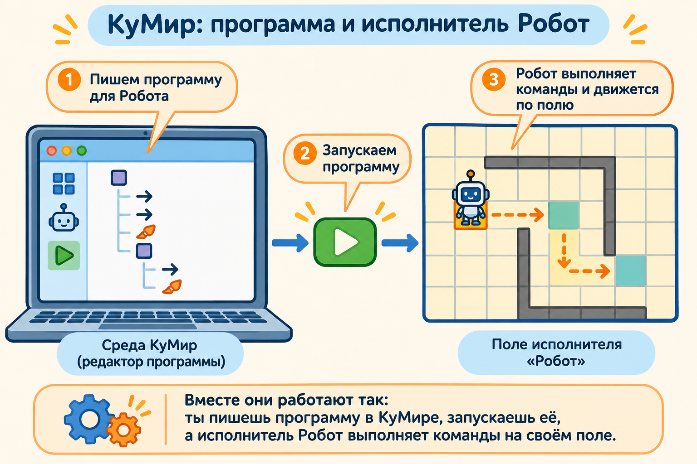

# Раздел 1. Среда КуМир и первые алгоритмы для Робота

**Уровень:** с нуля. **Объём:** 3 занятия по 45 минут.
**Что понадобится:** установленная система КуМир, клавиатура и мышь.  
**Результат раздела:** ученик умеет открыть и запустить программу, читать простейший алгоритм, управлять Роботом командами и проверять маршрут на поле.

## Цели

После раздела ученик сможет:

- различить среду программирования и исполнителя;
- объяснить назначение поля Робота, редактора программы и области сообщений;
- собрать программу с заголовком `алг`, началом `нач` и концом `кон`;
- записать последовательность команд Робота и предсказать конечное положение;
- выполнить программу целиком и по шагам, найти ошибку в маршруте.

## 1. КуМир и Робот — разные части одной работы

**КуМир** — среда, в которой мы записываем и запускаем алгоритм. **Робот** — исполнитель: он выполняет команды на клетчатом поле. Код задаёт последовательность действий, а поле показывает их результат.



*Схема показывает, как программа управляет Роботом на поле.*

В окне обычно видны редактор программы, область исполнителя, пульт Робота и сообщения/область ввода-вывода. В разных сборках расположение панелей и названия пунктов меню могут отличаться. Если нужная область закрыта, открой справку системы через меню **Инфо** или клавишу **F1**.

### Первое знакомство

1. Запусти КуМир и создай новую программу.
2. Найди область текста программы и окно Робота.
3. Попробуй дать Роботу команду кнопкой пульта.
4. Создай пустой алгоритм и сохрани файл с понятным именем, например `first_robot.kum`.
5. Запусти одну команду из программы, затем весь алгоритм.

Пульт полезен, чтобы исследовать отдельную команду. В программе команды записываются заранее; при запуске Робот исполняет их по порядку.

## 2. Поле и система команд

Поле состоит из клеток и может содержать стены. Робот выполняет команду движения на одну соседнюю клетку. Команда задаёт абсолютное направление на поле: `вверх` означает вверх, даже если до этого Робот двигался вправо.

| Команда | Действие |
|---|---|
| `вверх` | Перейти в соседнюю клетку выше |
| `вниз` | Перейти в соседнюю клетку ниже |
| `влево` | Перейти в соседнюю клетку слева |
| `вправо` | Перейти в соседнюю клетку справа |
| `закрасить` | Закрасить клетку, в которой находится Робот |

Если команда движения направляет Робота в стену, программа не сможет выполнить задуманный маршрут. Поэтому перед запуском проверь: из какой клетки стартует Робот, свободны ли клетки на пути и где он должен остановиться.

## 3. Каркас алгоритма

Программа для Робота подключает исполнителя и содержит алгоритм:

```text
использовать Робот
алг Маршрут
нач
  вправо
  вверх
  закрасить
кон
```

- `использовать Робот` подключает исполнителя.
- `алг Маршрут` начинает алгоритм и даёт ему имя. Имя удобно выбирать по задаче.
- `нач` отмечает начало команд алгоритма.
- Каждая строка внутри алгоритма — команда для выполнения.
- `кон` завершает алгоритм.

Вводи служебные слова и имена команд точно. Например, команда называется `вверх`, а не `наверх`. КуМир подсказывает синтаксис и сообщает об ошибках в области сообщений. Отступы делают программу удобнее для чтения; редактор может расставлять их автоматически.

## 4. Первая программа и прогноз результата

Начальная обстановка для следующего примера: клетка справа от Робота и клетка над ней свободны.

```text
использовать Робот
алг Два_шага
нач
  вправо
  вверх
  закрасить
кон
```

Перед запуском ответь на вопросы:

1. В какую клетку попадёт Робот после первой команды?
2. Где он окажется после второй?
3. Какая клетка будет закрашена?

**Проверка:** после запуска Робот должен стоять на клетке по диагонали вверх-вправо от старта, и именно эта клетка должна быть закрашена.

### Таблица выполнения

| Шаг | Команда | Положение после команды | Закрашенная клетка |
|---:|---|---|---|
| 0 | — | Начальная клетка | Нет |
| 1 | `вправо` | Соседняя клетка справа | Нет |
| 2 | `вверх` | На одну клетку выше | Нет |
| 3 | `закрасить` | Положение не меняется | Текущая клетка |

Такую таблицу называют **трассировкой**: она показывает, как меняется состояние программы после каждой команды.

## 5. Последовательность и маршрут

Линейный алгоритм состоит из команд, которые выполняются одна за другой. Пока мы не изучили циклы и условия, каждое повторение записываем явно.

### Пример: обойти квадрат и вернуться к старту

Начальная обстановка: Робот стоит в клетке свободного квадратного поля, четыре стороны свободны.

```text
использовать Робот
алг Квадрат
нач
  вправо
  вниз
  влево
  вверх
кон
```

**Ожидаемый результат:** Робот возвращается в начальную клетку. Программа ничего не закрашивает.

### Пример: ступенчатый маршрут

```text
использовать Робот
алг Ступени
нач
  закрасить
  вправо
  закрасить
  вверх
  закрасить
  вправо
  закрасить
  вверх
  закрасить
кон
```

**Ожидаемый результат:** закрашены пять клеток, включая стартовую; Робот заканчивает на две клетки выше и на две клетки правее стартовой. Поле нужно подготовить так, чтобы все клетки маршрута были свободны.

## 6. Запуск, пошаговое выполнение и сохранение

Кнопки и горячие клавиши могут различаться между версиями. Найди в меню **Программа** команды запуска непрерывно и выполнения по шагам. Пошаговый режим полезен, когда нужно увидеть, какая именно команда привела к неожиданному результату.

Рабочий порядок:

1. Запиши код.
2. Сохрани программу.
3. Предскажи конечное положение и закрашенные клетки.
4. Запусти алгоритм.
5. Сравни поле с прогнозом.
6. Если результат другой, проверь трассировку по командам.

## 7. Типичные ошибки

| Ошибка | Что произойдёт | Как исправить |
|---|---|---|
| Пропущено `использовать Робот` | Исполнитель может быть не подключён | Добавить строку перед алгоритмом |
| Пропущено `нач` или `кон` | КуМир сообщит об ошибке структуры | Проверить парность начала и конца |
| Название команды написано неверно | Команда не распознаётся | Выбрать точное имя из системы команд |
| Не проверены стены | Робот может столкнуться со стеной | Сверить маршрут с обстановкой до запуска |
| Маршрут мысленно повернули вслед за Роботом | Направления окажутся перепутаны | Помнить, что вверх/вниз/влево/вправо заданы относительно поля |
| Неверно сосчитали закрашенные клетки | Рисунок отличается от ожидаемого | Записывать отдельную строку трассировки для каждой команды |

## Мини-самопроверка

1. Чем отличаются КуМир и исполнитель Робот?
2. В каком направлении движется Робот по команде `вправо`?
3. Какую роль выполняют `алг`, `нач`, `кон`?
4. Что полезно проверить до запуска маршрута?
5. Как пошаговое выполнение помогает искать ошибку?

## Связанные файлы

- Домашняя работа: [01_homework.md](01_homework.md).
- Далее: [Раздел 2. Величины, ввод, вывод и вычисления](02_data_and_io.md).
