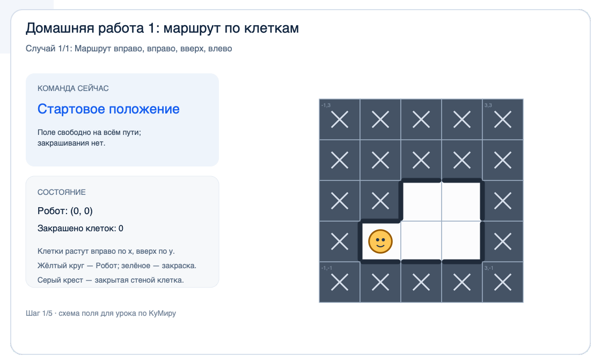
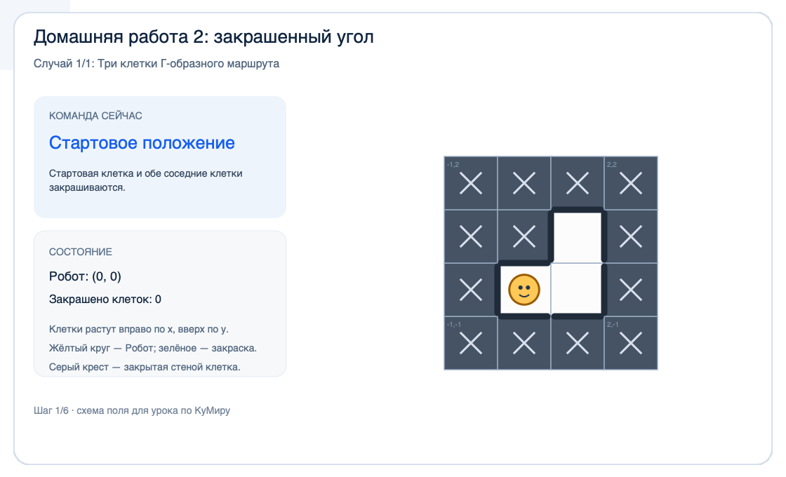
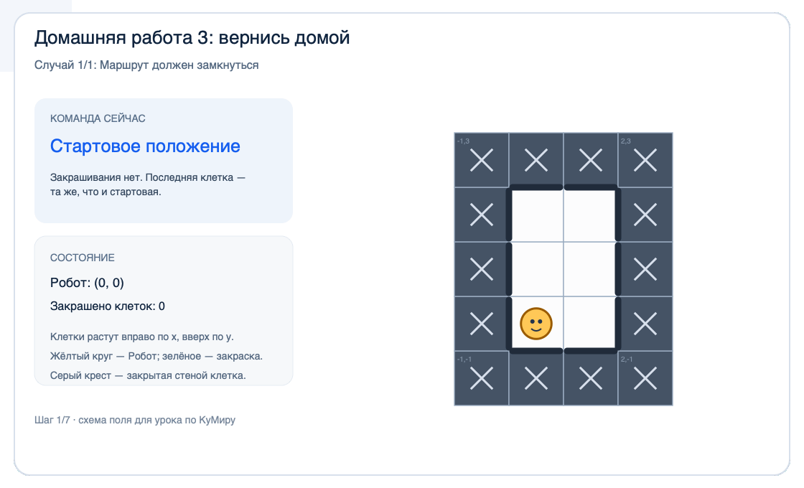
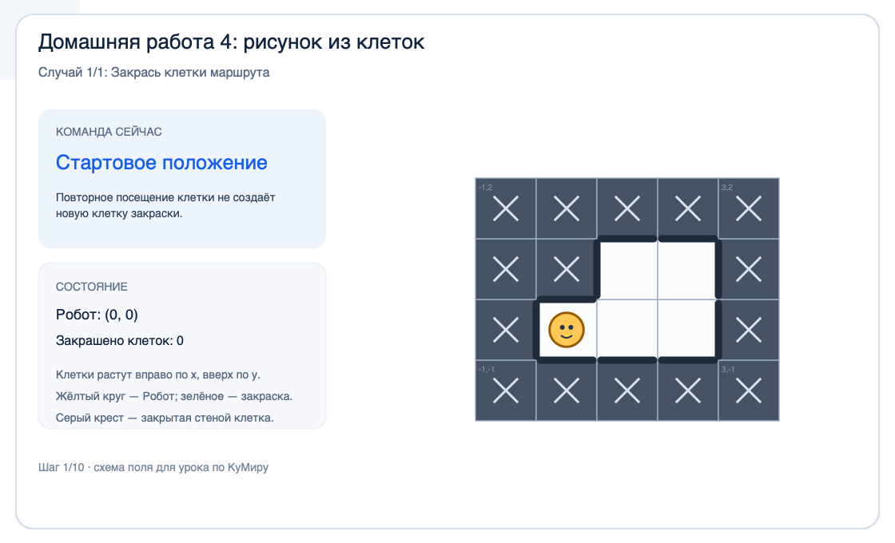
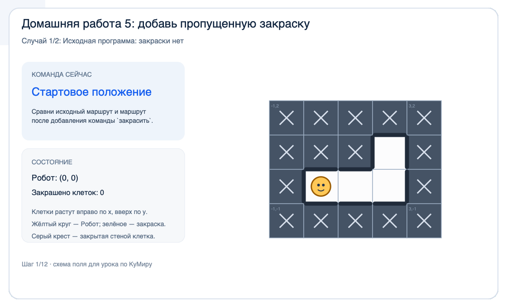

# Домашняя работа к разделу 1. Среда КуМир и первые алгоритмы

**Что сдать:** файл программы КуМира для каждой задачи и короткую таблицу проверки. Для задач с Роботом приложи описание стартовой обстановки и укажи конечное положение исполнителя.

Для схем ниже координаты — учебное обозначение, не формат файла КуМира: старт обозначен `(0,0)`, вправо увеличивается `x`, вверх увеличивается `y`. В каждой задаче отдельно перечислены доступные клетки; прочие клетки считаются закрытыми стенами. В схемах `S` — старт, `T` — цель, `.` — свободная клетка, `#` — закрытая клетка; `|` показывает стену между соседними клетками.

## 1. Маршрут по клеткам

Робот начинает на свободном поле. Запиши программу, которая проводит его на две клетки вправо, на одну вверх и на одну влево.

**Выход:** по завершении Робот должен оказаться на одну клетку правее и на одну клетку выше старта. Поле должно быть свободно на всём маршруте.

**Поле:** старт `(0,0)`. Доступны клетки `(0,0)`, `(1,0)`, `(2,0)`, `(2,1)`, `(1,1)`; остальные клетки закрыты. Стен на маршруте нет. Цель — `(1,1)`.

**Кадры:** старт `(0,0)` → вправо `(1,0)` → вправо `(2,0)` → вверх `(2,1)` → влево `(1,1)`. Ничего не закрашивать.


**Проверка:** до запуска начерти путь; после выполнения сравни положение Робота с прогнозом.

## 2. Закрашенный угол

На свободном поле нужно закрасить стартовую клетку, клетку справа от неё и клетку над правой клеткой. Робот должен закончить в последней закрашенной клетке.

**Требование:** используй только команды движения и `закрасить`; циклы и условия пока не применяй.

**Критерии:** закрашено ровно три клетки, стартовая входит в рисунок, конечное положение верно.

**Поле:** старт `(0,0)`. Доступны только клетки `(0,0)`, `(1,0)` и `(1,1)`; все прочие клетки закрыты стенами. Цель — закончить в `(1,1)`. Закрасить `(0,0)`, `(1,0)` и `(1,1)`.

**Кадры:** `(0,0)` — закрасить → вправо `(1,0)` — закрасить → вверх `(1,1)` — закрасить.


## 3. Вернись домой

Составь программу, которая проходит маршрут: две клетки вверх, одна вправо, две вниз, одна влево.

**Выход:** Робот должен вернуться в начальную клетку. Ничего закрашивать не нужно.

**Проверка:** проследи положение после каждой команды в таблице трассировки.

**Поле:** старт `(0,0)`. Доступны только клетки `(0,0)`, `(0,1)`, `(0,2)`, `(1,2)`, `(1,1)`, `(1,0)`; остальные клетки закрыты. Внутренних стен на маршруте нет. Цель — вернуться в `(0,0)`.

**Кадры:** `(0,0)` → вверх `(0,1)` → вверх `(0,2)` → вправо `(1,2)` → вниз `(1,1)` → вниз `(1,0)` → влево `(0,0)`.


## 4. Рисунок из клеток

На свободном поле закрась клетки по маршруту: старт, вправо, вправо, вверх, влево.

**Ожидаемый рисунок:** пять закрашенных клеток: стартовая и четыре новые клетки маршрута. Последняя клетка находится на одну клетку правее и на одну клетку выше старта.

**Критерии:** посчитай уникальные клетки рисунка; при повторном посещении клетка всё равно считается одной закрашенной клеткой.

**Поле:** старт `(0,0)`. Доступны только клетки `(0,0)`, `(1,0)`, `(2,0)`, `(2,1)`, `(1,1)`; остальные закрыты стенами. Цель — закончить в `(1,1)`; закрасить каждую из пяти клеток маршрута.

**Кадры:** `(0,0)` — закрасить → вправо `(1,0)` — закрасить → вправо `(2,0)` — закрасить → вверх `(2,1)` — закрасить → влево `(1,1)` — закрасить.


## 5. Найди и исправь ошибку

Нужно провести Робота на две клетки вправо, затем на одну вверх и закрасить клетку назначения. В программе пропущено одно необходимое действие:

```text
использовать Робот
алг Найти_ошибку
нач
  вправо
  вправо
  вверх
кон
```

Исправь программу и запусти её. Затем измени маршрут так, чтобы Робот после закрашивания вернулся на старт.

**Что объяснить:** какую команду добавил в первую версию и почему во второй версии изменился порядок команд.

**Поле:** старт `(0,0)`. Доступны клетки `(0,0)`, `(1,0)`, `(2,0)`, `(2,1)`; остальные клетки закрыты стенами. Стен на маршруте туда и обратно нет. Цель первого варианта — закрасить `(2,1)`. Цель второго — закрасить `(2,1)` и вернуться в `(0,0)`.

**Кадры:** после исправления исходного маршрута Робот проходит `(0,0) → (1,0) → (2,0) → (2,1)`, закрашивает `(2,1)`. В версии с возвращением кадры продолжатся: вниз `(2,0)` → влево `(1,0)` → влево `(0,0)`.


## 6. Проверка другой обстановки

Возьми задачу 1 и создай другую стартовую обстановку. Поле прямоугольное, три клетки в ширину и две в высоту: доступны `(0,0)`, `(1,0)`, `(2,0)`, `(0,1)`, `(1,1)`, `(2,1)`. Старт — `(0,0)`, цель прежняя — `(1,1)`. Внешний край поля закрыт. Единственная внутренняя стена находится **между `(0,0)` и `(1,0)`**; остальные соседние клетки соединены проходами.

```text
y=1    .    T    .
y=0    S    |    .
        x=0  x=1  x=2
```

Вертикальная черта `|` показывает стену между клетками `(0,0)` и `(1,0)`. Поэтому первый шаг задачи 1 — `вправо` — упирается в стену. Свободный путь к цели существует через `(0,1)`.

**Задание:** не запускай исходную программу задачи 1 на этом поле. На схеме карандашом отметь один безопасный путь от старта до цели и объясни, какую проверку Робот должен выполнить перед выбором следующей команды. Программу обхода пока писать не нужно.

**Критерии проверки раздела:** программа имеет правильную структуру, команды записаны без ошибок, трассировка согласуется с результатом, конечное положение и закрашенные клетки совпадают с условием.
