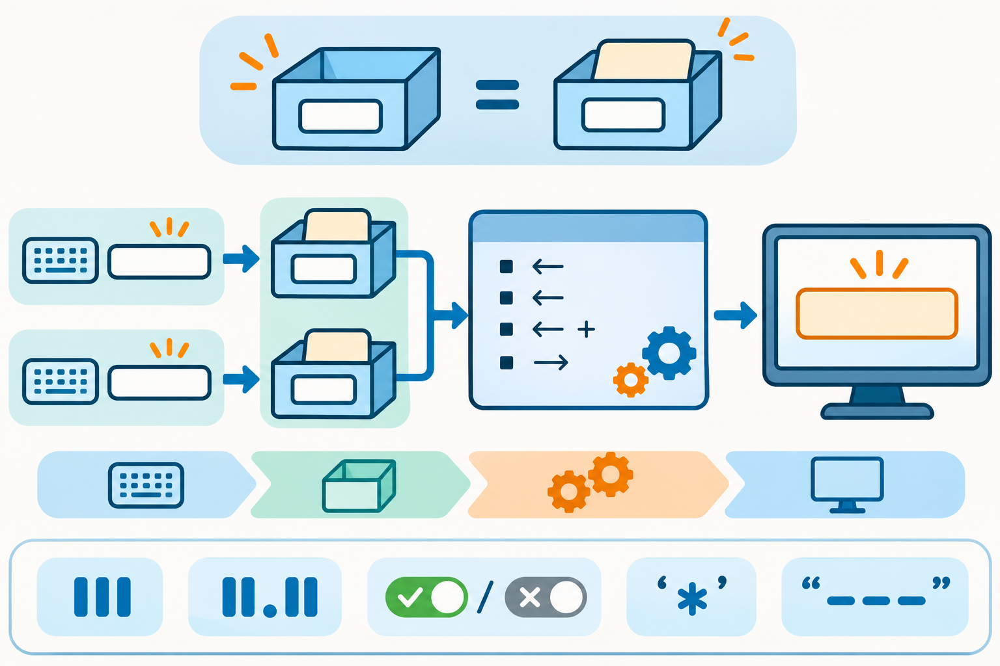
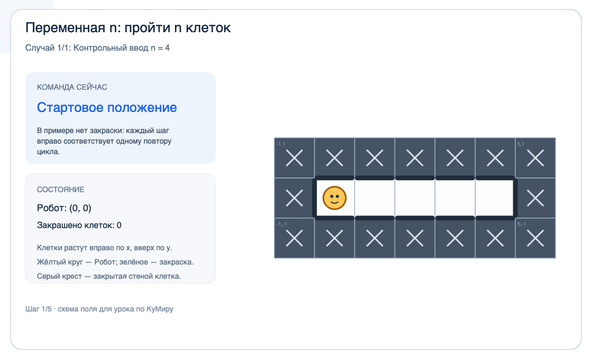

# Раздел 2. Величины, ввод, вывод и вычисления

**Уровень:** после раздела 1. **Объём:** 6 занятий по 45 минут.
**Результат раздела:** ученик описывает величины нужного типа, вводит исходные данные, выполняет вычисления, изменяет значения присваиванием и выводит результат в понятном формате.

## Цели

После раздела ученик сможет:

- объяснить, что величина хранит текущее значение, а тип определяет допустимые значения;
- описывать величины `цел`, `вещ`, `лог`, `сим`, `лит`;
- использовать присваивание `:=` и прослеживать обновление величин;
- организовывать ввод исходных данных и вывод ответов;
- записывать арифметические выражения и объяснять порядок вычислений;
- получать частное и остаток от деления с помощью `div` и `mod`.

## Величина как именованное место для значения

Переменная (в языке КуМир её называют **величиной**) имеет имя, тип и текущее значение. Имя помогает обращаться к значению в программе; тип ограничивает, какие данные можно хранить и какие операции с ними имеют смысл.



Перед использованием величины нужно описать. Описание обычно находится после `нач` и до команд алгоритма:

```text
алг Пример
нач
  цел количество
  вещ масса
  лог готово
  сим метка
  лит название
  количество := 4
  масса := 2.5
  готово := да
  метка := 'А'
  название := "Набор"
  вывод количество, нс
  вывод масса, нс
  вывод готово, нс
  вывод метка, нс
  вывод название, нс
кон
```

Основные типы:

| Тип | Что хранит | Пример |
|---|---|---|
| `цел` | Целые числа | `цел возраст` |
| `вещ` | Числа с дробной частью | `вещ длина` |
| `лог` | Логическое значение `да` или `нет` | `лог путь_свободен` |
| `сим` | Один символ | `сим ответ` |
| `лит` | Строку символов | `лит имя` |

Вещественные числа записываются с десятичной точкой: `2.5`. Текстовая строка заключается в двойные кавычки, например `"КуМир"`; один символ в примерах записан в одинарных кавычках, например `'А'`.

## Присваивание меняет значение

Команда присваивания записывается так:

```text
счёт := 3
```

Сначала вычисляется выражение справа от `:=`, затем полученный результат записывается в величину слева. Это не утверждение о равенстве: величина может получить новое значение.

```text
алг Изменение
нач
  цел число
  число := 4
  вывод число, нс
  число := число + 3
  вывод число, нс
кон
```

Ожидаемый вывод:

```text
4
7
```

### Таблица трассировки

| Команда | Значение `число` после команды | Что выведено |
|---|---:|---|
| `число := 4` | 4 | — |
| `вывод число, нс` | 4 | 4 |
| `число := число + 3` | 7 | — |
| `вывод число, нс` | 7 | 7 |

Правую часть всегда считай, используя значение величины **до** выполнения текущего присваивания.

## Ввод и вывод

`ввод` ждёт исходные данные и записывает их в указанные величины. `вывод` показывает текст, значения и результаты выражений. Через запятую можно перечислить несколько выводимых элементов; `нс` переводит вывод на новую строку.

```text
алг Приветствие
нач
  лит имя
  вывод "Как тебя зовут? "
  ввод имя
  вывод "Привет, ", имя, "!", нс
кон
```

Для задач, где результат должен быть проверен автоматически, чётко разделяй формат ответа и служебные подсказки. В учебном интерактивном примере приглашение удобно, но в задаче с точным форматом вывода оставляй только требуемые данные.

## Арифметические выражения

В выражениях используются привычные операции:

| Запись | Действие |
|---|---|
| `a + b` | Сложение |
| `a - b` | Вычитание |
| `a * b` | Умножение |
| `a / b` | Деление |
| `div(a, b)` | Целая часть частного целых чисел |
| `mod(a, b)` | Остаток от деления целых чисел |

Сначала выполняются действия в скобках, затем умножение и деление, затем сложение и вычитание. Если важно изменить порядок, ставь скобки.

### Пример 1. Прямоугольник

```text
алг Прямоугольник
нач
  цел a, b, p
  ввод a, b
  p := 2 * (a + b)
  вывод p, нс
кон
```

Проверки:

| Ввод | Ожидаемый вывод |
|---|---|
| `3 5` | `16` |
| `1 1` | `4` |

### Пример 2. Среднее двух чисел

```text
алг Среднее
нач
  вещ a, b, среднее
  ввод a, b
  среднее := (a + b) / 2
  вывод среднее, нс
кон
```

Проверки: `4 7` даёт `5.5`; `2 2` даёт `2`. Вещественный тип нужен, потому что среднее не всегда целое.

### Пример 3. Частное и остаток

```text
алг Частное_и_остаток
нач
  цел число, делитель
  ввод число, делитель
  вывод div(число, делитель), " ", mod(число, делитель), нс
кон
```

Для ввода `47 10` ожидаемый вывод — `4 7`: 10 помещается в 47 четыре раза, остаток равен 7. В этой задаче делитель должен быть положительным.

## Величины и Робот

Величины полезны и при программировании исполнителя. В следующей программе ученик вводит количество шагов, а Робот выполняет команду движения нужное число раз:

```text
использовать Робот
алг Пройти_ряд
нач
  цел n, i
  ввод n
  нц для i от 1 до n
    вправо
  кц
кон
```

Эта программа использует ввод и переменную цикла. Пока цикл не изучен, пример нужен только как связующее чтение; подробно конструкцию цикла разберём в соответствующем разделе. Поле должно иметь свободный коридор длины `n`.

**Учебная схема поля:** координаты указаны для объяснения, не как формат КуМира. Старт Робота `(0,0)`. Доступны только клетки `(0,0)`, `(1,0)`, `(2,0)`, `(3,0)`, `(4,0)`; вокруг коридора стены. Вводимое `n` должно быть от `0` до `4`. Цель после выполнения — клетка `(n,0)`; клетки не закрашиваются.

```text
y=0    S    .    .    .    G*
        x=0  x=1  x=2  x=3  x=4
```

`G*` показывает возможное конечное положение при `n = 4`; для меньшего значения цель находится в клетке с координатой `(n,0)`. Например, при вводе `3` Робот проходит кадры `(0,0) → (1,0) → (2,0) → (3,0)`. При вводе `0` он остаётся на старте. Это ознакомительный пример, не упражнение на самостоятельную работу.


## Типичные ошибки

| Ошибка | Почему это проблема | Как исправить |
|---|---|---|
| Величина используется до описания | Компилятор не знает её тип | Описать величину до первой команды |
| Записано `a = 5` вместо `a := 5` | `=` сравнивает значения, а `:=` присваивает | Использовать `:=` для изменения значения |
| Целое число описано как `вещ` без причины или наоборот | Тип влияет на представление и операции | Выбирать тип по ожидаемым данным и результату |
| Дробь записана через запятую | В программе дробная часть отделяется точкой | Писать, например, `2.5` |
| Строка не заключена в кавычки | Текст может быть воспринят как имя величины | Оформлять строковый литерал двойными кавычками |
| Потеряны скобки в формуле | Изменяется порядок действий | Сверить математическую формулу и выражение в коде |
| Вводятся данные неподходящего типа | Программа не сможет корректно прочитать значение | Ввести значение, согласованное с описанным типом |
| Делитель равен нулю | Деление на ноль не определено | Условием задачи гарантировать ненулевой делитель или отдельно обработать этот случай после изучения условий |

## Мини-самопроверка

1. Зачем описывать тип величины до её использования?
2. Чем отличаются `:=` и `=`?
3. Какой тип выбрать для среднего значения `4.5`?
4. Что выведет программа, если сначала `x := 6`, а затем `x := x + 2`?
5. Что возвращают `div(47, 10)` и `mod(47, 10)`?
6. Когда нужен `нс`?

## Связанные файлы

- Домашняя работа: [02_homework.md](02_homework.md).
- Предыдущий раздел: [Среда КуМир и первые алгоритмы для Робота](01_environment.md).
- Далее: [условия, логические выражения и ветвление](03_conditions.md).
