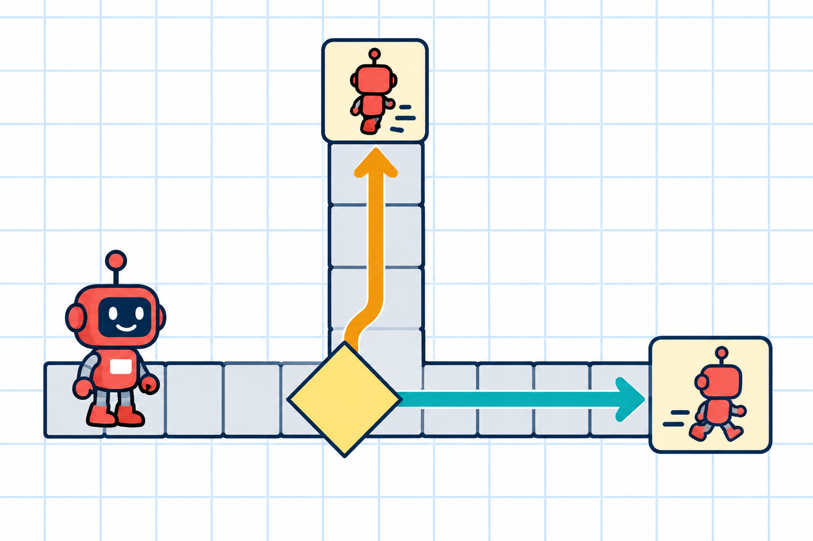
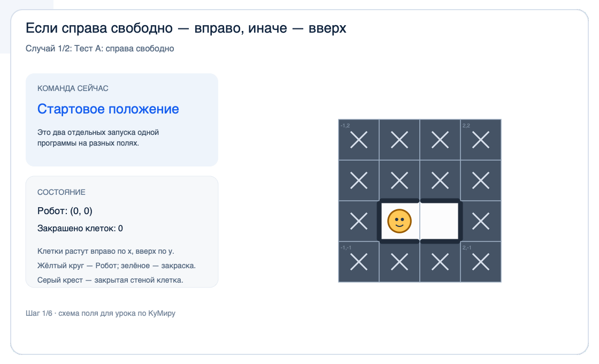

# Раздел 3. Логические выражения и ветвление

**Объём:** 3 занятия по 45 минут (занятия 10–12 курса).

## Цели

После раздела ученик умеет записывать сравнения, хранить логические значения, выбирать ветвь с помощью `если`/`иначе`, объединять проверки `и`, `или`, `не` и тестировать программу на всех ветвях и границах. Домашняя работа находится отдельно в [03_homework.md](03_homework.md).

## 1. Сравнение — логическое выражение

Сравнение двух значений возвращает `да` или `нет`. В КуМире доступны сравнения `=`, `<>`, `<`, `>`, `<=`, `>=`. Знак равенства в сравнении пишется `=`, а присваивание обозначается `:=`.

```text
x := 7       | присваиваем значение
x = 7        | проверяем равенство
```

Переменная типа `лог` хранит логическое значение:

```text
алг Сравнение
нач
  цел a, b
  лог первое_больше
  ввод a, b
  первое_больше := a > b
  вывод "Первое больше второго: ", первое_больше, нс
кон
```

Проверки: ввод `8 3` даёт `да`; ввод `3 8` и `5 5` даёт `нет`. Равенство нужно считать отдельно, если задача различает его с «первое меньше».

## 2. Составные условия

Логические операции:

- `A и B` — обе проверки истинны;
- `A или B` — хотя бы одна проверка истинна;
- `не A` — противоположное значение.

| A | B | A и B | A или B |
|---|---|---|---|
| нет | нет | нет | нет |
| нет | да | нет | да |
| да | нет | нет | да |
| да | да | да | да |

Чтобы проверить включённый диапазон от 10 до 20, нужны обе проверки: `x >= 10 и x <= 20`. Числа 10 и 20 входят в диапазон.

```text
алг Диапазон
нач
  цел x
  лог внутри
  ввод x
  внутри := x >= 10 и x <= 20
  вывод внутри, нс
кон
```

Контрольные данные: `9` → `нет`, `10` → `да`, `15` → `да`, `20` → `да`, `21` → `нет`.

Частая ошибка — записать диапазон через `или`: `x >= 10 или x <= 20`. Такое выражение истинно почти для любого числа. Для включённого интервала между нижней и верхней границей используется `и`.

## 3. Неполное ветвление

Если действие нужно выполнить только при истинном условии, используется форма:

```text
если условие
то
  команды
все
```

Когда условие ложно, тело пропускается.

```text
алг Положительное
нач
  цел n
  ввод n
  если n > 0
  то
    вывод "Положительное", нс
  все
кон
```

Проверки: `4` выводит `Положительное`, `0` и `-4` ничего не выводят. Это поведение намеренное: программа сообщает только о положительном числе.

## 4. Полное ветвление

Если нужно обработать оба исхода, добавляется `иначе`:

```text
если условие
то
  команды_если_да
иначе
  команды_если_нет
все
```

Программа ниже находит большее из двух чисел и отдельно обрабатывает равенство.

```text
алг Большее
нач
  цел a, b
  ввод a, b
  если a > b
  то
    вывод a, нс
  иначе
    если b > a
    то
      вывод b, нс
    иначе
      вывод "Равны", нс
    все
  все
кон
```

Трассировка для `4 9`:

| Шаг | Проверка или действие | Результат |
|---:|---|---|
| 1 | `4 > 9` | нет |
| 2 | Переход в `иначе` | — |
| 3 | `9 > 4` | да |
| 4 | Вывод `b` | `9` |

Проверь вводы `4 9` → `9`, `9 4` → `9`, `4 4` → `Равны`. Вложенная конструкция должна иметь своё закрывающее `все`.

## 5. Несколько категорий

Последовательность вложенных условий распределяет значения по категориям. Пример: балл от 0 до 100 переводится в три категории. Вход по условию находится в этом диапазоне.

```text
алг Категория
нач
  цел балл
  ввод балл
  если балл >= 90
  то
    вывод "Отлично", нс
  иначе
    если балл >= 60
    то
      вывод "Зачёт", нс
    иначе
      вывод "Повторить", нс
    все
  все
кон
```

Контрольные запуски: `95` → `Отлично`; `60` → `Зачёт`; `59` → `Повторить`. Сначала проверяется более высокий порог, чтобы результат 95 не попал в более общую категорию.

## 6. Условие в программе Робота

Робот может проверять соседние клетки, например `справа свободно`. Это логическое выражение. Оно истинно, когда справа можно безопасно перейти.

```text
использовать Робот
алг ВыбратьНаправление
нач
  если справа свободно
  то
    вправо
  иначе
    вверх
  все
кон
```

### Точные обстановки и состояния

Координаты клеток записаны как `(x, y)`: `x` растёт вправо, `y` — вверх. Стены ставятся на рёбрах клеток. В обоих полях старт — `(0,0)`, клетка старта чистая.

**Поле A — срабатывает `то`:** клетки `(0,0)` и `(1,0)` образуют одноклеточный коридор; переход `(0,0) → (1,0)` свободен. Все остальные рёбра клеток закрыты стенами. Цель — `(1,0)`.

```text
y=0   [R (0,0)] → [цель (1,0)]
```

Кадры: F0 — Робот `(0,0)`, справа свободно; F1 — команда `вправо`, Робот `(1,0)`. Итог: `(1,0)`.

**Поле B — срабатывает `иначе`:** клетки `(0,0)` и `(0,1)` образуют вертикальный коридор; переход `(0,0) → (0,1)` свободен. Справа от `(0,0)` стоит стена, остальные рёбра клеток закрыты стенами. Цель — `(0,1)`.

```text
y=1   [цель (0,1)]
y=0   [R (0,0)]
```

Кадры: F0 — Робот `(0,0)`, справа стена, сверху свободно; F1 — команда `вверх`, Робот `(0,1)`. Итог: `(0,1)`. Эта программа имеет только две ветви; поле с закрытыми проходами и справа, и сверху не является допустимым тестом для неё, так как команда `вверх` столкнулась бы со стеной.





## 7. План проверки

Для каждой программы составь набор тестов до запуска:

1. условие истинно;
2. условие ложно;
3. равенство или граница, если они возможны;
4. каждая ветвь, зависящая от карты Робота.

Для диапазона от 10 до 20 проверь `9`, `10`, `15`, `20`, `21`. Для классификатора проверь сами пороги и значения на единицу меньше.

## Типичные ошибки

- Путают `=` и `:=`.
- Не обрабатывают равенство при поиске большего числа.
- Пропускают `все` или закрывают не то вложенное условие.
- Используют `или` вместо `и` для проверки попадания внутрь диапазона.
- Проверяют только один пример и не запускают граничные значения.
- Отправляют Робота в ветви на клетку, отделённую стеной.

## Мини-самопроверка

1. Каков результат сравнения `7 <> 7`?
2. Что напечатает программа «Большее» для `6 6`?
3. Чем отличается `если...то...все` от формы с `иначе`?
4. Назови пять тестов для диапазона 10–20 включительно.
5. Какие карты проверяют обе ветви программы Робота?

Ответы: 1) `нет`; 2) `Равны`; 3) без `иначе` ложный исход пропускает тело, с `иначе` исполняется альтернативное тело; 4) например, `9, 10, 15, 20, 21`; 5) карта с проходом справа и карта со стеной справа, но свободной клеткой сверху.
