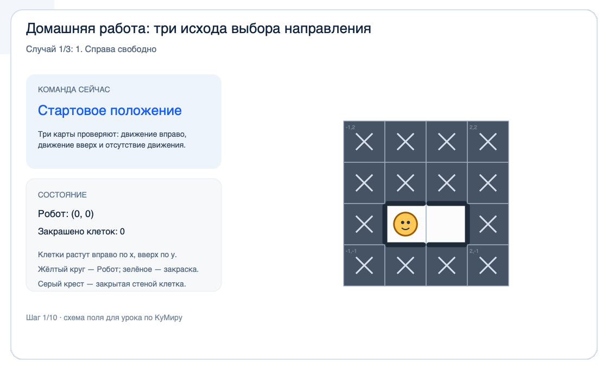

# Домашняя работа к разделу 3. Логические выражения и ветвление

Для каждой задачи создай программу в КуМире. До запуска предскажи ответ, затем проверь его по примеру и дополнительным тестам. Выводи только ответ, требуемый условием. Входные данные корректны. Если задача использует Робота, подготовь стартовые обстановки самостоятельно.

## Задача 1. Чётное число

Дано целое число `n`. Выведи `YES`, если `n` делится на 2 без остатка, иначе выведи `NO`.

**Ввод:** одно целое число `n`, `-1 000 000 <= n <= 1 000 000`.

**Вывод:** `YES` или `NO`.

| Ввод | Вывод |
|---:|---|
| `14` | `YES` |
| `-3` | `NO` |
| `0` | `YES` |

Проверь положительное чётное, отрицательное нечётное и ноль.

## Задача 2. Максимум из трёх

Даны три целых числа `a`, `b`, `c`. Выведи наибольшее. Числа могут совпадать.

**Ввод:** три целых числа через пробел, каждое в диапазоне от `-10 000` до `10 000`.

**Вывод:** одно наибольшее число.

| Ввод | Вывод |
|---|---:|
| `3 8 5` | `8` |
| `-2 -7 -2` | `-2` |
| `4 4 4` | `4` |

Проверь случаи, когда максимум находится в каждом из трёх мест, и случай равных чисел.

## Задача 3. Входит ли число в диапазон

Даны `x`, `a`, `b`, причём `a <= b`. Выведи `YES`, если `x` принадлежит закрытому диапазону от `a` до `b`, включая границы; иначе выведи `NO`.

**Ввод:** три целых числа `x`, `a`, `b`, каждое по модулю не больше `1 000 000`.

**Вывод:** `YES` или `NO`.

| Ввод | Вывод |
|---|---|
| `5 1 10` | `YES` |
| `1 1 10` | `YES` |
| `11 1 10` | `NO` |
| `4 4 4` | `YES` |

Проверь оба конца диапазона, числа непосредственно за границами и случай `a = b`.

## Задача 4. Направление Робота

Робот стоит на развилке. Если справа свободно, перейди вправо. Иначе, если сверху свободно, перейди вверх. Если оба направления закрыты стеной, не двигай Робота.

**Ввод:** не используется. Стены и стартовая клетка задаются в редакторе обстановки КуМира.

**Результат:** конечное положение Робота должно соответствовать выбранному правилу. Вывод в область сообщений не требуется.

Используй координаты `(x, y)`, где `x` растёт вправо, а `y` вверх. Стартовая клетка во всех случаях — `(0,0)` и изначально чистая. Стены ставятся на рёбрах клеток; не указанные как свободные рёбра закрыты. Для каждой карты цель — проверить предписанное конечное положение.

**Поле A:** клетки `(0,0)` и `(1,0)`, переход вправо свободен; все остальные рёбра закрыты. Цель `(1,0)`.

```text
y=0   [R (0,0)] → [цель (1,0)]
```

Состояния: F0 `(0,0)`; справа свободно; F1 после шага вправо — `(1,0)`.

**Поле B:** клетки `(0,0)` и `(0,1)`, переход вверх свободен; справа от старта стена, все остальные рёбра закрыты. Цель `(0,1)`.

```text
y=1   [цель (0,1)]
y=0   [R (0,0)]
```

Состояния: F0 `(0,0)`; справа стена, сверху свободно; F1 после шага вверх — `(0,1)`.

**Поле C:** единственная доступная клетка `(0,0)` окружена стенами со всех четырёх сторон. Цель — остаться в `(0,0)`.

```text
        стена
          ↑
стена ← [R (0,0)] → стена
          ↓
        стена
```

Ожидаемое состояние: Робот остаётся в `(0,0)`. Код решения в задании не дан; GIF показывает постановку и пример ожидаемого поведения, а не готовую программу.



**Критерий:** проверены все три исхода, Робот не сталкивается со стеной.

## Задача 5. Категория результата

Баллы `p` находятся от 0 до 100. Выведи одну категорию: `EXCELLENT`, если `p >= 90`; `PASS`, если `60 <= p < 90`; `RETRY`, если `p < 60`.

**Ввод:** одно целое число `p`, `0 <= p <= 100`.

**Вывод:** ровно одна строка: `EXCELLENT`, `PASS` или `RETRY`.

| Ввод | Вывод |
|---:|---|
| `90` | `EXCELLENT` |
| `60` | `PASS` |
| `59` | `RETRY` |
| `100` | `EXCELLENT` |

Проверь значения `59`, `60`, `89`, `90`, а также нижнюю и верхнюю границы входа.

## Самопроверка готовности

- Все программы запускаются и выводят ответ в заданном формате.
- Равенство и границы диапазонов обработаны правильно.
- Для диапазона использована логика, подходящая для одновременной проверки нижней и верхней границ.
- В задаче с Роботом проверена каждая обстановка.
- Ты можешь объяснить, почему для конкретного теста сработала именно эта ветвь.
