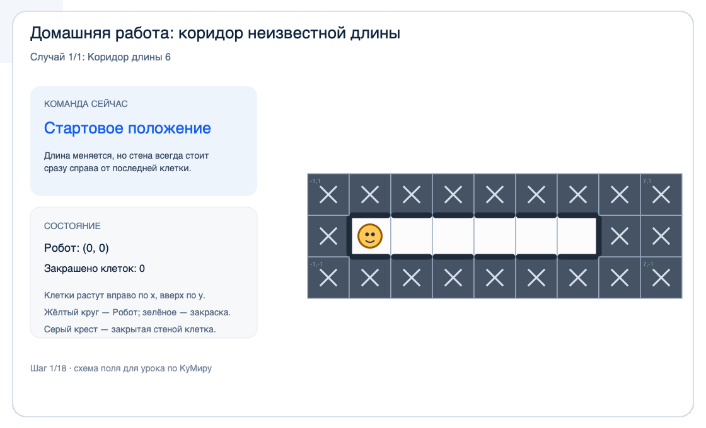
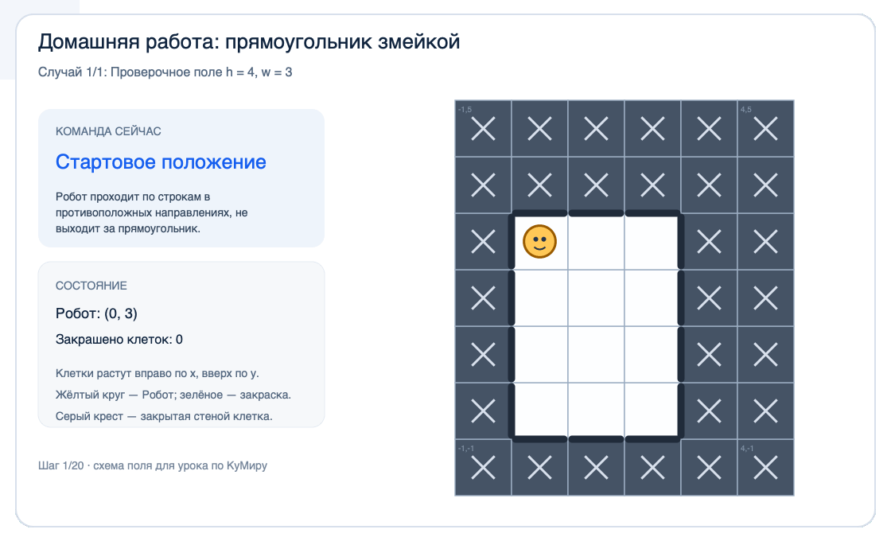

# Домашняя работа к разделу 4. Циклы

Создай и запусти программы в КуМире. До запуска предскажи результат и сравни его с примерами. Входные данные корректны. Выводи только ответ, требуемый условием. Для задач с Роботом дополнительно проверь несколько обстановок.

## Задача 1. Сумма чисел, кратных `k`

Даны целые числа `n` и `k`. Найди сумму положительных чисел от 1 до `n`, которые делятся на `k` без остатка.

**Ввод:** два целых числа `n` и `k`, где `0 <= n <= 10 000`, `1 <= k <= 100`.

**Вывод:** одно целое число. Если подходящих чисел нет, выведи `0`.

| Ввод | Вывод |
|---|---:|
| `10 3` | `18` |
| `5 8` | `0` |
| `0 2` | `0` |

В первом примере складываются `3 + 6 + 9`. Проверь также случай, когда ровно одно число подходит.

## Задача 2. Количество цифр

Дано неотрицательное целое число `n`. Определи количество цифр в его десятичной записи. Число `0` состоит из одной цифры.

**Ввод:** одно целое число `n`, `0 <= n <= 2 000 000 000`.

**Вывод:** одно целое число — количество цифр.

| Ввод | Вывод |
|---:|---:|
| `5072` | `4` |
| `9` | `1` |
| `0` | `1` |

При решении циклом `пока` обрати внимание, что для нуля условие `n > 0` изначально ложно, поэтому для него нужен отдельный случай.

## Задача 3. Лестница из звёздочек

Дано число `n`. Выведи `n` строк: в первой строке одна звёздочка, во второй две и так далее, в последней — `n` звёздочек. В строках не должно быть пробелов.

**Ввод:** одно целое число `n`, `1 <= n <= 20`.

**Вывод:** `n` строк с описанной последовательностью.

Пример для `n = 4`:

```text
*
**
***
****
```

Проверь, что в примере ровно четыре строки, а число звёздочек в последней строке равно четырём.

## Задача 4. Коридор

Робот стоит в первой клетке горизонтального коридора и направлен вправо. Коридор не имеет внутренних стен; с правой стороны он заканчивается стеной. Длина коридора заранее неизвестна. Закрась все клетки коридора и оставь Робота в последней клетке.

**Ввод:** отсутствует. Начальная клетка и стены задаются в поле исполнителя Робот.

**Проверяемый результат:** все клетки коридора закрашены, Робот находится в крайней правой клетке, столкновения со стенами нет.

Используй координаты `(x, y)`, `x` растёт вправо, `y` вверх. Для каждого значения длины `L` поле — клетки `(0,0)…(L-1,0)` в один ряд, старт `(0,0)`, переходы внутри ряда свободны; северные, южные и западные рёбра закрыты; восточнее `(L-1,0)` стоит стена. Цель — все клетки закрашены, Робот стоит в `(L-1,0)`.

| `L` | Карта | Состояния выполнения |
|---:|---|---|
| 1 | `[R (0,0)] |стена|` | закрасить старт; проверка справа ложна; итог `(0,0)` |
| 2 | `[R (0,0)] → [цель (1,0)] |стена|` | закрасить `(0,0)`; перейти и закрасить `(1,0)`; остановиться перед стеной |
| 6 | клетки `(0,0)…(5,0)`, стена к востоку от `(5,0)` | закрасить старт; переходить вправо и закрашивать `(1,0)…(5,0)`; затем завершиться |

Решение программы в задании не приведено. GIF показывает обстановку и примерный проход Робота, но не заменяет самостоятельное написание кода.



## Задача 5. Прямоугольная область

Робот стоит в верхней левой клетке прямоугольной области без внутренних стен. Даны высота `h` и ширина `w`. Закрась все клетки прямоугольника, двигаясь по нему змейкой: первую строку слева направо, следующую справа налево и так далее. Между строками переходи на одну клетку вниз. Начинай каждую строку с той стороны, где закончилась предыдущая.

**Ввод:** два целых числа `h` и `w`, `1 <= h <= 6`, `1 <= w <= 8`.

**Проверяемый результат:** в поле закрашено ровно `h` строк по `w` клеток; все переходы выполняются внутри прямоугольника. Дополнительный вывод не требуется.

| `h` | `w` | Ожидаемая закрашенная область |
|---:|---:|---|
| 1 | 4 | одна строка из четырёх клеток |
| 3 | 1 | один столбец из трёх клеток |
| 2 | 3 | две строки по три клетки |

### Точное тестовое поле `h=4`, `w=3`

Координаты `(x, y)`, где `x` растёт вправо, `y` вверх. Область — все клетки `x=0,1,2`, `y=0,1,2,3`; старт `(0,3)`, то есть верхняя левая клетка. Внутренних стен нет: каждое соседнее ребро внутри прямоугольника свободно. Внешняя граница окружена стенами. Все 12 клеток изначально чистые; все 12 клеток — цели.

```text
y=3   [R (0,3)] → [ (1,3)] → [ (2,3)]
y=2   [ (0,2)] ← [ (1,2)] ← [ (2,2)]
y=1   [ (0,1)] → [ (1,1)] → [ (2,1)]
y=0   [цель (0,0)] ← [ (1,0)] ← [ (2,0)]
       x=0         x=1         x=2
```

Маршрут змейки: `(0,3) → (1,3) → (2,3) ↓ (2,2) → (1,2) → (0,2) ↓ (0,1) → (1,1) → (2,1) ↓ (2,0) → (1,0) → (0,0)`. Закрасить каждую клетку при посещении; конечная позиция для чётного `h=4` — `(0,0)`. Проверяемые состояния после каждого ряда: после первого — верхний ряд закрашен, Робот `(2,3)`; после второго — два верхних ряда, Робот `(0,2)`; после третьего — три ряда, Робот `(2,1)`; в конце все клетки закрашены, Робот `(0,0)`.

Проверь также приведённые выше малые тесты `1×4` и `3×1`: они выявляют случаи без перехода между строками и без горизонтального перемещения. Решение в задании не дано; будущая GIF визуализирует постановку и примерный путь, а не готовый код.



## Критерии готовности

- Накопитель суммы имеет начальное значение `0`.
- Задача на количество цифр корректно обрабатывает `0`.
- В лестнице каждая следующая строка содержит на одну звёздочку больше.
- Цикл Робота проверяет проход до движения и работает на коридорах разной длины.
- В прямоугольнике закрашены все и только нужные клетки; Робот не выходит за его границы.
- Ученик может объяснить, что меняется на каждой итерации и почему цикл завершается.
