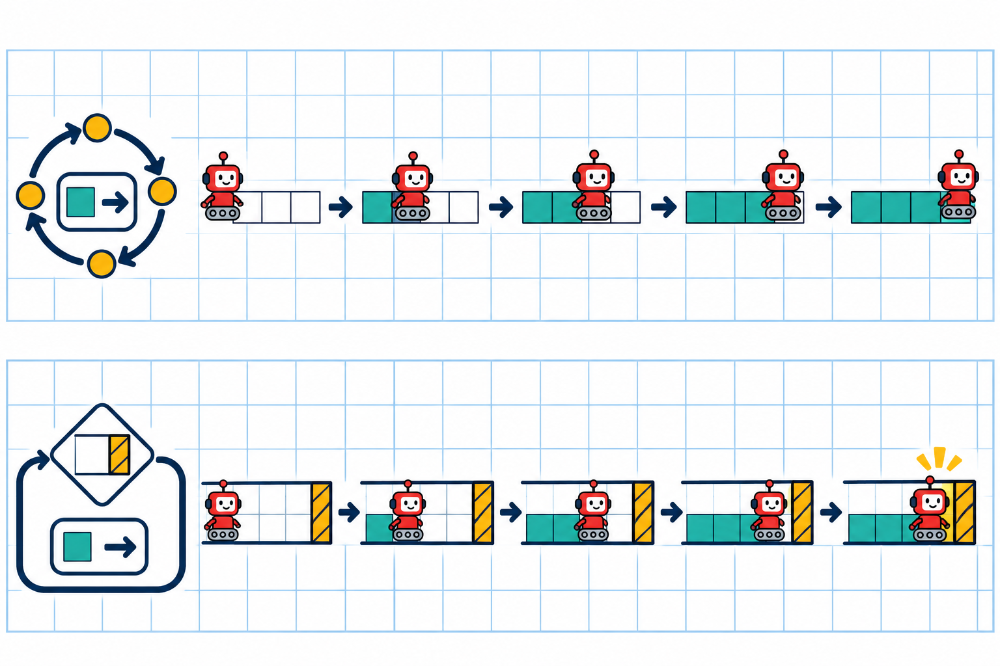

# Раздел 4. Циклы и повторяющиеся действия

## Цели

После раздела ученик умеет применять циклы с известным количеством повторений, цикл с параметром и цикл `нц пока`; объяснять работу счётчика и накопителя; трассировать вложенные циклы; выбирать конструкцию цикла по условию; безопасно двигать Робота до стены.

Домашняя работа находится отдельно в [04_homework.md](04_homework.md).

## 1. Зачем нужен цикл

Цикл повторяет одну или несколько команд. Вместо четырёх отдельных команд:

```text
вправо
вправо
вправо
вправо
```

можно написать:

```text
нц 4 раз
  вправо
кц
```

`нц` открывает цикл, `кц` закрывает его, команды между ними называются телом цикла. Отступ показывает границы тела читателю; границы программы определяют ключевые слова.



## 2. Цикл с известным количеством повторений

Форма `нц N раз` подходит, когда число повторов заранее известно:

```text
нц 3 раз
  вывод "Повтор", нс
кц
```

Этот пример печатает слово `Повтор` три раза, каждое на новой строке.

Программа выводит квадраты чисел от 1 до 4:

```text
алг Квадраты
нач
  цел i
  нц для i от 1 до 4
    вывод i * i, нс
  кц
кон
```

Ожидаемый вывод:

```text
1
4
9
16
```

## 3. Цикл с параметром

Цикл с параметром меняет счётчик от начального значения до конечного:

```text
нц для i от 1 до n
  команды
кц
```

При обычном шаге 1 `i` принимает значения `1, 2, ..., n`. На каждом проходе программа может использовать текущее значение счётчика.

Пример суммирует числа от 1 до `n`:

```text
алг СуммаОтПервогоДоN
нач
  цел n, i, сумма
  ввод n
  сумма := 0
  нц для i от 1 до n
    сумма := сумма + i
  кц
  вывод сумма, нс
кон
```

Для `n = 5` результат равен 15:

| Итерация | `i` | Сумма до сложения | Сумма после сложения |
|---:|---:|---:|---:|
| 1 | 1 | 0 | 1 |
| 2 | 2 | 1 | 3 |
| 3 | 3 | 3 | 6 |
| 4 | 4 | 6 | 10 |
| 5 | 5 | 10 | 15 |

Проверь `n = 5` → `15`, `n = 1` → `1`, `n = 0` → `0`. Для нуля тело цикла не выполняется, поэтому заранее присвоенное накопителю значение 0 остаётся ответом.

### Счётчик и накопитель

Счётчик хранит количество событий или элементов, а накопитель постепенно собирает результат, например сумму. Перед циклом обязательно задай начальное значение накопителя:

```text
сумма := 0
```

Для подсчёта элементов счётчик также обычно начинают с нуля и увеличивают на 1 при каждом подходящем элементе.

## 4. Цикл `нц пока`

Применяй `нц пока`, когда число повторов заранее неизвестно. Условие проверяется перед каждой итерацией:

```text
нц пока условие
  команды
кц
```

Пока условие истинно, тело выполняется. Если условие ложно сразу, тело не выполняется ни разу. Внутри тела меняй величину, от которой зависит условие, иначе цикл может стать бесконечным.

```text
алг ОбратныйОтсчёт
нач
  цел n
  ввод n
  нц пока n > 0
    вывод n, нс
    n := n - 1
  кц
  вывод 0, нс
кон
```

Для `n = 3` выводится `3`, `2`, `1`, `0`. При `n = 0` тело не выполняется, и программа выводит только `0`.

| Проверка | `n` до тела | Действие |
|---:|---:|---|
| 1 | 3 | вывести 3, уменьшить `n` до 2 |
| 2 | 2 | вывести 2, уменьшить `n` до 1 |
| 3 | 1 | вывести 1, уменьшить `n` до 0 |
| 4 | 0 | условие ложно, закончить цикл |

## 5. Вложенные циклы

Внутри цикла может находиться ещё один цикл. Внешний часто задаёт строки, внутренний — столбцы.

```text
алг Прямоугольник
нач
  цел строка, столбец
  нц для строка от 1 до 3
    нц для столбец от 1 до 4
      вывод "*"
    кц
    вывод нс
  кц
кон
```

Результат:

```text
****
****
****
```

Внутренний цикл выполняется полностью для каждого значения внешнего. Здесь выводится `3 * 4 = 12` звёздочек.

## 6. Цикл с Роботом: ряд фиксированной длины

Робот стоит у начала свободного ряда. Нужно закрасить четыре клетки и остаться в последней закрашенной клетке:

```text
использовать Робот
алг ЗакраситьЧетыре
нач
  нц 3 раз
    закрасить
    вправо
  кц
  закрасить
кон
```

После первых трёх повторов Робот делает три перехода. Последняя команда закрашивает четвёртую клетку без лишнего шага за неё. Обстановка должна иметь свободными три перехода вправо.

## 7. Цикл Робота до стены

Если длина коридора заранее неизвестна, условие позволяет остановиться перед стеной:

```text
использовать Робот
алг ЗакраситьКоридор
нач
  закрасить
  нц пока справа свободно
    вправо
    закрасить
  кц
кон
```

Сначала Робот закрашивает стартовую клетку. Затем он проверяет, свободно ли справа. Если да — переходит на соседнюю клетку и закрашивает её. Когда справа стена, проверка становится ложной и цикл заканчивается без движения сквозь стену.

Проверь коридоры длиной 1, 2 и 5 клеток. Все клетки должны оказаться закрашены, Робот должен остановиться в последней.

## 8. Трассировка цикла

Для цикла с параметром заполняй таблицу по итерациям:

| Номер итерации | Значение счётчика | Значение до тела | Значение после тела |
|---:|---:|---:|---:|
| 1 | ... | ... | ... |

Для `нц пока` записывай значение условия до каждого прохода и последний ложный результат. Для Робота отмечай старт, стены, закрашенные клетки и его положение после каждой команды.

## Типичные ошибки

- Забывают закрыть цикл словом `кц`.
- Начинают сумму не с нуля.
- В цикле `пока` не изменяют проверяемую величину, поэтому цикл не завершается.
- Для Робота проверяют стену после движения, а нужно проверить до него.
- Делают лишний шаг за последнюю клетку ряда.
- При вложенных циклах помещают команду не в тот блок.
- Не проверяют ноль и единицу, при которых тело может не выполниться либо выполниться один раз.

## Мини-самопроверка

1. Сколько раз выполняется `нц 7 раз`?
2. Чему равна сумма от 1 до 4?
3. Что будет, если в `нц пока n > 0` не менять `n`?
4. Сколько звёздочек выводит прямоугольник из 3 строк по 4?
5. Почему Робот проверяет `справа свободно` до команды `вправо`?

Ответы: 1) 7; 2) 10; 3) если `n` положительно, цикл не завершится; 4) 12; 5) чтобы не столкнуться со стеной.
