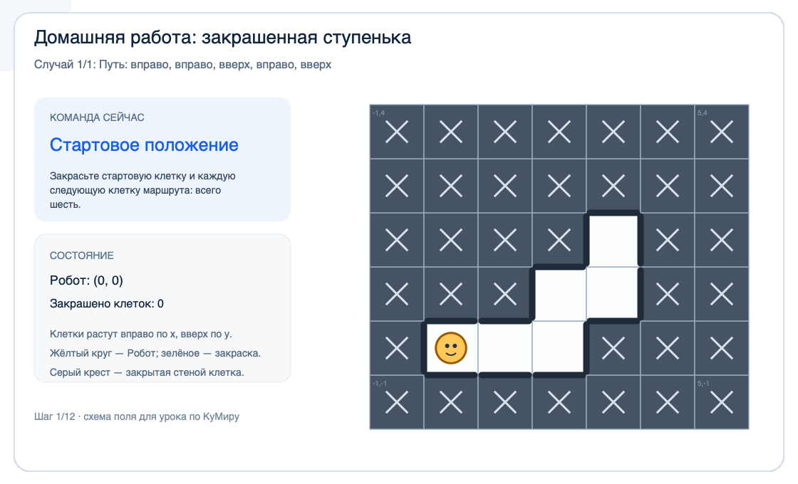
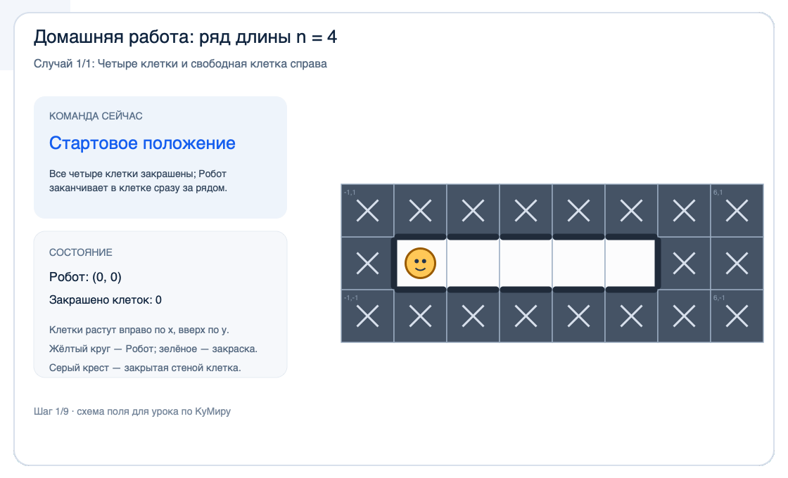
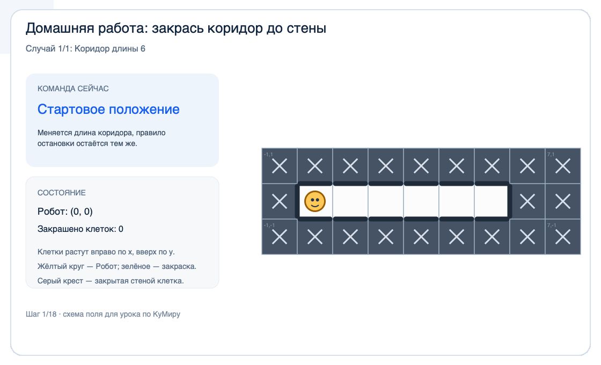
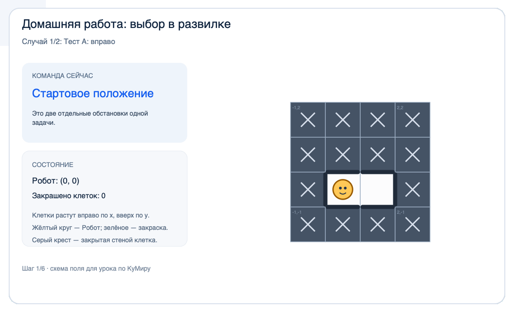
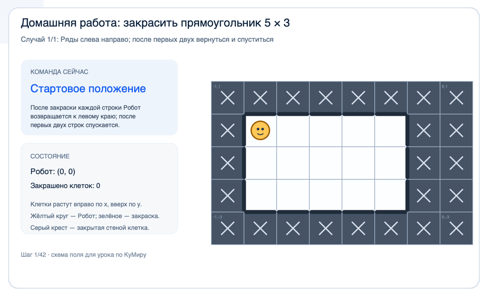
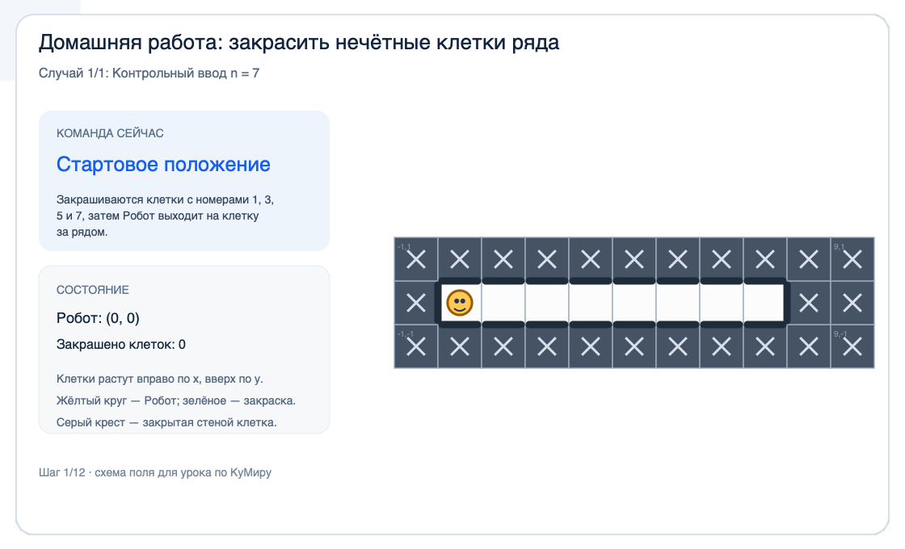

# Домашняя работа к разделу 5. Исполнитель Робот

Выполняй задания в КуМире. Для каждого задания сохрани программу и подготовь список проверочных обстановок. Не используй команды, не изученные в разделе. Если в условии указана стена, считай её непроходимой.

Координатное соглашение для схем: старт, если не сказано иначе, `(0,0)`; вправо — `x+1`, вверх — `y+1`, вниз — `y−1`. Ссылки на GIF ведут к визуализации поля и трассы; это не код и не ответ на задание.

В перечисленных областях свободны только указанные клетки и переходы; неуказанные переходы из поля считаются стенами. В открытом прямоугольнике все внутренние переходы свободны.

## Задание 1. Закрашенная ступенька

Робот стартует в левой нижней клетке ступенчатого коридора. Нужно дойти до верхней правой клетки и закрасить все клетки маршрута.

Путь по порядку: вправо, вправо, вверх, вправо, вверх. Все шесть клеток маршрута, включая стартовую, свободны; стены не мешают переходам.

**Карта:** маршрут проходит по клеткам `(0,0) → (1,0) → (2,0) → (2,1) → (3,1) → (3,2)`. Эти шесть клеток и пять соединяющих переходов свободны. Для единственной заданной дорожки все прочие выходы из её клеток закрыты стенами. Цель — закрасить все шесть клеток. Состояния: закрасить `(0,0)` → перейти и закрасить `(1,0)` → перейти и закрасить `(2,0)` → перейти и закрасить `(2,1)` → перейти и закрасить `(3,1)` → перейти и закрасить `(3,2)`, конечное положение `(3,2)`.

 — визуализация условия, не ответ.

**Что сдать:** программа и список координат закрашенных клеток после выполнения. Укажи также конечное положение Робота.

## Задание 2. Ряд длины `n`

Дано целое число `n` (`1 ≤ n ≤ 8`). Робот стоит в начале свободного горизонтального ряда. Напиши программу, которая закрашивает ровно первые `n` клеток ряда и заканчивает в клетке сразу справа от закрашенного участка.

**Вход:** одно целое число `n`.

**Проверки:** `n = 1`, `n = 4`, `n = 8`. Для каждого запуска подготовь поле с достаточным числом свободных клеток.

**Критерий:** закрашено ровно `n` клеток; конечная позиция — непосредственно справа от них.

**Карта:** старт `(0,0)`, свободны `(x,0)` для `x=0…n`; переходы вправо между ними свободны. Другие переходы не используются. Состояния: при `i=1…n` закрасить `(i−1,0)` и перейти в `(i,0)`; итоговая цель — закрашенные `x=0…n−1`, финиш `(n,0)`. Для тестов: `n=1` даёт закрашенную `(0,0)` и финиш `(1,0)`; `n=4` — `x=0…3`, финиш `(4,0)`; `n=8` — `x=0…7`, финиш `(8,0)`.

 — визуализация условия, не ответ.

## Задание 3. Коридор до стены

Робот стоит в начале прямого коридора, направленного вправо. Справа от коридора стоит стена. Длина коридора неизвестна, но составляет не менее одной клетки.

Напиши программу, которая закрашивает каждую клетку коридора и заканчивает в последней клетке перед стеной.

**Проверочные обстановки:** коридор длины 1, 2 и 6 клеток.

**Критерий:** во всех трёх обстановках закрашен весь коридор, Робот не сталкивается со стеной.

**Карта для длины `L`:** старт `(0,0)`, свободны клетки `(x,0)`, `x=0…L−1`; между ними свободные проходы. Справа от `(L−1,0)` стоит стена. Верх и низ коридора закрыты стенами. Итог для `L=1,2,6`: закрашены соответственно `x=0`, `x=0…1`, `x=0…5`; Робот остаётся в правой крайней клетке.

 — визуализация условия, не ответ.

## Задание 4. Выбор в развилке

Робот стоит перед развилкой. В каждом тесте верно одно из условий:

- в тесте A справа свободно, и Робот должен пройти вправо;
- в тесте B справа стена, сверху свободно, и Робот должен пройти вверх.

Напиши одну программу, которая выбирает направление по проверке прохода.

**Проверка:** запусти программу на обеих обстановках. Укажи, какое условие было истинным при каждом запуске, и конечную клетку Робота.

**Точные карты:** старт `(0,0)`. На поле A проход вправо в `(1,0)` свободен; переходы влево, вверх и вниз из старта — стены. На поле B справа стена, вверх в `(0,1)` свободно; влево и вниз — стены. Цель: на A финиш `(1,0)`, на B — `(0,1)`; закрашивания нет. Кадры: проверить `справа свободно`; выполнить соответствующий переход.

 — визуализация условия, не ответ.

## Задание 5. Закрась прямоугольник

Поле — пустой прямоугольник без внутренних стен, размером 5 клеток по горизонтали и 3 клетки по вертикали. Робот стоит в левом верхнем углу.

Напиши программу, которая закрашивает все 15 клеток прямоугольника и заканчивает в нижнем левом углу. В каждом ряду Робот проходит пять клеток слева направо. После первого и второго ряда он возвращается влево на четыре клетки и спускается на одну клетку вниз. После третьего ряда он останавливается в нижнем левом углу.

**Карта:** старт верхнего левого угла `(0,0)`. Открытая область закраски — `x=0…4`, `y=0,-1,-2`; внутри стен нет. Цель — все 15 клеток, финиш `(0,-2)`. Для соответствия возврату на 4 клетки Робот должен проходить вправо только между клетками: закрасить `(0,y)`, перейти вправо, …, закрасить `(4,y)` без дополнительного шага после последней клетки; затем 4 шага влево. После первого и второго ряда — вниз. Переходы по этим трассам свободны; прочие клетки не используются.

**Критерий:** программа закрашивает ровно три строки по пять клеток; Робот заканчивает в левом нижнем углу. Используй вложенные циклы.

 — визуализация поля, не решение.

## Задание 6. Шахматная дорожка

В свободном горизонтальном ряду находится `n` клеток (`1 ≤ n ≤ 10`). Робот начинает в первой клетке. Нужно закрасить клетки с нечётными номерами: 1, 3, 5 и так далее. Справа от ряда есть ещё одна свободная клетка. После обработки Робот должен оказаться в ней.

**Вход:** одно целое число `n`.

**Проверки:** `n = 1`, `n = 4`, `n = 7`.

**Критерий:** закрашены только клетки с нечётными номерами; Робот выходит на одну клетку за пределы ряда.

**Карта:** старт первой клетки `(0,0)`. Для каждого теста свободны клетки `x=0…n` ряда `y=0`, включая дополнительную выходную клетку `(n,0)`; стен на переходах нет. На шаге с номером `i` закрасить `(i−1,0)`, если `i` нечётно, затем перейти вправо. Для `n=1` цель `{(0,0)}`, финиш `(1,0)`; для `n=4` цель `{(0,0),(2,0)}`, финиш `(4,0)`; для `n=7` цель `{(0,0),(2,0),(4,0),(6,0)}`, финиш `(7,0)`.

 — визуализация условия, не ответ.

## Что приложить

- файлы программ КуМира;
- для каждого задания — контрольные значения или схему стартовой обстановки;
- ожидаемое конечное положение Робота и список закрашенных клеток;
- короткое объяснение, что именно проверяют тесты.
