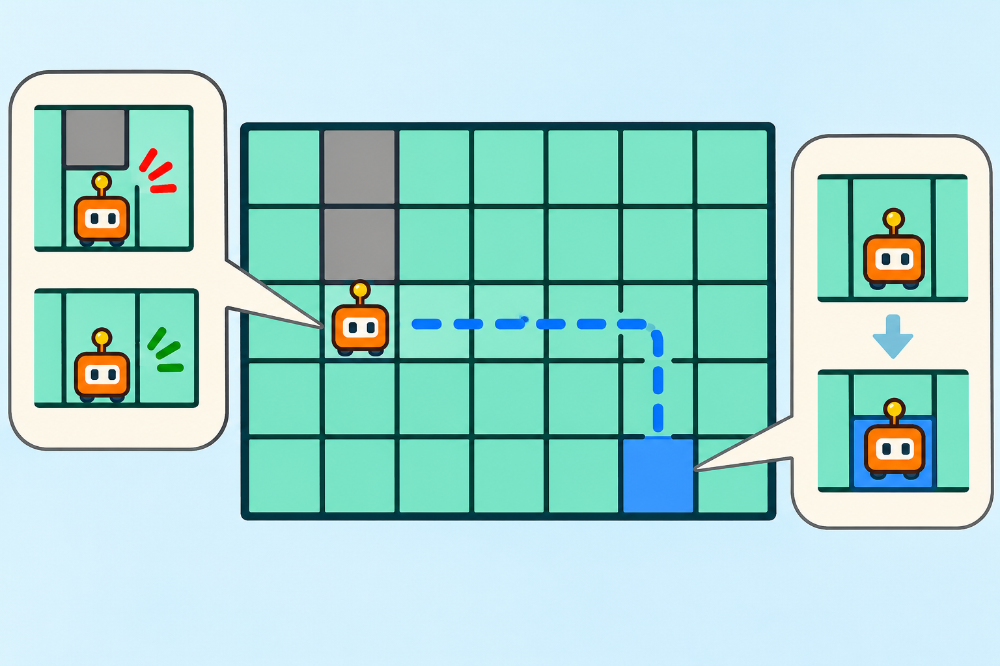
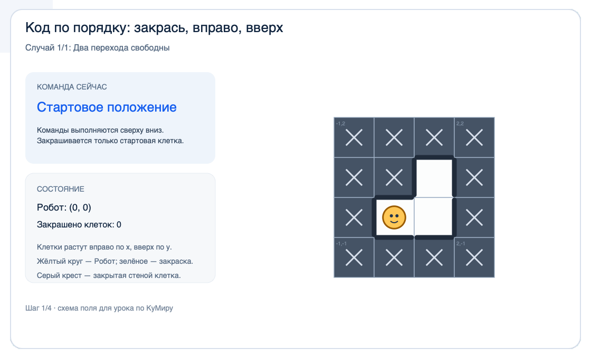
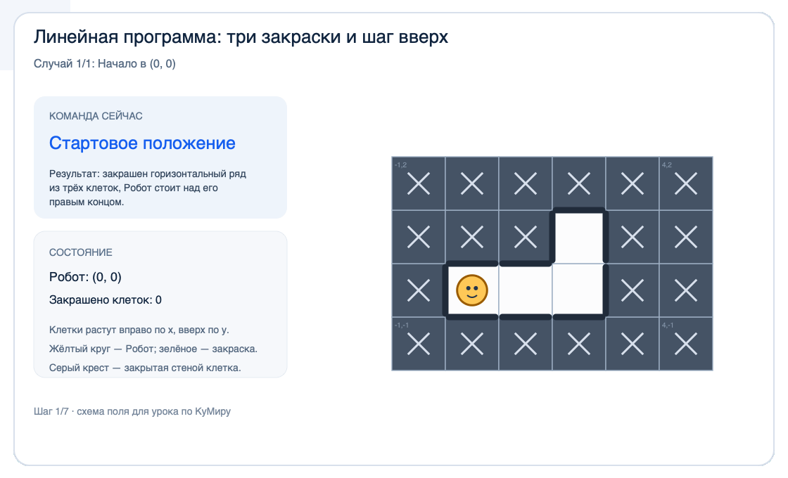
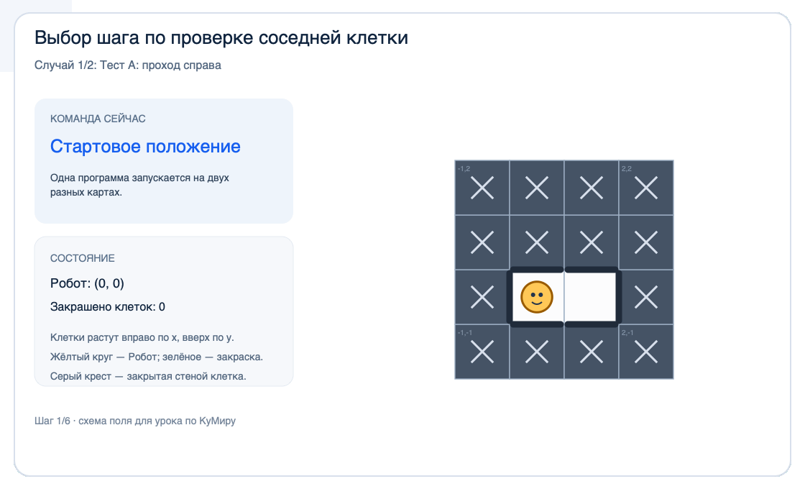
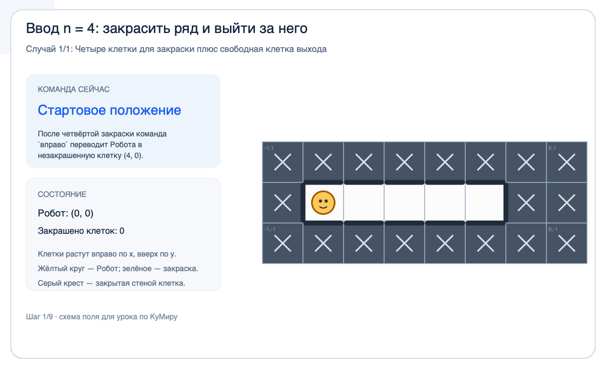
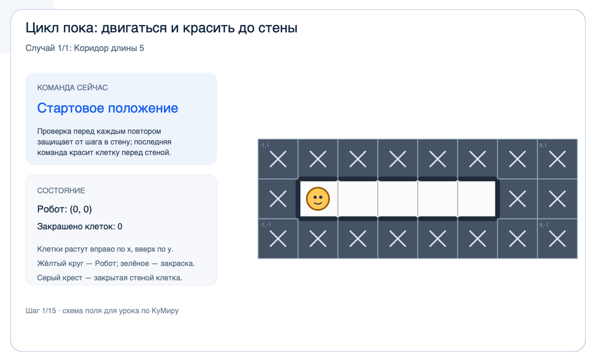
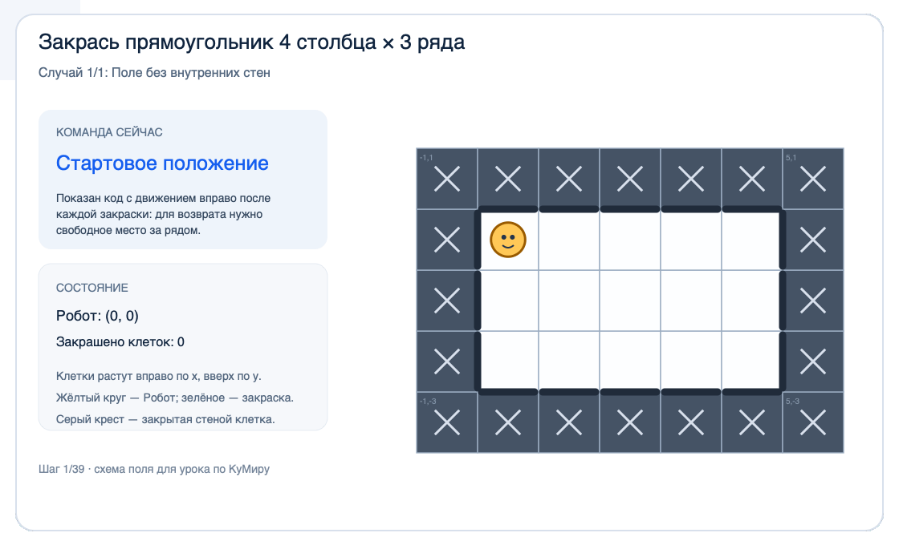
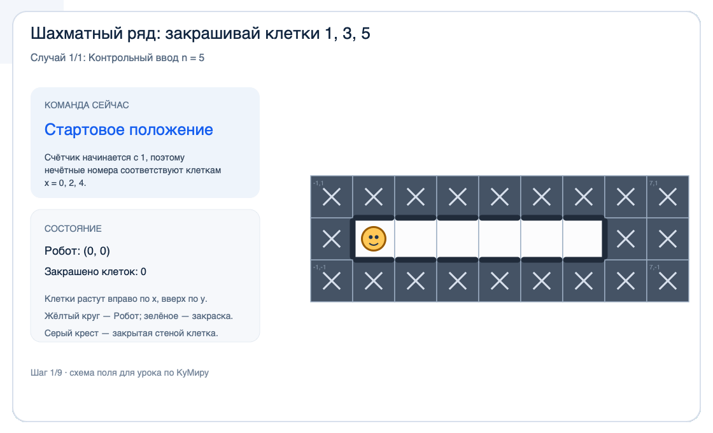

# Раздел 5. Исполнитель Робот: движение, проверки и обстановки

**Объём:** 5 занятий по 45 минут (занятия 18–22 курса).



*На схеме показаны поле Робота, стена и клетка, которую можно закрасить.*

Для карт и трасс используется соглашение: стартовая клетка имеет координаты `(0,0)`, `вправо` увеличивает `x`, `влево` уменьшает `x`, `вверх` увеличивает `y`, `вниз` уменьшает `y`. Если не сказано иначе, перечисленные переходы свободны, остальные поля программой не используются.

Для карт, где ниже указана точная область свободных клеток, считаем её границу стеной: переход из перечисленной области наружу закрыт. Внутри открытого прямоугольника все переходы между соседними клетками свободны, если отдельно не описано иначе.

## Что узнаем

После раздела ученик сможет:

- объяснить, как устроено поле Робота и что считается его состоянием;
- написать и запустить программу с движением и закрашиванием;
- проверить наличие стены перед движением;
- выбрать между циклом с числом повторений и циклом `пока`;
- использовать счётчик для маршрута заданной длины;
- проверить одну программу на нескольких обстановках.

## 1. Модель исполнителя

Робот работает на прямоугольном клетчатом поле. Между клетками могут стоять стены. Робот находится ровно в одной клетке; команда движения переносит его на соседнюю клетку в указанном направлении. Команда `закрасить` закрашивает клетку, в которой Робот стоит.

Состояние Робота для решения задачи удобно описывать так:

1. в какой клетке он находится;
2. какие стены находятся вокруг;
3. какие клетки уже закрашены.

Команды Робота можно разделить на две группы.

| Группа | Команды | Что происходит |
|---|---|---|
| Действия | `вверх`, `вниз`, `вправо`, `влево`, `закрасить` | Робот перемещается или меняет цвет текущей клетки |
| Проверки | `сверху свободно`, `снизу свободно`, `слева свободно`, `справа свободно`; соответствующие проверки `стена` | Возвращается логический ответ `да` или `нет`; положение Робота не меняется |

Проверка — это не движение. Выражение `справа свободно` сообщает, можно ли перейти в соседнюю клетку справа, но само по себе не перемещает Робота.

### Как записать программу

```text
использовать Робот
алг Пример
нач
  закрасить
  вправо
  вверх
кон
```

**Поле:** старт `(0,0)`. Свободны клетки `(0,0)`, `(1,0)`, `(1,1)` и переходы вправо из `(0,0)` и вверх из `(1,0)`; стен на этих переходах нет. Последовательность состояний: старт `(0,0)` → закрасить `(0,0)` → вправо в `(1,0)` → вверх в `(1,1)`. Итог: закрашена только `(0,0)`, финиш `(1,1)`.



Строка `использовать Робот` подключает исполнителя. В теле алгоритма команды выполняются сверху вниз. Сначала предскажи, где окажется Робот, затем запусти программу и сравни результат с прогнозом.

## 2. Линейная программа: команды идут по порядку

Линейная программа состоит из последовательности команд. В ней пока нет выбора и повторения.

**Поле:** старт `(0,0)`. Свободны клетки `x=0…2`, `y=0…1`; переходы между соседними клетками этого прямоугольника не перегорожены стенами. Прочие клетки не используются.

```text
использовать Робот
алг Дорожка
нач
  закрасить
  вправо
  закрасить
  вправо
  закрасить
  вверх
кон
```

Ожидаемый результат: закрашены клетки `(0, 0)`, `(1, 0)`, `(2, 0)`; Робот заканчивает в `(2, 1)`.

| Шаг | Команда | Положение после команды | Закрашенные клетки |
|---:|---|---|---|
| 0 | — | `(0, 0)` | — |
| 1 | `закрасить` | `(0, 0)` | `(0, 0)` |
| 2 | `вправо` | `(1, 0)` | `(0, 0)` |
| 3 | `закрасить` | `(1, 0)` | `(0, 0)`, `(1, 0)` |
| 4 | `вправо` | `(2, 0)` | без изменений |
| 5 | `закрасить` | `(2, 0)` | добавлена `(2, 0)` |
| 6 | `вверх` | `(2, 1)` | без изменений |



### Проверка по полю

Чтобы повторить проверку, задайте старт в `(0, 0)`, уберите стены с переходов к `(1, 0)`, `(2, 0)` и `(2, 1)`. После выполнения убедитесь, что закрашены ровно три клетки, а Робот оказался выше последней из них.

## 3. Движение и стена

Если команда движения направлена в стену, Робот не может пройти. Такая команда не заменяет проверку и не означает «попробовать идти, а если нельзя — выбрать другой путь». Прежде чем писать маршрут, выясните, гарантирует ли условие задачи свободный проход.

Задачи с заранее известным полем решаются с учётом именно этой обстановки. Если же расположение стены может меняться, программу нужно строить с проверками.

### Одна проверка и выбор направления

Следующая программа подходит для двух оговорённых обстановок: либо справа проход свободен, либо справа стена и сверху проход свободен.

**Поле A:** старт `(0,0)`, переход вправо в `(1,0)` свободен; переходы влево, вверх и вниз закрыты стенами. **Поле B:** старт `(0,0)`, справа стена, переход вверх в `(0,1)` свободен; влево и вниз закрыты стенами. Программа использует только эти локальные переходы.

```text
использовать Робот
алг ВыборШага
нач
  если справа свободно
    то вправо
    иначе вверх
  все
кон
```

Проверка значения выражения управляет ветвлением: если справа свободно, выполняется `вправо`; в противном случае выполняется `вверх`. Вторая обстановка должна обеспечить свободный проход вверх.

| Обстановка | Проверка | Выполненная команда | Ожидаемое положение |
|---|---|---|---|
| Справа свободно | `да` | `вправо` | на одну клетку правее старта |
| Справа стена, сверху свободно | `нет` | `вверх` | на одну клетку выше старта |



Это не универсальное правило обхода лабиринта. Оно решает задачу с указанными двумя случаями. Для неизвестного лабиринта нужны чёткие гарантии о его устройстве и отдельный алгоритм.

## 4. Повторение заданное число раз

Если условие задачи задаёт длину ряда, известное количество клеток удобно обрабатывать циклом.

```text
использовать Робот
алг Ряд
нач
  цел n, i
  вывод "Введите длину ряда: "
  ввод n
  нц для i от 1 до n
    закрасить
    вправо
  кц
кон
```

**Поле:** старт `(0,0)`. Для каждого значения `n` свободны клетки `(x,0)` при `x=0…n` и переходы между ними. Целевые клетки — `x=0…n−1`; клетка `(n,0)` нужна для финиша. Другие переходы не используются.

Переменная `n` хранит длину ряда, а `i` по очереди принимает значения от 1 до `n`. В каждом повторении Робот закрашивает текущую клетку и переходит вправо.

**Контрольный запуск:** при `n = 4` закрашены `(0,0)`, `(1,0)`, `(2,0)`, `(3,0)`; Робот заканчивает в `(4,0)`. Повторите запуск с `n = 1` и `n = 6`, каждый раз подготовив подходящее поле.

### Что меняется в цикле

| Повтор | `i` | Клетка под Роботом до закрашивания | Положение после `вправо` |
|---:|---:|---|---|
| 1 | 1 | `(0, 0)` | `(1, 0)` |
| 2 | 2 | `(1, 0)` | `(2, 0)` |
| 3 | 3 | `(2, 0)` | `(3, 0)` |
| 4 | 4 | `(3, 0)` | `(4, 0)` |



## 5. Цикл `пока`: число повторений неизвестно

Если длина коридора заранее не дана, но справа Робот должен идти до стены, число шагов неизвестно до запуска. В таком случае цикл проверяет условие перед каждым повторением:

```text
использовать Робот
алг ЗакраситьКоридор
нач
  нц пока справа свободно
    закрасить
    вправо
  кц
  закрасить
кон
```

Пока справа есть проход, Робот закрашивает текущую клетку и переходит вправо. Когда справа стена, цикл завершается; последняя команда закрашивает конечную клетку перед стеной.

**Ограничение алгоритма:** маршрут здесь — один прямой горизонтальный коридор. Робот начинает внутри коридора; справа от конечной клетки стоит стена. Алгоритм не ищет путь в произвольном лабиринте.

**Поле:** старт `(0,0)`, свободны клетки `(x,0)` при `x=0…L−1`. Восточная сторона последней клетки закрыта стеной; для коридора боковые стороны вдоль ряда также закрыты. Программа не использует других клеток.

**Проверка:** запусти программу на коридорах длины 1, 3 и 5 клеток. Во всех случаях должны быть закрашены все клетки коридора; Робот должен остаться в последней клетке перед правой стеной.



## 6. Цикл по прямоугольной области

Вложенный цикл удобен, когда нужно повторить одинаковое действие для каждой клетки нескольких рядов.

```text
использовать Робот
алг Прямоугольник
нач
  цел строка, столбец
  нц для строка от 1 до 3
    нц для столбец от 1 до 4
      закрасить
      вправо
    кц
    нц 4 раз
      влево
    кц
    если строка < 3
      то вниз
    все
  кц
кон
```

В каждой строке закрашиваются четыре клетки. После строки Робот возвращается к её левому краю. Если предстоит следующая строка, он опускается на одну клетку. Итог — прямоугольник **4 столбца × 3 строки**, Робот заканчивает у левого края нижней строки.

**Поле:** старт `(0,0)`. Свободны клетки `x=0…4`, `y=0,-1,-2` и переходы между ними. Целевая область — `x=0…3`, `y=0,-1,-2`; столбец `x=4` — свободная промежуточная полоса, куда Робот выходит после ряда и откуда возвращается влево. Внутренних стен нет.

| Номер строки | Стартовая клетка строки | Закрашено в строке | Положение после строки |
|---:|---|---|---|
| 1 | `(0, 0)` | `(0,0)` … `(3,0)` | `(0, -1)` после перехода вниз |
| 2 | `(0, -1)` | `(0,-1)` … `(3,-1)` | `(0, -2)` после перехода вниз |
| 3 | `(0, -2)` | `(0,-2)` … `(3,-2)` | `(0, -2)` |

В каждом ряду состояния идут так: закрасить `(0,y)`, перейти вправо в `(1,y)`, закрасить и пройти вправо до `(4,y)`, затем четырьмя шагами влево вернуться в `(0,y)`. После первого и второго ряда Робот идёт вниз. После третьего останавливается в `(0,-2)`.



## 7. Переменные в задачах с Роботом

Переменная помогает записать общее правило вместо множества одинаковых команд. Если длина ряда вводится в `n`, изменение значения `n` меняет число повторов без переписывания тела цикла.

Счётчик также можно использовать, чтобы обрабатывать клетки попарно или чередовать действия. Например, проверочная программа ниже закрашивает каждую клетку из ряда длины `n`, но перемещается вправо на каждом шаге:

```text
использовать Робот
алг ШахматныйРяд
нач
  цел n, i
  вывод "Введите число клеток: "
  ввод n
  нц для i от 1 до n
    если mod(i, 2) = 1
      то закрасить
    все
    вправо
  кц
кон
```

**Поле:** старт `(0,0)`. Свободны клетки `(x,0)` при `x=0…n`; переходы между ними открыты. Целевые клетки — `x=0…n−1`; дополнительная клетка `(n,0)` нужна для финиша.

При `n=5` закрашены номера 1, 3 и 5, то есть `(0,0)`, `(2,0)`, `(4,0)`; при `n=4` — `(0,0)`, `(2,0)`. На каждом шаге Робот двигается вправо, после последнего заканчивает в `(n,0)`.



## 8. Как проверять алгоритм

Для задачи с Роботом проверяют не только код, но и исходную обстановку.

1. Запишите стартовую клетку и расположение стен.
2. Отметьте, что должно быть закрашено в конце.
3. Перед запуском проследите выполнение по командам или по строкам цикла.
4. Выполните программу по шагам в редакторе КуМира.
5. Сравните фактическое положение и закраску с ожидаемыми.
6. Измените только одну особенность обстановки и повторите проверку.

У программы, которая должна работать на разных длинах коридора, должны быть тесты как минимум на короткий, средний и длинный коридор. Если алгоритм проверяет условие, нужны обстановки, в которых условие истинно и ложно.

## Типичные ошибки

- **Проверку принимают за действие.** `справа свободно` не перемещает Робота.
- **Делают шаг без гарантии свободного прохода.** Сначала проверяют стену или явно задают свободный маршрут.
- **Закрашивают не ту клетку.** `закрасить` действует на текущую клетку; смотрите, когда Робот перемещается относительно этой команды.
- **Цикл прекращается раньше последней клетки.** Учитывайте, что проверка `пока` происходит до выполнения тела; при необходимости обработайте конечную клетку после цикла.
- **Забывают о конечном положении.** После цикла Робот может стоять за закрашенным рядом или перед стеной — это зависит от порядка команд.
- **Проверяют только одну карту.** Один запуск не подтверждает правильность для другой длины или расположения стены.
- **Счётчик используют как номер текущей клетки, забыв границы.** Сверьте начало и конец диапазона счётчика с требуемым количеством повторов.

## Самопроверка

1. Чем команда проверки отличается от команды движения?
2. В какой момент цикла `нц пока` проверяется условие?
3. Почему в примере `ЗакраситьКоридор` есть команда `закрасить` после `кц`?
4. Где окажется Робот после ряда длины `n` в приведённой программе?
5. Какие две обстановки нужны, чтобы проверить условие `справа свободно`?

## Источники и материалы

- [НИИСИ РАН: статья об исполнителе Робот и проверках прохода](https://trudy.niisi.ru/2018_T8_N6.pdf).
- [К. Ю. Поляков: материалы и практикумы по КуМиру](https://www.kpolyakov.spb.ru/school/kumir.htm).
- [Сайт КуМира: программа, поле и выполнение по шагам](https://silvertests.ru/kumir).
