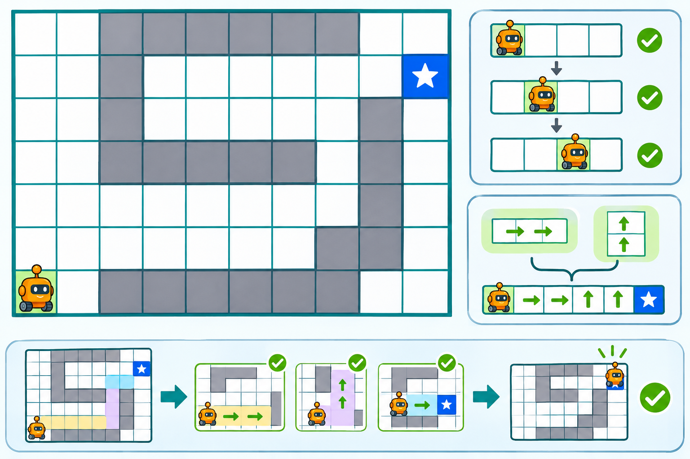

# Раздел 6. Вспомогательные алгоритмы, отладка и итоговый проект

**Объём:** 2 занятия по 45 минут (занятия 23–24 курса).



*На схеме показаны маршрут Робота и проверка программы по шагам.*

## Что узнаем

После раздела ученик сможет:

- выделить повторяющийся участок решения в отдельный вспомогательный алгоритм;
- передать алгоритму параметр и применить его несколько раз;
- запускать программу по шагам и следить за значениями величин и положением Робота;
- составлять набор тестов для разных обстановок;
- завершить и защитить небольшой проект для Робота.

## 1. Зачем нужен вспомогательный алгоритм

Большую задачу проще решать частями. Если несколько раз требуется выполнить одинаковый маршрут, повторяющуюся часть можно описать отдельным алгоритмом, дать ей имя и вызывать из основной программы.

Вспомогательный алгоритм полезен, когда:

- участок команд повторяется несколько раз;
- у части программы есть понятное отдельное действие, например «закрасить ряд»;
- изменение алгоритма должно выполняться в одном месте.

В КуМире первым в программе записывается основной алгоритм, который выполняется при запуске. Вспомогательные алгоритмы записываются ниже и вызываются по имени.

## 2. Алгоритм с параметром

Параметр позволяет одному алгоритму работать с разными входными значениями. В программе ниже `Ряд(n)` закрашивает `n` клеток подряд.

```text
использовать Робот
алг Квадрат
нач
  цел строка
  нц для строка от 1 до 3
    Ряд(4)
    нц 4 раз
      влево
    кц
    если строка < 3
      то вниз
    все
  кц
кон

алг Ряд(цел n)
нач
  цел i
  нц для i от 1 до n
    закрасить
    вправо
  кц
кон
```

Основной алгоритм три раза вызывает `Ряд(4)`. После каждого ряда Робот возвращается к его левому краю. Условие `строка < 3` разрешает переход вниз только после первого и второго рядов. При открытой обстановке будет закрашен прямоугольник 4 × 3, а Робот закончит на левом краю последнего ряда.

### Обратите внимание на предпосылки

Переменная `строка` показывает, какой ряд обрабатывается. Условие `строка < 3` означает, что после текущего ряда будет ещё один, поэтому Робот переходит вниз только после первого и второго рядов. После третьего ряда переход не выполняется. Обстановка должна быть открыта, без стен на пути движения и возвращения влево.

| Вызов | Значение параметра `n` | Закрашено за вызов | После возврата |
|---:|---:|---|---|
| 1 | 4 | 4 клетки первого ряда | Робот перешёл к началу второго ряда |
| 2 | 4 | 4 клетки второго ряда | Робот перешёл к началу третьего ряда |
| 3 | 4 | 4 клетки третьего ряда | Робот остался у начала третьего ряда |

Параметр `n` — вход алгоритма. Он задаёт длину ряда, но сам алгоритм `Ряд` не должен изменять его.

## 3. Разделение вычисления и вывода: функция

Вспомогательный алгоритм-функция возвращает одно значение. Его можно использовать в выражении или присвоить переменной.

```text
алг ПроверкаФункции
нач
  цел a
  a := КвадратЧисла(5)
  вывод "Квадрат числа 5: ", a, нс
кон

алг цел КвадратЧисла(цел x)
нач
  знач := x * x
кон
```

Ожидаемый вывод: `Квадрат числа 5: 25`. Функцию можно вызвать с другими значениями: например, `КвадратЧисла(0)` должно вернуть 0, `КвадратЧисла(-3)` — 9.

Для задач с Роботом часто достаточно алгоритмов-процедур, которые выполняют действия и могут не возвращать вычисленное число. Функции полезны в вычислительной части курса и позволяют отделить вычисление от основного алгоритма.

## 4. Вспомогательный алгоритм с параметром и результатом

У процедуры может быть параметр-аргумент для входного значения и параметр-результат, куда записывается ответ.

```text
алг ПроверкаСуммы
нач
  цел n, ответ
  n := 47
  СуммаЦифр(n, ответ)
  вывод "Сумма цифр 47: ", ответ, нс
кон

алг СуммаЦифр(арг цел n, рез цел s)
нач
  s := div(n, 10) + mod(n, 10)
кон
```

В примере рассматривается двузначное неотрицательное число. При `n = 47` параметр `ответ` получает значение 11. Вспомогательный алгоритм не вводит данные и не выводит результат самостоятельно: он получает значение через аргумент и записывает ответ через параметр `рез`.

Проверочные случаи: `n = 10` даёт 1, `n = 47` даёт 11, `n = 99` даёт 18. Границы допустимых значений должны быть указаны в условии задачи.

## 5. Пошаговая отладка

Отладка — это поиск и исправление ошибки в алгоритме. Запуск с результатом «похоже, работает» ещё не доказывает, что программа верна.

При пошаговой проверке следите за:

- текущей командой;
- значениями счётчиков и других переменных;
- истинностью условия цикла или ветвления;
- положением Робота;
- клетками, которые уже закрашены.

### Намеренно ошибочный пример

В следующем фрагменте Робот должен закрасить три клетки, но повторение выбрано неверно:

```text
использовать Робот
алг ОшибкаПовтора
нач
  нц 2 раз
    закрасить
    вправо
  кц
кон
```

**Задача отладки:** запусти программу на свободном ряду и сравни число закрашенных клеток с требуемым. Определи, что именно неверно: число повторов, порядок команд или обе вещи. Исправь программу и проверь на ряду длины 3 и 5, изменяя программу только там, где это необходимо.

Если ошибка сложнее, не исправляй код сразу. Сначала найди первую строку, после которой реальное состояние отличается от ожидаемого. При проверке цикла отдельно записывай номер повтора и позицию Робота.

## 6. План тестирования

Тест — это конкретная программа с конкретным вводом или стартовой обстановкой и ожидаемым результатом. Для каждой программы с условием нужны тесты для истинной и ложной ветви. Для цикла проверяют малое, типичное и граничное число повторений. Для Робота варьируют расположение стен в пределах, разрешённых условием.

| Что меняется | Пример проверки |
|---|---|
| Длина ряда | 1, 3 и 6 клеток |
| Проверка прохода | справа свободно / справа стена |
| Число рядов | один ряд / несколько рядов |
| Алгоритм с параметром | один и тот же ряд вызывается с разными `n` |
| Конечное положение | сверить не только закраску, но и клетку остановки |

Для задачи с Роботом в ожидаемом результате записывайте оба результата: **какие клетки закрашены** и **где Робот закончил**. Они независимы: программа может закрасить правильный рисунок, но оставить Робота не в той клетке.

## 7. Итоговый проект «Ремонтная бригада»

### Условие проекта

На прямоугольной платформе повреждён участок из нескольких одинаковых рядов. Робот начинает у левого края первого ряда. Нужно закрасить повреждённые клетки, обозначая их синим цветом, и оставить Робота у левого края последнего обработанного ряда.

Для первой версии используй открытую платформу без внутренних стен, шириной 4 клетки и высотой 3 ряда. Вынеси закрашивание одного ряда во вспомогательный алгоритм с параметром. Основная программа должна вызвать его для каждого ряда.

### Этапы

1. Изобразить старт, ряды и направление движения.
2. Составить алгоритм одного ряда и проверить его отдельно.
3. Оформить алгоритм ряда как вспомогательный.
4. Вызвать его несколько раз из основного алгоритма.
5. Добавить возврат к левому краю и переход на следующую строку.
6. Проверить число закрашенных клеток, их расположение и конечное положение Робота.
7. Объяснить, что делает параметр и почему программа работает для заданных размеров.

### Условия приёмки

- закрашено ровно 12 клеток: 4 × 3;
- закраска занимает три смежных ряда;
- внутри прямоугольника нет пропусков, вне его нет лишних закрашенных клеток;
- Робот заканчивает у левого края третьего ряда;
- повторяющаяся операция вынесена в вспомогательный алгоритм;
- ученик может показать программу по шагам и описать хотя бы два контрольных теста.

После базовой версии можно добавить ввод ширины и высоты, если изученные конструкции и среда позволяют подготовить корректные обстановки для соответствующего размера.

## Типичные ошибки

- **Алгоритм-процедуру путают с функцией.** Процедура выполняет команды; функция возвращает значение, которое можно использовать в выражении.
- **Параметр не передают при вызове.** Проверьте, совпадает ли количество переданных значений с параметрами заголовка.
- **Функция не задаёт `знач`.** В этом случае ожидаемого результата вычисления нет.
- **Вспомогательный алгоритм записан перед основным.** В учебной форме сначала располагают запускаемый алгоритм, затем используемые им вспомогательные алгоритмы.
- **После отладки проверен только один тест.** Условия и циклы нужно проверять на случаях с разными путями выполнения.
- **Сравнивают только закраску.** Положение Робота также является частью результата.
- **Исправляют код, не определив ошибочную команду.** Сначала найди первый момент, когда реальное состояние отличается от ожидаемого.

## Самопроверка

1. Когда полезно выделять часть программы во вспомогательный алгоритм?
2. Что передаётся параметру `n` при вызове `Ряд(4)`?
3. Чем параметр `арг` отличается от параметра `рез`?
4. Какие данные нужно отслеживать при пошаговом запуске программы для Робота?
5. Почему проверка итогового рисунка должна включать и конечное положение Робота?

## Источники и материалы

- [Фоксфорд: параметры алгоритма в КуМире](https://foxford.ru/wiki/informatika/parametry-algoritma-v-srede-kumir).
- [Пример вспомогательного алгоритма для Робота с параметром](https://www.silvertests.ru/kumir-robot-vspomogatelnyj-algoritm).
- [ФИПИ/ИРО Ярославской области: пример функции на школьном алгоритмическом языке](https://iro.yar.ru/fileadmin/iro/cit/informatic/attestashia/Roytberg_EGE-2013.pdf).
- [НИИСИ РАН: Робот, проверки прохода и обстановки](https://trudy.niisi.ru/2018_T8_N6.pdf).
