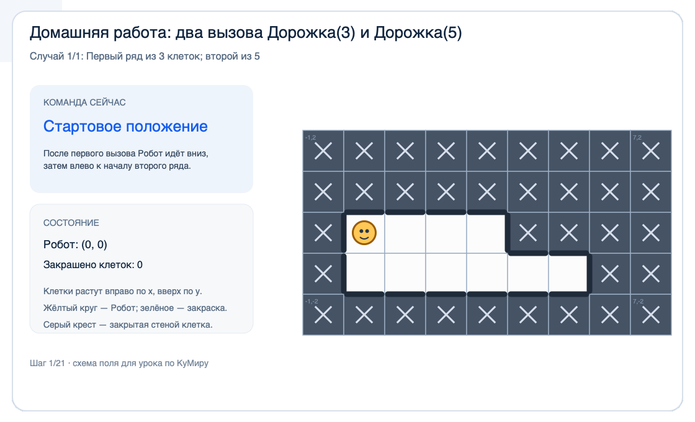
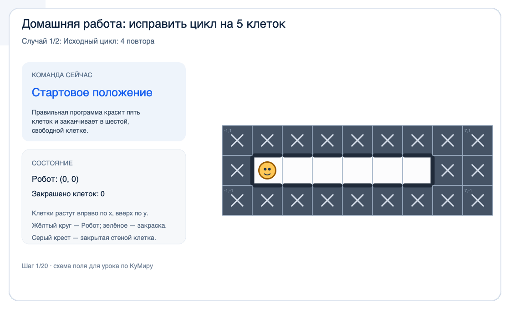
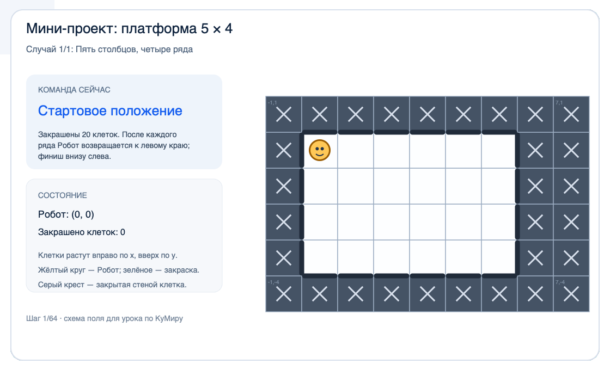

# Домашняя работа к разделу 6. Вспомогательные алгоритмы и проект

Выполняй задания в КуМире. Для каждого создай файлы программы, подготовь проверочные данные или обстановки и запиши ожидаемые результаты. Не включай в сдаваемые файлы готовые ответы из конспекта: покажи собственный вариант решения.

Координатное соглашение: старт, если не сказано иначе, `(0,0)`; вправо увеличивает `x`, вверх увеличивает `y`, вниз уменьшает `y`. GIF для заданий показывают поле и/или трассу состояний, но не содержат кода решения.

Неуказанные переходы из перечисленной области закрыты стенами; внутри открытой области все переходы между соседними клетками свободны.

## Задание 1. Вспомогательный алгоритм «Дорожка»

Напиши вспомогательный алгоритм с целочисленным параметром `n`. Он должен закрасить `n` клеток подряд, двигаясь вправо после каждой закраски. Основной алгоритм должен вызвать его сначала для `n = 3`, затем для `n = 5`.

**Начальное поле:** два свободных ряда, Робот стоит в начале первого. Первый ряд состоит из трёх клеток. После первого вызова Робот окажется в клетке сразу справа от ряда: спустись на одну клетку и пройди влево три клетки до начала второго ряда. Второй ряд должен быть не короче пяти клеток.

**Карта:** первый ряд — целевые `(0,0)`, `(1,0)`, `(2,0)` и выходная `(3,0)`; второй — целевые `(0,-1)…(4,-1)` и выходная `(5,-1)`. Все эти клетки свободны. Свободны переход вниз `(3,0)→(3,-1)` и переходы влево вдоль второго ряда от `(3,-1)` до `(0,-1)`. Старт `(0,0)`. Первый вызов `n=3` красит `x=0…2`, заканчивает `(3,0)`; переход вниз-влево приводит в `(0,-1)`; второй вызов `n=5` красит `x=0…4`, заканчивает `(5,-1)`. Другие выходы из этого маршрута не используются.

 — визуализация поля и трассы, не ответ.

**Критерии:** каждый вызов закрашивает ровно заданное число клеток; второй вызов использует тот же вспомогательный алгоритм с другим параметром.

## Задание 2. Функция и контрольные значения

Создай функцию, которая получает целое число и возвращает его удвоенное значение. Основная программа вызовет функцию с тремя значениями и выведет аргумент и результат.

**Контрольные значения:** `0`, `7`, `-4`.

**Ожидаемые пары:** `0 → 0`, `7 → 14`, `-4 → -8`.

## Задание 3. Сумма цифр двузначного числа

Создай вспомогательный алгоритм с параметром-аргументом для двузначного неотрицательного числа и параметром-результатом для суммы цифр. Основной алгоритм вызывает его и выводит ответ.

Входной параметр (аргумент) передаёт число в алгоритм. Выходной параметр (результат) возвращает из алгоритма сумму цифр.

**Ограничение:** `10 ≤ n ≤ 99`.

**Проверочные данные:** `10`, `47`, `99`.

**Ожидаемый вывод:** для `10` — `1`, для `47` — `11`, для `99` — `18`.

## Задание 4. Найди ошибку в маршруте

Робот должен закрасить пять клеток коридора, начиная с первой, и закончить в свободной клетке сразу справа от коридора. В программе использован цикл, но он повторяется только четыре раза:

```text
использовать Робот
алг ОшибкаПовтора
нач
  нц 4 раз
    закрасить
    вправо
  кц
кон
```

Исправь программу так, чтобы она закрашивала пять клеток, а затем вынеси повторяющиеся команды во вспомогательный алгоритм `Ряд` с параметром длины. Проверь длину ряда 1 и длину ряда 5.

**Что сдать:** исправленная программа, стартовые обстановки, ожидаемая закраска и конечное положение для обоих тестов. Объясни, почему исходный цикл заканчивается после закрашивания только четырёх клеток.

**Карта тестов:** для длины `n` старт `(0,0)`, коридор состоит из клеток `(0,0)…(n−1,0)`, выходная свободная клетка — `(n,0)`; переходы вправо свободны. Для `n=1` правильное состояние: покрасить `(0,0)`, перейти в `(1,0)` и остановиться. Для `n=5`: покрасить `(0,0)…(4,0)`, затем перейти в `(5,0)`. Исходный цикл с четырьмя повторами на пяти клетках красит только `x=0…3` и заканчивает в `(4,0)`, которая всё ещё пятая клетка коридора; он не заканчивает справа от коридора. Исправленный вариант с пятью повторами достигает `(5,0)`.

 — визуализация поля и состояний, не код решения.

## Задание 5. Мини-проект «Почини платформу»

Платформа представляет собой открытый прямоугольник из 5 столбцов и 4 рядов. Робот начинает у левого края верхнего ряда. Нужно закрасить все клетки прямоугольника и закончить у левого края нижнего ряда.

**Требования:**

- повторяющийся ряд оформить вспомогательным алгоритмом с параметром;
- основная программа должна вызвать его для каждого из четырёх рядов;
- после каждого ряда Робот должен вернуться к его левому краю;
- на внутреннем поле нет стен.

**Критерии приёмки:** закрашено ровно 20 клеток; рисунок содержит 5 столбцов и 4 ряда; Робот заканчивает у левого края нижнего ряда; алгоритм ряда вызывается с параметром 5.

**Карта:** целевая область `x=0…4`, `y=0,-1,-2,-3`; старт `(0,0)`. Чтобы использовать цикл ряда как в конспекте (закрасить клетку и сразу шагнуть вправо, в том числе после последней закраски), свободна также полоса `x=5` во всех четырёх рядах. Все переходы по рядам открыты, внутренних стен нет. На каждом ряду Робот красит `x=0…4`, выходит в `x=5`, возвращается пятью шагами влево в `x=0`; после первых трёх рядов спускается вниз. После четвёртого ряда остаётся в `(0,-3)`. Цель — 20 клеток; финиш `(0,-3)`.

 — визуализация поля/трассы, не решение.

## Задание 6. Защита решения

Подготовь короткую демонстрацию своей программы из задания 5:

1. покажи основную и вспомогательную части;
2. пошагово выполни один вызов вспомогательного алгоритма;
3. назови значение параметра при этом вызове;
4. измени ширину платформы в программе и объясни, что ещё нужно изменить в обстановке;
5. покажи тест, который проверяет, что Робот не выходит за границу ряда.

Используй ту же карту и целевые клетки, что в задании 5; отдельного нового поля или нового кода здесь нет.

## Что приложить

- программы КуМира;
- тестовые значения и схемы стартовых полей;
- таблицы с ожидаемой закраской и конечным положением;
- короткие ответы на пункты защиты.
