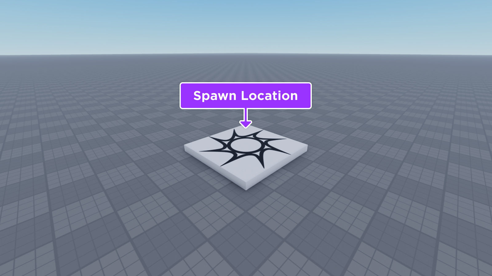
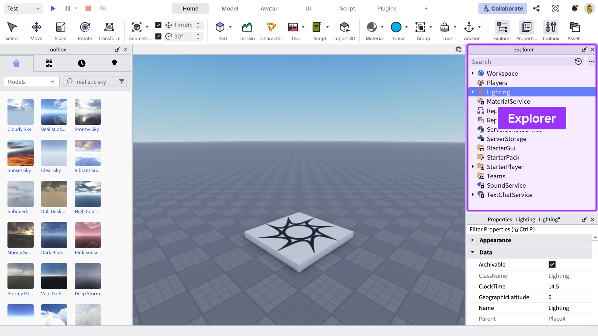
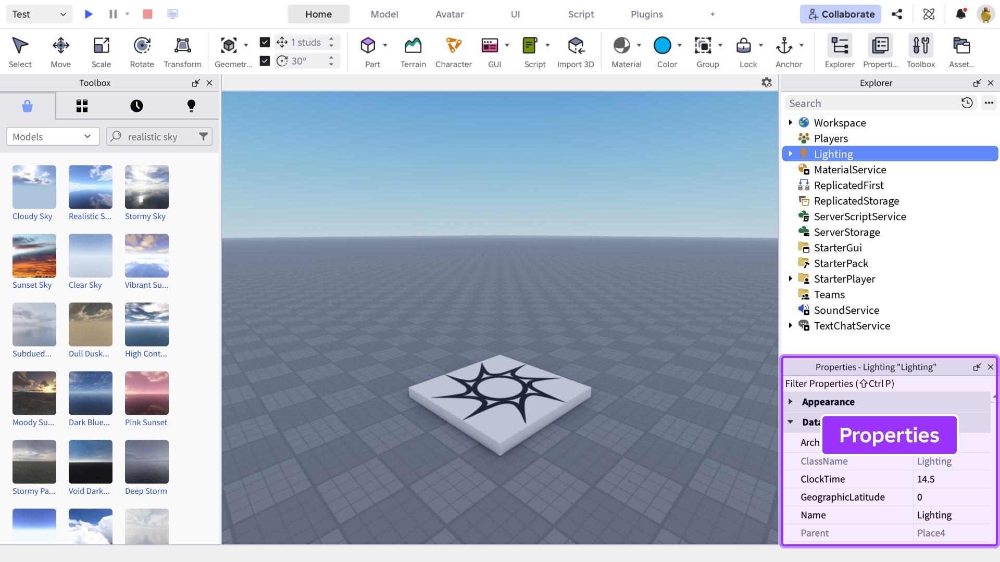
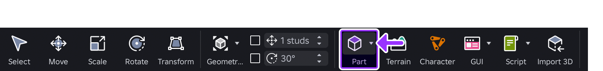
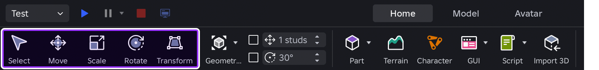
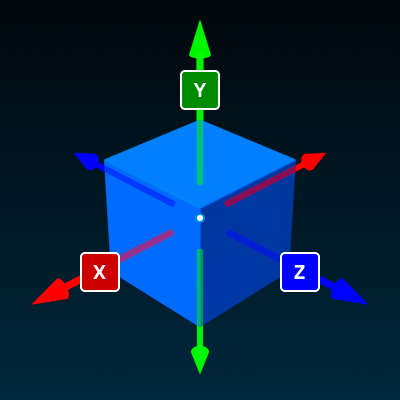
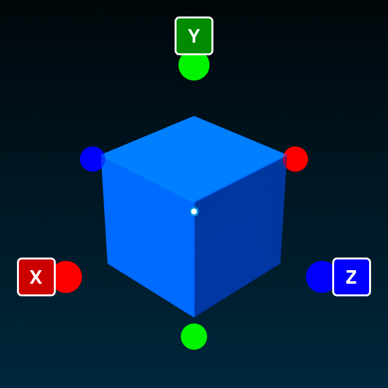
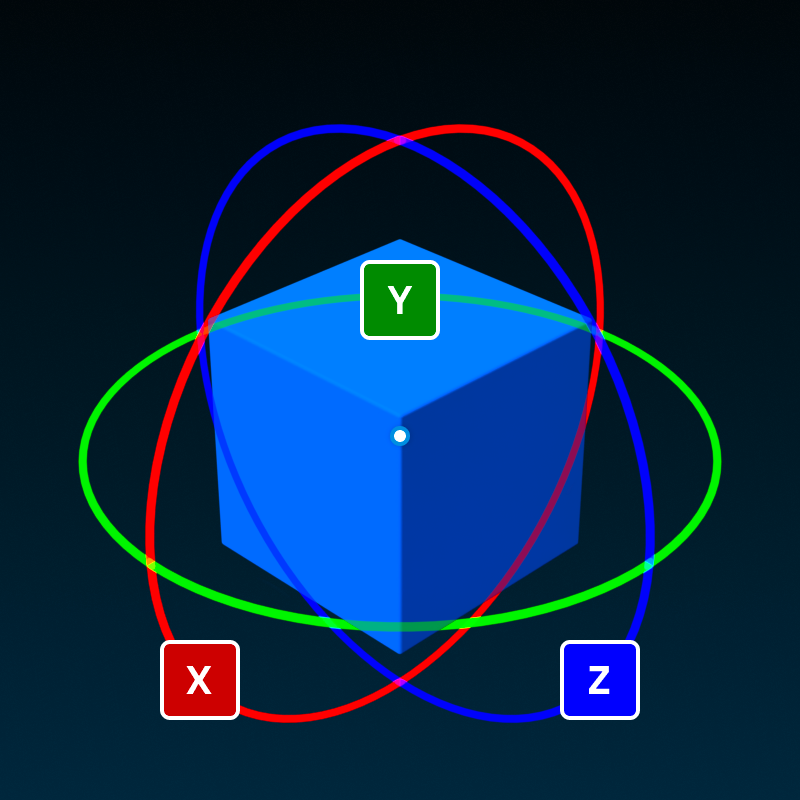
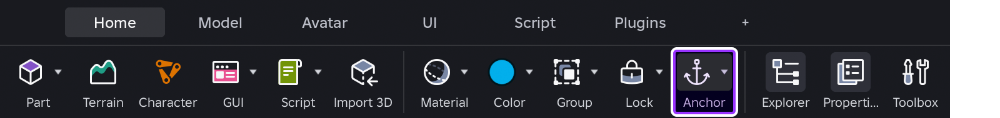
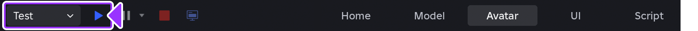

# Урок 1. Знакомство с Roblox Studio

[К разделу Luau и Roblox Studio](../README.md) · [Домашнее задание](#homework) · [Источники иллюстраций](../assets/studio-lesson-01/SOURCES.md)

**Уровень:** с нуля. **Время:** примерно 60–90 минут на урок и 30–45 минут на домашнюю работу. Если работаешь в Studio впервые, можно разделить урок на два занятия.

Сегодня ты соберёшь небольшую тренировочную площадку: старт, дорожку из платформ, финиш и декоративную колонну. Затем запустишь сцену, проверишь её персонажем и сохранишь проект. Все действия выполняются инструментами редактора; знание программирования пока не требуется.

## Что научимся делать

К концу урока ты сможешь:

1. Создать проект Baseplate и найти объекты сцены в Explorer.
2. Выбрать деталь и изменить её свойства в Properties.
3. Перемещать, растягивать, поворачивать, копировать и группировать детали.
4. Объяснить разницу между Anchored и CanCollide и проверить её в игре.
5. Запустить и остановить проверку, сохранить сцену в файл и снова открыть её.

## 1. Подготовь рабочее место

**Roblox** — платформа, на которой запускают игры. **Roblox Studio** — приложение, в котором их создают. **Luau** — язык программирования для поведения объектов: например, открытия двери или начисления монет. Сегодня мы подготовим сцену, а к программированию перейдём после знакомства с редактором.

Понадобятся компьютер с Windows или macOS, аккаунт Roblox и установленный Roblox Studio. Скачать приложение можно на [официальном сайте Roblox](https://create.roblox.com/). Для управления камерой удобна мышь с правой кнопкой и колёсиком.

Открой Studio, войди в аккаунт и создай новый проект по шаблону **Baseplate**. В нём уже есть большая плита основания и **SpawnLocation** — площадка, около которой появляется персонаж.



*Рисунок 1. На иллюстрации Roblox стрелка указывает на SpawnLocation. Это отдельный объект, а большая поверхность под ним — Baseplate.*

**Проверь:** ты видишь 3D-сцену и можешь выбрать площадку появления щелчком мыши.

> Скриншоты взяты из официального репозитория Roblox. Расположение кнопок зависит от версии и настройки Studio. В тексте приведены английские названия, чтобы их можно было найти в редакторе. Если окно закрыто, открой его через меню **Window**; в старых версиях такие переключатели находятся во вкладке **View**.

## 2. Разберись с окнами редактора

В центре находится **3D viewport** — окно, в котором ты видишь и редактируешь мир. Сверху расположены вкладки **Home**, **Model** и другие наборы инструментов.

### Explorer: какие объекты есть в проекте

**Explorer** показывает объекты в виде дерева. Раскрой **Workspace** стрелкой слева от его имени: здесь находятся объекты 3D-мира, в том числе Baseplate и SpawnLocation.



*Рисунок 2. Explorer помогает выбрать объект по имени, даже если его плохо видно в сцене.*

Вложенность означает связь «родитель — дочерний объект». Например, позже детали дорожки будут находиться внутри одной модели. Workspace — место для объектов мира, а не список всех возможных настроек проекта: в Explorer есть и другие разделы.

**Сделай:** выбери SpawnLocation сначала в сцене, затем по имени в Explorer. В обоих случаях выбирается один и тот же объект.

### Properties: как настроен выбранный объект

**Properties** показывает свойства текущего выделения. Если выбрать другой объект, содержимое окна изменится. Если ничего не выделено, нужных свойств может не быть.



*Рисунок 3. На исходном скриншоте выбран Lighting, поэтому показаны его свойства. Чтобы увидеть Size или Anchored, выбери именно деталь Part.*

| Свойство | Что означает |
| --- | --- |
| `Name` | Имя объекта в Explorer. Понятное имя помогает найти нужную деталь. |
| `Size` | Размер детали по трём осям: X, Y, Z. |
| `Position` | Положение центра детали по X, Y, Z. Может отображаться внутри `CFrame`. |
| `Orientation` | Поворот детали вокруг осей в градусах. Может отображаться внутри `CFrame`. |
| `Color` | Цвет поверхности. |
| `Material` | Материал, например Plastic или Wood. |
| `Anchored` | Закреплена ли деталь: `true` — да, `false` — нет. |
| `CanCollide` | Сталкиваются ли с деталью персонажи и другие физические объекты. |

Если строк много, введи название свойства в поле поиска Properties. Числовые компоненты X, Y, Z можно раскрыть стрелкой рядом со свойством и изменить отдельно. Перед поиском другого свойства очищай фильтр.

## 3. Научись управлять камерой

Камера — твоя точка обзора. Перемещение камеры не меняет положение деталей.

| Действие | Управление в окне 3D-сцены |
| --- | --- |
| Посмотреть в другую сторону | Удерживай правую кнопку мыши и двигай мышь. |
| Перемещаться вперёд, влево, назад, вправо | Используй W, A, S, D. |
| Опускать или поднимать камеру | Используй Q и E. |
| Приблизить или отдалить обзор | Прокрути колёсико мыши. |
| Найти выбранный объект | Выдели его в Explorer, затем нажми F в окне сцены. |

Сначала щёлкни в 3D-сцене: если курсор находится в текстовом поле Properties, клавиши будут вводить текст. Для WASD переключись на английскую раскладку.

**Мини-практика:** облети SpawnLocation, посмотри на неё сверху, затем выбери Baseplate в Explorer и нажми F. Объясни, изменился ли сам объект, когда ты двигал камеру.

## 4. Создай первую деталь

**Part** — простая строительная деталь. Из таких деталей можно собрать пол, ступени, стену или платформу.

1. На вкладке **Home** или **Model** найди кнопку **Part**.
2. Открой выбор формы маленькой стрелкой и выбери **Block**. Если при обычном нажатии сразу появился прямоугольный блок, нужная форма уже выбрана.
3. Найди новую деталь в Workspace.
4. В Properties измени `Name` на `PracticeBlock`.
5. Выбери любой цвет через `Color`.



*Рисунок 4. Кнопка Part создаёт новую деталь; выбор формы находится рядом с ней.*

Имя `PracticeBlock` — подпись объекта. Изменение имени не превращает его в другой тип: он остаётся Part.

**Проверь:** щёлкни в пустом месте, затем снова выбери PracticeBlock по имени в Explorer. Цвет и имя должны сохраниться.

## 5. Перемести, растяни и поверни деталь

Три основных инструмента работают с уже выбранным объектом:



*Рисунок 5. Move меняет положение, Scale — размер, Rotate — поворот.*

### Move: положение

Выбери PracticeBlock, включи **Move** и потяни за стрелку. В мировых осях X отмечена красным, Y — зелёным, Z — синим. Ось Y направлена вверх, а X и Z лежат в горизонтальной плоскости.



*Рисунок 6. Движение вдоль одной стрелки помогает изменить одну координату.*

Для точного положения открой `Position` в Properties и задай компоненты по отдельности. В примерах запись `(0, 6, 0)` означает X = 0, Y = 6, Z = 0. Это значения свойств, их не нужно вставлять в скрипт.

### Scale: размер

Включи **Scale** и потяни за цветной маркер. Деталь станет длиннее, выше или шире. Точный размер можно записать через `Size`.



*Рисунок 7. Размеры в Studio измеряются в studs — условных единицах мира.*

Задай `Size = (8, 1, 8)` и `Position = (0, 6, 0)`. Получится широкая тонкая платформа. Значение Size.Y = 1 — её толщина, а Position.Y = 6 — высота её центра. У неповёрнутой платформы верх находится на высоте 6,5, а низ — на 5,5.

### Rotate: поворот

Включи **Rotate** и потяни за цветное кольцо. Для поворота вокруг вертикальной оси используй кольцо Y. Точный угол можно задать через `Orientation`.



*Рисунок 8. Для поворота вокруг вертикали меняют компонент Y.*

**Предскажи и проверь:** что изменится, если заменить Size.Y с 1 на 3? А если оставить размер прежним и изменить только Position.Y? Выполни оба опыта по очереди и объясни разницу. После опытов верни размер `(8, 1, 8)`, положение `(0, 6, 0)` и поворот `(0, 0, 0)`.

## 6. Раздели закрепление и столкновения

У детали есть два независимых свойства:

- **Anchored = true**: деталь не падает под действием гравитации и её не сдвинут столкновения. Её по-прежнему можно переместить инструментом редактора.
- **CanCollide = true**: персонаж может стоять на детали и упираться в неё. При `false` он проходит сквозь неё.



*Рисунок 9. Кнопка Anchor переключает закрепление. Текущее значение всегда можно проверить в Properties.*

| Anchored | CanCollide | Что ожидать при запуске |
| --- | --- | --- |
| `true` | `true` | Неподвижная платформа, на которой можно стоять. |
| `false` | `true` | Незакреплённая деталь падает до столкновения с опорой. |
| `true` | `false` | Деталь остаётся на месте, но персонаж проходит сквозь неё. |

Закрепи PracticeBlock через `Anchored`. Оставь `CanCollide` включённым. Пока это просто неподвижная платформа — действие кнопки запуска разберём следующим шагом.

## 7. Запусти сцену и проведи опыт

1. В верхней части Studio выбери режим **Test** и нажми кнопку с треугольником **Play** рядом с ним. В старом интерфейсе запуск с персонажем может называться **Play**.
2. Персонаж появится около SpawnLocation. Управляй им клавишами WASD, прыгай пробелом.
3. Посмотри, остался ли PracticeBlock на высоте 6.
4. Нажми красную кнопку **Stop**, чтобы вернуться к редактированию.



*Рисунок 10. Режим Test запускает проверку с персонажем. Режим Run запускает симуляцию без него.*

**Опыт с гравитацией:** после Stop выключи `Anchored` у PracticeBlock. До запуска предположи, что произойдёт. Запусти Test, посмотри на падение и снова нажми Stop. Верни `Anchored = true` в режиме редактирования.

**Опыт со столкновениями:** после Stop задай платформе `Position = (0, 1, 0)` и `Size = (8, 1, 8)`. У SpawnLocation временно задай `Size = (4, 1, 4)`, `Position = (-7, 1, 0)` и `Anchored = true`: она окажется рядом с платформой, а не над ней. Включи Test, перепрыгни небольшой промежуток и встань на платформу. При `CanCollide = true` она удерживает персонажа. Останови проверку, выключи `CanCollide` **только у PracticeBlock** и повтори запуск и прыжок. Теперь персонаж провалится через платформу на Baseplate. После Stop снова включи `CanCollide` у PracticeBlock.

**Изменения во время Test сбрасываются после Stop.** Например, если ты перекрасишь деталь во время проверки, после остановки вернётся исходный цвет. Постоянные изменения сцены делай после Stop. Это отличается от сохранения файла: остановка проверки сама по себе не сохраняет проект.

## 8. Собери тренировочную дорожку

Теперь объедини знакомые действия в небольшую сцену. Для строительства останови Test.

### Шаг 1. Подготовь старт

Переименуй PracticeBlock в `Start`. Задай ему `Size = (8, 1, 8)`, `Position = (0, 2, 0)`, `Orientation = (0, 0, 0)`, `Anchored = true`, `CanCollide = true`. Выбери синий цвет.

У SpawnLocation задай `Size = (4, 1, 4)`, `Position = (0, 3, 0)` и `Orientation = (0, 0, 0)`. Проверь `Anchored = true` и `CanCollide = true`. Площадка появления окажется на старте; не удаляй её.

### Шаг 2. Скопируй платформу

Выдели Start и используй **Duplicate**: Ctrl+D в Windows или ⌘D в macOS. Копия сначала появится на том же месте, поэтому сразу измени её имя и положение.

Создай ещё три платформы. Для всех четырёх оставь `Size = (8, 1, 8)`, нулевой поворот, включённые Anchored и CanCollide.

| Имя | Position: X, Y, Z | Цвет |
| --- | --- | --- |
| `Start` | `(0, 2, 0)` | Синий |
| `Step01` | `(9, 2, 0)` | Любой, отличный от цвета финиша |
| `Step02` | `(18, 2, 0)` | Любой, отличный от цвета финиша |
| `Finish` | `(27, 2, 0)` | Зелёный |

Центры соседних платформ находятся на расстоянии 9 studs. Ширина каждой — 8 studs, значит между краями остаётся промежуток в 1 stud. Baseplate остаётся внизу: если оступишься, можно вернуться на старт и попробовать снова.

### Шаг 3. Добавь декорацию и сгруппируй дорожку

Добавь новый Block с именем `Decoration`. Задай `Size = (2, 4, 2)`, `Position = (12, 3, 10)` и `Orientation = (0, 45, 0)`. Закрепи его и выбери любой цвет. Он стоит в стороне от дорожки и помогает увидеть поворот на 45°.

В Explorer, удерживая Ctrl в Windows или ⌘ в macOS, выдели **только** Start, Step01, Step02 и Finish. Щёлкни по выделению правой кнопкой и выбери **Group**; переименуй получившуюся модель в `TrainingPath` через её свойство Name.

**Model** — контейнер для связанных объектов. Модель позволяет хранить и выбирать их вместе. Группировка сама по себе не скрепляет детали физически и не заменяет Anchored.

Структура выбранной части Workspace получится такой; другие стандартные объекты проекта могут оставаться рядом:

```text
Workspace
├── Baseplate
├── SpawnLocation
├── Decoration
└── TrainingPath (Model)
    ├── Start
    ├── Step01
    ├── Step02
    └── Finish
```

Если ошибся при перемещении или группировке, используй **Undo**: Ctrl+Z в Windows или ⌘Z в macOS. Отмена относится к действиям редактора, а Stop завершает запуск игры.

### Шаг 4. Проверь результат

Запусти Test. Пройди от старта к финишу, перепрыгивая промежутки. Если маршрут неудобен, останови проверку и исправь положение объектов. Зелёная платформа обозначает финиш визуально: автоматическое сообщение о победе мы добавим после изучения скриптов.

Перед продолжением проверь:

- [ ] Персонаж появляется на старте, а не далеко от дорожки.
- [ ] Все четыре платформы остаются на месте.
- [ ] Между соседними платформами есть небольшие промежутки.
- [ ] Через платформы нельзя провалиться.
- [ ] Колонна стоит в стороне и не закрывает путь.
- [ ] В Explorer четыре платформы находятся внутри TrainingPath.

## 9. Сохрани и снова открой проект

1. Нажми Stop.
2. В меню **File** выбери **Save to File**. В некоторых состояниях проекта команда называется **Download a Copy**.
3. Сохрани файл как `lesson_01_training.rbxl` в папку, которую сможешь найти. Расширение `.rbxl` — формат сцены Roblox; вариант `.rbxlx` тоже поддерживается, но для этого урока выбери `.rbxl`.
4. Убедись, что файл появился на компьютере. Закрой сохранённую сцену и открой этот файл через **File → Open from File** или двойным щелчком по файлу.
5. Проверь имена, цвета и расположение платформ и ещё раз запусти Test.

Сохранение файла на компьютере и публикация игры в Roblox — разные действия. Для сдачи этого урока достаточно локального файла.

## 10. Если что-то не получается

| Проблема | Что проверить |
| --- | --- |
| Пропали Explorer или Properties | Открой нужное окно через Window; в старом интерфейсе — View. |
| Не видно Size или Anchored | Выбери Part, а не Workspace, Lighting или модель. Очисти фильтр Properties. |
| Деталь потерялась | Выбери её в Explorer и нажми F в окне 3D-сцены. |
| Копия словно не появилась | Она могла остаться точно на месте оригинала. Выбери копию в Explorer и измени Position. |
| Платформа падает | После Stop включи Anchored у самой детали. |
| Персонаж проходит сквозь платформу | После Stop включи CanCollide. |
| Поворот квадрата плохо заметен | Проверь Orientation.Y и посмотри на края сверху. |
| После Stop пропали изменения | Они были сделаны во время Test. Повтори их после остановки. |
| Запуск есть, а персонажа нет | Выбран Run. Останови его и выбери Test. |
| После открытия файла осталась старая версия | Проверь имя и папку файла; сохрани исправленную сцену снова. |

<a id="homework"></a>

## Домашнее задание. Площадка для исследователя

**Сюжет:** исследователю нужна небольшая площадка: место появления, дорожка и хорошо различимый финиш. Твоя задача — самостоятельно собрать её в **новом проекте Baseplate**, используя инструменты этого урока.

**Что закрепляем:** выбор объектов, свойства, размеры и координаты, копирование, группировку и проверку сцены. В вопросах ниже повтори разницу между обзором камеры и движением объекта, закреплением и столкновениями.

### Часть 1. Собери сцену

| Дано | Требуемый результат |
| --- | --- |
| Новый проект Baseplate со стандартной SpawnLocation | Самостоятельно собранная площадка с именем модели `ExplorerCamp`. |
| Изученные инструменты Studio | Работающая сцена из простых деталей, без необходимости писать скрипты. |

**Обязательные требования:**

1. Внутри ExplorerCamp должно быть **пять платформ**: `Start`, `Platform01`, `Platform02`, `Platform03`, `Finish`. Все пять находятся на одной высоте и имеют нулевой поворот. Размер каждой — X от 8 до 12, Y = 1, Z от 8 до 12 studs. Высота центра — от 2 до 4 studs. Значения X и Z для положения выбирай самостоятельно, можно использовать отрицательные координаты.
2. Расположи платформы в порядке Start → Platform01 → Platform02 → Platform03 → Finish. Сделай **хотя бы один поворот маршрута на 90° в горизонтальной плоскости**: например, сначала вдоль X, затем вдоль Z. Промежутки между ближайшими краями соседних платформ — от 0 до 2 studs. Не должно быть случайных наложений платформ.
3. У всех платформ включи Anchored и CanCollide. Старт сделай синим, финиш — зелёным. Цвета остальных выбери сам, отличными от цвета финиша.
4. Поставь SpawnLocation над Start так, чтобы персонаж появлялся на старте. SpawnLocation оставь отдельным объектом в Workspace, как на уроке.
5. Внутри ExplorerCamp добавь **две декоративные колонны** с разными именами. Для каждой: размер `(2, 4, 2)`, Anchored = true, CanCollide = true. У одной задай Orientation.Y = 45°. Размести их сбоку от пути, чтобы они не мешали прохождению. Baseplate оставь в Workspace вне модели.

Итого в ExplorerCamp должно быть **семь деталей**: пять платформ и две колонны. Не нужно делать урон, монеты, сохранение прогресса или автоматическую победу: результат этого задания — построенная и проверенная сцена.

<details>
<summary>Подсказка 1. Как спланировать маршрут</summary>

Сначала набросай вид сверху на бумаге. Отметь пять прямоугольников и место поворота. Выбери размер платформ, затем проверь расстояния между их краями. Поворот маршрута получается из расположения платформ; поворачивать сами платформы не требуется.

</details>

<details>
<summary>Подсказка 2. Как найти промежуток</summary>

Если две неповёрнутые платформы стоят вдоль X, а их центры по Z совпадают, промежуток равен расстоянию между центрами по X минус половина ширины первой и половина ширины второй. Например, ширины 8 и 10 при расстоянии между центрами 10 дают промежуток 10 − 4 − 5 = 1 stud. Для участка вдоль Z используй Size.Z. Копирование создаёт деталь с прежними свойствами, но координаты и имя каждой копии нужно проверить.

</details>

### Часть 2. Исправь одну ошибку

После сохранения сцены выбери одну промежуточную платформу и временно выключи CanCollide. Предскажи результат, запусти Test и попробуй пройти по ней. Затем останови проверку, исправь свойство и снова пройди путь. Запиши 2–3 предложения: что ожидал, что увидел и что исправил. Перед сдачей сохрани **исправленную** версию.

### Часть 3. Проверь и сдай работу

| Проверка | Ожидаемый результат |
| --- | --- |
| Открой сохранённый файл и запусти Test | Персонаж появляется на Start. |
| Пройди весь маршрут | Можно добраться до Finish; маршрут хотя бы один раз поворачивает. |
| Постой на каждой платформе | Платформы неподвижны, персонаж не проваливается. |
| Останови Test и раскрой ExplorerCamp | Внутри ровно семь деталей с понятными именами. |
| Снова открой файл после сохранения | Размеры, цвета, повороты и имена сохранились. |

**Что сдать:**

- Файл `lesson_01_explorer_camp.rbxl` с исправленной сценой.
- Скриншот общего вида, где видны старт, весь маршрут и финиш.
- Скриншот Explorer с раскрытой моделью ExplorerCamp.
- Короткий отчёт об опыте со столкновениями и ответы на вопросы ниже. Ответы можно прислать сообщением или файлом `answers.md`.

**Ответь своими словами:**

1. Когда удобнее выбирать объект в Explorer, чем в 3D-сцене?
2. Чем Size.Y отличается от Position.Y?
3. Почему закреплённая деталь всё равно может пропускать персонажа насквозь?
4. Станут ли незакреплённые детали неподвижными после Group? Почему?
5. Почему перекрашивание детали во время Test не заменяет изменение после Stop?

**Критерии готовности:** все обязательные требования выполнены, проверки из таблицы пройдены, файл повторно открывается, а ты можешь объяснить назначение Anchored и CanCollide. Художественная сложность не оценивается.

**Дополнительно, по желанию:** добавь вторую модель `CampDecor` с несколькими простыми декоративными деталями. Не меняй обязательный состав ExplorerCamp и сохрани проходимость маршрута.

Задания и русскоязычные объяснения составлены для этого курса. Практика адаптирует базовые приёмы работы с деталями из документации Roblox, но использует собственную сцену и условия домашней работы.

## Источники и дальнейшее чтение

- [Roblox: знакомство с интерфейсом Studio](https://github.com/Roblox/creator-docs/blob/c8f5276703948ef4868c9b9fd44fae619dbe2f11/content/en-us/tutorials/curriculums/studio/explore-ui.md).
- [Roblox: детали, свойства и инструменты трансформации](https://github.com/Roblox/creator-docs/blob/c8f5276703948ef4868c9b9fd44fae619dbe2f11/content/en-us/parts/index.md).
- [Roblox: режимы проверки](https://github.com/Roblox/creator-docs/blob/c8f5276703948ef4868c9b9fd44fae619dbe2f11/content/en-us/studio/testing-modes.md).
- [Roblox: сохранение сцены в файл](https://github.com/Roblox/creator-docs/blob/c8f5276703948ef4868c9b9fd44fae619dbe2f11/content/en-us/projects/place-files.md).
- [Атрибуция всех десяти иллюстраций и лицензия](../assets/studio-lesson-01/SOURCES.md).

Иллюстрации: Roblox / участники Roblox/creator-docs, [CC BY 4.0](https://creativecommons.org/licenses/by/4.0/). Изображения скопированы без изменения; русские подписи расположены отдельно. Этот урок не является официальным курсом Roblox.

Дальше можно перейти к [основам Luau: переменным, условиям и циклу for](../01_basics/konpekt_lua_peremennye_usloviya_for.md). Этот конспект объединяет несколько следующих тем, поэтому проходи его постепенно.
