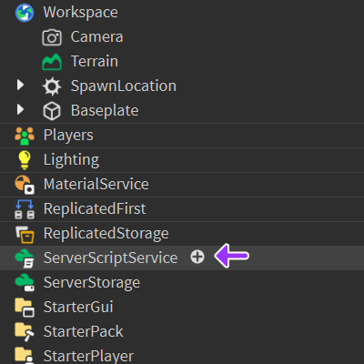
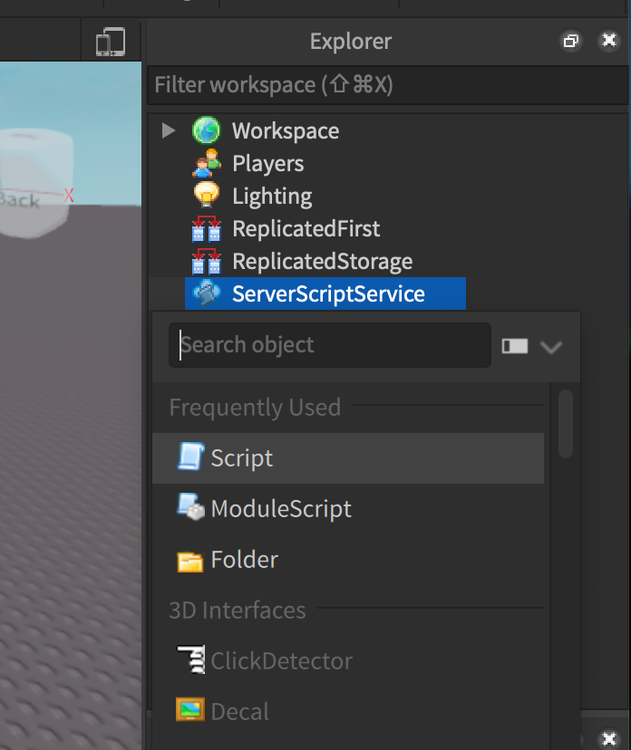
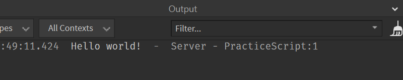
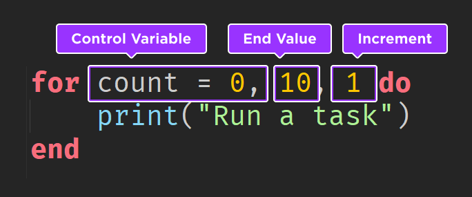
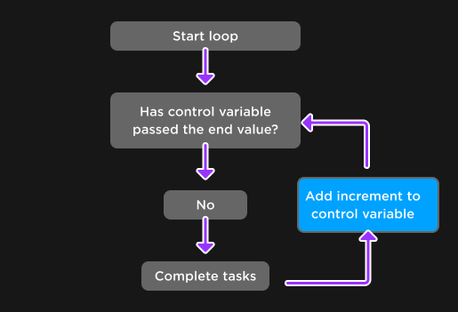
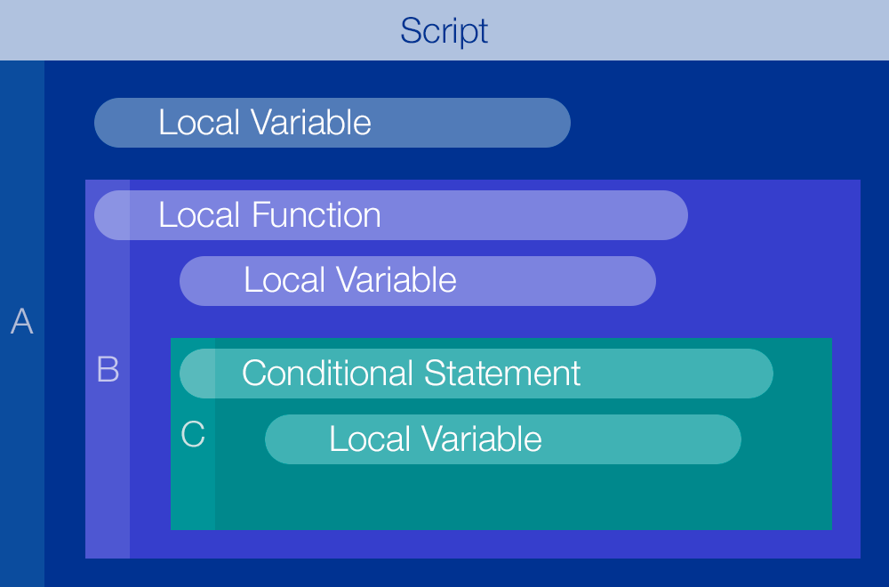

# Урок 2. Основы Luau

[К оглавлению](../README.md) · [Урок 1: Roblox Studio](../00_start/01_studio_basics.md) · [Домашняя работа](#homework) · [Источники картинок](../assets/luau-lesson-02/SOURCES.md)

**Что изучаем:** переменные, типы данных, операторы, условия, циклы, функции и области видимости.

**Перед началом:** ты умеешь открыть проект, найти Explorer, запустить Test и нажать Stop. Если эти действия пока непривычны, повтори первый урок.

Этот урок объединяет несколько основ программирования. Раздели его на **три занятия по 45–60 минут**: часть A — данные и операторы; часть B — условия и циклы; часть C — функции, области видимости и общая практика. Домашнюю работу удобно выполнить за два подхода по 30–45 минут. Это ориентир, а не ограничение по времени.

## Что научимся делать

1. Запускать Script и читать сообщения и ошибки в Output.
2. Хранить данные в локальных переменных, различать числа, строки, логические значения и nil.
3. Записывать вычисления и выбирать действия с помощью условий.
4. Повторять действия циклами и объяснять изменения переменных по шагам.
5. Создавать функции с параметрами и результатом и определять, где видны переменные.

В конце ты напишешь текстовый отчёт об игровой экспедиции. Пока результат появляется в Output: интерфейс на экране игрока и взаимодействие с объектами разберём отдельно.

## 0. Подготовь Script и Output

Luau — язык, на котором записывают команды для Roblox. Скрипт выполняет команды по порядку, но условия, циклы и вызовы функций могут менять этот порядок. Расширение файлов с примерами в этом уроке — `.luau`.

### Создай один учебный скрипт

1. Открой проект Baseplate или сохранённую сцену первого урока. Нажми Stop, если Test ещё работает.
2. В Explorer найди **ServerScriptService** и нажми **+** рядом с его именем.



*Рисунок 1. ServerScriptService находится в Explorer отдельно от Workspace. Источник: Roblox/creator-docs, CC BY 4.0.*

3. В меню добавления выбери **Script** и назови его `Lesson02`. Для изменения имени можно использовать Properties → Name. Двойной щелчок по Script открывает редактор кода.



*Рисунок 2. Выбирай Script. ModuleScript — другой тип скрипта, который понадобится позже. Скриншот из luau-lang/site, MIT; внешний вид меню может отличаться в твоей версии Studio.*

4. Открой **Output** через меню **Window** или вкладку **Script**. В старых версиях Studio окно можно включить через **View**.
5. Замени содержимое Lesson02 кодом ниже, запусти Test и посмотри в Output.

<!-- example: hello -->
```luau
print("Привет, исследователь!")
```

Ожидаемое сообщение:

```text
Привет, исследователь!
```



*Рисунок 3. На исходном скриншоте Roblox выведено Hello world! В твоём запуске будет сообщение из твоего скрипта. Время, пометка Server и ссылка на строку — служебные поля Studio, их не нужно печатать самостоятельно.*

`print` — готовая функция для вывода в Output. Круглые скобки содержат то, что нужно вывести. Кавычки отмечают текст. Сами кавычки в сообщение не попадают.

**Как выполнять примеры дальше:** нажми Stop → замени весь код Lesson02 одним примером → запусти Test → сравни сообщение с образцом → снова нажми Stop. Перед запуском очищай Output кнопкой очистки. Используй один учебный Script, чтобы несколько скриптов не печатали сообщения одновременно. Если одинаковые строки сворачиваются в одну запись со счётчиком, ориентируйся также на этот счётчик.

**Комментарии** начинаются с двух дефисов `--`. Всё после них до конца строки — пояснение для человека, а не команда. Пустые строки помогают разделять части программы.

---

## Часть A. Данные и операторы

## 1. Переменная — имя для значения

В игре нужно помнить имя игрока, количество монет и запас энергии. Для этого используют переменные.

<!-- example: variables -->
```luau
local coins = 10
print(coins)

coins = coins + 5
print(coins)
```

```text
10
15
```

Разберём изменения состояния:

| Шаг | Что происходит | Значение coins после шага |
| --- | --- | ---: |
| `local coins = 10` | Объявляется локальная переменная с начальным значением. | 10 |
| `print(coins)` | Значение читается и выводится; coins не изменяется. | 10 |
| `coins = coins + 5` | Справа вычисляется 10 + 5; результат записывается в coins. | 15 |
| `print(coins)` | Выводится новое значение. | 15 |

Знак `=` означает **присваивание**, а не математическое равенство. Сначала вычисляется правая часть, затем меняется значение слева. Поэтому `coins = coins + 5` — допустимая команда.

`local` нужен при объявлении новой локальной переменной. Для изменения уже объявленной переменной повторять `local` не нужно. Области видимости разберём в части C.

### Понятные имена

- Используй имена вроде `playerName`, `coins`, `hasKey`.
- В имени можно использовать латинские буквы, цифры и `_`; начинать с цифры нельзя.
- Пробелы и ключевые слова вроде `if` для имён не подходят.
- Регистр важен: `coins` и `Coins` — разные имена.
- Строка `"coins"` — текст из пяти букв, а `coins` без кавычек — обращение к переменной.

**Предскажи → выполни → измени:** замени награду 5 на 12. Сначала назови два ожидаемых сообщения, затем запусти код. Почему первое число осталось прежним?

## 2. Основные типы данных

Тип отвечает на вопрос «какое это значение и что с ним можно делать?».

| Тип | Примеры | Для чего подходит |
| --- | --- | --- |
| `number` | `10`, `0`, `-3`, `2.5` | Монеты, энергия, расстояние. Целые и дробные значения относятся к одному числовому типу. |
| `string` | `"Аня"`, `"10"`, `""` | Имена и сообщения. Число в кавычках является строкой. |
| `boolean` | `true`, `false` | Да/нет: есть ли ключ, открыт ли проход. Кавычки не нужны. |
| `nil` | `nil` | Отсутствие значения, например предмет ещё не выбран. |

Дробная часть числа отделяется **точкой**, например `2.5`. Запятая в коде разделяет элементы, например аргументы функции.

Готовая функция `type` возвращает название типа:

<!-- example: types -->
```luau
local playerName = "Аня"
local coins = 10
local hasKey = false
local selectedItem = nil

print(type(playerName))
print(type(coins))
print(type(hasKey))
print(type(selectedItem))
print(type("10"))
```

```text
string
number
boolean
nil
string
```

Переменная, объявленная без начального значения, тоже содержит nil. Это не ноль и не пустая строка. В примерах каждому имени даём одно понятное назначение: coins хранит число, hasKey — логическое значение. Это помогает избежать ошибок и предупреждений редактора.

Позже встретятся и другие типы, например таблицы и объекты Roblox. Для этого урока достаточно четырёх типов выше; после знакомства с функциями ты также увидишь тип `function`.

**Проверь себя:** какой тип у `true`, `"true"`, `0` и `"0"`? Ответ сначала запиши сам, затем проверь через type.

## 3. Операторы: вычисления и сравнения

### Арифметика

| Запись | Действие | Результат примера |
| --- | --- | --- |
| `8 + 3` | Сложение | 11 |
| `8 - 3` | Вычитание | 5 |
| `8 * 3` | Умножение | 24 |
| `8 / 2` | Деление | 4 |
| `8 % 3` | Остаток от деления | 2 |
| `2 ^ 3` | Возведение в степень | 8 |

<!-- example: arithmetic -->
```luau
local price = 8
local quantity = 3
local payment = 30
local total = price * quantity
local change = payment - total

print(total)
print(change)
print(8 % 3)
print(2 ^ 3)
print((2 + 3) * 4)
```

```text
24
6
2
8
20
```

Умножение и деление выполняются раньше сложения и вычитания. Скобки меняют порядок: `(2 + 3) * 4` даёт 20, а `2 + 3 * 4` — 14. На ноль делить в задачах этого урока не нужно.

После понимания обычного присваивания можно использовать сокращение Luau: `coins += 5` означает `coins = coins + 5`. Аналогично работают `-=`, `*=` и `/=`. В начале пиши развёрнутую форму, если так легче объяснить вычисление.

### Объединение строк

Две точки `..` соединяют строки. Это называется **конкатенацией**. Число можно явно превратить в текст готовой функцией `tostring`.

<!-- example: strings -->
```luau
local playerName = "Аня"
local coins = 15

print("Игрок: " .. playerName)
print("Монеты: " .. tostring(coins))
```

```text
Игрок: Аня
Монеты: 15
```

Пробел после двоеточия находится внутри кавычек. Оператор `+` складывает числа; для соединения текстовых сообщений используй `..`.

### Сравнения

Результат сравнения — boolean: true или false.

| Оператор | Значение | Пример |
| --- | --- | --- |
| `==` | Равно | `coins == 10` |
| `~=` | Не равно | `coins ~= 0` |
| `>` | Больше | `coins > 10` |
| `<` | Меньше | `coins < 10` |
| `>=` | Больше или равно | `coins >= 10` |
| `<=` | Меньше или равно | `coins <= 10` |

<!-- example: comparisons -->
```luau
local coins = 10

print(coins == 10)
print(coins > 10)
print(coins >= 10)
print(coins ~= 10)
```

```text
true
false
true
false
```

**Частая ошибка:** `=` меняет значение, а `==` сравнивает. Для проверки «не равно» в Luau пишут `~=`, а не `!=`.

### Логические операторы

| Оператор | Если использовать логические значения |
| --- | --- |
| `and` | Оба условия должны быть истинны. |
| `or` | Достаточно хотя бы одного истинного условия. |
| `not` | Меняет true на false и false на true. |

<!-- example: logic -->
```luau
local level = 5
local hasKey = true
local isBanned = false

print(level >= 5 and hasKey)
print(level >= 10 or hasKey)
print(not isBanned)
```

```text
true
true
true
```

В составных проверках используй скобки: `(level >= 5 and hasKey) or isVip`. Сначала вычисляется not, затем and, затем or. Скобки делают твой замысел заметнее.

У and и or есть дополнительные применения: они могут возвращать сами значения операндов. В этом уроке используем их с boolean и результатами сравнений.

**Контрольная точка A:** самостоятельно запиши переменные для имени, числа монет и наличия ключа. Выведи имя и сообщение с количеством монет; сравни число монет с ценой 20. Объясни отличие значения 20 от строки "20".

---

## Часть B. Условия и циклы

## 4. Условия: выбери одно действие

Пусть для покупки нужно не меньше 10 монет.

<!-- example: branch -->
```luau
local coins = 10
local price = 10

if coins >= price then
    print("Покупка доступна")
else
    print("Монет недостаточно")
end
```

```text
Покупка доступна
```

`if` начинает проверку. После условия пишется `then`. Если условие истинно, выполняется первая ветка. Иначе выполняется ветка `else`. Слово `end` закрывает всю конструкцию. Отступы помогают видеть, какие строки относятся к ветке; сами границы блока определяются ключевыми словами.

**Измени одну деталь:** проверь coins = 9, 10 и 11. Почему при ровно 10 покупка доступна? Что изменится при замене `>=` на `>`?

### Несколько вариантов: elseif

<!-- example: elseif -->
```luau
local score = 75

if score >= 90 then
    print("Золотая награда")
elseif score >= 60 then
    print("Серебряная награда")
else
    print("Продолжай тренировку")
end
```

```text
Серебряная награда
```

Проверки идут сверху вниз. Выполняется **только первая подходящая ветка**. При score = 95 обе проверки по отдельности истинны, но выведется только золотая награда. Поэтому более высокий порог поставлен первым. Несколько отдельных if — другая программа: у неё могут выполниться несколько веток.

### Что считается ложным

В условиях Luau ложными считаются **только false и nil**. Ноль и пустая строка считаются истинными.

<!-- example: truthiness -->
```luau
local coins = 0

if coins then
    print("Число 0 считается истинным")
end

if coins > 0 then
    print("Есть монеты")
else
    print("Монет нет")
end
```

```text
Число 0 считается истинным
Монет нет
```

Для проверки количества используй сравнение, например coins > 0, а не просто if coins.

## 5. Цикл for: повтори известное количество раз

Чтобы вывести три номера, не обязательно писать три команды вручную.

<!-- example: for_count -->
```luau
for count = 1, 3 do
    print(count)
end
```

```text
1
2
3
```

Тело между do и end выполняется с разными значениями count. Один проход называют **итерацией**. В числовом for задаются начало, граница и необязательный шаг. Шаг по умолчанию равен 1.



*Рисунок 4. На схеме Roblox: Control Variable — счётчик, End Value — граница, Increment — шаг. В исходном примере значения идут от 0 до 10 включительно: это 11 повторений, а не 10.*



*Рисунок 5. Для положительного шага: не вышел ли счётчик за верхнюю границу? Если не вышел, выполняем тело, прибавляем шаг и возвращаемся к проверке. Для отрицательного шага сравнение направлено в другую сторону.*

### Проследи выполнение по шагам

<!-- example: accumulator -->
```luau
local total = 0

for round = 1, 3 do
    total = total + 2
    print(total)
end

print("Итог: " .. tostring(total))
```

```text
2
4
6
Итог: 6
```

| Итерация | round | total до сложения | total после сложения |
| --- | ---: | ---: | ---: |
| Первая | 1 | 0 | 2 |
| Вторая | 2 | 2 | 4 |
| Третья | 3 | 4 | 6 |

total — **накопитель**: новое значение зависит от результата предыдущего прохода. Его объявляют до цикла. Если каждый раз создавать внутри цикла новый local total = 0, накопления не получится.

### Шаг и обратный отсчёт

<!-- example: for_step -->
```luau
for number = 2, 6, 2 do
    print(number)
end

for count = 3, 1, -1 do
    print("Старт через " .. tostring(count))
end
```

```text
2
4
6
Старт через 3
Старт через 2
Старт через 1
```

В первом цикле шаг 2, во втором — минус 1. **Шаг не должен быть нулём.** Граница включается, если последовательность её достигает. Например, при начале 1, границе 6 и шаге 2 значения будут 1, 3, 5.

Если направление шага не ведёт к допустимому диапазону, тело может не выполниться ни разу: `for count = 3, 1 do` с обычным шагом 1 ничего не выведет. В задачах с числом повторов 0 удобно писать `for round = 1, rounds do`: при rounds = 0 тело не выполняется.

## 6. Цикл while: повторяй, пока условие истинно

Пусть аккумулятор заряжается порциями по 2 единицы, пока заряд меньше 6.

<!-- example: while_charge -->
```luau
local energy = 0

while energy < 6 do
    energy = energy + 2
    print(energy)
end

print("Зарядка завершена")
```

```text
2
4
6
Зарядка завершена
```

| Проверка перед телом | Действие |
| --- | --- |
| 0 < 6 → true | Заряд становится 2. |
| 2 < 6 → true | Заряд становится 4. |
| 4 < 6 → true | Заряд становится 6. |
| 6 < 6 → false | Цикл завершается, тело больше не выполняется. |

while проверяет условие **до** каждой итерации. Если начальный заряд уже равен 6, тело не выполнится ни разу.

**Почему цикл должен закончиться:** в теле меняется energy, и рано или поздно energy < 6 становится ложным. Если убрать изменение, условие останется истинным и программа зациклится. Не запускай такой вариант. Учебные примеры здесь короткие и конечные; постоянные игровые процессы будем строить позже с учётом событий и ожидания.

**Самостоятельное изменение:** начни с energy = 5. Предскажи последний заряд. Получится 7: цикл проверяет условие до прибавления и сам не ограничивает результат числом 6. Если задача требует верхний предел, его нужно отдельно описать и реализовать условием.

### Ещё один вид: repeat…until

repeat сначала выполняет тело, а затем проверяет условие **завершения**. Поэтому тело выполняется хотя бы один раз.

<!-- example: repeat -->
```luau
local attempt = 0

repeat
    attempt = attempt + 1
    print(attempt)
until attempt >= 2
```

```text
1
2
```

Когда условие после until становится истинным, цикл заканчивается. Для for и while нужен end; repeat закрывается строкой until с условием.

| Цикл | Когда удобно выбрать |
| --- | --- |
| Числовой `for` | Известны число повторений или числовая последовательность. |
| `while` | Нужно проверять условие перед каждым действием. |
| `repeat…until` | Нужно сначала выполнить действие, затем проверить, пора ли закончить. |

**Контрольная точка B:** без готового образца выведи числа от 5 до 1. Затем посчитай сумму наград за четыре раунда по 3 монеты. Объясни, где объявить накопитель и почему.

---

## Часть C. Функции и области видимости

## 7. Функции: назови действие и вызови его

Функция — блок команд, который можно выполнить по имени. Она помогает разделить программу на понятные действия и не копировать один и тот же код.

<!-- example: greeting -->
```luau
local function greet(playerName)
    print("Привет, " .. playerName .. "!")
end

greet("Аня")
greet("Борис")
```

```text
Привет, Аня!
Привет, Борис!
```

- `local function` объявляет локальную функцию.
- `greet` — имя функции.
- `playerName` — **параметр**, имя для полученного значения внутри вызова.
- `"Аня"` и `"Борис"` — **аргументы**, конкретные значения при вызове.
- `end` завершает определение функции.
- `greet("Аня")` выполняет тело функции. Одно определение без вызова ничего не печатает.

При каждом вызове параметр получает переданное значение. Для двух параметров используй запятую: functionName(firstValue, secondValue).

### return: верни результат

print показывает сообщение. **return передаёт результат вызывающему коду** и завершает текущий вызов функции. Это разные действия.

<!-- example: return -->
```luau
local function calculateCost(price, quantity)
    local cost = price * quantity
    return cost
end

local total = calculateCost(8, 3)
print(total)
print(total + 5)
print(type(calculateCost))
```

```text
24
29
function
```

Здесь price получает 8, quantity — 3. Функция вычисляет 24 и возвращает его. Это число записывается в total; затем его можно использовать в другом вычислении. Если функция только печатает число и не возвращает значение, присваивание её результата даст nil.

Параметры нужно передавать в согласованном порядке. Если пропустить обязательный числовой аргумент, на его месте окажется nil и арифметика может вызвать ошибку. В условиях наших задач типы и диапазоны аргументов заданы заранее: проверку произвольного неверного ввода пока не добавляем.

**Измени и объясни:** вызови calculateCost с ценой 5 и количеством 4. Выведи результат. Почему без print вызов, который только возвращает число, не показывает его в Output?

## 8. Области видимости: где доступно имя

**Область видимости** — часть кода, где можно обратиться к переменной или функции по её имени. Блоками бывают тело функции, ветка условия и тело цикла.

Локальная переменная видна после своего объявления в текущем блоке и во вложенных блоках. Имя, объявленное внутри блока, снаружи недоступно.



*Рисунок 6. Схема Roblox: A — внешний код, B — функция внутри него, C — условие внутри функции. Внутренний блок видит подходящие объявления внешнего блока; внешний блок не видит локальные объявления внутреннего. Также важно, объявлено ли имя к моменту использования.*

### Изменение внешней переменной

<!-- example: scope_update -->
```luau
local coins = 10

if true then
    coins = coins + 5
end

print(coins)
```

```text
15
```

Внутри if не объявлялась новая coins. Поэтому присваивание изменило ту переменную, которая объявлена снаружи.

### Новая переменная с тем же именем

<!-- example: scope_shadow -->
```luau
local coins = 10

if true then
    local coins = 99
    print(coins)
end

print(coins)
```

```text
99
10
```

Внутреннее local coins создаёт **другую переменную**, которая временно скрывает внешнюю. Это называют затенением. После end снова доступна внешняя coins со значением 10. Для начала лучше выбирать разные имена, если переменные выполняют разные роли.

### Локальные значения внутри функции

<!-- example: scope_function -->
```luau
local function addReward(balance, reward)
    local newBalance = balance + reward
    return newBalance
end

local coins = 10
coins = addReward(coins, 5)
print(coins)
```

```text
15
```

balance, reward и newBalance нужны внутри функции. Снаружи результат получен через return. Сам вызов addReward(coins, 5) не меняет внешнюю coins: чтобы сохранить возвращённое число, мы явно присвоили его переменной.

Не пытайся использовать newBalance снаружи функции: это другое место кода, где такого локального имени нет. При анализе Studio отметит неизвестное имя; при обращении к отсутствующему глобальному значению во время выполнения можно получить nil. Это не способ передавать результаты между блоками.

Если создать переменную присваиванием без local и без подходящего локального объявления, получится глобальное имя окружения скрипта. В учебном коде новые имена объявляй через local. Глобальная переменная одного Roblox Script не становится автоматически общей переменной всех скриптов; обмен данными между скриптами — отдельная тема.

Счётчик числового for тоже локален для тела цикла. Значение, которое нужно после цикла, храни в отдельной переменной до цикла, как total в примере накопления.

**Контрольная точка C:** объясни разницу между `coins = 99` и `local coins = 99` внутри if. Затем напиши функцию с двумя числовыми параметрами, возвращающую их сумму, и используй результат в print.

## 9. Практика на уроке. Отчёт об экспедиции

**Задача:** у игрока есть начальные монеты. За каждый раунд начисляется награда, а после достижения цели появляется сообщение об успехе. Для VIP награда за раунд удваивается.

Сначала составим план:

1. Запишем исходные настройки в переменные.
2. Вынесем расчёт награды в функцию с параметрами.
3. Повторим начисление известное число раундов.
4. Выведем результат каждого раунда и итоговое сообщение.

<!-- example: expedition -->
```luau
local playerName = "Аня"
local startCoins = 5
local rounds = 3
local baseReward = 4
local isVip = false
local target = 15

local function calculateReward(base, vip)
    if vip then
        return base * 2
    end
    return base
end

local coins = startCoins
print("Игрок: " .. playerName)

for round = 1, rounds do
    local reward = calculateReward(baseReward, isVip)
    coins = coins + reward
    print("Раунд " .. tostring(round) .. ": " .. tostring(coins))
end

print("Итог: " .. tostring(coins))

if coins >= target then
    print("Цель достигнута")
else
    print("Нужно продолжить")
end
```

```text
Игрок: Аня
Раунд 1: 9
Раунд 2: 13
Раунд 3: 17
Итог: 17
Цель достигнута
```

Внутренний return из первой ветки завершает вызов calculateReward: при vip = true строка return base уже не выполняется. reward создаётся заново на каждой итерации и не нужен после неё, а coins объявлен снаружи и сохраняет накопленный результат.

### Измени, проверь и объясни

В каждом опыте сначала верни исходные настройки, затем меняй только указанную настройку.

| Изменение | Ожидаемый итог |
| --- | --- |
| `isVip = true` | Монеты по раундам: 13, 21, 29. Итог 29, цель достигнута. |
| `rounds = 0` | Строк раундов нет. Итог 5, нужно продолжить. |
| `baseReward = 0` | Монеты по раундам: 5, 5, 5. Итог 5, нужно продолжить. |
| `target = 17` | Итог 17, цель достигнута: равенство учитывается. |

Это учебная модель начисления, а не готовая система сохранения монет Roblox. Числа здесь существуют в памяти запуска скрипта и при новом Test задаются заново.

Полный пример сохранён в [examples/02_expedition.luau](examples/02_expedition.luau). Файл можно открыть как текст и скопировать его содержимое в Lesson02; создавать файловую структуру внутри Explorer для этого не требуется.

## 10. Как читать ошибку

1. Открой Output и найди первое сообщение об ошибке своего Script. Сообщения других систем могут не относиться к примеру.
2. Нажми ссылку с именем скрипта и номером строки, чтобы перейти к месту ошибки.
3. Нажми Stop и проверь также предыдущие строки: причина бывает раньше места, где редактор её обнаружил.
4. Исправь одну причину, очисти Output и запусти снова.

| Симптом | Возможная причина |
| --- | --- |
| Редактор просит закрыть блок | Пропущен end, then или do. Проверь пары ключевых слов. |
| В вычислении используется nil | Опечатка в имени, пропущенный аргумент, отсутствующий return или переменная вне своей области. |
| Условие не срабатывает при точном пороге | Перепутаны `>` и `>=`. |
| Сумма каждый раз начинается заново | Накопитель объявлен или обнулён внутри цикла. |
| Цикл не выполняется | Начальное условие ложно либо начало и шаг for не подходят к границе. |
| Скрипт слишком долго работает | Условие while не меняется или меняется не в нужную сторону. Останови запуск. |
| Функция определена, но сообщений нет | Её не вызвали либо она возвращает результат без print. |
| Монеты не изменились после вызова | Возвращённое число не присвоили внешней переменной. |

---

<a id="homework"></a>

## Домашняя работа

Выполни **пять обязательных задач**. Здесь нет ввода с клавиатуры: входные данные записываются в переменные в начале скрипта или передаются функции аргументами. Каждый пример из таблицы запускай отдельно после Stop. Сравнивай текст сообщений без времени и служебных полей Output. Гарантируется, что исходные данные удовлетворяют указанным ограничениям.

Подготовь пять файлов `.luau` или пять отдельных текстов скриптов с именами из заданий. В Studio запускай их по одному через Lesson02. Если создаёшь несколько Script, остальные на время проверки должны быть отключены. Условия и подсказки ниже находятся в этом же уроке. Используй примеры как опору, но составь решения по требованиям сам.

### Задача 1. Покупка припасов

**Сюжет:** исследователь покупает одинаковые наборы припасов. Нужно узнать стоимость покупки и остаток монет.

**Задача:** создай переменные playerName, coins, price и quantity. Вычисли стоимость и остаток после покупки. Данных достаточно для оплаты; ветвление в этой задаче не требуется.

| Входные данные | Ограничения |
| --- | --- |
| `playerName` — непустая строка | Любое короткое имя. |
| `coins` — начальные монеты | Целое число от 0 до 1000. |
| `price` — цена одного набора | Целое число от 1 до 100. |
| `quantity` — число наборов | Целое число от 0 до 10; price × quantity ≤ coins. |

**Выходные данные:** три строки: `Игрок: <имя>`, `Стоимость: <число>`, `Осталось: <число>`. Угловые скобки обозначают место значения и в вывод не входят.

| Входные значения | Ожидаемые сообщения по строкам |
| --- | --- |
| playerName = "Аня", coins = 30, price = 8, quantity = 3 | `Игрок: Аня`<br>`Стоимость: 24`<br>`Осталось: 6` |
| playerName = "Лев", coins = 20, price = 10, quantity = 2 | `Игрок: Лев`<br>`Стоимость: 20`<br>`Осталось: 0` |
| playerName = "Мира", coins = 0, price = 5, quantity = 0 | `Игрок: Мира`<br>`Стоимость: 0`<br>`Осталось: 0` |

Во втором случае потрачены все монеты. В третьем ничего не куплено, поэтому и стоимость равна нулю.

<details><summary>Подсказка 1</summary>

Сначала отдельно посчитай полную стоимость, затем используй её для расчёта остатка.

</details>
<details><summary>Подсказка 2</summary>

Для подписи перед числом используй строку, `..` и `tostring`. Каждое из трёх сообщений выводи отдельным print.

</details>

**Что сдать:** `task_01_supplies.luau` и вывод для всех трёх наборов.

### Задача 2. Вход в портал

**Сюжет:** портал доступен игроку от 10-го уровня с билетом или владельцу VIP. Заблокированный игрок не допускается ни при каких условиях.

**Задача:** выведи ровно одну строку: `Вход разрешён` или `Вход запрещён`.

| Входные данные | Ограничения |
| --- | --- |
| `level` | Целое число от 0 до 100. |
| `hasTicket`, `isVip`, `isBanned` | Логические значения true или false, без кавычек. |

| Входные значения | Ожидаемое сообщение |
| --- | --- |
| level = 10, hasTicket = true, isVip = false, isBanned = false | `Вход разрешён` |
| level = 9, hasTicket = true, isVip = false, isBanned = false | `Вход запрещён` |
| level = 0, hasTicket = false, isVip = true, isBanned = false | `Вход разрешён` |
| level = 100, hasTicket = true, isVip = true, isBanned = true | `Вход запрещён` |
| level = 10, hasTicket = false, isVip = false, isBanned = false | `Вход запрещён` |

Ровно 10 — допустимый уровень. VIP заменяет требование уровня и билета, но не отменяет блокировку. Добавь ещё свой пример и объясни ожидаемый результат.

<details><summary>Подсказка 1</summary>

Сначала опиши словами два допустимых способа входа. Отдельно учти запрет для заблокированного игрока.

</details>
<details><summary>Подсказка 2</summary>

Используй скобки для группировки условий. Можно написать одно составное условие или несколько вложенных if: принимается любой правильный вариант.

</details>

**Что сдать:** `task_02_portal.luau`, результаты проверок и свой дополнительный пример.

### Задача 3. Кристаллы за раунды

**Сюжет:** за каждый раунд выдаётся постоянное число кристаллов. Нужно напечатать запас после каждого раунда и общий итог.

**Задача:** используй числовой for и накопитель. Не заменяй весь цикл одной формулой: здесь проверяется последовательное изменение состояния.

| Входные данные | Ограничения |
| --- | --- |
| `startCrystals` | Целое число от 0 до 100. |
| `reward` | Целое число от 0 до 20. |
| `rounds` | Целое число от 0 до 10. |

**Выходные данные:** для каждого раунда строка `Раунд <номер>: <запас>`, затем `Итог: <запас>`. Нумерация начинается с 1. При rounds = 0 строк раундов нет; итог равен начальному запасу.

| Входные значения | Ожидаемые сообщения по строкам |
| --- | --- |
| startCrystals = 2, reward = 3, rounds = 3 | `Раунд 1: 5`<br>`Раунд 2: 8`<br>`Раунд 3: 11`<br>`Итог: 11` |
| startCrystals = 7, reward = 5, rounds = 0 | `Итог: 7` |
| startCrystals = 0, reward = 0, rounds = 2 | `Раунд 1: 0`<br>`Раунд 2: 0`<br>`Итог: 0` |

В третьем случае цикл всё равно выполняется два раза, хотя запас не меняется.

<details><summary>Подсказка 1</summary>

Раздели «номер раунда» и «запас кристаллов»: это разные переменные. Запас должен сохраняться между проходами.

</details>
<details><summary>Подсказка 2</summary>

Объяви накопитель перед for. Итоговый print помести после end, чтобы он выполнялся один раз.

</details>

**Что сдать:** `task_03_crystals.luau`, вывод и таблицу изменения запаса для первого примера.

### Задача 4. Сколько зарядок понадобится?

**Сюжет:** станция за одно действие добавляет фиксированную порцию энергии. Нужно выяснить, сколько действий потребуется, чтобы заряд стал не меньше 100.

**Задача:** напиши локальную функцию `countCharges(startEnergy, step)`, которая с помощью while **возвращает число действий**. Внутри функции сообщения не печатай. Результат выведи снаружи через print. Если начальный заряд уже 100, нужно 0 действий. Последняя порция может увеличить заряд выше 100: для этой задачи это допустимо.

| Аргумент | Ограничения |
| --- | --- |
| `startEnergy` | Целое число от 0 до 100. |
| `step` | Целое число от 1 до 50. Нулевого шага не бывает. |

| Вызов | Возвращаемое число и сообщение print |
| --- | --- |
| countCharges(70, 10) | `3` |
| countCharges(95, 10) | `1` |
| countCharges(100, 5) | `0` |
| countCharges(0, 20) | `5` |

Для 95 достаточно одной порции: заряд становится 105, то есть уже не меньше 100. В функции нужны отдельные локальные значения для текущей энергии и количества действий. Аргументы гарантированно корректны; обработку строк, nil и отрицательного шага не добавляй.

<details><summary>Подсказка 1</summary>

Запиши вручную цепочку зарядов для 70 и шага 10. Посчитай переходы между значениями, а не число записанных зарядов.

</details>
<details><summary>Подсказка 2</summary>

В теле while меняются две величины: заряд увеличивается на step, а число действий — на 1. Когда цикл закончен, верни счётчик через return.

</details>

**Что сдать:** `task_04_charges.luau` с функцией и четырьмя вызовами, а также объяснение, почему цикл завершится.

### Задача 5. Найди ошибку области видимости

**Сюжет:** путешествие должно потратить 6 единиц энергии, но после вызова функции внешний запас остаётся прежним.

<!-- exercise: scope_bug -->
```luau
local energy = 20

local function spendEnergy(reserve, cost)
    local energy = reserve - cost
    print(energy)
end

spendEnergy(energy, 6)
print(energy)
```

Код запускается без ошибки выполнения, но печатает 14, затем 20. Объясни, почему это две разные energy и почему внутренний print не передаёт результат наружу.

**Исправь контракт функции:** spendEnergy(reserve, cost) должна возвращать оставшуюся энергию без вывода внутри. Снаружи сохрани результат в energy и выведи только итоговое число. Не используй глобальные переменные и не меняй внешнюю energy прямо из тела функции.

| Входные данные | Ограничения |
| --- | --- |
| reserve | Целое число от 0 до 100. |
| cost | Целое число от 0 до reserve. Энергии достаточно для путешествия. |

| Начальный запас и расход | Единственное итоговое сообщение |
| --- | --- |
| energy = 20, cost = 6 | `14` |
| energy = 0, cost = 0 | `0` |
| energy = 9, cost = 9 | `0` |

<details><summary>Подсказка 1</summary>

Отметь границы функции и подпиши, в какой области объявлена каждая energy. Затем отдели вычисление результата от его отображения.

</details>
<details><summary>Подсказка 2</summary>

Функция передаёт число через return. Вызывающий код должен не просто вызвать функцию, а присвоить её результат нужной переменной.

</details>

**Что сдать:** `task_05_scope.luau`, результаты трёх проверок и объяснение ошибки в 2–3 предложениях.

### Повтори действия из первого урока

После выполнения задач сохрани сцену с Lesson02 в файл `lesson_02_luau_basics.rbxl`. Закрой и снова открой её. Убедись, что Script остался в ServerScriptService, открой Output и запусти последнюю исправленную задачу. Файл сцены не заменяет пять текстов решений: по ним удобнее проверять каждую задачу отдельно.

### Дополнительная задача: остановка по достижению цели

Доработай самостоятельно задачу 3: напиши функцию `roundsToTarget(startCrystals, reward, target)`, возвращающую число раундов до достижения цели. Используй while. Ограничения: startCrystals и target — целые от 0 до 100, reward — целое от 1 до 20. Если начальный запас уже не меньше цели, результат 0. Превышение цели последней наградой разрешено. Эта задача необязательна.

| Аргументы | Результат |
| --- | --- |
| roundsToTarget(2, 3, 10) | `3` |
| roundsToTarget(10, 2, 10) | `0` |
| roundsToTarget(12, 5, 10) | `0` |

В первом случае запас проходит значения 5, 8, 11, поэтому нужно три раунда. Сдай файл `extra_rounds_to_target.luau` с функцией и проверками.

<details><summary>Подсказка 1</summary>

Определи, при каком состоянии запаса нужно выполнять ещё один раунд, а при каком уже можно остановиться.

</details>
<details><summary>Подсказка 2</summary>

Храни отдельно запас и число выполненных раундов. Положительный reward гарантирует движение к цели. Сначала проверь случай, когда цель достигнута до первого раунда.

</details>

### Критерии готовности домашней работы

- [ ] Все пять задач выполнены отдельными текстами кода.
- [ ] Вывод совпадает с примерами, включая нулевые значения и точное равенство порогу.
- [ ] В задаче 3 используется for, в задаче 4 — while и возвращаемый результат функции.
- [ ] Накопители не обнуляются внутри циклов, циклы завершаются.
- [ ] В задаче 5 результат передаётся через return; глобальных переменных нет.
- [ ] Ты объясняешь каждый параметр, return и область видимости переменной.
- [ ] Сохранённая сцена повторно открывается, код запускается из ServerScriptService.

Все домашние задачи — авторские задачи этого курса. Они закрепляют изученные приёмы в других условиях; материалы внешних репозиториев используются как справочные источники и источники иллюстраций.

## Примеры и источники

- [Полная практика: examples/02_expedition.luau](examples/02_expedition.luau).
- [Ещё примеры, ожидаемый вывод и заметки о проверке](examples/README.md).
- [Roblox: переменные](https://github.com/Roblox/creator-docs/blob/c8f5276703948ef4868c9b9fd44fae619dbe2f11/content/en-us/luau/variables.md), [операторы](https://github.com/Roblox/creator-docs/blob/c8f5276703948ef4868c9b9fd44fae619dbe2f11/content/en-us/luau/operators.md), [управление выполнением](https://github.com/Roblox/creator-docs/blob/c8f5276703948ef4868c9b9fd44fae619dbe2f11/content/en-us/luau/control-structures.md).
- [Roblox: функции](https://github.com/Roblox/creator-docs/blob/c8f5276703948ef4868c9b9fd44fae619dbe2f11/content/en-us/luau/functions.md) и [области видимости](https://github.com/Roblox/creator-docs/blob/c8f5276703948ef4868c9b9fd44fae619dbe2f11/content/en-us/luau/scope.md).
- [Luau: синтаксис языка](https://github.com/luau-lang/site/blob/c0eb09dc75b30cac6af600df0a4c07b4079a4b51/src/content/docs/getting-started/syntax.md).
- [Шесть иллюстраций: точные источники и лицензии](../assets/luau-lesson-02/SOURCES.md).

Русские объяснения и учебные программы составлены для этого курса. Изображения из Roblox/creator-docs распространяются по CC BY 4.0, изображение из luau-lang/site — по MIT. Копии лицензий сохранены рядом с изображениями. Этот урок не является официальным курсом Roblox.

Далее можно повторить [краткий конспект переменных, условий и for](konpekt_lua_peremennye_usloviya_for.md) или перейти к [созданию Part, функциям и скриптам в Studio](../02_roblox_studio/lua_roblox_part_basics.md). Таблицы и более подробную организацию кода будем изучать отдельной темой.
