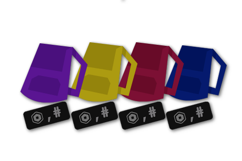
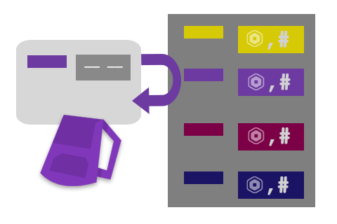
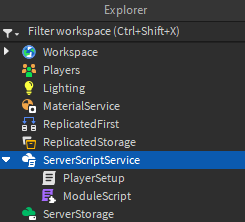

# Урок 3. Таблицы и организация кода

[К оглавлению](../README.md) · [Урок 2: основы Luau](../01_basics/02_luau_basics.md) · [Домашняя работа](#homework) · [Источники изображений](../assets/tables-lesson-03/SOURCES.md)

**Темы:** массивы, словари, перебор таблиц, ссылки и копии, ModuleScript, require и разделение программы на модули.

**Перед началом:** ты умеешь объявлять local-переменные, писать if, for и функции с параметрами и return. Ты знаешь, как создать Script в ServerScriptService и прочитать Output. Если нужно, повтори второй урок.

Материал удобно разделить на **три занятия по 45–60 минут**: массивы и словари; перебор и ссылки; модули и общая практика. Домашняя работа состоит из трёх небольших задач и одного проекта; запланируй два-три подхода по 30–45 минут.

## Что научимся делать

1. Выбирать массив для упорядоченного списка и словарь для поиска по ключу.
2. Читать, изменять, добавлять и удалять элементы таблиц.
3. Перебирать данные, получать сумму и число записей, не полагаясь на порядок словаря.
4. Объяснять разницу между общей таблицей и её копией.
5. Разделять данные, расчёт и запуск между ModuleScript и Script, соединяя их через require.

В конце ты соберёшь учебную лавку: каталог товаров, расчёт стоимости корзины и скрипт отчёта. Результат пока выводится в Output. Создание интерфейса магазина, реальные покупки и сохранение данных в этот урок не входят.

## 0. Подготовь место для работы

Открой проект Studio и останови Test. Отключи обычные учебные Script предыдущих уроков, например Lesson02, через свойство **Enabled = false**. В версиях Studio со свойством Disabled это соответствует Disabled = true. Для первых примеров используй **один Script с именем Lesson03 в ServerScriptService**. Перед каждым примером замени его код целиком, очисти Output и запусти Test. После проверки нажми Stop.

В части с модулями создадим отдельную папку с несколькими объектами. Когда перейдёшь к ней, отключи Lesson03 через Enabled = false, чтобы старые примеры не запускались вместе с практикой.

---

## Часть A. Массивы и словари

## 1. Таблица хранит несколько значений

До сих пор мы могли хранить каждую реплику отдельной переменной. Но список реплик удобнее держать вместе: можно добавлять новые строки и выбирать их по номеру.


*Рисунок 1. Иллюстрация Roblox показывает реплики как упорядоченный список. Мы будем работать с такими данными через Output; систему общения с NPC здесь создавать не нужно.*

В Luau используется тип **table**. Таблицу создают фигурными скобками `{}`. Массив и словарь — два способа организации данных внутри таблицы, а не два разных типа языка.

<!-- example: empty_table -->
```luau
local inventory = {}
print(type(inventory))
```

```text
table
```

Пустая таблица пока не содержит элементов. Позже её можно заполнить.

## 2. Массив: список с номерами

**Массивом** в этом уроке называем плотную последовательность значений с индексами 1, 2, 3 и так далее, без пропусков. Индекс — номер элемента.

<!-- example: array_read -->
```luau
local dialogue = {"Привет!", "Как дела?", "До встречи!"}

print(dialogue[1])
print(dialogue[3])
print(#dialogue)
```

```text
Привет!
До встречи!
3
```

| Индекс | Значение |
| ---: | --- |
| 1 | `"Привет!"` |
| 2 | `"Как дела?"` |
| 3 | `"До встречи!"` |

Квадратные скобки `[]` выбирают элемент, а `#` даёт длину плотного массива. **Первый индекс в Luau — 1, а не 0.** Чтение отсутствующего элемента, например dialogue[4], даёт nil.

Число внутри скобок можно получить из переменной. Заменять существующий элемент можно обычным присваиванием:

<!-- example: array_change -->
```luau
local items = {"Карта", "Факел", "Верёвка"}
local slot = 2

items[slot] = "Компас"
print(items[2])
print(#items)
```

```text
Компас
3
```

Изменился второй элемент, но количество элементов осталось прежним. Массив может хранить значения разных типов, однако для начала удобнее держать в одном списке однотипные данные: только имена или только числа.

**Предскажи → проверь:** чему равны items[1], items[0] и items[4]? Затем поменяй slot на 3 и объясни, какой элемент заменится.

## 3. Добавление и удаление элементов

Для работы с массивом есть готовые функции библиотеки table. Точка в table.insert — обращение к функции, хранящейся в библиотеке.


*Рисунок 2. На исходной иллюстрации Roblox подпись table.insert(potion) условно обозначает добавление предмета. В настоящем коде нужно передать сам массив и значение: table.insert(items, "Зелье").*

<!-- example: array_insert_remove -->
```luau
local items = {"Карта", "Факел"}

table.insert(items, "Верёвка")
table.insert(items, 2, "Компас")
local removed = table.remove(items, 3)

print("Убрали: " .. removed)
print(items[1])
print(items[2])
print(items[3])
print(#items)
```

```text
Убрали: Факел
Карта
Компас
Верёвка
3
```

| Действие | Состояние массива после действия |
| --- | --- |
| Создание | Карта, Факел |
| Добавление в конец | Карта, Факел, Верёвка |
| Вставка на позицию 2 | Карта, Компас, Факел, Верёвка |
| Удаление позиции 3 | Карта, Компас, Верёвка |

table.insert(items, value) добавляет значение в конец. table.insert(items, position, value) вставляет его на заданное место и сдвигает следующие элементы. table.remove(items, position) удаляет элемент, сдвигает следующие назад и возвращает удалённое значение.

### Почему не нужно оставлять «дырки»

Присваивание items[2] = nil удаляет запись с индексом 2, но **не сдвигает** следующий элемент. Получается таблица с пропуском. Для такого набора # больше нельзя использовать как надёжный счётчик всех элементов, а разные способы перебора могут вести себя по-разному.

В этом уроке массивы всегда плотные. Удаляй из них элементы через table.remove. Перед удалением знай допустимый индекс: от 1 до #items; в пустом массиве удалять нечего. Не добавляй и не удаляй элементы во время их перебора в учебных задачах — сначала закончи проход, затем измени список.

## 4. Перебор массива

Перебрать массив — последовательно обработать каждый элемент. Числовой for уже знаком: границу теперь можно получить из длины списка.

<!-- example: numeric_iteration -->
```luau
local items = {"Карта", "Факел", "Верёвка"}

for index = 1, #items do
    print(tostring(index) .. ": " .. items[index])
end
```

```text
1: Карта
2: Факел
3: Верёвка
```

В Luau есть и **обобщённый перебор**: таблицу можно поставить прямо после in. В этом варианте цикл получает сразу ключ и значение.

<!-- example: generalized_iteration -->
```luau
local items = {"Карта", "Факел", "Верёвка"}

for index, item in items do
    print(tostring(index) .. ": " .. item)
end
```

```text
1: Карта
2: Факел
3: Верёвка
```

Для плотного массива значения проходят по индексам 1, 2, 3. `index` и `item` — локальные переменные тела цикла. На каждом проходе они получают новую пару.

В других примерах ты встретишь `for index, item in ipairs(items) do`: ipairs тоже подходит для последовательности с индексами от 1 и останавливается на первом nil. Эта функция не устарела. В нашем коде используем прямой перебор Luau, а числовой for — когда нужен явный диапазон индексов.

### Накопление результата

<!-- example: array_sum -->
```luau
local rewards = {4, 7, 3}
local total = 0

for index, reward in rewards do
    total = total + reward
    print("После " .. tostring(index) .. ": " .. tostring(total))
end

print("Итог: " .. tostring(total))
```

```text
После 1: 4
После 2: 11
После 3: 14
Итог: 14
```

Накопитель total объявлен до цикла и сохраняет значение между итерациями. Для пустого массива {} цикл не выполнится, поэтому итог останется 0.

**Контрольная точка A:** создай массив из трёх названий предметов. Замени второй, добавь четвёртый, удали первый и выведи оставшиеся элементы с новыми номерами. Объясни, почему номера после удаления изменились.

## 5. Словарь: поиск по ключу

В словаре значение находят не по порядковому номеру, а по **ключу**. Например, количество предметов удобно искать по их внутренним именам.

<!-- example: dictionary_read -->
```luau
local stock = {
    potion = 2,
    rope = 0,
}

print(stock.potion)
print(stock["rope"])

local itemId = "potion"
print(stock[itemId])
print(stock["shield"])
```

```text
2
0
2
nil
```

| Ключ | Значение |
| --- | ---: |
| `"potion"` | 2 |
| `"rope"` | 0 |

Записи stock.potion и stock["potion"] обращаются к одному строковому ключу. Если ключ хранится в переменной, нужны скобки: stock[itemId]. Запись stock.itemId искала бы буквально ключ "itemId", а не значение переменной.

Регистр важен: ключи "rope" и "Rope" различаются. В наших словарях ключи — строки, а тип значений зависит от задачи.

### Изменение, добавление и удаление

<!-- example: dictionary_change -->
```luau
local stock = {potion = 2, rope = 0}

stock.potion = stock.potion + 1
stock.torch = 5
stock.rope = nil

print(stock.potion)
print(stock.torch)
print(stock.rope)
```

```text
3
5
nil
```

В словаре присваивание nil удаляет пару ключ–значение. Значения 0 и false при этом остаются настоящими значениями, а не признаками отсутствия записи.

<!-- example: dictionary_presence -->
```luau
local settings = {soundEnabled = false}

if settings.soundEnabled ~= nil then
    print("Настройка существует")
end

if settings.soundEnabled then
    print("Звук включён")
else
    print("Звук выключен")
end
```

```text
Настройка существует
Звук выключен
```

Проверка field ~= nil отвечает на вопрос «есть ли значение?», а if field использует его логическую истинность. Вспомни: 0 в Luau считается истинным.

## 6. Перебор словаря и порядок вывода

У словаря нет гарантированного порядка строковых ключей. Не рассчитывай, что они пройдут по алфавиту или в порядке записи в коде.

<!-- example: dictionary_iteration unordered -->
```luau
local stock = {potion = 2, rope = 3}

for itemId, amount in stock do
    print(itemId .. ": " .. tostring(amount))
end
```

Один из допустимых вариантов вывода:

```text
potion: 2
rope: 3
```

Строки могут поменяться местами — это тоже правильный результат. Запись `for key, value in pairs(stock) do` также перебирает пары без обещания порядка. ipairs для такого словаря не подходит: он ищет числовую последовательность от 1, а не строковые ключи.

### Как посчитать записи

Оператор # не считает пары словаря. Для этого нужен отдельный счётчик.

<!-- example: dictionary_count -->
```luau
local stock = {potion = 2, rope = 0, torch = 5}
local kinds = 0
local total = 0

for itemId, amount in stock do
    kinds = kinds + 1
    total = total + amount
end

print("Видов: " .. tostring(kinds))
print("Всего: " .. tostring(total))
```

```text
Видов: 3
Всего: 7
```

rope = 0 всё равно является записью. Счётчик видов увеличивается и для неё, а сумма предметов — нет. При пустом словаре оба результата будут 0.

### Как задать понятный порядок

Если строки отчёта должны идти в определённом порядке, отдельно сохрани массив ключей.

<!-- example: ordered_dictionary -->
```luau
local stock = {potion = 2, rope = 0, torch = 5}
local order = {"rope", "potion", "torch"}

for index, itemId in order do
    print(itemId .. ": " .. tostring(stock[itemId]))
end
```

```text
rope: 0
potion: 2
torch: 5
```

Здесь порядок берётся из массива order, а количество — из словаря stock. В этом примере все ключи из order существуют.

## 7. Таблицы внутри таблиц

Значением в таблице может быть другая таблица. Массив записей помогает хранить несколько свойств каждого участника или товара.

<!-- example: records -->
```luau
local players = {
    {name = "Аня", coins = 10},
    {name = "Борис", coins = 7},
}

print(players[1].name)

local total = 0
for index, player in players do
    total = total + player.coins
end

print(total)
```

```text
Аня
17
```

Разбор players[1].name: сначала выбирается первая запись из массива, затем в этой записи читается поле name. Внутри цикла player — текущая запись, поэтому player.coins даёт её монеты.

**Контрольная точка B:** объясни разницу между {"potion", "rope"} и {potion = 2, rope = 0}. Для какой таблицы подходит #? Как посчитать записи другой? Как получить nil, не вызывая функцию?

---

## Часть B. Общая таблица и её копия

## 8. Присваивание не копирует таблицу

Вспомни, как число передавалось в функцию во втором уроке. У таблицы появляется ещё одна особенность: разные переменные могут ссылаться на **один и тот же объект**.

<!-- example: table_alias -->
```luau
local backpack = {"Карта", "Факел"}
local sameBackpack = backpack

sameBackpack[1] = "Компас"

print(backpack[1])
print(backpack == sameBackpack)
```

```text
Компас
true
```

Строка local sameBackpack = backpack создала второе имя для той же таблицы. Изменение элемента видно через оба имени. Сравнение двух таблиц через == здесь проверяет, один ли это объект, а не совпадают ли все элементы.

### Создание отдельной копии

<!-- example: table_clone -->
```luau
local backpack = {"Карта", "Факел"}
local copy = table.clone(backpack)

copy[1] = "Компас"

print(backpack[1])
print(copy[1])
print(backpack == copy)
```

```text
Карта
Компас
false
```

table.clone создаёт новую таблицу с теми же ключами и значениями. Для плоского массива строк это отдельный список, который можно менять независимо.

### Копируется только один уровень

Если значением была вложенная таблица, сама она не копируется автоматически.

<!-- example: shallow_clone -->
```luau
local original = {coins = 10, items = {"Карта"}}
local copy = table.clone(original)

copy.coins = 99
copy.items[1] = "Компас"

print(original.coins)
print(original.items[1])
print(original.items == copy.items)
```

```text
10
Компас
true
```

Это **поверхностная копия**: внешние таблицы разные, вложенная items общая. Если нужно отделить именно её, после копирования выполни copy.items = table.clone(original.items). Для более глубоких структур требуется отдельное продуманное копирование; универсальную рекурсивную функцию пока не пишем.

То же правило действует при передаче таблицы функции: если функция меняет элементы переданного объекта, вызывающий код увидит эти изменения. Удобно заранее договориться, что функция только читает данные или что она их меняет. В нашей лавке функция расчёта будет только читать каталог и корзину.

---

## Часть C. ModuleScript и разделение программы

## 9. Зачем нужны модули

Представь, что у каждого рюкзака в магазине есть отдельная копия одинакового расчёта цены. При изменении правила придётся исправлять много мест.



*Рисунок 3. Иллюстрация Roblox: несколько отдельных реализаций сложнее менять согласованно.*

Вместо этого можно отделить различающиеся данные от общего действия. У каждого товара будут своё имя и цена, а расчёт останется в одном месте.



*Рисунок 4. Общая функция использует таблицу с данными. Этот принцип мы применим к учебной лавке с условными монетами.*

**ModuleScript** — объект Roblox для кода, который можно получить и использовать из другого скрипта. Часто модуль возвращает таблицу с данными или функциями. **Script** в нашем проекте запускает сценарий; **ModuleScript** предоставляет часть программы.

Сам по себе ModuleScript не запускает игровой сценарий при Test. Его код выполняется, когда другой скрипт впервые вызывает require с этим модулем.

## 10. Создай первый ModuleScript

Для чистого опыта после Stop отключи Lesson03. В **ServerScriptService** нажми + и создай **Folder** с именем `ModulePractice`. Folder — папка для организации объектов. Создай внутри неё:

- ModuleScript с именем `Greeting`;
- обычный Script с именем `Main`.


*Рисунок 5. На скриншоте из luau-lang/site показаны оба типа. В этот раз для Greeting выбираем именно ModuleScript, а для Main — Script. В твоём опыте объекты создаются внутри ModulePractice, а не прямо в ServerScriptService.*



*Рисунок 6. На исходном скриншоте Roblox Script называется PlayerSetup. В нашем опыте его имя Main. У модуля и обычного скрипта разные значки; ориентируйся прежде всего на тип объекта.*

Дерево должно получиться таким:

```text
ServerScriptService
└── ModulePractice (Folder)
    ├── Greeting (ModuleScript)
    └── Main (Script)
```

### Код Greeting

Замени шаблон ModuleScript **целиком**, включая исходный return, следующим кодом:

<!-- module: Greeting -->
```luau
local Greeting = {}

local function makeMessage(playerName)
    return "Привет, " .. playerName .. "!"
end

Greeting.makeMessage = makeMessage

print("Greeting загружен")
return Greeting
```

Функцию можно хранить в таблице так же, как число или строку. Строка Greeting.makeMessage = makeMessage помещает функцию в поле таблицы. **Экспорт** — то, что модуль отдаёт наружу. Здесь экспортируется таблица Greeting с одной функцией.

Само локальное имя makeMessage не становится видимым в Main. Доступ к функции появится через поле возвращённой таблицы. Последняя строка return Greeting возвращает **одно значение** — таблицу. Имя этой переменной выбрано для понятности; возвращаемая таблица не связывается с именем объекта автоматически.

### Код Main

<!-- module_runner: Greeting -->
```luau
local Greeting = require(script.Parent.Greeting)
local sameGreeting = require(script.Parent.Greeting)

print(Greeting.makeMessage("Аня"))
print(Greeting == sameGreeting)
```

Ожидаемый вывод при новом запуске:

```text
Greeting загружен
Привет, Аня!
true
```

Разберём путь:

| Запись | Значение в этом проекте |
| --- | --- |
| `script` | Текущий Script — Main. |
| `script.Parent` | Его родитель — папка ModulePractice. |
| `script.Parent.Greeting` | Дочерний ModuleScript с точным именем Greeting в этой папке. |
| `require(...)` | Получает результат выполнения указанного ModuleScript. |
| `Greeting.makeMessage("Аня")` | Вызывает функцию из экспортированной таблицы. |

В этом коде Roblox require получает **объект ModuleScript**, а не текст с путём к файлу на компьютере. Обычный Script вместо ModuleScript не подходит. Имена чувствительны к регистру. Greeting и Main должны быть соседями, как в дереве выше.

### Почему сообщение о загрузке появилось один раз

Roblox сохраняет результат require. При повторном подключении **того же ModuleScript в одной среде выполнения** возвращается то же значение, а код модуля не выполняется заново. Поэтому Greeting загружен печатается один раз, а сравнение таблиц даёт true.

Если возвращённая таблица изменяема, разные потребители в этой же среде увидят её общие изменения. require не делает копию настроек при каждом вызове. Это связано с темой ссылок из части B.

Это правило не означает, что память общая у сервера и всех игроков: сервер и клиент имеют разные среды и отдельные результаты загрузки. Обмен между ними изучим позже. После изменения модуля для этого урока используй Stop и новый Test; здесь мы не обновляем уже загруженные модули на лету.

## 11. Делай обязанности модулей понятными

В небольшом проекте достаточно трёх ролей:

| Часть | Отвечает за | Не должна делать в нашей практике |
| --- | --- | --- |
| Каталог | Данные о товарах. | Печатать отчёт или запускать покупки. |
| Расчёт корзины | Функцию, которая читает данные и возвращает стоимость. | Менять каталог, корзину или баланс игрока. |
| Главный Script | Подключение модулей, исходную корзину, вызов функции и вывод. | Хранить несколько копий одного расчёта. |

Не создавай цикл зависимостей: A подключает B, а B снова подключает A. Такой require может зависнуть. В нашей структуре только главный Script подключает два независимых модуля; модули не подключают друг друга.

Локальные служебные переменные и функции, которые не помещены в возвращаемую таблицу, остаются внутренними. Это позволяет менять реализацию расчёта, сохраняя понятный способ вызова для Main.

## 12. Практика. Лавка исследователя

**Цель:** вычислить стоимость корзины и сообщить, хватает ли условных монет. Данные не сохраняются между запусками. Никаких событий, GUI или денежных операций на платформе не требуется.

Сначала запишем договорённости:

- Каталог — словарь: ключ товара → запись с name и price.
- Корзина — плотный массив записей с itemId и quantity.
- Все цены и количества — целые неотрицательные числа. Данные создаём сами и считаем корректными по типам.
- Если встречается неизвестный itemId, функция возвращает nil. Пустая корзина стоит 0.
- Функция только читает переданные таблицы; стоимость повторяющихся товаров складывается.

### Подготовь три объекта

Останови Test. Отключи Main из ModulePractice, чтобы сообщение Greeting не смешивалось с новым отчётом. Создай новую папку `ShopLesson` в ServerScriptService и три объекта внутри неё:

```text
ServerScriptService
└── ShopLesson (Folder)
    ├── Catalog (ModuleScript)
    ├── CartMath (ModuleScript)
    └── Main (Script)
```

Файлы ниже — тексты для этих объектов. Расширения .luau и .server.luau относятся к файлам в репозитории; в Explorer используй короткие имена Catalog, CartMath и Main без расширений. Весь код модуля вставляй вместо его шаблона.

### Catalog: только данные

<!-- file: shop/Catalog.luau -->
```luau
local Catalog = {
    potion = {name = "Зелье", price = 12},
    rope = {name = "Верёвка", price = 5},
    torch = {name = "Факел", price = 3},
}

return Catalog
```

Например, Catalog["potion"].price даёт 12. Внутренний ключ potion нужен коду, а поле name содержит подпись для человека.

### CartMath: расчёт без вывода

<!-- file: shop/CartMath.luau -->
```luau
local CartMath = {}

local function calculateTotal(cart, catalog)
    local total = 0

    for index, line in cart do
        local item = catalog[line.itemId]
        if item == nil then
            return nil
        end
        total = total + item.price * line.quantity
    end

    return total
end

CartMath.calculateTotal = calculateTotal
return CartMath
```

cart — массив строк корзины. В каждой итерации line — одна запись. По line.itemId находится запись каталога item, затем её цена умножается на количество. При неизвестном товаре возвращается nil и весь расчёт прекращается. Это отдельно оговорённый результат, а не стоимость 0.

### Main: подключение и отчёт

<!-- file: shop/Main.server.luau -->
```luau
local Catalog = require(script.Parent.Catalog)
local CartMath = require(script.Parent.CartMath)

local cart = {
    {itemId = "potion", quantity = 2},
    {itemId = "rope", quantity = 1},
}
local coins = 30

local total = CartMath.calculateTotal(cart, Catalog)

if total == nil then
    print("Ошибка: неизвестный товар")
else
    print("Стоимость: " .. tostring(total))
    if coins >= total then
        print("Покупка доступна")
        print("Останется: " .. tostring(coins - total))
    else
        print("Не хватает: " .. tostring(total - coins))
    end
end
```

Ожидаемый вывод:

```text
Стоимость: 29
Покупка доступна
Останется: 1
```

Мы только проверили возможность покупки и рассчитали остаток. Фактического списания coins и изменения запасов этот Script не делает.

### Проверки практики

Каждый раз возвращай исходный код Main, затем меняй только указанное значение.

| Изменение | Ожидаемые сообщения |
| --- | --- |
| coins = 29 | `Стоимость: 29`<br>`Покупка доступна`<br>`Останется: 0` |
| coins = 10 | `Стоимость: 29`<br>`Не хватает: 19` |
| cart = {} | `Стоимость: 0`<br>`Покупка доступна`<br>`Останется: 30` |
| cart = {{itemId = "unknown", quantity = 1}} | Только `Ошибка: неизвестный товар` |
| cart = {{itemId = "torch", quantity = 0}} | `Стоимость: 0`<br>`Покупка доступна`<br>`Останется: 30` |

**Объясни:** почему Main проверяет total == nil, а не total == 0? Какая часть программы изменится, если цена верёвки станет 7? Нужно ли переписывать функцию расчёта?

Все три текста находятся в [examples/shop](examples/shop/). Порядок создания объектов и запуск описаны также в [памятке примеров](examples/README.md).

## 13. Найди причину ошибки

| Проблема | Что проверить |
| --- | --- |
| Первый элемент оказался nil | Массив начинается с индекса 1. |
| Количество записей словаря неверное | Не используй # для словаря; посчитай пары циклом. |
| Порядок сообщений меняется | Словарь не обещает порядок. Для упорядоченного вывода используй массив ключей. |
| Исходная таблица неожиданно изменилась | Возможно, вторая переменная или функция использует ту же таблицу. |
| Вложенные данные изменились после clone | Копия поверхностная; вложенные таблицы могут остаться общими. |
| Greeting не найден | Проверь имя, регистр и расположение относительно script.Parent. |
| require не принимает объект | Убедись, что это ModuleScript, а не обычный Script. |
| После require нельзя вызвать функцию | Проверь return таблицы и имя экспортированного поля. |
| Модуль не печатает ничего при Test | ModuleScript выполняется при require, а не сам по себе. |
| После редактирования виден старый результат | Выполни Stop и запусти новый Test. |
| require завис | Проверь, нет ли взаимного подключения модулей. |

---

<a id="homework"></a>

## Домашняя работа

Первые три задачи короткие; четвёртая — самостоятельный проект на изученные таблицы и модули. **Сначала составь план словами, затем пиши код.** Все входные данные задаются в начале Script или в модуле данных. Читать ввод с клавиатуры не нужно. Тестовые значения гарантированно соответствуют ограничениям.

### Задача 1. Очередь экспедиции

**Сюжет:** второй участник покидает очередь, а новый участник присоединяется в конец. Нужно вывести обновлённый список.

**Задача:** из плотного массива team удали второго участника, запомни его имя, добавь newMember в конец и напечатай результат. Исходный team разрешено менять. Используй table.remove, table.insert и перебор; не записывай готовую очередь вручную.

| Входные данные | Ограничения |
| --- | --- |
| team | Массив от 2 до 6 непустых строк. Имена могут повторяться. |
| newMember | Непустая строка с именем нового участника. |

**Выход:** сначала `Ушёл: <имя>`, затем по одной строке `<номер>: <имя>` для всех оставшихся участников. Номера начинаются с 1.

| Входные значения | Ожидаемые сообщения |
| --- | --- |
| team = {"Аня", "Борис", "Вика"}, newMember = "Глеб" | `Ушёл: Борис`<br>`1: Аня`<br>`2: Вика`<br>`3: Глеб` |
| team = {"Лев", "Мира"}, newMember = "Лев" | `Ушёл: Мира`<br>`1: Лев`<br>`2: Лев` |

Повтор имени во втором примере допустим: участники остаются отдельными элементами массива.

<details><summary>Подсказка 1</summary>

Номер удаляемого участника и его имя — разные вещи. Функция удаления может передать имя обратно вызывающему коду.

</details>
<details><summary>Подсказка 2</summary>

Сохрани результат table.remove в переменную. После добавления нового имени перебери уже изменённый массив, чтобы получить новые номера.

</details>

**Что сдать:** task_01_team.luau и вывод для обоих примеров.

### Задача 2. Нулевой запас или неизвестный предмет?

**Сюжет:** кладовщик проверяет количество предметов. Нулевой запас известного предмета нужно отличать от отсутствующей записи.

**Задача:** для словаря stock и строки itemId напечатай количество видов предметов, а затем либо запас выбранного предмета, либо сообщение об отсутствии ключа. Под «видом» понимается каждая существующая запись, включая количество 0. Сам словарь не меняй.

| Входные данные | Ограничения |
| --- | --- |
| stock | Словарь из 0–5 пар: непустой строковый ключ → целое количество от 0 до 20. |
| itemId | Непустая строка. Регистр ключа важен. |

**Выход:** строка `Видов: <число>`, затем `Запас: <число>` или `Нет такого предмета`. Порядок перебора словаря не должен влиять на результат.

| Входные значения | Ожидаемые сообщения |
| --- | --- |
| stock = {potion = 0, rope = 3}, itemId = "potion" | `Видов: 2`<br>`Запас: 0` |
| stock = {potion = 0, rope = 3}, itemId = "torch" | `Видов: 2`<br>`Нет такого предмета` |
| stock = {}, itemId = "rope" | `Видов: 0`<br>`Нет такого предмета` |
| stock = {rope = 2}, itemId = "Rope" | `Видов: 1`<br>`Нет такого предмета` |

<details><summary>Подсказка 1</summary>

Отдельно реши две задачи: посчитать записи и найти запись с конкретным ключом. Не заменяй отсутствие записи нулём заранее.

</details>
<details><summary>Подсказка 2</summary>

Количество пар считай циклом. Для поиска по переменной используй квадратные скобки. Сравнение с nil позволит отличить отсутствующий ключ от количества 0.

</details>

**Что сдать:** task_02_stock.luau, результаты четырёх проверок и объяснение, почему #stock не подходит.

### Задача 3. Черновик списка покупок

**Сюжет:** ученик хочет попробовать другой первый предмет в черновике, сохранив исходный список. Но меняется и оригинал.

<!-- exercise: alias_bug -->
```luau
local original = {"Хлеб", "Сыр"}
local draft = original

draft[1] = "Молоко"

print(original[1])
print(draft[1])
```

Этот код печатает Молоко два раза. Объясни причину. Затем исправь создание черновика, чтобы он стал отдельной таблицей. Содержимое original менять нельзя, второй элемент обоих списков должен сохраниться. Для этой задачи список плоский, вложенных таблиц нет.

| Входные данные | Ограничения |
| --- | --- |
| original | Плотный массив из 1–5 непустых строк. |
| replacement | Непустая строка для первого элемента черновика. |

**После исправления выведи:** первый элемент original, первый элемент draft, затем результат сравнения original == draft. Для произвольного набора используй replacement вместо фиксированного слова из неисправного примера.

| Входные значения | Ожидаемые сообщения |
| --- | --- |
| original = {"Хлеб", "Сыр"}, replacement = "Молоко" | `Хлеб`<br>`Молоко`<br>`false` |
| original = {"Карта"}, replacement = "Карта" | `Карта`<br>`Карта`<br>`false` |

Во втором примере значения первых элементов совпадают, но объекты таблиц должны быть разными.

<details><summary>Подсказка 1</summary>

Нарисуй original и draft как две стрелки. Куда они указывают после обычного присваивания? Что должно измениться до записи в draft[1]?

</details>
<details><summary>Подсказка 2</summary>

Для плоского списка строк достаточно поверхностной копии. Не создавай original заново после изменения: задача — сохранить его без побочного эффекта.

</details>

**Что сдать:** task_03_draft.luau, вывод двух примеров и объяснение, почему такой же приём не копирует автоматически все вложенные таблицы.

### Задача 4. Проект «Отчёт о тренировке»

**Сюжет:** инструктор хранит очки участников и хочет менять исходные данные отдельно от расчёта. Главный скрипт должен только соединять части программы и выводить отчёт.

**Собери структуру:**

```text
ServerScriptService
└── TrainingLesson (Folder)
    ├── TrainingData (ModuleScript)
    ├── TrainingStats (ModuleScript)
    └── Main (Script)
```

Отключи Main предыдущих опытов, чтобы сообщения не смешивались. Тексты проекта создай самостоятельно по контракту ниже.

| Часть | Требуемое содержимое |
| --- | --- |
| TrainingData | Возвращает таблицу с полями participants и target. participants — массив записей с name и points. target — порог очков. |
| TrainingStats | Возвращает таблицу с функцией summarize(participants, target). Функция возвращает таблицу с count, total и qualified. Внутри не должно быть print или require других модулей. |
| Main | Подключает оба ModuleScript через require, вызывает функцию и печатает три строки отчёта. |

**Что вычисляет summarize:** count — число участников, total — сумма их очков, qualified — число участников с points **не меньше target**. Все три поля результата должны быть числами. Порядок записей и повторяющиеся имена не меняют правила: каждая запись считается отдельным участником. Функция не изменяет participants и вложенные записи.

| Входные данные | Ограничения |
| --- | --- |
| participants | Плотный массив из 0–10 записей. У каждой есть непустая строка name и целое points от 0 до 100. |
| target | Целое число от 0 до 100. |

**Точный формат отчёта:** `Участников: <count>`, затем `Очки: <total>`, затем `Достигли цели: <qualified>`. Пустой массив даёт три нуля. Значение points = target учитывается как достижение цели.

| Данные TrainingData | Ожидаемые сообщения Main |
| --- | --- |
| participants = {{name = "Аня", points = 8}, {name = "Борис", points = 12}, {name = "Вика", points = 10}}, target = 10 | `Участников: 3`<br>`Очки: 30`<br>`Достигли цели: 2` |
| participants = {}, target = 10 | `Участников: 0`<br>`Очки: 0`<br>`Достигли цели: 0` |
| participants = {{name = "Лев", points = 0}}, target = 0 | `Участников: 1`<br>`Очки: 0`<br>`Достигли цели: 1` |
| participants = {{name = "Мира", points = 5}, {name = "Мира", points = 5}}, target = 5 | `Участников: 2`<br>`Очки: 10`<br>`Достигли цели: 2` |

### Контрольные точки проекта

1. Объясни словами, какие данные передаются функции и какая таблица возвращается.
2. Проверь summarize на одном участнике, затем на пустом массиве.
3. Соедини три объекта в Studio, соблюдая имена и типы.
4. Проверь все четыре набора из таблицы, каждый раз после Stop меняя только данные.
5. Для одного и того же набора вызови summarize два раза. Результаты должны совпасть, а исходные записи — сохраниться.

<details><summary>Подсказка 1. Раздели роли</summary>

Модуль данных не должен считать итог. Модуль расчёта не должен знать, как подписываются строки Output. В Main остаются подключение, вызов и отображение результата.

</details>
<details><summary>Подсказка 2. Найди накопители</summary>

Нужны счётчик записей, сумма очков и счётчик достижения порога. Объяви их до прохода. В конце функции собери отдельную таблицу результата, а в Main прочитай её поля.

</details>

**Что сдать:** TrainingData.luau, TrainingStats.luau и Main.server.luau; скриншот дерева TrainingLesson в Explorer; сообщения для четырёх проверок; короткое объяснение пути script.Parent и возвращаемого значения require.

### Сохрани и проверь домашнюю работу

Сохрани проект Studio как lesson_03_tables_modules.rbxl, снова открой его и запусти Main из TrainingLesson. Файл сцены сдаётся вместе с текстами решений: это позволяет проверить и код, и правильность типов объектов.

- [ ] Выполнены три короткие задачи и проект из трёх объектов.
- [ ] Во всех массивах индексы идут от 1 без пропусков.
- [ ] Количество пар словаря посчитано без #.
- [ ] Отсутствующее значение отличается от 0 и false.
- [ ] Порядок словаря не влияет на проверяемый вывод.
- [ ] Черновик списка не меняет оригинал.
- [ ] Модули возвращают нужные таблицы, функции вызываются через их поля.
- [ ] Пустые данные, повторяющиеся имена и равенство порогу обработаны по условию.
- [ ] Расчёт тренировки не изменяет исходные данные и повторяется с тем же результатом.
- [ ] Сцена повторно открывается, включён только нужный учебный Main.

Домашние задачи и проект подготовлены для этого курса. Они используют изученные приёмы в самостоятельных условиях; полного решения домашнего проекта в примерах нет.

## Примеры и первоисточники

- [Файлы практики и порядок запуска](examples/README.md).
- [Roblox: таблицы, массивы, словари и ссылки](https://github.com/Roblox/creator-docs/blob/c8f5276703948ef4868c9b9fd44fae619dbe2f11/content/en-us/luau/tables.md).
- [Roblox: введение в ModuleScript](https://github.com/Roblox/creator-docs/blob/c8f5276703948ef4868c9b9fd44fae619dbe2f11/content/en-us/tutorials/fundamentals/coding-6/intro-to-module-scripts.md).
- [Roblox: точные правила ModuleScript и кеширования require](https://github.com/Roblox/creator-docs/blob/c8f5276703948ef4868c9b9fd44fae619dbe2f11/content/en-us/reference/engine/classes/ModuleScript.yaml).
- [Luau: обобщённый перебор](https://github.com/luau-lang/site/blob/c0eb09dc75b30cac6af600df0a4c07b4079a4b51/src/content/docs/getting-started/syntax.md) и [библиотека table, включая table.clone](https://github.com/luau-lang/site/blob/c0eb09dc75b30cac6af600df0a4c07b4079a4b51/src/content/docs/reference/library.md).
- [Все шесть изображений, точные ревизии и лицензии](../assets/tables-lesson-03/SOURCES.md).

Русские объяснения, последовательность примеров и программы практики составлены для этого курса. Пять иллюстраций взяты из Roblox/creator-docs по CC BY 4.0, одна — из luau-lang/site по MIT. Изображения сохранены без изменений, копии лицензий находятся рядом с ними. Это самостоятельный учебный материал, не официальный курс Roblox.

После урока можно перейти к [практике с Part и скриптами](../02_roblox_studio/lua_roblox_part_basics.md). Объекты и события Roblox будем разбирать следующей отдельной темой.
