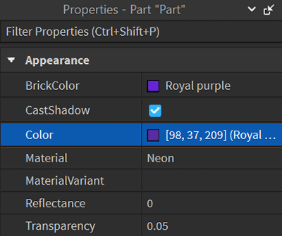
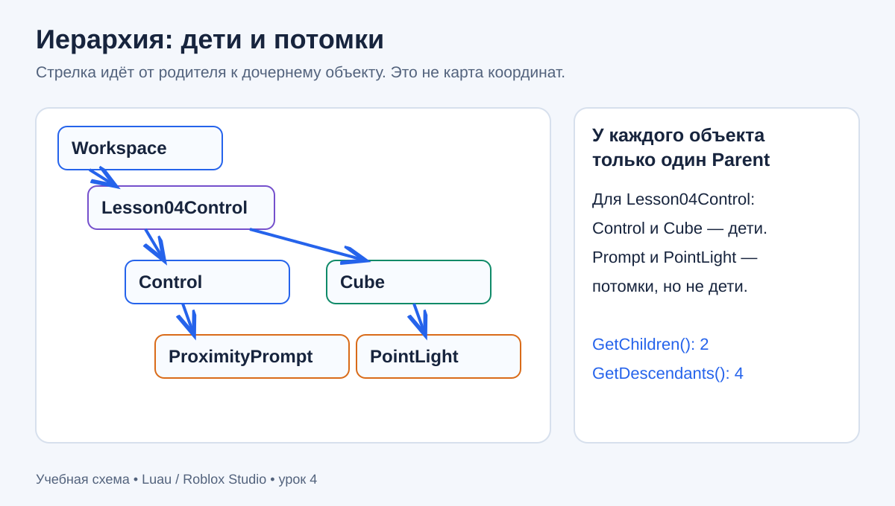
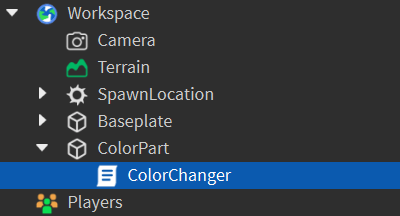
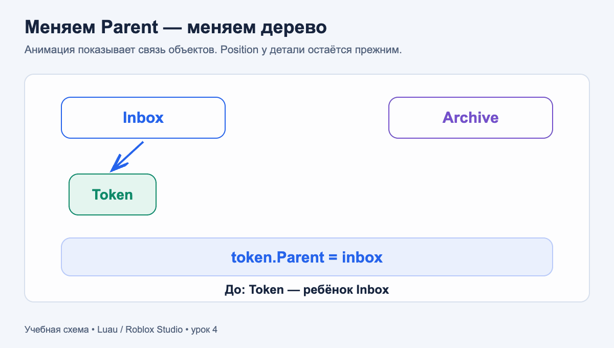
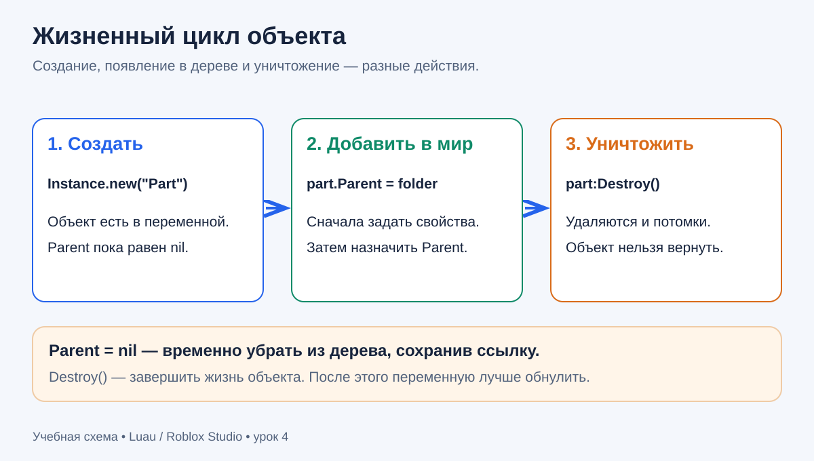
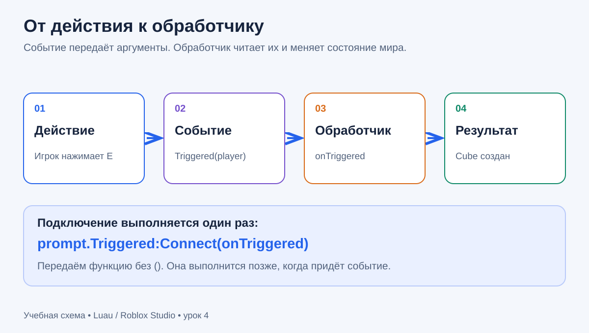
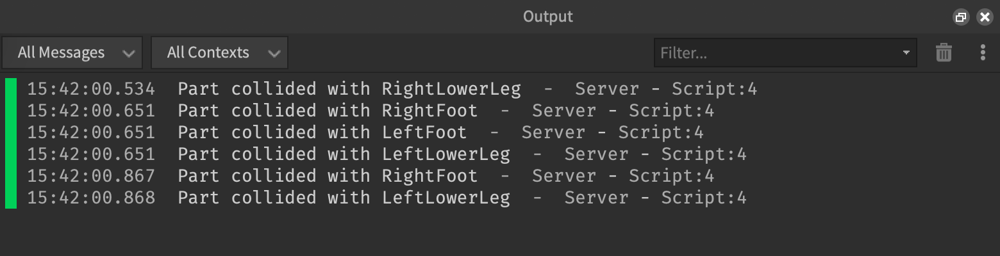
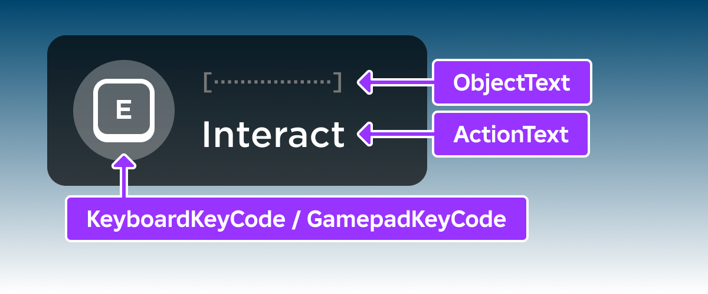
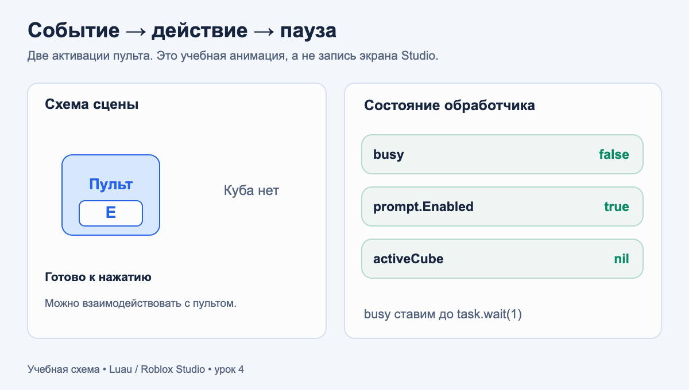

# Урок 4. Объекты и события Roblox

[К оглавлению](../README.md) · [Урок 3: таблицы и модули](../03_tables_modules/03_tables_and_modules.md) · [Домашняя работа](#homework) · [Файлы примеров](examples/README.md)

**Темы:** свойства объектов, Parent/Child, поиск в дереве, создание и уничтожение объектов, события, обработчики, подключение и отключение функций.

**Перед началом:** ты знаком с переменными, условиями, функциями, таблицами и циклами. Умеешь пользоваться Explorer и запускать обычный Script из ServerScriptService. Модули из прошлого урока помогут организовывать большие системы; здесь сначала разберём сами объекты и сигналы, из которых такие системы состоят.

Материал удобно разделить на **три занятия по 45–60 минут**: объекты и иерархия; создание и уничтожение; события и интерактивная практика. Для домашней работы запланируй два-три подхода по 30–45 минут.

## Что научимся делать

1. Различать класс объекта, имя, свойство, метод и событие.
2. Находить родителей, детей и потомков и объяснять путь к нужному объекту.
3. Создавать, настраивать, переподчинять и уничтожать объекты из кода.
4. Подключать обработчики, получать аргументы события и отключать ненужные подключения.
5. Защищать действие от повторного запуска во время паузы и проверять интерактивную сцену по сценариям.

В конце получится **пульт светового куба**: первое взаимодействие создаёт куб и источник света, второе — удаляет их. Это учебная сцена в общем мире, без сохранения данных и персональных наград.

## Как запускать примеры

Открой **Baseplate** в Studio. Останови Test и отключи учебные Script прошлых уроков через Enabled = false; в старом интерфейсе с Disabled — Disabled = true. Создай обычный Script **Lesson04** в ServerScriptService. Он работает на сервере; LocalScript для примеров этого урока не нужен.

Каждый полный пример ниже запускается **отдельно**: Stop → заменить весь код Lesson04 → очистить Output → Test. Копирование шести примеров сразу приведёт к появлению нескольких учебных объектов. При Stop объекты, созданные только во время Test, исчезнут. Сохраняй код после Stop, чтобы он остался в проекте.

Готовые файлы лежат в [examples](examples/README.md). Временны́е отметки, имя Script и пометка Server в Output не входят в ожидаемые сообщения.

## Как читать иллюстрации

В уроке есть четыре скриншота из официального репозитория Roblox, три авторские SVG-схемы и две GIF-анимации. **GIF показывают учебные модели, а не запись работающего Studio.** Они объясняют порядок действий; поведение своего кода проверяй в Test. Если GIF не проигрывается, используй статичные схемы и таблицы рядом.

---

## Часть A. Объекты и иерархия

## 1. Класс, имя и свойства

Большинство элементов в Explorer — **объекты Instance**: детали, папки, модели, источники света и скрипты. У каждого объекта есть конкретный **класс**. Класс Part описывает простую физическую деталь; Folder — папку; PointLight — источник света.

| Понятие | Пример | Смысл |
| --- | --- | --- |
| Класс | Part | Какие свойства, методы и события доступны объекту. |
| Имя | Control | Подпись конкретного объекта в Explorer. |
| Свойство | part.Color | Текущее значение настройки. |
| Метод | part:Destroy() | Действие, которое объект умеет выполнять. |
| Событие | part.Touched | Сигнал о произошедшем действии или изменении. |

**Имя и класс — разные вещи.** Можно назвать Part словом Lamp, но он останется Part. Свойство ClassName можно читать, но нельзя использовать для превращения существующей детали в другой класс. Для другого класса создают новый объект.



*Рисунок 1. Properties показывает настройки выбранного объекта. На скриншоте Roblox выделен Color; в коде используется то же свойство.*

### Числа, векторы, цвета и логические значения

Свойству нужно передавать значение подходящего типа.

| Свойство | Пример значения | Что означает |
| --- | --- | --- |
| Name | `"Control"` | Имя — строка. |
| Size | `Vector3.new(6, 1, 6)` | Размер по X, Y, Z в studs. |
| Position | `Vector3.new(0, 3, -10)` | Координаты центра детали. |
| Color | `Color3.fromRGB(37, 99, 235)` | Цвет из трёх компонентов от 0 до 255. |
| Anchored | `true` | Деталь не двигается от гравитации и столкновений. |
| CanCollide | `true` | Другие физические объекты могут упираться в неё. |
| CanTouch | `true` | Деталь участвует в событиях касания. Это не то же самое, что CanCollide. |
| Transparency | `0.2` | Число от 0 — полностью видно — до 1 — полностью прозрачно. |

Vector3.new создаёт значение с компонентами X, Y, Z. Color3.fromRGB создаёт значение цвета. Это не Part: сами по себе вектор и цвет не появляются в Explorer.

## 2. Создай и настрой деталь

**Instance.new("Part")** создаёт объект. Сначала настроим его, затем назначим Parent — родителя в дереве. Глобальное имя **workspace** указывает на Workspace, где находятся объекты 3D-мира.

<!-- file: 01_properties.server.luau -->
```luau
local part = Instance.new("Part")
part.Name = "Lesson04Properties"
part.Size = Vector3.new(6, 1, 6)
part.Position = Vector3.new(0, 3, -10)
part.Anchored = true
part.CanCollide = true
part.Color = Color3.fromRGB(37, 99, 235)
part.Transparency = 0.2
part.Parent = workspace

print(part.ClassName)
print(part.Name)
print(part.Size.Y)
print(part.Position.Y)
```

Ожидаемые сообщения:

```text
Part
Lesson04Properties
1
3
```

После запуска найдётся синяя полупрозрачная платформа около позиции (0, 3, −10). Anchored включён, поэтому она не падает. Размер по Y равен 1, а высота центра — 3. Это разные свойства.

Parent назначается **последним**: в мир попадает уже настроенная деталь. Без Parent новый объект остаётся доступен через переменную, но не становится объектом сцены Workspace.

**Предскажи → проверь → объясни:** поменяй только Size.Y на 3, затем верни размер и поменяй только Position.Y на 6. Сравни изменения. Почему присваивание Name = "Lamp" не добавит свет?

## 3. Parent, Child и Descendant

У объекта может быть **не больше одного непосредственного родителя Parent**, но много детей. **Child** — непосредственный ребёнок. **Descendant** — любой потомок: ребёнок, ребёнок ребёнка и далее.



*Схема 1. Так будет устроен пульт после создания куба. У папки два непосредственных ребёнка и четыре потомка. Вложенность не обозначает положение в пространстве.*



*Рисунок 2. На скриншоте Roblox ColorChanger — ребёнок ColorPart. Поэтому внутри такого Script выражение script.Parent обозначает Part. У нашего Lesson04, расположенного в ServerScriptService, script.Parent обозначает ServerScriptService. Всегда проверяй, где находится сам скрипт.*

### Точка и двоеточие

- `object.Name` читает свойство.
- `object.Name = "Token"` меняет свойство.
- `object:FindFirstChild("Token")` вызывает метод объекта.

При записи через двоеточие объект передаётся методу автоматически. Здесь не нужно добавлять object первым аргументом. Это отличается от функции модуля CartMath.calculateTotal(cart, catalog) из прошлого урока, которая вызывалась через точку.

## 4. Поиск и обход дерева

| Способ | Когда использовать |
| --- | --- |
| `folder.Token` | Ребёнок точно существует и имеет подходящее уникальное имя. Если его нет, обращение к отсутствующему члену Instance вызовет ошибку. |
| `folder:FindFirstChild("Token")` | Проверить непосредственного ребёнка без ожидания. При отсутствии вернёт nil. |
| `folder:FindFirstChild("Token", true)` | Найти по имени среди всех потомков. Возвращается первый найденный объект. |
| `folder:WaitForChild("Token", 2)` | Подождать появление ребёнка до двух секунд; при истечении времени вернёт nil. |
| `folder:GetChildren()` | Получить массив непосредственных детей. |
| `folder:GetDescendants()` | Получить массив всех потомков. |
| `object:IsA("BasePart")` | Проверить, относится ли объект к указанному классу или его наследнику. Например, Part относится к BasePart. |

GetChildren и GetDescendants возвращают массивы, но **не обещают порядок**. Для подсчёта можно использовать # полученного массива. Это отличается от # у словаря из прошлого урока.

FindFirstChildOfClass("Humanoid") ищет непосредственного ребёнка именно класса Humanoid. Этот метод пригодится при касании персонажа. Класс Humanoid управляет, в частности, состоянием и здоровьем персонажа.

Не называй разных соседей одинаково: Roblox это допускает, но поиск «первого» не поможет выбрать нужный из нескольких одинаковых имён. Не используй WaitForChild как исправление опечатки: ожидание не создаёт отсутствующий объект. Проверяй nil после поиска или ожидания с ограничением времени.

### Полный опыт с деревом

Следующий пример сам создаёт Inbox, Archive, деталь Token и источник Glow. Он не зависит от платформы прошлого примера.

<!-- file: 02_hierarchy.server.luau -->
```luau
local root = Instance.new("Folder")
root.Name = "Lesson04Tree"

local inbox = Instance.new("Folder")
inbox.Name = "Inbox"
inbox.Parent = root

local archive = Instance.new("Folder")
archive.Name = "Archive"
archive.Parent = root

local token = Instance.new("Part")
token.Name = "Token"
token.Size = Vector3.new(2, 2, 2)
token.Position = Vector3.new(0, 4, -10)
token.Anchored = true
token.Parent = inbox

local light = Instance.new("PointLight")
light.Name = "Glow"
light.Brightness = 2
light.Range = 10
light.Parent = token

root.Parent = workspace

print(token.Parent.Name)
print(#root:GetChildren())
print(#root:GetDescendants())
print(root:FindFirstChild("Token") == nil)
print(root:FindFirstChild("Token", true).Name)

token.Parent = archive
print(token.Parent.Name)
print(token.Position.Y)
print(#inbox:GetChildren())

local partCount = 0
for index, object in root:GetDescendants() do
    if object:IsA("BasePart") then
        object.Color = Color3.fromRGB(15, 138, 104)
        partCount = partCount + 1
    end
end
print(partCount)
```

Ожидаемые сообщения:

```text
Inbox
2
4
true
Token
Archive
4
0
1
```

| Проверка | Почему такой результат |
| --- | --- |
| Два ребёнка root | Это Inbox и Archive. |
| Четыре потомка root | Дополнительно учитываются Token и Glow. |
| Прямой поиск Token вернул nil | Token находится внутри Inbox, а не прямо под root. |
| Рекурсивный поиск нашёл Token | Он просматривает и вложенные папки. |
| После переноса Inbox пуст | Деталь Token теперь принадлежит Archive. |
| Высота осталась 4 | Изменение Parent не меняет Position. |
| Найдена одна BasePart | Token — деталь; папки и PointLight не являются деталями. |



*GIF 1. В анимации перемещается значок в дереве. В 3D-мире переподчинение само по себе не переносит деталь. Изменение Parent также не создаёт физического соединения деталей.*

**Контрольная точка A:** нарисуй дерево из папки, двух деталей и источника света внутри одной детали. Укажи число детей и потомков папки. Объясни, что изменится, если источник света переподчинить другой детали.

---

## Часть B. Создание и завершение жизни объектов

## 5. Убрать из дерева или уничтожить?



*Схема 2. Parent = nil и Destroy() решают разные задачи.*

**object.Parent = nil** временно убирает объект из дерева. Если ссылка сохранена в переменной, объект можно вернуть, назначив Parent снова.

**object:Destroy()** уничтожает объект вместе с потомками, убирает его из дерева и отключает подключения его событий. После этого Parent заблокирован: вернуть уничтоженный объект в мир нельзя. Чтобы получить новый, нужно снова использовать Instance.new.

Переменная после Destroy сама по себе не становится nil. Хорошая привычка — обнулить больше не нужные ссылки, чтобы случайно не использовать уничтоженный объект.

<!-- file: 03_lifecycle.server.luau -->
```luau
local root = Instance.new("Folder")
root.Name = "Lesson04Lifecycle"
root.Parent = workspace

local cube = Instance.new("Part")
cube.Name = "TemporaryCube"
cube.Size = Vector3.new(3, 3, 3)
cube.Position = Vector3.new(0, 4, -10)
cube.Anchored = true

local light = Instance.new("PointLight")
light.Parent = cube
cube.Parent = root

print("Потомков: " .. tostring(#root:GetDescendants()))
task.wait(1)

cube.Parent = nil
print("Детей после скрытия: " .. tostring(#root:GetChildren()))
task.wait(1)

cube.Parent = root
print("Детей после возврата: " .. tostring(#root:GetChildren()))
task.wait(1)

cube:Destroy()
cube = nil
light = nil
print("Потомков после Destroy: " .. tostring(#root:GetDescendants()))
```

С интервалами примерно в секунду появятся сообщения:

```text
Потомков: 2
Детей после скрытия: 0
Детей после возврата: 1
Потомков после Destroy: 0
```

task.wait(1) приостанавливает **текущий поток выполнения скрипта**, а не весь мир игры. Остальные объекты и обработчики продолжают работать. Фактическое ожидание может быть немного дольше указанного времени.

Пока cube.Parent равен nil, его свет тоже не находится в дереве Workspace: Glow остаётся ребёнком cube. Когда уничтожается cube, уничтожается и Glow. Не заменяй Destroy простым присваиванием cube = nil: это только убирает ссылку из переменной и не удаляет уже размещённую деталь из Workspace.

**Проверь понимание:** почему после временного скрытия куб можно вернуть, а после Destroy — нельзя? Что останется в root в конце опыта?

---

## Часть C. События и обработчики

## 6. Событие сообщает, что что-то произошло

В игре необязательно проверять каждую деталь бесконечным циклом. Roblox сообщает о важных действиях через **события**. **Обработчик** — функция, которую мы подключили к событию.



*Схема 3. Подключение настраивается заранее. После этого обработчик вызывается в ответ на событие.*

Запись **event:Connect(handler)** подключает функцию и возвращает объект подключения — RBXScriptConnection. Мы передаём handler **без скобок вызова**. Запись Connect(handler()) сначала немедленно вызовет handler, а затем попробует подключить возвращённое значение. Обычно это приведёт к ошибке, потому что вместо функции получится nil.

Событие также передаёт обработчику аргументы:

| Сигнал | Что получает функция |
| --- | --- |
| `part.Touched` | Другую соприкоснувшуюся деталь otherPart, а не Player. |
| `prompt.Triggered` | Player, который активировал подсказку взаимодействия. |
| `part:GetPropertyChangedSignal("Color")` | Аргументов нет; новое значение читают из part.Color. |

У событий нет общего обещанного точного времени относительно физики и других сигналов. В современных сценах часть обработчиков выполняется отложенно. Не строим логику на предположении, что любой сигнал уже полностью обработан сразу после изменения свойства.

## 7. Касание: Touched и повторные срабатывания

Событие Touched появляется при **физическом контакте** деталей. У одной из соприкасающихся деталей должна быть возможность физического движения; персонаж обычно обеспечивает её. Простое присваивание Position или CFrame, которое наложило две закреплённые детали, не является надёжным способом вызвать Touched.

CanTouch должно быть включено у участвующих деталей. CanCollide управляет столкновениями, а не подпиской на касания; эти свойства решают разные задачи. В примере площадка закреплена и имеет оба свойства true.



*Рисунок 3. Скриншот Roblox: один персонаж касается объекта ногой и другими частями тела, поэтому сообщений несколько. Не считай, что одно приближение игрока гарантирует один вызов.*

### Ограничь повторный запуск

Пусть площадка меняет цвет на две секунды. Пока обработчик ждёт, новые события могут продолжать приходить. Нужен флаг **busy**, который ставится **до task.wait**. Этот приём часто называют debounce или защитой от повторного срабатывания.

<!-- file: 04_touch.server.luau -->
```luau
local pad = Instance.new("Part")
pad.Name = "Lesson04TouchPad"
pad.Size = Vector3.new(8, 1, 8)
pad.Position = Vector3.new(0, 1, -12)
pad.Anchored = true
pad.CanCollide = true
pad.CanTouch = true
pad.Color = Color3.fromRGB(37, 99, 235)
pad.Parent = workspace

local busy = false

local function onTouched(otherPart)
    if busy then
        return
    end

    local character = otherPart.Parent
    if character == nil then
        return
    end
    local humanoid = character:FindFirstChildOfClass("Humanoid")
    if humanoid == nil then
        return
    end

    busy = true
    pad.Color = Color3.fromRGB(15, 138, 104)
    print("Контакт персонажа")
    task.wait(2)
    pad.Color = Color3.fromRGB(37, 99, 235)
    busy = false
end

pad.Touched:Connect(onTouched)
print("Площадка готова")
```

Сначала Output покажет `Площадка готова`. Подойди к синей площадке и запрыгни на неё. При подходящем контакте появится `Контакт персонажа`, а площадка станет зелёной примерно на две секунды.

Разбор обработчика:

1. Если busy уже true, новый вызов сразу заканчивается через return.
2. otherPart — конкретная деталь. Её Parent может быть моделью персонажа.
3. Ищем у этого родителя Humanoid. Если его нет, событие пропускаем.
4. Ставим busy, меняем цвет и ждём.
5. Возвращаем исходный цвет и снимаем busy.

Фильтр принимает контакт детали, чей непосредственный родитель содержит Humanoid. Обычные части тела персонажа подходят; деталь внутри аксессуара может быть пропущена. Это также не проверка «только настоящий Player»: NPC с Humanoid может подойти. Для учебной площадки такое правило допустимо и явно задано.

Флаг общий **для площадки**, а не отдельный для каждого игрока. Приходы во время busy игнорируются, а не складываются в очередь. Стояние на площадке после окончания паузы само по себе не обещает нового Touched — для следующего опыта сойди и коснись её снова.

## 8. Отключи ненужный обработчик

**connection:Disconnect()** отключает функцию от будущих событий. Это не отменяет уже выполняющийся обработчик. Свойство connection.Connected позволяет проверить состояние подключения.

<!-- file: 05_disconnect.server.luau -->
```luau
local part = Instance.new("Part")
part.Name = "Lesson04Signal"
part.Anchored = true
part.Position = Vector3.new(0, 3, -10)
part.Color = Color3.fromRGB(37, 99, 235)
part.Parent = workspace

local calls = 0
local function onColorChanged()
    calls = calls + 1
    print("Цвет изменился")
end

local connection = part:GetPropertyChangedSignal("Color"):Connect(onColorChanged)

part.Color = Color3.fromRGB(15, 138, 104)
task.wait(0.1)

connection:Disconnect()
print(connection.Connected)

part.Color = Color3.fromRGB(220, 70, 70)
task.wait(0.1)
print(calls)
```

Ожидаемые сообщения:

```text
Цвет изменился
false
1
```

Сначала меняется Color и вызывается обработчик. После Disconnect второе изменение цвета не увеличивает calls. Небольшие ожидания дают движку возможность обработать отложенный сигнал до следующих проверок.

В долгоживущих системах сохраняй подключения, которые нужно отключать. Не вызывай Connect внутри другого часто срабатывающего обработчика без необходимости: можно случайно добавить всё новые слушатели, и одно действие будет вызывать несколько одинаковых функций.

**Контрольная точка B:** объясни, почему Connect(onTriggered) и Connect(onTriggered()) — разные программы. Как отличить отключение подключения от удаления самого Part?

## 9. Явное действие игрока: ProximityPrompt

Для пульта удобнее не физическое касание, а явное взаимодействие. **ProximityPrompt** показывает рядом с объектом подсказку действия. На компьютере обычно используется E; на других устройствах Roblox показывает соответствующий способ ввода.



*Рисунок 4. ObjectText — что это за объект; ActionText — что можно сделать. Скриншот из официальной документации Roblox.*

| Настройка | Что задаёт в нашей практике |
| --- | --- |
| ObjectText | Подпись «Пульт». |
| ActionText | «Создать куб» или «Убрать куб». |
| KeyboardKeyCode | Enum.KeyCode.E — клавиша E. |
| HoldDuration | 0 — не нужно удерживать кнопку. |
| MaxActivationDistance | 10 studs — нужно подойти достаточно близко. |
| RequiresLineOfSight | false — для учебного пульта не требуем свободного луча от камеры. |
| Enabled | false временно скрывает и отключает подсказку. |

**Enum** содержит именованные значения Roblox. Например, Enum.KeyCode.E обозначает клавишу, а Enum.Material.Neon — материал. Это не строки, которые нужно заключать в кавычки.

В нашем примере ProximityPrompt — ребёнок Part Control. Событие Triggered передаёт Player. Обычный серверный Script меняет общую сцену: результат увидят все игроки этого сервера. Клиентские интерфейсы и передачу сообщений между клиентом и сервером изучим отдельно.

## 10. Практика. Пульт светового куба

### Что должно получиться

- После запуска есть синий пульт, но куба ещё нет.
- Первая активация создаёт Cube с дочерним PointLight.
- Во время паузы около секунды новое действие не принимается.
- Следующая принятая активация уничтожает куб вместе со светом.
- Затем можно снова создавать и удалять куб.



*GIF 2. Схематичная анимация двух принятых активаций. Во время паузы busy = true и prompt.Enabled = false; после неё пульт снова готов.*

### Подготовка

Оставь включённым только один Lesson04 в ServerScriptService. Замени его код полным примером ниже. Все объекты сцены создаются самим скриптом; вручную добавлять ProximityPrompt или Cube не нужно.

В новом Test дерево Workspace будет таким:

```text
Workspace
└── Lesson04Control (Folder)
    └── Control (Part)
        └── ProximityPrompt
```

После создания куба рядом с Control внутри папки появится Cube, а внутри него — Glow класса PointLight. Именно этот момент показан на первой схеме урока.

<!-- file: 06_control.server.luau -->
```luau
if workspace:FindFirstChild("Lesson04Control") ~= nil then
    warn("Lesson04Control уже существует. Оставь один учебный Script.")
    return
end

local root = Instance.new("Folder")
root.Name = "Lesson04Control"

local control = Instance.new("Part")
control.Name = "Control"
control.Size = Vector3.new(4, 2, 3)
control.Position = Vector3.new(0, 1, -10)
control.Anchored = true
control.Color = Color3.fromRGB(37, 99, 235)
control.Parent = root

local prompt = Instance.new("ProximityPrompt")
prompt.Name = "ProximityPrompt"
prompt.ObjectText = "Пульт"
prompt.ActionText = "Создать куб"
prompt.KeyboardKeyCode = Enum.KeyCode.E
prompt.HoldDuration = 0
prompt.MaxActivationDistance = 10
prompt.RequiresLineOfSight = false
prompt.Parent = control

local activeCube = nil
local busy = false

local function createCube()
    local cube = Instance.new("Part")
    cube.Name = "Cube"
    cube.Size = Vector3.new(3, 3, 3)
    cube.Position = Vector3.new(6, 3, -10)
    cube.Anchored = true
    cube.CanCollide = false
    cube.CanTouch = false
    cube.Color = Color3.fromRGB(15, 138, 104)
    cube.Material = Enum.Material.Neon

    local light = Instance.new("PointLight")
    light.Name = "Glow"
    light.Color = cube.Color
    light.Brightness = 2
    light.Range = 12
    light.Parent = cube

    cube.Parent = root
    return cube
end

local function onTriggered(player)
    if busy then
        return
    end
    busy = true
    prompt.Enabled = false

    if activeCube == nil then
        activeCube = createCube()
        prompt.ActionText = "Убрать куб"
        print("Куб создан")
    else
        activeCube:Destroy()
        activeCube = nil
        prompt.ActionText = "Создать куб"
        print("Куб удалён")
    end

    task.wait(1)
    prompt.Enabled = true
    busy = false
end

prompt.Triggered:Connect(onTriggered)
root.Parent = workspace
print("Пульт готов")
```

### Разберём обязанности частей

| Часть программы | За что отвечает |
| --- | --- |
| Проверка имени Lesson04Control | Не позволяет второй копии примера молча создать ещё один одинаковый пульт. warn печатает предупреждение в Output. |
| Создание root, control и prompt | Подготавливает объекты и свойства. |
| createCube | Создаёт один настроенный куб со светом и возвращает ссылку на него. |
| activeCube | nil, когда куба нет, или ссылка на действующий Cube. |
| busy | Запрещает повторный вход, пока предыдущая активация ждёт окончания паузы. |
| onTriggered | Выбирает создать или удалить, меняет подпись и управляет паузой. |
| Connect | Один раз связывает сигнал с функцией. |
| root.Parent = workspace | Добавляет уже подготовленную систему в сцену. |

Внутри createCube свет сначала получает Parent = cube, а сам cube — Parent = root. В мир попадает готовая небольшая иерархия. После Destroy ссылка activeCube явно обнуляется, поэтому следующий вызов понимает, что нужен новый объект.

Функция onTriggered получает player, хотя здесь не использует его имя или данные. Само наличие аргумента не делает куб личным: состояние пульта всё ещё общее. Ограничение применяется к этому пульту целиком.

### Проверь по сценариям

Подойди к пульту около (0, 1, −10). Если персонаж находится дальше 10 studs, подсказки не будет. После каждого принятого действия выжди больше секунды перед следующей проверкой.

| Действие | Ожидаемый результат |
| --- | --- |
| Новый Test | В Output `Пульт готов`. Cube отсутствует. |
| Первая активация | `Куб создан`. В папке ровно один Cube со светом; подпись после паузы — «Убрать куб». |
| Попытка повторить во время паузы | Нового куба и дополнительного сообщения нет. Подсказка временно отключена. |
| Вторая принятая активация | `Куб удалён`. Нет ни Cube, ни его дочернего Glow. |
| Третья принятая активация | Создаётся новый Cube. Это новый объект, а не возврат уничтоженного. |
| Stop и новый Test | Пульт начинает с исходного состояния; истории прошлых нажатий нет. |

Покажи Explorer во время опыта. У папки сначала один ребёнок Control, после создания куба — два. Их потомков соответственно два и четыре. Изменение состояния хорошо видно и в мире, и в дереве.

**Измени и объясни:** поменяй цвет куба и Range света. Затем увеличь паузу до двух секунд и проверь, что повторная попытка до её окончания не создаёт дополнительный объект. Верни исходные настройки перед домашней работой.

## 11. Если результат отличается

| Проблема | Что проверить |
| --- | --- |
| Деталь создана, но не видна | Parent, Position, Size и Transparency. Выбери объект в Explorer и нажми F. |
| Имя изменилось, но поведение класса нет | Name не меняет ClassName. |
| nil или ошибка при поиске | Правильны ли имя, регистр и глубина поиска? Есть ли проверка результата? |
| Метод не находится | Не перепутаны ли объект и таблица? Подходит ли класс? Используется ли правильное имя метода? |
| Скрипт будто «завис» на поиске | У WaitForChild могло не быть ограничения ожидания; исправь имя и проверь структуру. |
| Платформа не реагирует на касание | CanTouch, физическое движение и тип второго объекта. Для персонажа в примере нужен Humanoid у непосредственного родителя детали. |
| Реакция повторяется слишком часто | Флаг поставлен до ожидания? Не подключён ли обработчик несколько раз? |
| Функция вызвалась до действия игрока | Возможно, в Connect передан результат handler(), а не функция handler. |
| Подсказки E нет | Test с персонажем, расстояние, Enabled, Parent подсказки и положение пульта. |
| После удаления куб не создаётся | После Destroy нужно присвоить activeCube = nil. |
| В Output лишние сообщения | Отключи учебные Script прошлых уроков и лишние копии Lesson04. |

---

<a id="homework"></a>

## Домашняя работа

Обязательная часть — две небольшие задачи и самостоятельный проект. Повтори навыки прошлого урока: массив записей, перебор и функции. Сначала набросай дерево объектов и план словами, затем создавай код.

### Задача 1. Маршрут с удаляемой платформой

**Сюжет:** в тренировочном маршруте три платформы. Первая временная: через секунду после запуска она должна исчезнуть вместе со своим источником света.

**Задача:** создай папку Route в Workspace. Из массива описаний создай три закреплённые Part с размером (4, 1, 4), CanCollide = true и именами A, B, C. Только у A должен быть дочерний PointLight с именем Glow. Через task.wait(1) уничтожь A, обнули переменную, которой пользовался для её хранения, и напечатай число детей и потомков Route. Baseplate и другие стандартные объекты не удаляй.

| Входные описания | Ограничения |
| --- | --- |
| A: Position = (−6, 1, −10), B: (0, 1, −10), C: (6, 1, −10) | Ровно три записи, имена уникальны. Координаты задаются через Vector3. |
| Цвет и яркость Glow | Цвет выбирай сам; Brightness от 1 до 3, Range от 8 до 12. |

| Момент проверки | Ожидаемый результат |
| --- | --- |
| До удаления | У Route три непосредственных ребёнка и четыре потомка. |
| После удаления A | У Route два ребёнка и два потомка; B и C остаются, A и Glow отсутствуют. |
| Сообщения после удаления | `Детей: 2`<br>`Потомков: 2` |

Порядок возвращаемых GetChildren объектов не оценивается. Проверяется состав, количество и уничтожение потомка вместе с родителем.

<details><summary>Подсказка 1</summary>

Раздели описание платформ и их создание: данные удобно хранить в массиве записей. Ссылку на временную платформу нужно сохранить до ожидания.

</details>
<details><summary>Подсказка 2</summary>

Функция создания может возвращать Part. Уничтожай сам объект A, а не только меняй значение переменной. Считай детей и потомков именно Route, а не всего Workspace.

</details>

**Что сдать:** task_01_route.server.luau, скриншоты дерева до и после удаления, сообщения Output.

### Задача 2. Ошибка подключения

**Сюжет:** кнопка должна напечатать сообщение один раз после действия игрока. Вместо этого сообщение появляется сразу, а затем возникает ошибка.

Создай в Workspace Part TestControl с дочерним ProximityPrompt. Part закрепи и размести так, чтобы к нему можно было подойти. Обычный Script помести в ServerScriptService. В нём использован такой неисправный код:

<!-- exercise: connect_bug -->
```luau
local control = workspace:WaitForChild("TestControl", 2)
if control == nil then
    warn("Создай TestControl в Workspace")
    return
end

local prompt = control:FindFirstChildOfClass("ProximityPrompt")
if prompt == nil then
    warn("Добавь ProximityPrompt в TestControl")
    return
end

local function onTriggered(player)
    print("Проверка пройдена")
end

prompt.Triggered:Connect(onTriggered())
```

**Исправь:** до первой активации сообщение не выводится; при первой активации печатается `Проверка пройдена`, а затем обработчик **отключается через Disconnect**. Вторая и последующие активации в том же запуске ничего не печатают. Подсказку после этого можно дополнительно скрыть, но это не заменяет требуемое отключение подключения.

| Действие | Ожидаемые сообщения |
| --- | --- |
| Запуск, игрок ещё не взаимодействовал | Нет сообщения `Проверка пройдена` и нет ошибки Connect. |
| Первая активация | Ровно одна строка `Проверка пройдена`. |
| Ещё две активации | Новых строк нет. |
| Stop и новый Test | Первое взаимодействие снова допускается. |

<details><summary>Подсказка 1</summary>

Отдели «передать функцию» от «вызвать её сейчас». Затем подумай, где хранить объект подключения, чтобы обработчик мог к нему обратиться позже.

</details>
<details><summary>Подсказка 2</summary>

Переменную подключения можно объявить до функции, а значение присвоить после её определения. При обычном пользовательском событии к моменту вызова обработчика подключение уже создано.

</details>

**Что сдать:** task_02_once.server.luau, результаты четырёх проверок и объяснение ошибки в исходной строке.

### Проект. Три энергоячейки для ворот

**Сюжет:** ворота лаборатории открываются после установки трёх энергоячеек. Каждое принятое действие на пульте создаёт одну ячейку. Когда собраны все три, ячейки расходуются, ворота открываются, а пульт больше не принимает действия.

Используй **один обычный Script в ServerScriptService**, который сам создаёт такую структуру:

```text
Workspace
└── Lesson04Home (Folder)
    ├── Control (Part)
    │   └── ProximityPrompt
    ├── Gate (Part)
    │   └── Indicator (PointLight)
    └── Cells (Folder)
```

Детали создаются закреплёнными. Gate расположен рядом с пультом, но не перекрывает доступ к нему. Для Control используй размер (4, 2, 3) и позицию (0, 1, −10); для Gate — (6, 6, 1) и (0, 3, −16). Baseplate и SpawnLocation оставь. Цвета пульта и ячеек можно выбрать самостоятельно.

**Контракт проекта:**

1. Счётчик принятых активаций начинается с 0. Gate сначала непрозрачен и имеет CanCollide = true. Indicator светит красным. ProximityPrompt включён, HoldDuration = 0, MaxActivationDistance = 10.
2. Принятая активация увеличивает счётчик на 1, создаёт Part с именем Cell1, Cell2 или Cell3 внутри Cells и печатает `Ячеек: <число>/3`. Размер ячейки — (1, 1, 1), CanCollide = false. Каждая следующая стоит на 2 studs правее предыдущей; первую поставь в (6, 1, −10).
3. После каждого принятого действия на одну секунду включается общий флаг busy и отключается подсказка. Повторные попытки во время паузы игнорируются и **не создают** дополнительные ячейки.
4. При достижении 3 сразу уничтожаются все Part из Cells, но сама папка Cells остаётся. Gate получает Transparency = 0.6 и CanCollide = false, Indicator становится зелёным. После строки `Ячеек: 3/3` выводится `Ворота открыты`.
5. Подключение Triggered отключается через Disconnect. Подсказка остаётся отключённой до нового Test: код окончания паузы не должен включить её обратно после завершения задачи.
6. В начале каждого нового Test исходное состояние восстанавливается. Это общие ворота сцены, не отдельный прогресс для каждого игрока.

Слово «принятая» означает активацию, при которой система ещё не завершена и busy равен false. Точное количество сырых сигналов или кадров не является счётчиком прогресса.

| Сценарий | Ожидаемое состояние и сообщения |
| --- | --- |
| Новый Test | Gate закрыт, Cells пуст, подсказка доступна. Сообщений о ячейках нет. |
| Первая принятая активация | Одна Cell1, Gate закрыт; `Ячеек: 1/3`. |
| Попытка во время паузы | Счётчик и число ячеек не изменяются; новых сообщений нет. |
| Вторая принятая активация после паузы | Две ячейки; `Ячеек: 2/3`. |
| Третья принятая активация после паузы | Cells пуст; ворота пропускают персонажа; индикатор зелёный; `Ячеек: 3/3`, затем `Ворота открыты`. |
| Ожидание ещё двух секунд и попытка активировать пульт | Ячеек нет, ворота открыты, подсказка отключена, новых сообщений нет. |

### Этапы самостоятельной работы

1. Нарисуй дерево и подпиши, какие объекты нужно сохранять в переменных.
2. Создай исходную сцену без событий. Проверь свойства Gate и Indicator.
3. Добавь обработчик одной принятой активации и отдельную функцию создания ячейки.
4. Добавь защиту от повторного входа и проверь паузу.
5. Реализуй завершение: уничтожение ячеек, открытие ворот и отключение подключения.
6. Пройди всю таблицу сценариев после нового Test.

<details><summary>Подсказка 1. Раздели состояния</summary>

Есть разные причины отказать в действии: временная пауза и окончательное завершение. Если хранить только одно из этих состояний, код после ожидания может случайно вернуть систему к работе.

</details>
<details><summary>Подсказка 2. Удали объекты, сохрани папку</summary>

GetChildren возвращает отдельный массив ссылок. Можно получить этот массив и вызвать Destroy у каждого ребёнка Cells. Это не удаление элементов самого массива во время его перебора. После паузы включай prompt только при незавершённом проекте.

</details>

**Что сдать:** project_cells.server.luau, сцену lesson_04_objects_events.rbxl, скриншоты Explorer до начала и после открытия ворот, короткую запись экрана или GIF прохождения трёх активаций и результаты проверок из таблицы. Способ записи экрана выбирай удобный; публикация игры не требуется.

### Критерии готовности

- [ ] Выполнены две короткие задачи и самостоятельный проект.
- [ ] Объекты имеют правильные классы, свойства и родителей.
- [ ] Код не удаляет Baseplate, SpawnLocation и чужие объекты сцены.
- [ ] Уничтожение родителя корректно удаляет нужных потомков.
- [ ] В Connect передаются функции; нет новых подключений при каждом действии.
- [ ] Во время паузы не растёт счётчик и не появляются лишние ячейки.
- [ ] После завершения отключение остаётся окончательным, даже когда task.wait закончился.
- [ ] Проект сохраняется, снова открывается и начинает новый Test с исходного состояния.
- [ ] Ты можешь объяснить хотя бы один Parent, один аргумент события и один вызов Destroy в своём коде.

Задания и самостоятельный проект составлены для этого курса. Они используют знакомые приёмы в новых условиях: на уроке объект переключается между двумя состояниями, дома нужно накопить три действия, израсходовать созданные объекты и окончательно завершить работу.

## Примеры, визуальные материалы и источники

- [Все шесть файлов примеров, сценарии запуска и границы проверки](examples/README.md).
- [Источники изображений, лицензия и исходники схем/GIF](../assets/objects-lesson-04/SOURCES.md).
- [Roblox: Instance — свойства, Parent, поиск и Destroy](https://github.com/Roblox/creator-docs/blob/c8f5276703948ef4868c9b9fd44fae619dbe2f11/content/en-us/reference/engine/classes/Instance.yaml).
- [Roblox: события и подключение функций](https://github.com/Roblox/creator-docs/blob/c8f5276703948ef4868c9b9fd44fae619dbe2f11/content/en-us/scripting/events/index.md).
- [Roblox: защита от повторного срабатывания](https://github.com/Roblox/creator-docs/blob/c8f5276703948ef4868c9b9fd44fae619dbe2f11/content/en-us/scripting/debounce.md).
- [Roblox: BasePart.Touched и CanTouch](https://github.com/Roblox/creator-docs/blob/c8f5276703948ef4868c9b9fd44fae619dbe2f11/content/en-us/reference/engine/classes/BasePart.yaml), [ProximityPrompt.Triggered](https://github.com/Roblox/creator-docs/blob/c8f5276703948ef4868c9b9fd44fae619dbe2f11/content/en-us/reference/engine/classes/ProximityPrompt.yaml), [RBXScriptConnection](https://github.com/Roblox/creator-docs/blob/c8f5276703948ef4868c9b9fd44fae619dbe2f11/content/en-us/reference/engine/datatypes/RBXScriptConnection.yaml).

Текст, код примеров, схемы и учебные GIF подготовлены для курса. Внешние скриншоты: Roblox / участники Roblox/creator-docs, CC BY 4.0; файлы сохранены без изменения. Это не официальный курс Roblox.

Следующая тема — **[урок 5. Игровые механики](../05_gameplay/05_game_mechanics.md)**: урон, монеты, контрольные точки и правила повторного срабатывания. К ней переходи после того, как умеешь объяснить связь события и функции без подсказки.
