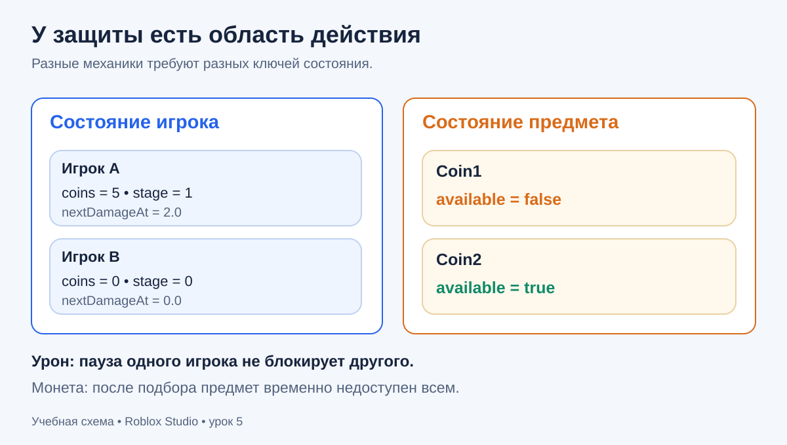
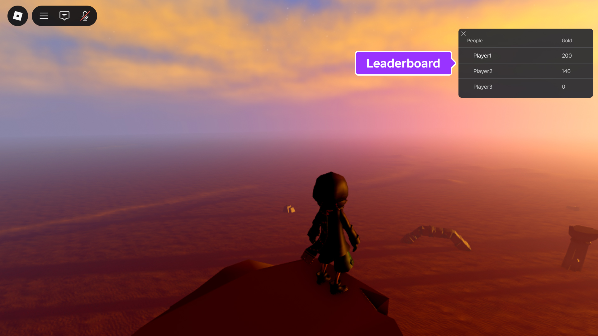
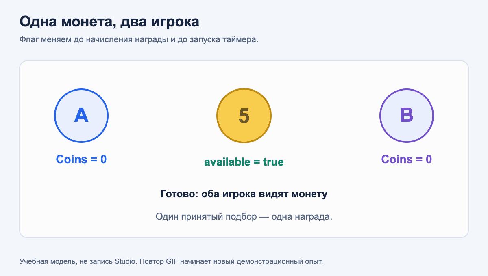
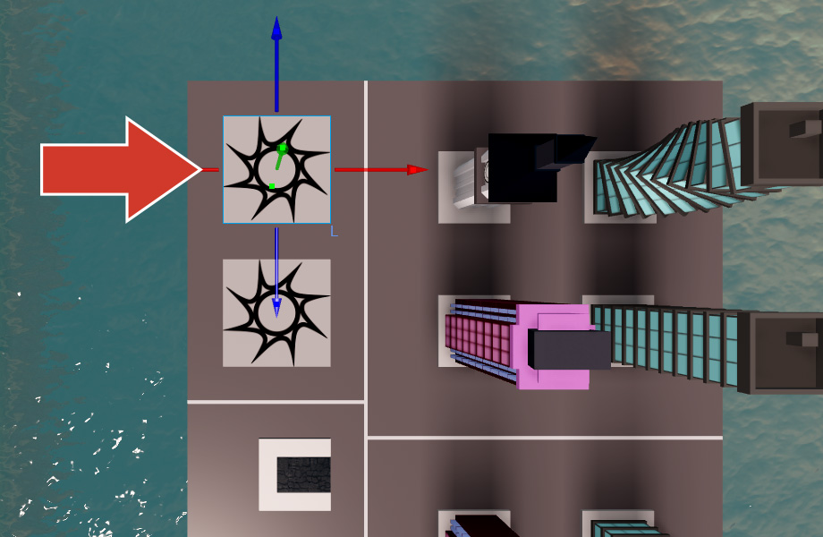
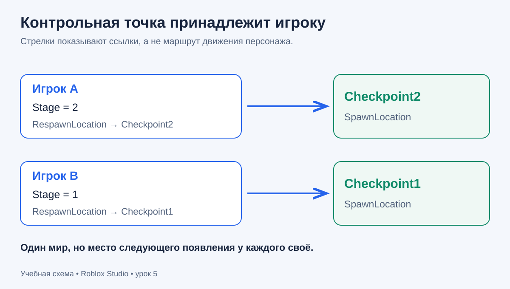
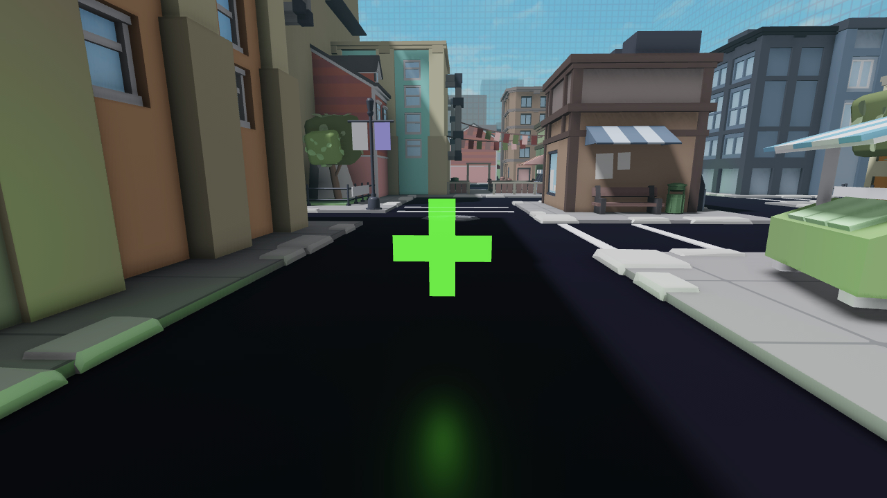
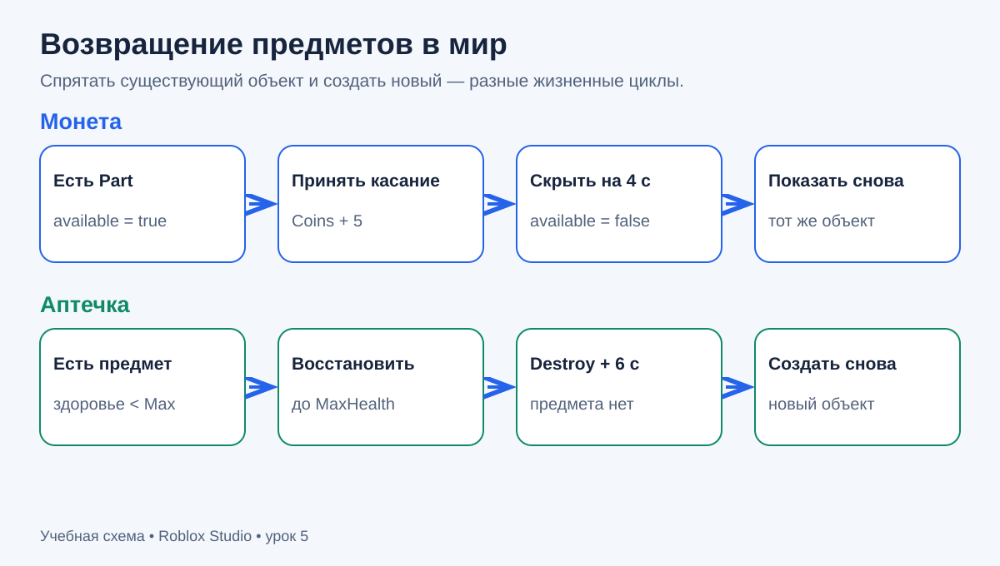

# Урок 5. Игровые механики

Урон, монеты, checkpoints, счётчики, появление предметов и защита от повторного срабатывания.

[К маршруту курса](../README.md) · [Урок 4. Объекты и события](../04_objects_events/04_objects_and_events.md)

В предыдущем уроке событие меняло объект. Теперь событие будет менять состояние игры: здоровье персонажа, баланс игрока, его контрольную точку и доступность предмета. Соберём небольшой стенд, на котором каждую механику можно проверить отдельно, а затем вдвоём.

**Перед началом:** ты умеешь работать с таблицами, `ModuleScript` и `require`, создавать `Part`, находить объекты и подключать функции через `Connect`. Если это пока трудно, повтори [урок 3](../03_tables_modules/03_tables_and_modules.md) и урок 4.

После урока ты сможешь:

1. Определить, какому игроку принадлежит коснувшаяся деталь, и нанести урон живому персонажу.
2. Начислить монеты один раз за подбор и показать `Coins` и `Stage` в таблице игроков.
3. Назначить каждому игроку свою точку возрождения и сохранить прогресс при смерти персонажа.
4. Вернуть скрытую монету и создать новую аптечку с задержкой.
5. Выбрать область защиты от повторов: отдельный игрок, отдельный предмет или продвижение по этапам.

Проходи материал в три приёма: сначала состояние и урон, затем монеты и checkpoints, затем сборка и самостоятельная работа. Полные файлы находятся [рядом с уроком](examples/MechanicsLesson/README.md).

## 1. Кому принадлежит состояние

У Roblox есть три разных объекта, которые легко перепутать.

| Объект | За что отвечает | Что происходит при смерти |
| --- | --- | --- |
| `Player` | Участник сервера: его статистика и выбранный checkpoint | Остаётся, пока игрок не покинет сервер |
| `Character` | Текущая модель персонажа в мире | При возрождении заменяется новой моделью |
| `Humanoid` | Здоровье и поведение этого персонажа | Новый персонаж получает новый `Humanoid` |

Поэтому `Coins` и `Stage` будем хранить в записи игрока, а здоровье читать у текущего `Humanoid`. После смерти монеты останутся; после выхода и нового входа начнутся с нуля. Сохранение между посещениями через DataStore — отдельная тема.

В словаре `sessions` ключом будет сам `Player`. Значение содержит таблицу чисел и ссылки на объекты статистики:

```lua
sessions[player] = {
    state = {coins = 0, stage = 0, nextDamageAt = 0},
    coinsStat = coinsStat,
    stageStat = stageStat,
}
```

`nextDamageAt` — момент, начиная с которого этот игрок снова может получить урон от нашей красной площадки. Мы создаём **новую таблицу для каждого игрока**. Общая таблица состояния заставила бы участников делить баланс и задержку.



Предскажи: A получил урон, а B сразу наступил на ту же площадку. Должен ли B ждать? Нет: пауза принадлежит A. Но если A забрал `Coin1`, B не получает эту же монету до её возврата. Здесь пауза принадлежит предмету.

## 2. От касания к игроку

`Touched` передаёт коснувшуюся **деталь**, например ногу или `Handle` аксессуара. В отличие от `ProximityPrompt.Triggered`, готового `Player` в аргументе нет. Нельзя считать, что `hit.Parent` всегда является персонажем: у аксессуара между ними есть ещё один объект.

Наша функция `findContact` поднимается по цепочке `Parent`. Для каждой встреченной модели она спрашивает `Players:GetPlayerFromCharacter(model)`. Метод вернёт игрока, если это именно его текущий персонаж, или `nil`. Затем проверяем наличие `Humanoid` и положительное здоровье. Обычный куб, NPC и мёртвый персонаж не проходят проверку. [Описание метода Players](https://github.com/Roblox/creator-docs/blob/c8f5276703948ef4868c9b9fd44fae619dbe2f11/content/en-us/reference/engine/classes/Players.yaml).

```lua
local contact = findContact(hit)
if contact == nil then
    return
end
local session = sessions[contact.player]
if session == nil then
    return
end
```

Здесь ранний `return` заканчивает только текущий вызов обработчика. Следующие касания продолжают работать. Проверка `session` нужна, потому что игрок мог уйти или его настройка не была выполнена.

Сервис `Players` получаем через `game:GetService("Players")`. Сначала подключаем `PlayerAdded`, затем настраиваем уже присутствующих игроков из `GetPlayers()`. Проверка существующей записи не даёт выполнить настройку дважды. В `PlayerRemoving` удаляем `sessions[player]`, чтобы ушедший игрок не оставался ключом в нашей таблице.

## 3. Урон и время следующего разрешённого удара

Для урона используем `humanoid:TakeDamage(25)`. Метод учитывает защиту `ForceField`. Прямое присваивание `humanoid.Health = humanoid.Health - 25` обходит такую защиту, поэтому для этой механики оно не подходит. [Humanoid:TakeDamage](https://github.com/Roblox/creator-docs/blob/c8f5276703948ef4868c9b9fd44fae619dbe2f11/content/en-us/reference/engine/classes/Humanoid.yaml).

Один контакт может породить несколько `Touched`: сначала нога, затем другая нога, затем часть аксессуара. Наносить 25 урона за каждую деталь нельзя. Вместо ожидания внутри обработчика запишем срок следующего удара:

```lua
local function tryDamage(state, now, cooldown)
    if now < state.nextDamageAt then
        return false
    end
    state.nextDamageAt = now + cooldown
    return true
end
```

`os.clock()` даёт текущее значение монотонного времени в секундах относительно произвольной начальной точки. Для задержки важна разница значений, а не календарная дата. В проекте `cooldown` равен `1.5`. До границы функция возвращает `false`; **на самой границе** — `true`. Запись срока происходит до нанесения урона. В этом участке нет `task.wait` и других ожиданий. [Описание os.clock](https://github.com/Roblox/creator-docs/blob/c8f5276703948ef4868c9b9fd44fae619dbe2f11/content/en-us/reference/engine/libraries/os.yaml).

| Касание | Время | Старый срок | Результат | Новый срок |
| --- | ---: | ---: | --- | ---: |
| A, первое | 10.0 | 0 | Принято | 11.5 |
| A, другая нога | 10.1 | 11.5 | Пропущено | 11.5 |
| B, первое | 10.1 | 0 | Принято | 11.6 |
| A, на границе | 11.5 | 11.5 | Принято | 13.0 |

Одна запись `nextDamageAt` здесь обслуживает **одну площадку**. Если позже создашь независимые источники урона, заранее реши, нужна ли общая неуязвимость или отдельный срок для каждого источника.

Защита от повторного входа называется debounce. Это правило допуска к действию, а не свойство, которое автоматически понимает движок. [Официальное объяснение debounce](https://github.com/Roblox/creator-docs/blob/c8f5276703948ef4868c9b9fd44fae619dbe2f11/content/en-us/scripting/debounce.md).

**Предскажи → проверь → измени → объясни.** При здоровье 100 два касания одного игрока в пределах 1.5 секунды дадут один принятый удар: сразу после него здоровье 75. Поставь `DAMAGE = 10` и повтори: сразу после удара ожидается 90. Позднее значение может отличаться из-за стандартного восстановления здоровья. При активном `ForceField` удар может не уменьшить здоровье, но срок в нашей таблице всё равно обновится.

Это механика «удар при разрешённом новом касании». Если просто стоять на площадке, новые события по расписанию не гарантированы. Для периодического урона внутри зоны нужна другая проверка присутствия; бесконечный цикл в каждом `Touched` сейчас не добавляем.

## 4. Счётчики в таблице игроков



Официальный скриншот показывает столбец `Gold`. В нашем проекте будут `Coins` и `Stage`. Это пример встроенного интерфейса, а не снимок результата нашего кода.

Roblox отображает значения из папки с точным именем **`leaderstats`** внутри `Player`. Регистр важен. Для целого числа подходит объект `IntValue`; имя объекта становится названием столбца, а число хранится в свойстве `Value`. [Правила встроенной таблицы](https://github.com/Roblox/creator-docs/blob/c8f5276703948ef4868c9b9fd44fae619dbe2f11/content/en-us/players/leaderboards.md).

```text
Players
└── Player
    └── leaderstats (Folder)
        ├── Coins (IntValue): Value = 0
        └── Stage (IntValue): Value = 0
```

Сначала создаём объекты, задаём имена и значения, затем помещаем готовую папку в `Player`. В `publishStats` копируем числа из `session.state` в два `Value`. Основные решения принимает серверный `Script`: он определяет подбор, начисление, урон и checkpoint. Для этого стенда `LocalScript` и `RemoteEvent` не нужны.

Зачем и таблица, и `IntValue`? Таблица содержит правила и служебный срок урона. `IntValue` показывает нужные числа через встроенный интерфейс. Менять баланс следует через правило, затем вызывать `publishStats`, иначе данные и отображение разойдутся. `leaderstats` сам по себе не сохраняет данные между серверами.

## 5. Монета: одна награда за один подбор

У каждой монеты своя локальная переменная `available`. Функция `connectCoin` вызывается отдельно для `Coin1` и `Coin2`, поэтому создаёт две независимые переменные. Вложенный обработчик продолжает пользоваться своей переменной после завершения `connectCoin` — это замыкание.

Порядок действий после проверок:

1. Установить `available = false`.
2. Скрыть монету через `Transparency = 1`.
3. Прибавить 5 монет этому игроку и обновить статистику.
4. Запланировать возврат через 4 секунды.

Флаг закрывается **до награды и до любого ожидания**. Если несколько обработчиков получат касания почти одновременно, следующий увидит `false` и завершится. Пока монета скрыта, её не может получить ни первый, ни второй игрок. Другая монета работает независимо.

```lua
task.delay(COIN_RESPAWN, restoreCoin)
```

`task.delay` планирует вызов функции позже, после указанной задержки, и сразу возвращает управление. Планировщик может вызвать её немного позднее; это не точный секундомер. Передаём `restoreCoin` **без круглых скобок**. Запись `restoreCoin()` немедленно вызвала бы функцию и передала её результат. В отличие от `task.wait`, задержка здесь не приостанавливает текущий обработчик. [Библиотека task](https://github.com/Roblox/creator-docs/blob/c8f5276703948ef4868c9b9fd44fae619dbe2f11/content/en-us/reference/engine/libraries/task.yaml).



GIF — авторская поясняющая модель событий, а не запись Roblox Studio. На схеме A первым получает +5, B не получает повторную награду; после возврата B может подобрать монету новым касанием. В конце цикл иллюстрации начинается заново, игровой баланс сам по себе не сбрасывается.

**Важная деталь:** оставляем `CanTouch = true`, даже когда монета невидима. При `CanTouch = false` Roblox отключает соединения `Touched`; простое возвращение `true` не восстанавливает старый `Connect`. Доступность регулирует наш флаг. Невидимая монета остаётся объектом в мире, а `CanCollide = false` позволяет пройти сквозь неё. [BasePart.CanTouch](https://github.com/Roblox/creator-docs/blob/c8f5276703948ef4868c9b9fd44fae619dbe2f11/content/en-us/reference/engine/classes/BasePart.yaml).

В `restoreCoin` проверяем `coin.Parent ~= nil`, затем возвращаем видимость и доступность. Здесь монету не уничтожаем. Если стоять внутри неё во время появления, нового `Touched` может не быть: для проверки отойди и войди снова.

Проверь: после одного подбора `Coins = 5`, повторные касания скрытой монеты не меняют число, а подбор другой доступной монеты даёт 10. Измени `COIN_REWARD` на 3, начни новую сессию и объясни результат двух подборов.

## 6. Checkpoints: личный прогресс и место возрождения



`SpawnLocation` — специальная площадка появления персонажа. В проекте есть `Start`, `Checkpoint1` и `Checkpoint2`. У каждого `Player` есть свойство `RespawnLocation`: назначенная площадка используется для следующего возрождения. Это не телепорт текущего персонажа. [Player.RespawnLocation](https://github.com/Roblox/creator-docs/blob/c8f5276703948ef4868c9b9fd44fae619dbe2f11/content/en-us/reference/engine/classes/Player.yaml).

Для наших площадок задаём `Enabled = true`, `Neutral = true` и оставляем их внутри `Workspace`. Так они доступны игрокам без команд. `AllowTeamChangeOnTouch = false` отключает смену команды при касании. `Duration = 0` отключает защиту появления на этих учебных площадках, чтобы удобнее проверять урон. На других SpawnLocation настройки могут отличаться. Отключённый `SpawnLocation` не используется для возрождения. [SpawnLocation](https://github.com/Roblox/creator-docs/blob/c8f5276703948ef4868c9b9fd44fae619dbe2f11/content/en-us/reference/engine/classes/SpawnLocation.yaml).

Начальный `Stage` равен 0. При касании принимаем checkpoint, только если его номер **больше** текущего. После этого обновляем `Stage`, `RespawnLocation` и статистику.

| Было | Коснулись | Стало | Результат |
| ---: | ---: | ---: | --- |
| 0 | 1 | 1 | Следующее возрождение на Checkpoint1 |
| 1 | 1 | 1 | Повтор ничего не меняет |
| 2 | 1 | 2 | Назад не откатываемся |
| 0 | 2 | 2 | Пропуск первого этапа разрешён |

Это правило «сохраняй самый дальний checkpoint», а не строгая последовательность. Стенд позволяет обойти препятствия, чтобы отдельно проверить каждую механику.



Площадки общие, но ссылка `RespawnLocation` и число `Stage` принадлежат игроку. Не перекрашиваем checkpoint «для всех» как признак личного прогресса: A мог дойти до второго, пока B остался на первом. Цвета в проекте постоянные и лишь помогают различать площадки.

При настройке игрока назначаем `Start`. Если персонаж успел появиться раньше, он может стоять у исходного SpawnLocation из Baseplate. Дождись сообщения о готовности и сделай Reset: следующее возрождение должно использовать `Start`. После касания checkpoint и Reset используются уже его координаты. Без явного `RespawnLocation` несколько доступных нейтральных площадок могут давать случайное место появления.

## 7. Аптечка: уничтожить предмет и создать новый



На скриншоте — модель с зелёным крестом из документации. В нашем стенде аптечка выглядит как простой зелёный куб на светлой подставке. Её задача — показать механику, а не готовое оформление.

Аптечка добавляет 30 здоровья, но не превышает `MaxHealth`:

```lua
local newHealth = math.min(health + amount, maxHealth)
```

`math.min` выбирает меньшее число. При `health = 90`, `amount = 30`, `maxHealth = 100` результат равен 100. Здесь присваивание `Health` уместно: мы восстанавливаем здоровье живого персонажа, прошедшего проверку. Мёртвого персонажа не оживляем.

Полностью здоровый игрок не расходует аптечку. Для повреждённого персонажа обработчик сначала закрывает локальный флаг `collected`, затем лечит, уничтожает предмет и планирует `spawnMedkit` через 6 секунд. Появившаяся аптечка — новый `Part` с новым соединением `Touched`.

Переменная `currentMedkit` хранит ссылку на существующий предмет. `spawnMedkit` ничего не делает, если предмет уже есть или папка стенда удалена. Поэтому один вызов создания не порождает несколько одновременно доступных аптечек.



Сравни жизненные циклы. Монета сохраняет объект и подписку, меняя видимость. Аптечка уничтожается вместе со старой подпиской; для нового объекта подключаем новую функцию. В обоих случаях защита закрывается до изменения награды или здоровья.

Проверь: при здоровье 100 аптечка остаётся. При здоровье около 75 подбор даёт до 100, предмет исчезает, затем появляется один новый. При тестировании учитывай стандартную регенерацию: смотри значение непосредственно перед подбором и сразу после него.

## 8. Правила отдельно от сцены

В `GameRules` находятся только таблицы и числа. Модуль не знает о деталях, игроках и интерфейсе, поэтому его проще проверить отдельно. Входные данные в этом уроке задаёт наш серверный код: количество монет, урон, задержки и лечение неотрицательны; номер checkpoint — положительное целое; здоровье живого персонажа не превышает его максимума. Проверку живого персонажа выполняет `Main` до вызова правила.

Создай `ModuleScript` **GameRules**:

```lua
local GameRules = {}

local function newSession()
    return {coins = 0, stage = 0, nextDamageAt = 0}
end

local function tryDamage(state, now, cooldown)
    if now < state.nextDamageAt then
        return false
    end
    state.nextDamageAt = now + cooldown
    return true
end

local function addCoins(state, amount)
    state.coins = state.coins + amount
    return state.coins
end

local function advanceCheckpoint(state, stage)
    if stage <= state.stage then
        return false
    end
    state.stage = stage
    return true
end

local function calculateHealedHealth(health, maxHealth, amount)
    return math.min(health + amount, maxHealth)
end

GameRules.newSession = newSession
GameRules.tryDamage = tryDamage
GameRules.addCoins = addCoins
GameRules.advanceCheckpoint = advanceCheckpoint
GameRules.calculateHealedHealth = calculateHealedHealth
return GameRules
```

Перед сборкой попробуй в отдельном временном `Script` рядом с модулем:

```lua
local Rules = require(script.Parent.GameRules)
local a = Rules.newSession()
local b = Rules.newSession()
print(Rules.tryDamage(a, 10, 1.5))
print(Rules.tryDamage(a, 10.2, 1.5))
print(Rules.tryDamage(b, 10.2, 1.5))
print(Rules.addCoins(a, 5))
print(b.coins)
print(Rules.advanceCheckpoint(a, 2))
print(Rules.advanceCheckpoint(a, 1))
print(Rules.calculateHealedHealth(90, 100, 30))
```

Предскажи вывод, затем запусти. Ожидается по строкам: `true`, `false`, `true`, `5`, `0`, `true`, `false`, `100`. Измени второй момент времени на `11.5` и объясни, какая строка поменяется. После проверки отключи или удали временный `Script`.

## 9. Собираем стенд в Studio

Создай отдельный проект **Baseplate**. Отключи прежние учебные скрипты: готовый пример намеренно не удаляет чужую папку `leaderstats`. В `ServerScriptService` создай папку `MechanicsLesson` и внутри неё два `ModuleScript` и один обычный серверный `Script`:

```text
ServerScriptService
└── MechanicsLesson (Folder)
    ├── GameRules (ModuleScript)
    ├── World (ModuleScript)
    └── Main (Script)
```

Имена должны совпадать, расширения `.luau` и `.server.luau` из файлов репозитория в имена Studio не добавляй. `script.Parent.GameRules` обращается к соседнему модулю. `Main` запускается, а модули выполняются при `require`. Не добавляй вторую копию `Main`.

### World: построение сцены

`World.create` создаёт папку и детали, затем возвращает ссылки на них. Checkpoint хранится записью `{spawn = объект, stage = номер}`. Массив таких записей позволяет одинаково подключить обе площадки в цикле. `Enum.PartType.Ball` делает монету шаром; `Enum.Material.Neon` задаёт светящийся вид поверхности. Всё основано на знакомом `Instance.new`.

Полный код `ModuleScript` **World**:

```lua
local World = {}

local function createPart(parent, name, size, position, color)
    local part = Instance.new("Part")
    part.Name = name
    part.Size = size
    part.Position = position
    part.Anchored = true
    part.CanCollide = true
    part.CanTouch = true
    part.Color = color
    part.Parent = parent
    return part
end

local function createSpawn(parent, name, position, color)
    local spawn = Instance.new("SpawnLocation")
    spawn.Name = name
    spawn.Size = Vector3.new(8, 1, 8)
    spawn.Position = position
    spawn.Anchored = true
    spawn.CanCollide = true
    spawn.CanTouch = true
    spawn.Neutral = true
    spawn.Enabled = true
    spawn.AllowTeamChangeOnTouch = false
    spawn.Duration = 0
    spawn.Color = color
    spawn.Parent = parent
    return spawn
end

local function create()
    local root = Instance.new("Folder")
    root.Name = "Lesson05Mechanics"

    local start = createSpawn(root, "Start", Vector3.new(0, 0.5, 12), Color3.fromRGB(37, 99, 235))
    local checkpoint1 = createSpawn(root, "Checkpoint1", Vector3.new(24, 0.5, 0), Color3.fromRGB(15, 138, 104))
    local checkpoint2 = createSpawn(root, "Checkpoint2", Vector3.new(48, 0.5, 0), Color3.fromRGB(117, 80, 204))
    local hazard = createPart(root, "Hazard", Vector3.new(6, 1, 8), Vector3.new(12, 0.5, 0), Color3.fromRGB(220, 60, 60))

    local coins = {}
    for index, position in {Vector3.new(6, 1.5, -6), Vector3.new(30, 1.5, -6)} do
        local coin = createPart(root, "Coin" .. tostring(index), Vector3.new(2, 2, 2), position, Color3.fromRGB(246, 190, 35))
        coin.Shape = Enum.PartType.Ball
        coin.Material = Enum.Material.Neon
        coin.CanCollide = false
        table.insert(coins, coin)
    end

    createPart(root, "MedkitBase", Vector3.new(4, 0.5, 4), Vector3.new(36, 0.25, 6), Color3.fromRGB(210, 235, 222))
    root.Parent = workspace

    return {
        root = root,
        start = start,
        hazard = hazard,
        checkpoints = {{spawn = checkpoint1, stage = 1}, {spawn = checkpoint2, stage = 2}},
        coins = coins,
        medkitPosition = Vector3.new(36, 1.5, 6),
    }
end

World.create = create
return World
```

| Объект | Цвет / вид | Положение X, Y, Z |
| --- | --- | --- |
| Start | Синий SpawnLocation | 0, 0.5, 12 |
| Hazard | Красная площадка | 12, 0.5, 0 |
| Checkpoint1 | Зелёный SpawnLocation | 24, 0.5, 0 |
| Checkpoint2 | Фиолетовый SpawnLocation | 48, 0.5, 0 |
| Coin1 / Coin2 | Жёлтые шары | 6, 1.5, −6 / 30, 1.5, −6 |
| Medkit | Зелёный куб на подставке | 36, 1.5, 6 |

### Main: связываем правила и события

В начале файла собраны настройки. Далее идут настройка игроков, определение контакта и отдельные подключения механик. При повторном запуске, если папка `Lesson05Mechanics` уже существует, скрипт предупреждает о дубликате и заканчивает работу.

Полный код серверного `Script` **Main**:

```lua
local Players = game:GetService("Players")
local GameRules = require(script.Parent.GameRules)
local World = require(script.Parent.World)

local DAMAGE = 25
local DAMAGE_COOLDOWN = 1.5
local COIN_REWARD = 5
local COIN_RESPAWN = 4
local HEAL_AMOUNT = 30
local MEDKIT_RESPAWN = 6

if workspace:FindFirstChild("Lesson05Mechanics") ~= nil then
    warn("Lesson05Mechanics уже существует. Оставь одну копию Main.")
    return
end

local world = World.create()
local sessions = {}

local function publishStats(session)
    session.coinsStat.Value = session.state.coins
    session.stageStat.Value = session.state.stage
end

local function setupPlayer(player)
    if sessions[player] ~= nil then
        return
    end
    if player:FindFirstChild("leaderstats") ~= nil then
        warn("У игрока уже есть leaderstats. Отключи прежние учебные Script.")
        return
    end

    local stats = Instance.new("Folder")
    stats.Name = "leaderstats"
    local coinsStat = Instance.new("IntValue")
    coinsStat.Name = "Coins"
    coinsStat.Value = 0
    coinsStat.Parent = stats
    local stageStat = Instance.new("IntValue")
    stageStat.Name = "Stage"
    stageStat.Value = 0
    stageStat.Parent = stats

    sessions[player] = {state = GameRules.newSession(), coinsStat = coinsStat, stageStat = stageStat}
    player.RespawnLocation = world.start
    stats.Parent = player
end

local function removePlayer(player)
    sessions[player] = nil
end

Players.PlayerAdded:Connect(setupPlayer)
Players.PlayerRemoving:Connect(removePlayer)
for index, player in Players:GetPlayers() do
    setupPlayer(player)
end

local function findContact(hit)
    local object = hit
    while object ~= nil do
        if object:IsA("Model") then
            local player = Players:GetPlayerFromCharacter(object)
            if player ~= nil then
                local humanoid = object:FindFirstChildOfClass("Humanoid")
                if humanoid ~= nil and humanoid.Health > 0 then
                    return {player = player, humanoid = humanoid}
                end
                return nil
            end
        end
        object = object.Parent
    end
    return nil
end

local function onHazardTouched(hit)
    local contact = findContact(hit)
    if contact == nil then
        return
    end
    local session = sessions[contact.player]
    if session == nil then
        return
    end
    if GameRules.tryDamage(session.state, os.clock(), DAMAGE_COOLDOWN) then
        contact.humanoid:TakeDamage(DAMAGE)
    end
end
world.hazard.Touched:Connect(onHazardTouched)

local function connectCoin(coin)
    local available = true

    local function restoreCoin()
        if coin.Parent ~= nil then
            coin.Transparency = 0
            available = true
        end
    end

    local function onTouched(hit)
        if not available then
            return
        end
        local contact = findContact(hit)
        if contact == nil then
            return
        end
        local session = sessions[contact.player]
        if session == nil then
            return
        end

        available = false
        coin.Transparency = 1
        GameRules.addCoins(session.state, COIN_REWARD)
        publishStats(session)
        task.delay(COIN_RESPAWN, restoreCoin)
    end

    coin.Touched:Connect(onTouched)
end

for index, coin in world.coins do
    connectCoin(coin)
end

local function connectCheckpoint(entry)
    local function onTouched(hit)
        local contact = findContact(hit)
        if contact == nil then
            return
        end
        local session = sessions[contact.player]
        if session ~= nil and GameRules.advanceCheckpoint(session.state, entry.stage) then
            contact.player.RespawnLocation = entry.spawn
            publishStats(session)
        end
    end
    entry.spawn.Touched:Connect(onTouched)
end

for index, entry in world.checkpoints do
    connectCheckpoint(entry)
end

local currentMedkit = nil
local function spawnMedkit()
    if currentMedkit ~= nil or world.root.Parent == nil then
        return
    end

    local item = Instance.new("Part")
    item.Name = "Medkit"
    item.Size = Vector3.new(2, 2, 2)
    item.Position = world.medkitPosition
    item.Anchored = true
    item.CanCollide = false
    item.CanTouch = true
    item.Color = Color3.fromRGB(15, 180, 90)
    item.Material = Enum.Material.Neon
    local collected = false

    local function onTouched(hit)
        if collected then
            return
        end
        local contact = findContact(hit)
        if contact == nil or sessions[contact.player] == nil then
            return
        end
        local humanoid = contact.humanoid
        if humanoid.Health >= humanoid.MaxHealth then
            return
        end

        collected = true
        humanoid.Health = GameRules.calculateHealedHealth(humanoid.Health, humanoid.MaxHealth, HEAL_AMOUNT)
        item:Destroy()
        currentMedkit = nil
        task.delay(MEDKIT_RESPAWN, spawnMedkit)
    end

    item.Touched:Connect(onTouched)
    currentMedkit = item
    item.Parent = world.root
end

spawnMedkit()
print("Механики готовы: Coins, Stage, Hazard, Medkit")
```

Код выше — полный рабочий пример, а не набор фрагментов для вставки друг в друга. Если копировать из файлов, возьми [GameRules](examples/MechanicsLesson/GameRules.luau), [World](examples/MechanicsLesson/World.luau) и [Main](examples/MechanicsLesson/Main.server.luau).

### Проверка в одном окне

1. Запусти Play. В Output появится `Механики готовы: Coins, Stage, Hazard, Medkit`. Дождись сообщения и сделай Reset для проверки `Start`.
2. Проверь `leaderstats` в `Player`: `Coins = 0`, `Stage = 0`. Во встроенной таблице игроков должны появиться оба столбца.
3. Подбери монету: получи 5, обойди невидимое место, дождись возврата и подбери новым касанием: получи 10.
4. Коснись красной площадки. Быстрые повторные касания не должны наносить несколько принятых ударов подряд. Для следующего удара выйди с неё и снова войди после паузы.
5. Подбери аптечку повреждённым персонажем. Проверь ограничение здоровья и появление одного предмета после задержки.
6. Коснись Checkpoint1, затем Checkpoint2, затем снова первого: `Stage` остаётся 2. Сделай Reset: появись у второго. `Coins` сохраняется.
7. Останови Play и запусти заново: это новая сессия, значения снова 0.

### Проверка с двумя игроками

Запусти локальный сервер и два клиента в режиме тестирования Studio. Выполни действия по очереди, наблюдая оба окна и серверные значения:

| Действия | Что должно произойти |
| --- | --- |
| A касается Hazard, затем сразу B | Оба получают свой разрешённый удар; пауза A не блокирует B |
| A и B касаются одной монеты до её возврата | Только один получает +5 за этот подбор |
| A забирает Coin1, B забирает Coin2 | Оба получают +5 |
| A доходит до второго checkpoint, B до первого | После Reset каждый появляется у своего |
| Здоровый A касается аптечки, повреждённый B подбирает её | A не расходует предмет, B лечится |
| Повреждённые A и B касаются одной аптечки | Подбор принимает один персонаж, предмет расходуется один раз |

Почти одновременный подбор не обещает победу конкретному игроку. Требование — ровно один принятый подбор, без двойной награды.

### Если результат отличается

| Признак | Что проверить |
| --- | --- |
| Не найден `GameRules` или `World` | Тип `ModuleScript`, имена и общий родитель |
| Нет столбцов | Точное имя `leaderstats`, объект внутри `Player`, отсутствие старого скрипта статистики |
| Монета выдаёт много наград | Флаг устанавливается до начисления; один `Main`; по одной подписке на монету |
| Монета видна, но больше не работает | Не отключался ли `CanTouch`; после правки начни новую Play-сессию |
| Урон не виден | Есть ли живой `Humanoid`, `ForceField`, прошло ли 1.5 секунды; новое ли это касание |
| Появление не на checkpoint | `RespawnLocation` игрока, `Enabled`, `Neutral`, наличие площадки в Workspace; проверяешь ли следующий respawn |
| Аптечка не исчезает | Полное здоровье специально не расходует предмет |
| Аптечек несколько | Нет ли второго спавнера или второго Main; используется ли `currentMedkit` |

## 10. Домашняя работа

Сначала сделай две короткие задачи, затем проект. Для каждой сохрани код и короткое объяснение проверки. Решения не нужно публиковать в общий сервер: достаточно отдельного учебного места Studio и текстовых файлов.

### Задача 1. Расписание урона

У A и B начальные `nextDamageAt = 0`. Задержка равна 2 секундам. Вызовы идут в порядке: A в 5.0, A в 6.9, B в 6.9, A в 7.0, B в 8.8, B в 8.9.

До запуска заполни таблицу: игрок, время, результат `true/false`, новый срок. Затем напиши временный `Script`, который создаёт две записи через `newSession`, выполняет эти вызовы и выводит результат и соответствующий `nextDamageAt`. Используй только заданные моменты времени — не `task.wait`.

Формат результата каждой строки: имя игрока, результат, новый срок; срок сравнивай как число, независимо от того, выводит ли Output `7` или `7.0`. Проверка: первый вызов A принят и оставляет срок 7.0; последний B принят и оставляет срок 10.9. Объясни отдельно поведение на границе. Остальные строки заполни самостоятельно.

Отдельные примеры для одной свежей записи при задержке 2 секунды:

| Вызовы | Возвращаемые значения и сроки |
| --- | --- |
| Время 0, затем 1 | `true`, срок 2; `false`, срок 2 |
| Время 0, затем 2 | `true`, срок 2; `true`, срок 4 |

<details><summary>Подсказка 1</summary>

Меняй срок только при принятом вызове. Отклонённый удар не продлевает паузу.

</details>
<details><summary>Подсказка 2</summary>

Выписывай сроки A и B в разные столбцы. Сравнивается `now < nextDamageAt`, а не `<=`.

</details>

### Задача 2. Строгие checkpoints

Напиши **новую** функцию `advanceSequential(state, candidate)` в отдельном модуле для домашней работы. В отличие от примера она разрешает только следующий этап: `candidate == state.stage + 1`. При успехе меняет `state.stage` и возвращает `true`; иначе возвращает `false` без изменения. Входы: начальный `stage` — целое число от 0, `candidate` — положительное целое. Сцену и `RespawnLocation` эта функция не изменяет.

Последовательность кандидатов при начальном 0: `2, 1, 1, 3, 2, 1, 3`. Проверь результат каждого вызова, итоговый этап должен быть 3. Выводи возвращаемое значение и новый `state.stage` для каждого вызова. Также проверь две независимые записи игроков: продвижение A не меняет B. Объясни, какой фрагмент `Main` позже сможет применить такое правило к настоящим площадкам.

| Исходное состояние и вызов | Результат и состояние после |
| --- | --- |
| `stage = 0`, кандидат 2 | `false`, `stage = 0` |
| `stage = 0`, кандидат 1 | `true`, `stage = 1` |
| `stage = 1`, кандидат 1 | `false`, `stage = 1` |

<details><summary>Подсказка 1</summary>

Проверяй допустимость до изменения таблицы. Если сначала записать `candidate`, старый этап уже потерян.

</details>
<details><summary>Подсказка 2</summary>

Здесь недостаточно проверки «кандидат больше текущего»: переход 0 → 2 должен быть отклонён.

</details>

### Самостоятельный проект «Платная лечебная станция»

Сделай копию стенда. Добавь отдельный подбираемый предмет `PaidMedkit` другого цвета, например синий, на отдельной подставке. Бесплатная аптечка из урока остаётся для сравнения. Новый предмет лечит на 20, стоит **5 учебных Coins** и появляется новым объектом через 8 секунд после успешного подбора. Это внутриигровые очки нашего стенда, не Robux.

Правила:

- В мире одновременно не больше одного доступного `PaidMedkit`.
- Только живой текущий персонаж игрока может подобрать предмет.
- Если здоровье полное или Coins меньше 5, ничего не списывается, предмет остаётся доступен, таймер не запускается.
- При успехе списывается ровно 5, здоровье увеличивается максимум до `MaxHealth`, интерфейс Coins обновляется, предмет расходуется один раз.
- Несколько частей тела и второй игрок не должны вызвать второе списание у уже принятого предмета.
- После 8 секунд появляется один новый предмет; после удаления папки стенда новые предметы не создаются.
- Личные checkpoints и обычные монеты продолжают работать. После смерти Coins и Stage сохраняются в этой сессии.

Раздели работу по обязанностям: `GameRules` проверяет числа и вычисляет новое состояние, `World` задаёт место, `Main` проверяет контакт и выполняет действия с объектами. Правило оплаты должно быть проверено **до изменения баланса**. Все проверки отказа проходят до закрытия предмета; после решения о принятии закрой его до списания и лечения. В этом участке не должно быть ожиданий.

Проверочные случаи для нового предмета:

| Coins до | Health / MaxHealth до | Ожидаемый результат |
| ---: | --- | --- |
| 0 | 60 / 100 | Отказ, 0 и 60, предмет остаётся |
| 4 | 60 / 100 | Отказ, 4 и 60, предмет остаётся |
| 5 | 100 / 100 | Отказ, 5 и 100, предмет остаётся |
| 5 | 60 / 100 | Успех, 0 и 80, предмет расходуется |
| 10 | 95 / 100 | Успех, 5 и 100, предмет расходуется |

Для числовых случаев используй отдельные состояния, чтобы регенерация Studio не влияла на ожидаемые числа. В сцене дополнительно проверь мёртвого персонажа, повторы касания и двух игроков у одного предмета. Для одновременного подбора проверяй, что принят один игрок; победитель заранее не задан.

Сдай три файла проекта, описание места нового предмета, таблицу результатов пяти числовых случаев и заметку о проверке двух клиентов. В заметке объясни, почему общий флаг у лечебного предмета подходит, а общий флаг урона блокировал бы второго игрока.

<details><summary>Подсказка 1</summary>

Отказ и успех должны быть разными путями выполнения. Сначала проверь достаточность баланса и необходимость лечения, затем закрывай предмет и меняй значения.

</details>
<details><summary>Подсказка 2</summary>

Сравни с бесплатной аптечкой: добавляются цена, изменение `state.coins` и вызов `publishStats`. Жизненный цикл нового объекта остаётся таким же; флаг и ссылка на текущий предмет должны быть собственными.

</details>

Задания составлены для курса. В них нужно перенести изученные правила на новые условия: точную границу задержки, запрет пропуска этапов и подбор, который расходует накопленные очки. Полного решения домашнего проекта перед заданием нет.

## 11. Источники и границы проверки

- [Файлы проекта, порядок запуска и проверка](examples/MechanicsLesson/README.md).
- [Происхождение семи иллюстраций, лицензия, исходники схем и GIF](../assets/mechanics-lesson-05/SOURCES.md).
- [Roblox: debounce](https://github.com/Roblox/creator-docs/blob/c8f5276703948ef4868c9b9fd44fae619dbe2f11/content/en-us/scripting/debounce.md), [leaderstats](https://github.com/Roblox/creator-docs/blob/c8f5276703948ef4868c9b9fd44fae619dbe2f11/content/en-us/players/leaderboards.md).
- [Player и RespawnLocation](https://github.com/Roblox/creator-docs/blob/c8f5276703948ef4868c9b9fd44fae619dbe2f11/content/en-us/reference/engine/classes/Player.yaml), [SpawnLocation](https://github.com/Roblox/creator-docs/blob/c8f5276703948ef4868c9b9fd44fae619dbe2f11/content/en-us/reference/engine/classes/SpawnLocation.yaml), [Humanoid](https://github.com/Roblox/creator-docs/blob/c8f5276703948ef4868c9b9fd44fae619dbe2f11/content/en-us/reference/engine/classes/Humanoid.yaml).

Три полных файла проверены компилятором Luau. Числовые правила и порядок реакций проверяются автоматическими сценариями с ограниченной моделью Roblox API. Такая модель не воспроизводит физику касаний, интерфейс, сеть, реальное возрождение и планировщик движка. Полный запуск стенда в подключённой Studio при подготовке этого урока не выполнялся; проверки в одном окне и с двумя клиентами выше нужны именно для поведения движка.

Текст, код, схемы и учебная GIF подготовлены для курса. Три внешних скриншота: Roblox / участники Roblox/creator-docs, CC BY 4.0, сохранены без изменения. Это не официальный курс Roblox.

Перед продолжением объясни без кода три вещи: где хранится личный прогресс, почему скрытая монета не выдаёт вторую награду и чем возврат монеты отличается от создания новой аптечки.

[Назад к уроку 4](../04_objects_events/04_objects_and_events.md) · [К оглавлению курса](../README.md)
