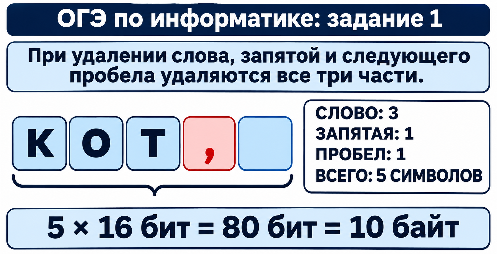
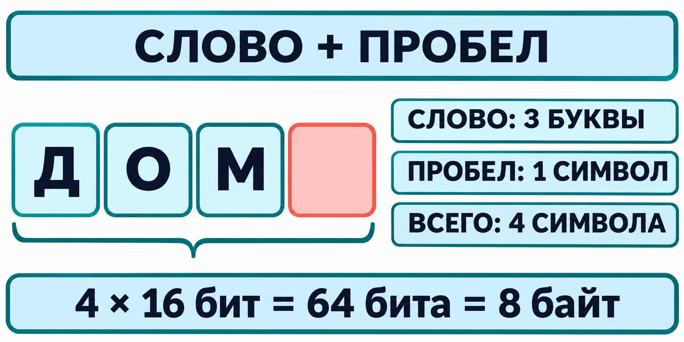
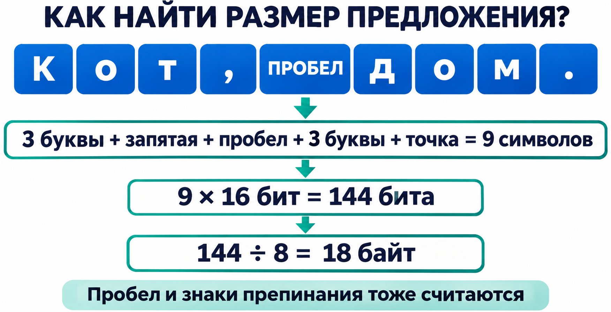
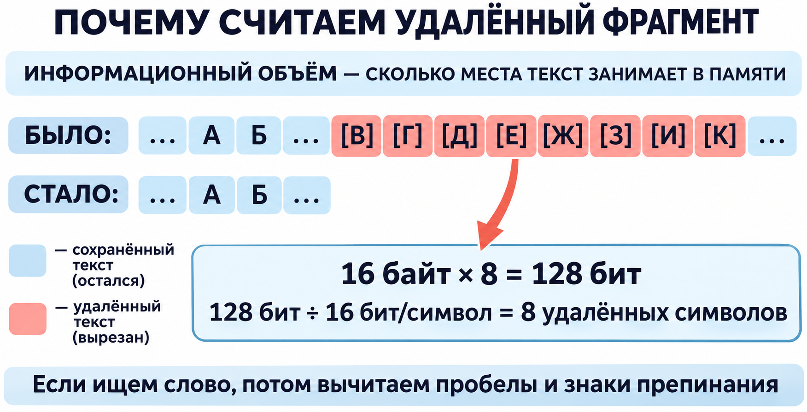

# ОГЭ по информатике: задание 1

## Объём текста и количество символов

**Информационный объём** — это размер информации: сколько места она занимает в памяти или файле. Его измеряют в битах и байтах. Для текста складывается размер кодов всех символов.

Не путай: **количество символов** — сколько знаков в тексте, а **информационный объём** — сколько места в памяти занимают их коды.

Например, если в тексте 3 символа и каждый кодируется 16 битами, весь текст занимает `3 × 16 = 48 бит`, то есть 6 байт. Это размер текста в памяти, а не число букв в слове.

В демоверсии ФИПИ-2027 дано 16 бит на символ и предлагается найти удалённое слово по уменьшению размера текста. Ниже разобраны три типа: удаляются слово с запятой и пробелом; слово только с пробелом; либо нужно вычислить объём текста или найти число символов по объёму.

## Формулы

Обозначения:

- `i` — сколько бит занимает один символ;
- `K` — количество символов всего текста, если считаем его полный объём;
- `V` — информационный объём текста в байтах;
- `ΔV` — насколько уменьшился объём после удаления части текста.

```text
V = K × i ÷ 8
K = V × 8 ÷ i
число удалённых символов = ΔV × 8 ÷ i
```

Если объём дан в битах, делить или умножать на 8 не нужно:

```text
объём в битах = количество символов × бит на символ
```

**Каждый знак считается отдельно:** буква, цифра, пробел, запятая и точка — это отдельные символы. `1 байт = 8 бит`.

**Почему при удалении считаем все символы фрагмента?** Уменьшение размера показывает, сколько памяти занимал именно удалённый кусок текста. Поэтому сначала считаем все исчезнувшие символы — буквы, пробелы и знаки препинания. Если спрашивают длину слова, потом вычитаем пробел и запятую, которые тоже исчезли.

## Тип 1. Удалили слово, запятую и пробел

Сначала вычисли, сколько символов исчезло всего. Затем вычти запятую и пробел: на само слово останется на два символа меньше.



**Пример.** Объём уменьшился на 16 байт, один символ кодируется 16 битами. Вместе со словом удалили запятую и пробел.

```text
16 × 8 ÷ 16 = 8 символов удалено всего
8 − 1 − 1 = 6 букв в слове
```

Значит, ищем в условии слово из шести букв.

**Правило:**

```text
длина слова = уменьшение в байтах × 8 ÷ бит на символ − 2
```

Вычитай именно два символа, только если условие действительно говорит, что удалили и запятую, и пробел.

## Тип 2. Удалили слово и пробел

Запятую не вычитай, если её нет в условии или она осталась в тексте. Из общего числа удалённых символов убери только один пробел.



**Пример.** Уменьшение — 8 байт, один символ кодируется 16 битами. Удалены слово и один пробел:

```text
8 × 8 ÷ 16 = 4 символа удалено всего
4 − 1 = 3 буквы в слове
```

**Правило:**

```text
длина слова = уменьшение в байтах × 8 ÷ бит на символ − 1
```

## Тип 3. Найти объём текста или число символов

### 3а. Посчитать размер предложения

Если в условии дано само предложение, посчитай **все символы** в нём: буквы, пробелы, запятые, точки и другие знаки. Затем умножь их количество на число бит на символ. Если ответ нужен в байтах, раздели результат на 8.



**Пример.** В предложении `Кот, дом.` девять символов: 3 буквы + запятая + пробел + 3 буквы + точка. Если каждый символ кодируется 16 битами:

```text
9 × 16 = 144 бита
144 ÷ 8 = 18 байт
```

Кавычки, которыми предложение выделено в условии, не считай, если они не являются частью самого текста.

### 3б. Найти число символов по объёму

Если известен объём всего текста, переведи байты в биты и раздели на число бит на символ.

**Пример.** Текст занимает 120 байт, один символ кодируется 16 битами:

```text
120 × 8 ÷ 16 = 60 символов
```

### 3в. Посчитать удалённые символы по разнице объёма

Если спрашивают, сколько символов удалено, ответом будет число символов во всём удалённом фрагменте. Разница между размером текста до удаления и после него — это объём этого фрагмента.



На схеме красным показаны символы, которых больше нет после удаления. Именно их суммарный объём равен разнице размера текста:

```text
16 × 8 = 128 бит
128 ÷ 16 = 8 символов
```

Значит, удалённый фрагмент содержал 8 символов. Если требуется найти не число символов фрагмента, а длину слова внутри него, вычти пробелы и знаки препинания по условию — смотри тип 1 или тип 2.

## Пример из демоверсии ФИПИ-2027

В списке предметов удалили название одного предмета, а также запятую и пробел. Размер предложения уменьшился на 16 байт. Каждый символ занимает 16 бит. Найди название предмета.

1. Переводим уменьшение объёма в биты: `16 × 8 = 128 бит`.
2. Считаем все исчезнувшие символы: `128 ÷ 16 = 8 символов`.
3. Убираем запятую и пробел: `8 − 2 = 6 букв`.
4. В списке находим слово из шести букв: **физика**.

Проверка: `физика` — 6 букв, плюс запятая и пробел — всего 8 символов. `8 × 16 = 128 бит = 16 байт`.

## Универсальный порядок действий

1. Найди в условии число бит на один символ.
2. Определи, что дано: изменение объёма или объём всего текста.
3. Если объём дан в байтах, умножь его на 8.
4. Раздели число бит на `i` — получишь количество символов.
5. Если нужно найти слово, вычти только те пробелы и знаки препинания, которые удалялись вместе с ним.
6. Если нужно просто количество символов, ничего не вычитай.
7. Проверь ответ по исходному тексту и запиши без лишних знаков.

## Самопроверка

1. Найди размер предложения `Я дома!`, если каждый символ кодируется 16 битами. Сколько байт оно занимает?
2. Уменьшение — 14 байт, кодировка — 16 бит на символ. Удалены слово, запятая и пробел. Сколько букв в слове?
3. Уменьшение — 10 байт, кодировка — 16 бит на символ. Удалены слово и пробел, запятой нет. Сколько букв в слове?
4. Текст уменьшился на 24 байта; символ занимает 8 бит. Сколько символов удалено?

<details>
<summary>Ответы с решением</summary>

1. В `Я дома!` 7 символов. `7 × 16 = 112 бит`; `112 ÷ 8 = 14 байт`.
2. `14 × 8 ÷ 16 = 7` символов всего; `7 − 2 = 5` букв.
3. `10 × 8 ÷ 16 = 5` символов всего; `5 − 1 = 4` буквы.
4. `24 × 8 ÷ 8 = 24` символа.

</details>

## Частые ошибки

- Забыть перевести байты в биты: при объёме в байтах сначала умножай на 8.
- Вычесть два символа автоматически, хотя удалялся только пробел.
- Вычесть пунктуацию, когда требуется только общее количество удалённых символов.
- Не считать пробелы и запятые самостоятельными символами.
- Считать удалённый пробел не с той стороны слова. Следуй формулировке и смотри, какие знаки действительно исчезли.

## Источники

- [Раздел ФИПИ с демоверсиями, спецификациями и кодификаторами ОГЭ-2027](https://fipi.ru/oge/demoversii-specifikacii-kodifikatory)
- [Официальный комплект материалов ФИПИ по информатике ОГЭ-2027](https://doc.fipi.ru/oge/demoversii-specifikacii-kodifikatory/2027/inf_9_2027.zip)
