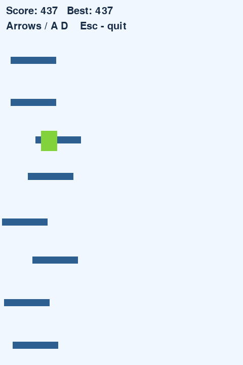
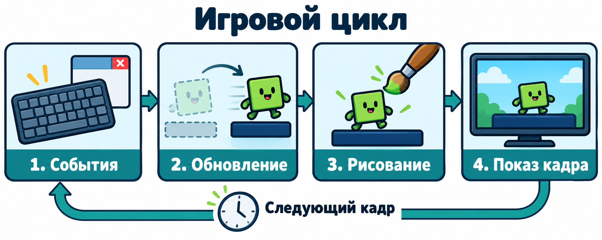
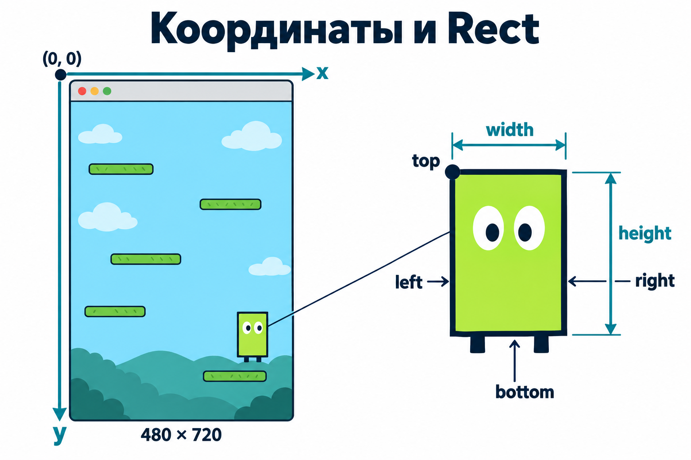
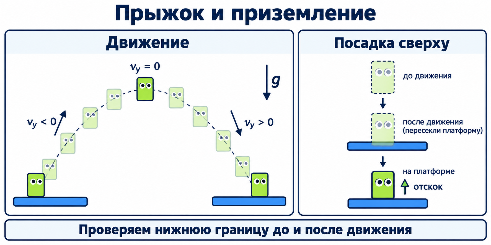
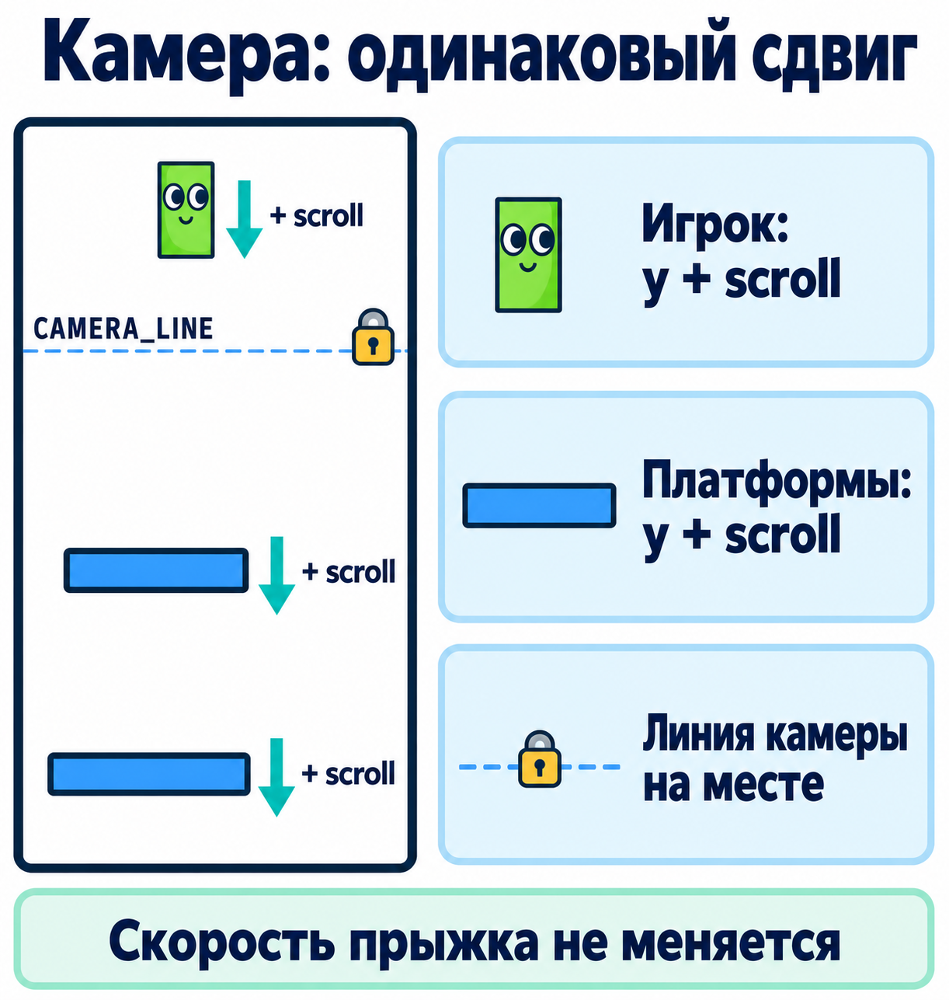

# Doodle Jump на Pygame: создаём игру с нуля

Это подробный практический материал для ученика, который уже знает переменные, условия, циклы, списки и функции Python, но ещё не работал с Pygame. Мы начнём с пустого файла и постепенно соберём игру: герой сам отскакивает от платформ, игрок управляет им по горизонтали, камера следует за подъёмом, сверху появляются новые платформы, а падение завершает попытку.

Ничего из Pygame заранее знать не требуется. Каждый новый инструмент сначала получает понятную задачу, затем объяснение и только потом используется в программе.

**Что получится.** Окно размером 480 × 720 пикселей, зелёный прямоугольник-герой, синие платформы, бесконечный маршрут, счёт и перезапуск. В нашей учебной версии герой останавливается у боковых границ окна. Прыжок автоматический: пробел нажимать не нужно. Платформы пропускают героя снизу вверх и ловят только при падении.

Так выглядит настоящая программа после прохождения этапов:



Начинаем с геометрических фигур: так легче увидеть, что именно делает программа. Нарисованные в иллюстрациях глаза и декорации помогают объяснить идею; сама первая версия игры рисует обычные прямоугольники. Сгенерированные PNG — учебные схемы, а не точные снимки окна и не обязательные игровые ресурсы.

## Как пользоваться материалом

Быстрый поиск по частым затруднениям: [как читать код](#reading-code), [что означает top](#rect-top), [что означает self.rect.top](#self-rect-top), [все переменные проекта](#project-names), [как увидеть ошибку по значениям](#debug-values).

На каждом этапе работай в одном файле `main.py`:

1. Прочитай, **какую задачу** решаем и почему она нужна игре.
2. Набирай по одной строке из раздела «Пишем построчно» и сразу читай её объяснение. Особое внимание — отступам.
3. Запусти программу и выполни короткую проверку.
4. Объясни результат своими словами и попробуй предложенный эксперимент.
5. Переходи дальше, когда текущая версия работает.

Рядом лежат [контрольные версии всех этапов](steps/). Это отдельные полные программы. Если запутался, скопируй **один файл целиком** в `main.py` и начни с него. В каждом разделе также раскрывается полный код именно этого этапа. Смешивать половину одного этапа с половиной другого не нужно.

Полная готовая игра находится в [main.py](main.py), но для обучения полезнее пройти путь по порядку.

| Этап | Что появится | Главный новый вопрос |
|---|---|---|
| 1 | Окно и игровой цикл | Почему программа постоянно повторяет одни действия? |
| 2 | Герой на экране | Что такое координаты, Surface и Rect? |
| 3 | Движение стрелками | Чем удержание отличается от события нажатия? |
| 4 | Падение и пол | Как скорость отличается от координаты? |
| 5 | Автоматический отскок | Как понять, что герой приземлился сверху? |
| 6 | Несколько платформ | Как один алгоритм применить к списку объектов? |
| 7 | Случайный маршрут | Как добавить случайность и сохранить достижимость? |
| 8 | Камера | Почему платформы движутся вниз, когда герой поднимается? |
| 9 | Бесконечная высота | Откуда берутся новые платформы и куда исчезают старые? |
| 10 | Счёт, проигрыш, перезапуск | Что нужно обновлять, а что сохранять между попытками? |


### Как писать по одной строке

В каждом этапе сначала идёт раздел **«Пишем построчно»**. Читай и набирай по одной показанной строке. Сразу под ней объясняется, что она добавляет программе. Число пробелов указано отдельно: это отступ строки в `main.py`, а не часть имени команды.

Сначала закончи текущее изменение целиком. Одинокая строка `if ...:`, незакрытая скобка или объявление функции без тела — временно незавершённый код. **После каждой отдельной строки запускать программу не нужно.** Запускай в контрольных точках, где это прямо предложено.

В начале первого этапа файл пустой. Начиная со второго, продолжаем свою предыдущую работающую версию. Для каждого изменения указаны старый фрагмент и соседние строки: найди это место, затем набирай замену построчно. Старый и новый варианты одновременно не оставляй. Строки, которых изменение не касается, остаются на месте.

Номера рядом с объяснениями относятся к полной контрольной версии **текущего** этапа и в файл не вводятся. Пустые строки разделяют части для чтения; они не выполняют действие и не заканчивают блок с отступом. В построчном разборе пропускаются только такие пустые строки. Первое описание между тройными кавычками и подпись окна также разобраны, хотя механику игры они не меняют.

Если изменился только отступ знакомой строки, прочитай её объяснение ещё раз: команда выполняется в новом блоке и может срабатывать при других условиях. Разделы после построчного написания помогают проверить понимание и разобрать числа подробнее. Полный код — контрольный образец после написания.

### Что ты научишься объяснять и делать

После проекта ты сможешь:

1. По записи `player.bottom = platform.top` объяснить, какой объект меняется, откуда берётся число и почему герой оказывается на платформе.
2. Разобрать один кадр по порядку: клавиши → координаты → скорость → посадка → камера → изображение.
3. Добавить механизм в нужное место программы, сохранив отступы и уже работающие части.
4. Проследить значения нескольких переменных вручную и найти строку, после которой возникла ошибка.
5. Самостоятельно изменить одно правило игры и проверить обычный случай и границу.

<a id="reading-code"></a>

### Как читать записи в коде

Имена вроде `player` и `velocity_y` выбираем мы. Имена `pygame.Rect`, `top` у Rect и `pygame.QUIT` предоставляет библиотека. Если переименовываешь своё имя, меняй все его использования. Готовое имя библиотеки нельзя произвольно заменить переводом.

| Запись | Как прочитать | Что получается |
|---|---|---|
| `WIDTH = 480` | Вычисли справа и сохрани под именем слева | Имя `WIDTH` связано с числом 480 |
| `x += 5` | Возьми прежний x, прибавь 5, запиши обратно | Для числа это сокращение `x = x + 5` |
| `x == 5` | Проверь, равен ли x пяти | `True` или `False`; x не меняется |
| `object.name` | Обратись к атрибуту `name` у объекта | Например, к числу или методу, связанному с объектом |
| `function(...)` | Вызови функцию с аргументами в скобках | Выполнение действия и, возможно, возвращённый результат |
| `object.method(...)` | Вызови метод объекта | Например, `screen.fill(...)` заполняет этот холст |
| `items[index]` | Возьми элемент по индексу | Например, `platforms[-1]` — последняя платформа |
| `if condition:` | Выполни блок, только если условие истинно | Двоеточие открывает блок с отступом |

Точка сама по себе ничего не перемещает. В `player.top` мы читаем атрибут; в `player.top = 100` присваиваем ему значение; в `screen.fill(...)` вызываем метод. Скобки после имени — важная часть записи вызова.

**Отступ — часть программы.** В этом уроке каждый уровень вложенности равен четырём пробелам. Строка с отступом 8 пробелов может находиться внутри `if`, который сам находится внутри `while`. Пустая строка нужна для чтения и не завершает блок; уменьшение отступа завершает его.

В полных версиях первая строка между тройными кавычками — описание файла. Она не создаёт окно и не управляет игрой. Строка после `#` — комментарий для читателя; Python её не выполняет. Пустые строки между частями программы можно сохранять как в образце.

**Два способа работы.** Основной — изменить свою предыдущую версию по разделу «Пишем построчно», затем свериться с полной. Запасной — заменить весь `main.py` контрольной версией этапа и заново разобрать изменения. Не вставляй полную программу внутрь старой: получатся два окна, два цикла или повторная инициализация.

Полные программы начинаются с запуска Python, а не продолжают память предыдущего запуска. Изменил файл → сохранил → закрыл прежнюю игру → запустил заново. Уже открытое окно не подхватывает изменения файла автоматически.

## 0. Готовим рабочее место

### Что такое библиотека

Python уже умеет считать, хранить данные и выполнять циклы. Но обычный `print()` пишет в терминал, а нам нужны окно, рисунки, клавиатура и время. **Pygame** — библиотека: набор готовых инструментов для таких задач. Мы подключим её через `import pygame`.

Для этой учебной версии закреплена Pygame 2.6.1: это позволяет всем ученикам запускать один и тот же вариант библиотеки. Для простого начала подойдут Python 3.11 или 3.12. На более новых версиях Python установка старого выпуска Pygame иногда требует сборки; новичку удобнее использовать Python 3.12. [Страница выбранного выпуска Pygame](https://pypi.org/project/pygame/2.6.1/).

Если Python ещё не установлен, установи его с [python.org](https://www.python.org/downloads/). На Windows при установке включи добавление Python в PATH. Затем открой редактор, например VS Code, создай папку `doodle_jump` и открой её как проект.

### Терминал и файл программы — разные места

В `main.py` мы пишем **Python-код**. Команды установки и запуска вводятся в **терминале** — отдельной панели редактора или отдельном окне. Не вставляй команду `pip install` в файл игры и не вводи команды в приглашение Python `>>>`.

Открой терминал в папке проекта. Убедись, что Python найден:

- Windows: `py --version`.
- macOS / Linux: `python3 --version`.

Ниже команды для окружения с Python 3.11/3.12. Если установлено несколько версий, можно явно выбрать `py -3.12` на Windows или `python3.12` на macOS/Linux вместо первой команды создания окружения.

### Создаём отдельное окружение

**Окружение** — папка, в которой хранятся библиотеки именно этого проекта. Оно помогает не перепутать разные установки Python. Мы будем запускать Python прямо из этой папки, поэтому включать окружение специальной командой не потребуется.

Windows, терминал PowerShell:

```powershell
py -m venv .venv
.\.venv\Scripts\python.exe -m pip install pygame==2.6.1
.\.venv\Scripts\python.exe -c "import pygame; print(pygame.version.ver)"
```

macOS / Linux:

```bash
python3 -m venv .venv
.venv/bin/python -m pip install pygame==2.6.1
.venv/bin/python -c "import pygame; print(pygame.version.ver)"
```

В последней строке должно появиться `2.6.1`. Pygame может также напечатать приветствие — это нормально. Если в Linux отсутствует модуль `venv`, установи пакет `python3-venv` средствами своего дистрибутива и повтори создание окружения.

Создай пустой файл `main.py`. Для каждого запуска дальше используй:

| Система | Команда из папки проекта |
|---|---|
| Windows | `.\.venv\Scripts\python.exe main.py` |
| macOS / Linux | `.venv/bin/python main.py` |

Дальше фраза **«запусти main.py»** означает соответствующую команду из этой таблицы. Если редактор предлагает выбрать интерпретатор, укажи Python из `.venv`.

При скачивании готовой папки можно установить зависимости через `-m pip install -r requirements.txt` тем же Python из окружения. Для самостоятельного написания достаточно установки выше. Для игры нужны локальный Python и графический рабочий стол: обычная ячейка Google Colab не откроет такое окно на твоём компьютере.


## 1. Открываем окно и учимся его закрывать

**Зачем этот этап.** До прыжков нужно убедиться, что Pygame установлен, умеет открыть окно и получает команды от операционной системы.

Начни с пустого `main.py`. Напиши программу по одной строке из следующего разбора. Пока не добавляй героя или платформы: наша цель — светлое окно, которое спокойно закрывается.


<!-- linewise:start stage=1 -->

### Пишем построчно: этап 1

Открой пустой `main.py`. Набирай следующие строки сверху вниз. Закончи весь этап до первого запуска. Отступы показаны и в коде, и рядом с ним.

#### Изменение 1

Начни файл со следующей строки и продолжай вниз:

**Набери строку 1. Пробелов в начале: 0.**

```python
"""Doodle Jump: учебный этап 1. Полная запускаемая программа."""
```

Записываем описание учебного файла между тройными кавычками. Здесь указаны название проекта и номер этапа 1. Это строка документации: она помогает узнавать версию, но не открывает окно и не влияет на движение. Тройные кавычки закрыты в той же строке.

**Набери строку 3. Пробелов в начале: 0.**

```python
import pygame
```

Подключаем библиотеку Pygame и получаем имя `pygame`. Через это имя дальше обращаемся к окну, событиям, прямоугольникам и рисованию. Сам импорт ещё не открывает окно.

**Набери строку 5. Пробелов в начале: 0.**

```python
pygame.init()
```

Вызываем начальную настройку модулей Pygame. Точка выбирает функцию `init` из библиотеки, а пустые круглые скобки запускают её без наших аргументов. Эта подготовка выполняется один раз перед созданием окна.

**Набери строку 7. Пробелов в начале: 0.**

```python
WIDTH = 480
```

Создаём имя `WIDTH` и связываем его с целым числом 480 — шириной области рисования в пикселях. Это размер окна, не координата героя. Далее можно менять настройку в одном месте вместо поиска всех чисел 480.

**Набери строку 8. Пробелов в начале: 0.**

```python
HEIGHT = 720
```

Сохраняем высоту области рисования: 720 пикселей. В паре размеров ширина идёт первой, высота второй. Пиксели по y имеют номера от 0 до 719, а нижняя граница области находится на 720.

**Набери строку 9. Пробелов в начале: 0.**

```python
FPS = 60
```

Задаём верхний предел частоты — 60 кадров в секунду. Один кадр будет одним проходом главного цикла. Само присваивание ничего не замедляет: настройку позже прочитает `clock.tick(FPS)`.

**Набери строку 11. Пробелов в начале: 0.**

```python
BACKGROUND = (240, 247, 255)
```

Сохраняем цвет фона как тройку RGB: 240 красного, 247 зелёного, 255 синего. Скобки с запятыми образуют кортеж из трёх чисел от 0 до 255. Пока это только данные; заливку выполнит `screen.fill`.

**Набери строку 12. Пробелов в начале: 0.**

```python
PLAYER_COLOR = (130, 210, 60)
```

Готовим зелёный цвет героя: красная составляющая 130, зелёная 210, синяя 60. На первом этапе героя ещё нет, поэтому этот цвет пока не используется. На следующем этапе его прочитает команда рисования героя.

**Набери строку 13. Пробелов в начале: 0.**

```python
PLATFORM_COLOR = (45, 95, 145)
```

Готовим синий цвет пола и платформ. Имя не создаёт платформу: оно хранит только тройку чисел цвета. Рисование этого цвета появится при добавлении пола.

**Набери строку 15. Пробелов в начале: 0.**

```python
screen = pygame.display.set_mode((WIDTH, HEIGHT))
```

Сначала вызываем `pygame.display.set_mode` с одной парой размеров `(480, 720)`. Внешние скобки — вызов, внутренние — кортеж ширины и высоты. Открывается окно, функция возвращает его холст Surface; сохраняем его под именем `screen`, чтобы дальше рисовать именно на нём.

**Набери строку 16. Пробелов в начале: 0.**

```python
pygame.display.set_caption("Doodle Jump — step 1")
```

Задаём подпись окна «Doodle Jump — step 1». Кавычки выделяют строку текста; менять её нужно в прежнем вызове, а не добавлять новое окно. Номер помогает отличить запущенный этап. На координаты и физику подпись не влияет.

**Набери строку 17. Пробелов в начале: 0.**

```python
clock = pygame.time.Clock()
```

Создаём объект часов Pygame и сохраняем его как `clock`. Заглавная `C` в `Clock` важна: это готовое имя библиотеки. Часы создаём до цикла, чтобы один и тот же объект измерял промежутки между кадрами.

**Набери строку 19. Пробелов в начале: 0.**

```python
running = True
```

Создаём логический флаг работы программы. Значение `True` означает «да, продолжаем». Вначале оно разрешит вход в `while`; при запросе выхода мы изменим этот же флаг на `False`.

**Набери строку 20. Пробелов в начале: 0.**

```python
while running:
```

Открываем главный игровой цикл: пока `running` истинно, выполняем вложенные строки снова и снова. Двоеточие означает, что дальше нужен блок с отступом. Условие перечитывается перед каждым новым проходом; сам цикл не создаёт изображение.

**Набери строку 21. Пробелов в начале: 4.**

```python
    clock.tick(FPS)
```

Обращаемся к нашим часам и ограничиваем темп цикла значением 60 кадров в секунду. При необходимости метод задерживает слишком быстрый следующий кадр. Здесь возвращённое время ещё не сохраняем; на этапе управления оно понадобится для расчёта движения.

**Набери строку 22. Пробелов в начале: 4.**

```python
    for event in pygame.event.get():
```

Забираем накопившиеся сообщения окна через `pygame.event.get()`. Цикл `for` по очереди связывает имя `event` с каждым сообщением и выполняет свой блок. Если сообщений нет, тело `for` пропускается, а кадр продолжается. Обрабатывать очередь нужно и тогда, когда герой не движется.

**Набери строку 23. Пробелов в начале: 8.**

```python
        if event.type == pygame.QUIT:
```

Читаем `type` текущего события и сравниваем его с готовой константой `pygame.QUIT` — запросом закрыть окно. Два знака `==` проверяют равенство и ничего не присваивают. Следующая вложенная строка выполнится только для такого события.

**Набери строку 24. Пробелов в начале: 12.**

```python
            running = False
```

В ответ на запрос закрыть окно меняем флаг работы на `False`. Само присваивание не перескакивает к концу файла: выполнение продолжится до проверки `if not running`. Она завершит главный цикл, после чего вызовется `pygame.quit()`.

**Набери строку 26. Пробелов в начале: 4.**

```python
    if not running:
```

Проверяем флаг после обработки событий. `not` обращает логическое значение: если `running` стало `False`, выражение истинно. Тогда следующая строка немедленно завершит главный цикл, и мы не будем рисовать ещё один кадр после команды выхода.

**Набери строку 27. Пробелов в начале: 8.**

```python
        break
```

Выходим из ближайшего цикла — здесь это главный `while running`. Цикл событий `for` к этой строке уже завершён, потому что отступ уменьшился. Рисование ниже пропускается, выполнение переходит к `pygame.quit()` после цикла.

**Набери строку 29. Пробелов в начале: 4.**

```python
    screen.fill(BACKGROUND)
```

Заполняем весь холст `screen` цветом `BACKGROUND`. Это стирает рисунок предыдущего кадра, чтобы движущиеся объекты не оставляли следы. Все объекты текущего кадра рисуем после этой строки: заливка поверх героя скрыла бы его.

**Набери строку 31. Пробелов в начале: 4.**

```python
    pygame.display.flip()
```

Показываем в окне готовое изображение, которое подготовили на `screen` в этом кадре. Вызываем после фона и объектов, один раз за кадр. Без показа кадра изменения холста не будут надёжно появляться на экране.

**Набери строку 33. Пробелов в начале: 0.**

```python
pygame.quit()
```

Завершаем работу модулей Pygame после выхода из главного цикла. Здесь нет отступа: строка не должна выполняться каждый кадр. Затем Python доходит до конца файла и заканчивает программу.

**Контрольная точка: теперь можно запускать.** Запусти `main.py`: появится светлое окно. Закрой крестиком и убедись, что терминал снова принимает команды. Назови строку, которая получает запрос закрытия, и строку, которая завершает цикл.

Если результат отличается, сначала проверь последнее внесённое изменение и отступы. Ниже есть полный код текущего этапа для сверки; не добавляй его вторым экземпляром к своему файлу.

<!-- linewise:end stage=1 -->


### Полная версия этапа: [01_window.py](steps/01_window.py)

<details>
<summary>Раскрыть весь код этого этапа</summary>

```python
"""Doodle Jump: учебный этап 1. Полная запускаемая программа."""

import pygame

pygame.init()

WIDTH = 480
HEIGHT = 720
FPS = 60

BACKGROUND = (240, 247, 255)
PLAYER_COLOR = (130, 210, 60)
PLATFORM_COLOR = (45, 95, 145)

screen = pygame.display.set_mode((WIDTH, HEIGHT))
pygame.display.set_caption("Doodle Jump — step 1")
clock = pygame.time.Clock()

running = True
while running:
    clock.tick(FPS)
    for event in pygame.event.get():
        if event.type == pygame.QUIT:
            running = False

    if not running:
        break

    screen.fill(BACKGROUND)

    pygame.display.flip()

pygame.quit()
```

</details>


### Разбираем программу по порядку

| Строка или группа строк | Что делает | Зачем нужна |
|---|---|---|
| `import pygame` | Подключает библиотеку | Даёт доступ к `pygame.display`, `pygame.event` и другим инструментам |
| `pygame.init()` | Подготавливает модули Pygame | Вызывается до работы с окном и другими возможностями |
| `WIDTH`, `HEIGHT` | Хранят ширину и высоту | Одни числа используются во всей программе |
| `BACKGROUND = (240, 247, 255)` | Задаёт цвет RGB | Три числа 0–255: красная, зелёная и синяя составляющие |
| `display.set_mode((WIDTH, HEIGHT))` | Открывает окно | Возвращает `Surface`, на котором будем рисовать |
| `display.set_caption(...)` | Меняет подпись окна | Помогает отличить нашу программу от других окон |
| `pygame.time.Clock()` | Создаёт часы | Помогает ограничить частоту кадров |
| `running = True` | Разрешает продолжать работу | Цикл повторяется, пока переменная истинна |
| `clock.tick(FPS)` | Ограничивает частоту сверху | Игра не пытается делать тысячи кадров в секунду |
| `pygame.event.get()` | Забирает накопившиеся события | Например, просьбу закрыть окно |
| `screen.fill(BACKGROUND)` | Очищает холст цветом | Каждый кадр строится заново |
| `pygame.display.flip()` | Показывает готовый кадр | Делает результат рисования видимым |
| `pygame.quit()` | Завершает работу модулей | Вызывается после выхода из цикла |

**Surface** можно представить как цифровой лист бумаги. `screen` — лист, связанный с окном. **Кадр** — одно готовое изображение. **FPS** — количество кадров за секунду. `tick(60)` ограничивает частоту 60 кадрами сверху, но не обещает, что медленный компьютер всегда успеет выдать ровно 60.

### Почему нужен цикл

Программа с одним `print()` быстро заканчивается. Игра должна долго отвечать на действия пользователя. Поэтому у неё есть **игровой цикл**: получить события → изменить состояние → нарисовать → показать кадр. Сейчас состояние почти не меняется; позже мы заполним это место движением.



На рисунке один обход стрелок — один кадр. Героя на этом этапе ещё нет; картинка показывает устройство будущей программы.

`event` — одно сообщение о случившемся. `pygame.QUIT` означает запрос на закрытие. Мы ставим `running = False`, затем `break` выходит из игрового цикла. Само закрытие окна не должно быть случайным побочным эффектом ошибки.

**Почему очищаем экран каждый раз?** Рисование само не стирает старые изображения. Если не очищать холст, движущийся герой оставит след. Сначала фон, затем все объекты, затем `flip()` — этот порядок будет сопровождать весь проект.

**Проверка.** Окно светлое, заголовок виден, крестик закрывает его без ошибки в терминале. Если окно мгновенно исчезает, прочитай сообщение в терминале и проверь отступы у `while` и `for`.

**Эксперимент.** Измени фон на `(30, 40, 70)`, затем верни прежний. Предскажи, какой станет картинка. Не меняй одновременно ширину, цвет и цикл: так легче понять причину результата.


## 2. Рисуем героя: координаты и прямоугольник Rect

**Зачем этот этап.** Игра должна знать, где находится герой и какого он размера. Пока нарисуем его неподвижным.

<!-- linewise:start stage=2 -->

### Пишем построчно: этап 2

Исходная точка — работающий этап 1. Выполни изменения по порядку. Внутри каждого изменения набирай показанные новые строки по одной, читая объяснение сразу под строкой. Строки, приведённые только как ориентиры, повторно не добавляй.

#### Изменение 1

Найди и убери **ровно этот прежний фрагмент** (пустые строки вокруг него несущественны):

```python
"""Doodle Jump: учебный этап 1. Полная запускаемая программа."""
```

На освободившееся место набери следующую замену по строкам:

После замены продолжится прежняя строка, которую оставляем:

```python
import pygame
```

**Набери строку 1. Пробелов в начале: 0.**

```python
"""Doodle Jump: учебный этап 2. Полная запускаемая программа."""
```

Записываем описание учебного файла между тройными кавычками. Здесь указаны название проекта и номер этапа 2. Это строка документации: она помогает узнавать версию, но не открывает окно и не влияет на движение. Тройные кавычки закрыты в той же строке.

#### Изменение 2

Добавь новые строки **между** двумя существующими ориентирами. Сверху остаётся:

```python
PLATFORM_COLOR = (45, 95, 145)
```

Снизу остаётся:

```python
screen = pygame.display.set_mode((WIDTH, HEIGHT))
```

**Набери строку 15. Пробелов в начале: 0.**

```python
PLAYER_WIDTH = 32
```

Задаём ширину героя — 32 пикселя. Это собственная настройка размера прямоугольника; она не меняет ширину окна. Позже её также вычтем из ширины окна, чтобы герой целиком помещался у правого края.

**Набери строку 16. Пробелов в начале: 0.**

```python
PLAYER_HEIGHT = 40
```

Задаём высоту героя — 40 пикселей. Если его верх находится на y = 340, низ будет на `340 + 40 = 380`. Эта высота понадобится и для размещения ног на платформе.

#### Изменение 3

Найди и убери **ровно этот прежний фрагмент** (пустые строки вокруг него несущественны):

```python
pygame.display.set_caption("Doodle Jump — step 1")
```

Он находится после строки-ориентира, которую оставляем:

```python
screen = pygame.display.set_mode((WIDTH, HEIGHT))
```

На освободившееся место набери следующую замену по строкам:

После замены продолжится прежняя строка, которую оставляем:

```python
clock = pygame.time.Clock()
```

**Набери строку 19. Пробелов в начале: 0.**

```python
pygame.display.set_caption("Doodle Jump — step 2")
```

Задаём подпись окна «Doodle Jump — step 2». Кавычки выделяют строку текста; менять её нужно в прежнем вызове, а не добавлять новое окно. Номер помогает отличить запущенный этап. На координаты и физику подпись не влияет.

#### Изменение 4

Добавь новые строки **между** двумя существующими ориентирами. Сверху остаётся:

```python
clock = pygame.time.Clock()
```

Снизу остаётся:

```python
running = True
```

**Набери строку 22. Пробелов в начале: 0.**

```python
player = pygame.Rect(WIDTH // 2 - PLAYER_WIDTH // 2, 340, PLAYER_WIDTH, PLAYER_HEIGHT)
```

Создаём Rect героя из четырёх аргументов: левая x, верхняя y, ширина, высота. Здесь x равна `480 // 2 - 32 // 2 = 224`, y равна 340, размер — 32 × 40. `//` — целочисленное деление. Сохраняем новый объект как `player` один раз до цикла. Сам Rect хранит положение и ничего не рисует.

#### Изменение 5

Добавь новые строки **между** двумя существующими ориентирами. Сверху остаётся:

```python
    screen.fill(BACKGROUND)
```

Снизу остаётся:

```python
    pygame.display.flip()
```

**Набери строку 35. Пробелов в начале: 4.**

```python
    pygame.draw.rect(screen, PLAYER_COLOR, player)
```

Рисуем прямоугольник героя. Аргументы по порядку: где — холст `screen`; каким цветом — `PLAYER_COLOR`; в какой области — текущий Rect `player`. Если ранее изменили координаты этого Rect, рисунок появится на новом месте. Выполняем после заливки фона и перед показом кадра.

**Контрольная точка: теперь можно запускать.** Запусти: герой неподвижен примерно в центре. Найди создание Rect и его рисование. Объясни, почему один из этих вызовов нужен до цикла, а второй — внутри него.

Если результат отличается, сначала проверь последнее внесённое изменение и отступы. Ниже есть полный код текущего этапа для сверки; не добавляй его вторым экземпляром к своему файлу.

<!-- linewise:end stage=2 -->


### Как устроены координаты окна

Экран состоит из маленьких точек — **пикселей**. Начало координат находится в левом верхнем углу области рисования:

- `x` увеличивается вправо;
- `y` увеличивается вниз;
- `(0, 0)` — левый верхний угол;
- `(240, 360)` — центр окна 480 × 720.

Это отличается от привычного графика в тетради, где вертикальная ось часто направлена вверх.



Координаты `screen` относятся к области рисования: заголовок окна и рамка операционной системы в них не входят.

Положение игрока мы опишем объектом **Rect** — прямоугольной областью. Он хранит четыре числа: левую координату, верхнюю координату, ширину, высоту:

```python
player = pygame.Rect(224, 340, 32, 40)
```

Такой прямоугольник занимает 32 пикселя по ширине и 40 по высоте. Его левый верхний угол находится в `(224, 340)`. В полной версии `224` вычисляется как `WIDTH // 2 - PLAYER_WIDTH // 2`: середина окна минус половина ширины героя.

### Rect сам ничего не рисует

`Rect` — данные о положении и границах, а `Surface` — место или изображение для рисования. Чтобы увидеть героя, после очистки фона добавляем:

```python
pygame.draw.rect(screen, PLAYER_COLOR, player)
```

Три аргумента отвечают на вопросы: **где рисовать? каким цветом? в какой области?**

Создаём `player` **один раз до цикла**. Если создавать его на исходном месте каждый кадр, дальнейшее движение будет постоянно сбрасываться.


<a id="rect-top"></a>

### `top` — координата верхней границы, а не отдельная деталь героя

Разбери `player.top` слева направо: `player` — наш объект Rect; точка — доступ к его атрибуту; `top` — числовая координата верхнего края. В данном примере она равна 340. Это не функция, поэтому после `top` нет `()`.

Высота героя 40, значит при `top = 340` нижняя граница `bottom = 380`. Если записать `player.top = 100`, весь прямоугольник переместится: низ станет 140. Размер не изменится. Если затем записать `player.bottom = 660`, Pygame вычислит верх как `660 - 40 = 620`.

Не нужно вручную менять одновременно `top`, `bottom` и `y`: это связанные способы задать положение **одного** прямоугольника. Для Rect `top` и `y` обозначают одну координату. Изменение одного отражается в другом.

Схема для `Rect(224, 340, 32, 40)`:

```text
                   top = y = 340
            (224, 340) +----------+
                      |          |  height = 40
                      +----------+
                   bottom = 380
            left = 224          right = 256
                       width = 32
```

**Предскажи:** если увеличить `player.top` на 10, герой поднимется или опустится? Затем проверь, временно изменив исходную y с 340 на 350. Верни 340. Меньшее значение `top` означает более высокое положение на экране.

<a id="self-rect-top"></a>

### Отдельный разбор: что значит `self.rect.top`

Этот подраздел нужен, если ты встретил `self` в другом варианте игры. Основные десять этапов используют `player.top` и не требуют писать свои классы. Пример ниже запусти в **отдельном файле `rect_self_demo.py`**, не вставляй его вместо героя в `main.py`.

**Класс** описывает, какие данные и действия будут у объектов. **Экземпляр** — конкретный объект этого класса. Создадим класс `Player`, который хранит прямоугольник каждого героя, и метод, который ставит его на платформу:

#### Пишем отдельный пример с `self` по строкам

Работай в пустом `rect_self_demo.py`. Закончи все строки до запуска: незавершённый класс или метод пока нельзя выполнять.

<!-- linewise-extra:start name=self -->

**Набери строку 1. Пробелов в начале: 0.**

```python
import pygame
```

Подключаем библиотеку Pygame и получаем имя `pygame`. Через это имя дальше обращаемся к окну, событиям, прямоугольникам и рисованию. Сам импорт ещё не открывает окно.

**Набери строку 4. Пробелов в начале: 0.**

```python
class Player:
```

Объявляем собственный класс с именем `Player`. Он описывает, как хранить прямоугольник конкретного героя и что с ним делать. Самого героя эта строка ещё не создаёт. После двоеточия тело класса записывается с отступом.

**Набери строку 5. Пробелов в начале: 4.**

```python
    def __init__(self, x, y):
```

Внутри класса объявляем метод начальной настройки экземпляра. При `Player(100, 200)` Python передаст в `self` создаваемый объект, в `x` число 100, в `y` число 200. `self` — общепринятое имя параметра, не отдельная команда библиотеки. Двойные подчёркивания в `__init__` являются частью специального имени.

**Набери строку 6. Пробелов в начале: 8.**

```python
        self.rect = pygame.Rect(x, y, 32, 40)
```

Создаём новый Rect шириной 32 и высотой 40 с координатами из аргументов. Затем сохраняем его в атрибуте `rect` текущего экземпляра, доступного через `self`. При другом вызове `Player(...)` будет создан другой Rect. Без `self.` локальное имя `rect` не стало бы атрибутом героя.

**Набери строку 8. Пробелов в начале: 4.**

```python
    def land_on(self, platform):
```

Объявляем второй метод того же класса — действие посадки. При вызове `hero.land_on(platform)` параметр `self` получит объект `hero`, а параметр `platform` — нашу платформу. Отступ уменьшился с восьми до четырёх пробелов: метод находится рядом с `__init__`, а не внутри него.

**Набери строку 9. Пробелов в начале: 8.**

```python
        self.rect.bottom = platform.top
```

Сначала читаем верх переданной платформы. Затем через `self` находим Rect текущего героя и ставим его низ на эту координату. При поверхности 660 верх героя высотой 40 станет 620. Меняется герой, для которого вызвали метод; остальные экземпляры и сама платформа остаются на месте.

**Набери строку 12. Пробелов в начале: 0.**

```python
hero = Player(100, 200)
```

Создаём первый экземпляр класса и сохраняем как `hero`. Python вызывает его начальную настройку с x = 100 и y = 200. После неё `hero.rect.top` равен 200, `hero.rect.bottom` равен 240. Метод посадки пока не вызывался.

**Набери строку 13. Пробелов в начале: 0.**

```python
other = Player(300, 50)
```

Отдельным вызовом создаём второго героя: его Rect имеет x = 300 и верх 50. У него свой прямоугольник, поэтому его низ равен 90. Это поможет проверить, что `self` выбирает конкретный объект, а не всех героев сразу.

**Набери строку 14. Пробелов в начале: 0.**

```python
platform = pygame.Rect(80, 660, 90, 14)
```

Создаём Rect опоры: левая x = 80, поверхность y = 660, ширина 90, толщина 14. Этот маленький пример не проверяет реальное столкновение и не рисует окно: метод только демонстрирует установку ног на заданную поверхность.

**Набери строку 16. Пробелов в начале: 0.**

```python
print(hero.rect.top, hero.rect.bottom)
```

До посадки печатаем две границы первого героя через пробел: `200 240`. Чтение атрибутов ничего не передвигает. Эта строка даёт исходные числа, чтобы после действия можно было сравнить состояние.

**Набери строку 17. Пробелов в начале: 0.**

```python
hero.land_on(platform)
```

Вызываем действие посадки именно для `hero`. Объект автоматически передаётся в первый параметр `self`; вручную второй раз писать `hero` в скобках не нужно. Переданная платформа задаёт поверхность 660. После вызова у первого героя верх 620 и низ 660.

**Набери строку 18. Пробелов в начале: 0.**

```python
print(hero.rect.top, hero.rect.bottom)
```

После вызова посадки читаем границы того же первого героя и печатаем `620 660`. Верх вычислился как 660 минус высота 40. Запись `hero.rect.top` означает три шага: объект `hero` → его Rect в атрибуте `rect` → число верхней границы `top`.

**Набери строку 19. Пробелов в начале: 0.**

```python
print(other.rect.top, other.rect.bottom)
```

Печатаем верх и низ второго героя: `50 90`. Внутри метода `self` обозначал первого героя, поэтому Rect второго не передвигался. На экране терминала это третья строка вывода, подтверждающая независимость двух экземпляров.

<!-- linewise-extra:end name=self -->

**Полная контрольная версия примера после набора:**

```python
import pygame


class Player:
    def __init__(self, x, y):
        self.rect = pygame.Rect(x, y, 32, 40)

    def land_on(self, platform):
        self.rect.bottom = platform.top


hero = Player(100, 200)
other = Player(300, 50)
platform = pygame.Rect(80, 660, 90, 14)

print(hero.rect.top, hero.rect.bottom)
hero.land_on(platform)
print(hero.rect.top, hero.rect.bottom)
print(other.rect.top, other.rect.bottom)
```

Запуск из терминала: Windows — `.\.venv\Scripts\python.exe rect_self_demo.py`; macOS/Linux — `.venv/bin/python rect_self_demo.py`. Окно не открывается: пример работает с числами и Rect, рисования в нём нет. Помимо возможного приветствия Pygame, ожидается такой вывод:

```text
200 240
620 660
50 90
```

| Строка или имя | Подробное значение |
|---|---|
| `class Player:` | Объявляет новый класс; это ещё не создание героя |
| `def __init__(self, x, y):` | Объявляет метод начальной настройки; Python вызывает его при создании экземпляра. Двойные подчёркивания в имени обязательны |
| `hero = Player(100, 200)` | Создаёт экземпляр; при настройке `x` получает 100, `y` — 200, `self` — создаваемый объект |
| `self` | Параметр метода, через который обращаемся к текущему экземпляру. Это общепринятое имя, не отдельная команда Pygame |
| `self.rect = pygame.Rect(...)` | Создаёт Rect и сохраняет его в атрибуте `rect` именно этого экземпляра |
| `self.rect.top` | У текущего экземпляра возьми `rect`, у прямоугольника возьми число `top` |
| `def land_on(self, platform):` | Объявляет действие экземпляра; `platform` получает переданную платформу |
| `hero.land_on(platform)` | Вызывает метод для `hero`: Python передаёт `hero` первым аргументом `self`, а нашу платформу — следующим |
| `self.rect.bottom = platform.top` | Читает верх платформы 660 и передвигает прямоугольник текущего героя так, чтобы его низ стал 660 |
| `other = Player(300, 50)` | Создаёт другой экземпляр со своим новым Rect; посадка `hero` его не перемещает |

Вызов `hero.land_on(platform)` для этого класса можно прочитать как `Player.land_on(hero, platform)`. В обычном коде используй первый вариант. Писать `hero.land_on(hero, platform)` не нужно: объект уже передаётся автоматически.

`self.top` и `self.rect.top` — разные обращения. Наш `Player` хранит атрибут `rect`, но атрибута `top` у него нет: `hero.top` вызовет `AttributeError`. Атрибут `top` есть у вложенного Rect. В основной игре `player` **уже сам Rect**, поэтому там пишем `player.top` без дополнительного `.rect`.

Наконец, `rect = pygame.Rect(...)` внутри метода создаёт локальное имя этого вызова, а `self.rect = ...` сохраняет доступ к прямоугольнику через экземпляр. Другой метод не получит локальное имя `rect` автоматически. Поэтому часть `self.` здесь имеет конкретную задачу.

**Проверка понимания:** измени y у `other` с 50 на 70. До запуска предскажи все три строки вывода. Объясни, почему результат посадки `hero` не изменился. Разбор механики `self` также есть в [руководстве Python о классах](https://docs.python.org/3/tutorial/classes.html).

### Полная версия этапа: [02_player.py](steps/02_player.py)

<details>
<summary>Раскрыть весь код этого этапа</summary>

```python
"""Doodle Jump: учебный этап 2. Полная запускаемая программа."""

import pygame

pygame.init()

WIDTH = 480
HEIGHT = 720
FPS = 60

BACKGROUND = (240, 247, 255)
PLAYER_COLOR = (130, 210, 60)
PLATFORM_COLOR = (45, 95, 145)

PLAYER_WIDTH = 32
PLAYER_HEIGHT = 40

screen = pygame.display.set_mode((WIDTH, HEIGHT))
pygame.display.set_caption("Doodle Jump — step 2")
clock = pygame.time.Clock()

player = pygame.Rect(WIDTH // 2 - PLAYER_WIDTH // 2, 340, PLAYER_WIDTH, PLAYER_HEIGHT)

running = True
while running:
    clock.tick(FPS)
    for event in pygame.event.get():
        if event.type == pygame.QUIT:
            running = False

    if not running:
        break

    screen.fill(BACKGROUND)
    pygame.draw.rect(screen, PLAYER_COLOR, player)

    pygame.display.flip()

pygame.quit()
```

</details>


### Какие границы доступны

| Поле | Значение для Rect(224, 340, 32, 40) |
|---|---|
| `player.left` или `player.x` | 224 |
| `player.right` | 256 |
| `player.top` или `player.y` | 340 |
| `player.bottom` | 380 |
| `player.width` | 32 |
| `player.height` | 40 |

`right = left + width`, `bottom = top + height`. В Pygame правая и нижняя границы обозначают край области, а не координату последнего закрашенного пикселя. Внутри окна пиксели по x имеют номера от 0 до 479, но правая граница окна равна 480.

Если присвоить `player.bottom = 660`, Pygame передвинет прямоугольник целиком: его верх станет `620`, высота останется 40. Это пригодится при посадке.

**Проверка.** На светлом фоне виден зелёный прямоугольник примерно посередине. Стрелки пока ничего не делают.

**Эксперимент.** Увеличь начальную координату y на 100. Герой сместится вниз. Увеличь x на 50 — вправо. После эксперимента верни контрольную версию.

**Объясни своими словами.** Почему `pygame.Rect(...)` без `pygame.draw.rect(...)` не показывает героя?


## 3. Добавляем управление и учитываем время

**Зачем этот этап.** Игрок должен выбирать, куда лететь. Заодно сделаем скорость понятной: будем задавать её в пикселях **за секунду**.

<!-- linewise:start stage=3 -->

### Пишем построчно: этап 3

Исходная точка — работающий этап 2. Выполни изменения по порядку. Внутри каждого изменения набирай показанные новые строки по одной, читая объяснение сразу под строкой. Строки, приведённые только как ориентиры, повторно не добавляй.

#### Изменение 1

Найди и убери **ровно этот прежний фрагмент** (пустые строки вокруг него несущественны):

```python
"""Doodle Jump: учебный этап 2. Полная запускаемая программа."""
```

На освободившееся место набери следующую замену по строкам:

После замены продолжится прежняя строка, которую оставляем:

```python
import pygame
```

**Набери строку 1. Пробелов в начале: 0.**

```python
"""Doodle Jump: учебный этап 3. Полная запускаемая программа."""
```

Записываем описание учебного файла между тройными кавычками. Здесь указаны название проекта и номер этапа 3. Это строка документации: она помогает узнавать версию, но не открывает окно и не влияет на движение. Тройные кавычки закрыты в той же строке.

#### Изменение 2

Добавь новые строки **между** двумя существующими ориентирами. Сверху остаётся:

```python
PLAYER_HEIGHT = 40
```

Снизу остаётся:

```python
screen = pygame.display.set_mode((WIDTH, HEIGHT))
```

**Набери строку 17. Пробелов в начале: 0.**

```python
PLAYER_SPEED = 260  # пикселей в секунду
```

Задаём горизонтальную скорость 260 пикселей за секунду. Текст после `#` — комментарий об единицах, он не выполняется. В одном кадре мы пройдём только долю этого расстояния: скорость умножим на время кадра.

#### Изменение 3

Найди и убери **ровно этот прежний фрагмент** (пустые строки вокруг него несущественны):

```python
pygame.display.set_caption("Doodle Jump — step 2")
```

Он находится после строки-ориентира, которую оставляем:

```python
screen = pygame.display.set_mode((WIDTH, HEIGHT))
```

На освободившееся место набери следующую замену по строкам:

После замены продолжится прежняя строка, которую оставляем:

```python
clock = pygame.time.Clock()
```

**Набери строку 20. Пробелов в начале: 0.**

```python
pygame.display.set_caption("Doodle Jump — step 3")
```

Задаём подпись окна «Doodle Jump — step 3». Кавычки выделяют строку текста; менять её нужно в прежнем вызове, а не добавлять новое окно. Номер помогает отличить запущенный этап. На координаты и физику подпись не влияет.

#### Изменение 4

Добавь новые строки **между** двумя существующими ориентирами. Сверху остаётся:

```python
player = pygame.Rect(WIDTH // 2 - PLAYER_WIDTH // 2, 340, PLAYER_WIDTH, PLAYER_HEIGHT)
```

Снизу остаётся:

```python
running = True
```

**Набери строку 24. Пробелов в начале: 0.**

```python
player_x = float(player.x)
```

Читаем левую координату Rect и переводим её в дробное число: например, 224 становится 224.0. Сохраняем точное горизонтальное положение в отдельном имени `player_x`, потому что Rect хранит целые координаты. Делаем это при создании сцены; во время обычного движения дробная часть должна сохраняться между кадрами.

#### Изменение 5

Найди и убери **ровно этот прежний фрагмент** (пустые строки вокруг него несущественны):

```python
    clock.tick(FPS)
```

Он находится после строки-ориентира, которую оставляем:

```python
while running:
```

На освободившееся место набери следующую замену по строкам:

После замены продолжится прежняя строка, которую оставляем:

```python
    for event in pygame.event.get():
```

**Набери строку 28. Пробелов в начале: 4.**

```python
    dt = min(clock.tick(FPS) / 1000, 0.05)
```

Вызываем `tick` ровно один раз за кадр, получаем миллисекунды и делим на 1000 для секунд. Из результата и 0.05 функция `min` выбирает меньшее. Например, 20 мс превращаются в 0.02 с, а пауза 300 мс ограничивается 0.05 с. Под именем `dt` сохраняется время для этого шага расчётов.

#### Изменение 6

Добавь новые строки **между** двумя существующими ориентирами. Сверху остаётся:

```python
            running = False
```

Снизу остаётся:

```python
    if not running:
```

**Набери строку 32. Пробелов в начале: 8.**

```python
        if event.type == pygame.KEYDOWN:
```

Проверяем, является ли текущее событие нажатием клавиши. Только внутри этого блока будем читать `event.key`: у события закрытия такого поля может не быть. Этот способ подходит для разового действия — выхода или перезапуска.

**Набери строку 33. Пробелов в начале: 12.**

```python
            if event.key == pygame.K_ESCAPE:
```

Внутри клавиатурного события сравниваем нажатую клавишу с Escape. `pygame.K_ESCAPE` — готовая константа библиотеки. Если совпало, вложенная строка изменит флаг работы программы.

**Набери строку 34. Пробелов в начале: 16.**

```python
                running = False
```

В ответ на нажатие Escape меняем флаг работы на `False`. Само присваивание не перескакивает к концу файла: выполнение продолжится до проверки `if not running`. Она завершит главный цикл, после чего вызовется `pygame.quit()`.

#### Изменение 7

Добавь новые строки **между** двумя существующими ориентирами. Сверху остаётся:

```python
        break
```

Снизу остаётся:

```python
    screen.fill(BACKGROUND)
```

**Набери строку 39. Пробелов в начале: 4.**

```python
    keys = pygame.key.get_pressed()
```

Опросом получаем текущее состояние удержания клавиш и сохраняем как `keys`. Это не одно событие нажатия: один и тот же результат «клавиша удерживается» может приходить много кадров подряд. Поэтому такой опрос подходит для непрерывного движения.

**Набери строку 40. Пробелов в начале: 4.**

```python
    direction = 0
```

Начинаем расчёт направления текущего кадра со значения 0 — без движения. Затем проверки клавиш могут изменить его на -1 или 1. Строка нужна внутри цикла: если клавиши отпущены, прошлое направление не должно сохраняться само.

**Набери строку 41. Пробелов в начале: 4.**

```python
    if keys[pygame.K_LEFT] or keys[pygame.K_a]:
```

Берём из `keys` состояние левой стрелки и буквы A. `or` означает, что достаточно удерживать любую из этих клавиш. Квадратные скобки выбирают состояние конкретной клавиши, а вложенная строка задаст движение влево.

**Набери строку 42. Пробелов в начале: 8.**

```python
        direction -= 1
```

Для нажатой левой стороны вычитаем 1 из направления: из 0 получится -1. Это сокращение `direction = direction - 1`. Отрицательное направление позже уменьшит x, то есть сдвинет героя влево.

**Набери строку 43. Пробелов в начале: 4.**

```python
    if keys[pygame.K_RIGHT] or keys[pygame.K_d]:
```

Отдельно проверяем правую стрелку или D. Это второй `if`, поэтому он проверяется даже после левой стороны. При удержании обеих сторон сначала вычтем 1, затем прибавим 1 и получим 0.

**Набери строку 44. Пробелов в начале: 8.**

```python
        direction += 1
```

Для нажатой правой стороны прибавляем 1 к направлению. Если была только правая клавиша, получится 1; если ранее сработала левая, получится 0. Пока меняется только число направления, а не координата героя.

**Набери строку 46. Пробелов в начале: 4.**

```python
    player_x += direction * PLAYER_SPEED * dt
```

Вычисляем расстояние за кадр и прибавляем его к точной x. Например, вправо при `dt = 0.02`: `1 * 260 * 0.02 = 5.2` пикселя. Влево прибавка будет отрицательной, при направлении 0 — нулевой. Дробная координата накапливает даже части пикселя.

**Набери строку 47. Пробелов в начале: 4.**

```python
    player_x = max(0, min(WIDTH - PLAYER_WIDTH, player_x))
```

Сначала `min(448, player_x)` не разрешает левой координате стать больше 448: герой шириной 32 тогда касается правого края 480. Затем `max(0, ...)` не разрешает уйти левее нуля. Записываем ограниченное значение обратно в точную x, чтобы за краем не копилось невидимое перемещение.

**Набери строку 48. Пробелов в начале: 4.**

```python
    player.x = round(player_x)
```

Округляем точную x до целого и записываем её в Rect героя. Только теперь данные, по которым рисуется прямоугольник, получают новую горизонтальную позицию. `player_x` при этом остаётся дробной: округлённое значение не записываем обратно в неё.

**Контрольная точка: теперь можно запускать.** Запусти: удержание стрелок или A/D двигает героя, отпускание останавливает, оба направления вместе дают остановку. У краёв герой целиком виден. Затем закрой окно через Escape.

Если результат отличается, сначала проверь последнее внесённое изменение и отступы. Ниже есть полный код текущего этапа для сверки; не добавляй его вторым экземпляром к своему файлу.

<!-- linewise:end stage=3 -->


### Событие нажатия и удержание — разные задачи

Для одиночного действия удобно событие `KEYDOWN`: «клавишу только что нажали». Так будет работать выход по Escape и позже перезапуск.

Для непрерывного движения спрашиваем состояние клавиш каждый кадр:

```python
keys = pygame.key.get_pressed()
direction = 0
if keys[pygame.K_LEFT] or keys[pygame.K_a]:
    direction -= 1
if keys[pygame.K_RIGHT] or keys[pygame.K_d]:
    direction += 1
```

`direction` — направление: `-1` влево, `0` стоим, `1` вправо. Если нажаты обе стороны, изменения взаимно уничтожаются. `pygame.K_LEFT` — готовое имя клавиши, его не нужно придумывать самому.

Обработка очереди событий остаётся: окно всё ещё должно закрываться и получать сообщения от системы.

### Что такое dt

Один кадр занимает некоторое время. `clock.tick(FPS)` возвращает его в миллисекундах. В секунде 1000 миллисекунд:

```python
dt = min(clock.tick(FPS) / 1000, 0.05)
player_x += direction * PLAYER_SPEED * dt
```

`dt` — время кадра в секундах. Если скорость 260 пикселей в секунду, за `0.01` секунды герой проходит `2.6` пикселя. При 60 FPS время кадра примерно `1 / 60` секунды, перемещение — около `4.3` пикселя.

Формула проста: **изменение координаты = направление × скорость × время**.

Ограничение `min(..., 0.05)` защищает от огромного скачка после долгой паузы, например при перетаскивании окна. На очень медленном компьютере с кадрами дольше 0.05 секунды игровое время из-за этого замедлится. При обычной частоте кадров движение учитывает реальное время кадра. `tick` вызывается только один раз за кадр.

### Зачем отдельная дробная координата

`Rect` хранит целые координаты. Перемещение за кадр часто дробное, поэтому точное положение держим в `player_x`:

```python
player_x = float(player.x)
```

Это выполняется **до цикла**, а не внутри него. В цикле меняем `player_x` и переносим округлённый результат в `player.x`:

```python
player.x = round(player_x)
```

Иначе маленькие перемещения могли бы теряться при округлении.

### Не выпускаем героя за края

Левая координата героя должна находиться между `0` и `WIDTH - PLAYER_WIDTH`, то есть между 0 и 448:

```python
player_x = max(0, min(WIDTH - PLAYER_WIDTH, player_x))
```

Сначала `min` не даёт уйти слишком далеко вправо, затем `max` — влево. Ограничиваем дробную координату, после этого обновляем Rect.


### Разбор каждой части горизонтального движения

`keys` — результат опроса клавиатуры. Запись `keys[pygame.K_LEFT]` проверяет, удерживается ли левая стрелка сейчас. `or` разрешает альтернативу: левая стрелка **или** A. Два отдельных `if` позволяют проверить обе стороны; `elif` дал бы другой приоритет при одновременном удержании.

| Удерживаемые клавиши | Начальное `direction` в кадре | После левой проверки | После правой |
|---|---:|---:|---:|
| Ничего | 0 | 0 | 0 |
| Влево | 0 | -1 | -1 |
| Вправо | 0 | 0 | 1 |
| Обе стороны | 0 | -1 | 0 |

`direction = 0` находится **внутри** `while`: каждый кадр заново вычисляем направление из текущих клавиш. `player_x = float(player.x)` находится **до** `while`: положение должно сохраняться между кадрами. Это две разные задачи и два разных места инициализации.

Пусть `player_x = 224.0`, нажата правая стрелка и `dt = 0.02`. Тогда:

```text
direction * PLAYER_SPEED * dt = 1 * 260 * 0.02 = 5.2
player_x: 224.0 → 229.2
player.x = round(229.2) → 229
```

В следующем таком кадре считаем от **229.2**, а не от округлённого 229: получаем 234.4. Так дробная часть продолжает участвовать в движении. Рисование использует целочисленный `player`, поэтому после расчёта копируем положение в Rect. Изменение только `player_x` без этой строки не передвинет рисунок.

Ограничение `player_x = max(0, min(WIDTH - PLAYER_WIDTH, player_x))` читаем изнутри наружу. Правая допустимая x равна `480 - 32 = 448`: при ней правый край героя равен 480. `min(448, player_x)` срезает выход вправо, `max(0, ...)` — выход влево.

| Рассчитанная x | После `min(448, x)` | После `max(0, ...)` |
|---:|---:|---:|
| -5 | -5 | 0 |
| 229.2 | 229.2 | 229.2 |
| 450 | 448 | 448 |

Для чтения ту же мысль можно развернуть в две проверки: «если x меньше 0, присвоить 0; если больше 448, присвоить 448». В файле оставляем один вариант. Если ограничить только `player.x`, а дробную x оставить за краем, некоторое время после разворота герой будет пытаться вернуться из невидимой области. Поэтому сначала ограничиваем дробное значение, затем округляем.

**Проверь:** отпусти кнопки — x перестаёт меняться; зажми обе стороны — герой стоит; у каждого края герой полностью виден. При уменьшении FPS с 60 до 30 он должен проходить примерно то же расстояние за секунду. Затем верни 60.

### Полная версия этапа: [03_controls.py](steps/03_controls.py)

<details>
<summary>Раскрыть весь код этого этапа</summary>

```python
"""Doodle Jump: учебный этап 3. Полная запускаемая программа."""

import pygame

pygame.init()

WIDTH = 480
HEIGHT = 720
FPS = 60

BACKGROUND = (240, 247, 255)
PLAYER_COLOR = (130, 210, 60)
PLATFORM_COLOR = (45, 95, 145)

PLAYER_WIDTH = 32
PLAYER_HEIGHT = 40
PLAYER_SPEED = 260  # пикселей в секунду

screen = pygame.display.set_mode((WIDTH, HEIGHT))
pygame.display.set_caption("Doodle Jump — step 3")
clock = pygame.time.Clock()

player = pygame.Rect(WIDTH // 2 - PLAYER_WIDTH // 2, 340, PLAYER_WIDTH, PLAYER_HEIGHT)
player_x = float(player.x)

running = True
while running:
    dt = min(clock.tick(FPS) / 1000, 0.05)
    for event in pygame.event.get():
        if event.type == pygame.QUIT:
            running = False
        if event.type == pygame.KEYDOWN:
            if event.key == pygame.K_ESCAPE:
                running = False

    if not running:
        break

    keys = pygame.key.get_pressed()
    direction = 0
    if keys[pygame.K_LEFT] or keys[pygame.K_a]:
        direction -= 1
    if keys[pygame.K_RIGHT] or keys[pygame.K_d]:
        direction += 1

    player_x += direction * PLAYER_SPEED * dt
    player_x = max(0, min(WIDTH - PLAYER_WIDTH, player_x))
    player.x = round(player_x)

    screen.fill(BACKGROUND)
    pygame.draw.rect(screen, PLAYER_COLOR, player)

    pygame.display.flip()

pygame.quit()
```

</details>


**Где находится движение?** После чтения событий, перед рисованием. Иначе можно нарисовать старое положение или сбросить управление.

**Проверка.** Зажми стрелку: герой движется, отпусти: останавливается. A и D работают так же. У края герой целиком остаётся в окне. Escape закрывает игру. Если клавиши не действуют, щёлкни по окну, чтобы оно получило фокус.

**Эксперимент.** Поставь `PLAYER_SPEED = 130`. Движение должно стать примерно вдвое медленнее. Затем верни 260.

**Проверка понимания.** Почему движение находится не только внутри события `KEYDOWN`? Потому что нам важно всё время удержания, а не только момент нажатия.


## 4. Учим героя падать: координата, скорость и гравитация

**Зачем этот этап.** Для прыжка сначала нужно понять падение. Пока герой будет падать на неподвижный пол и останавливаться.

Здесь легко перепутать три разных величины:

| Величина | Смысл | Единицы |
|---|---|---|
| `player_y` | Где находится верх героя | пиксели |
| `velocity_y` | Как быстро меняется y | пиксели в секунду |
| `GRAVITY` | Как быстро меняется скорость | пиксели в секунду за секунду |

Гравитация — постоянное ускорение вниз. Поэтому скорость падения увеличивается, а не остаётся одинаковой.

После горизонтального движения и до рисования выполняем:

```python
velocity_y += GRAVITY * dt
player_y += velocity_y * dt
player.y = round(player_y)
```

Сначала меняется скорость, затем по новой скорости — положение. Это простая пошаговая модель движения. Формулы работают по тем же единицам, что и горизонтальное перемещение.

<!-- linewise:start stage=4 -->

### Пишем построчно: этап 4

Исходная точка — работающий этап 3. Выполни изменения по порядку. Внутри каждого изменения набирай показанные новые строки по одной, читая объяснение сразу под строкой. Строки, приведённые только как ориентиры, повторно не добавляй.

#### Изменение 1

Найди и убери **ровно этот прежний фрагмент** (пустые строки вокруг него несущественны):

```python
"""Doodle Jump: учебный этап 3. Полная запускаемая программа."""
```

На освободившееся место набери следующую замену по строкам:

После замены продолжится прежняя строка, которую оставляем:

```python
import pygame
```

**Набери строку 1. Пробелов в начале: 0.**

```python
"""Doodle Jump: учебный этап 4. Полная запускаемая программа."""
```

Записываем описание учебного файла между тройными кавычками. Здесь указаны название проекта и номер этапа 4. Это строка документации: она помогает узнавать версию, но не открывает окно и не влияет на движение. Тройные кавычки закрыты в той же строке.

#### Изменение 2

Добавь новые строки **между** двумя существующими ориентирами. Сверху остаётся:

```python
PLAYER_SPEED = 260  # пикселей в секунду
```

Снизу остаётся:

```python
screen = pygame.display.set_mode((WIDTH, HEIGHT))
```

**Набери строку 18. Пробелов в начале: 0.**

```python
GRAVITY = 1600  # пикселей в секунду за секунду
```

Задаём ускорение вниз: каждую секунду вертикальная скорость возрастала бы на 1600 пикселей в секунду. Это не координата и не сама скорость. За кадр длительностью 0.02 с прибавка к скорости составит `1600 * 0.02 = 32`.

**Набери строку 19. Пробелов в начале: 0.**

```python
GROUND_Y = HEIGHT - 60
```

Вычисляем высоту поверхности пола: `720 - 60 = 660` от верха окна. Сохраняем именно y поверхности, на которую должны попадать ноги. Нижние 60 пикселей пока остаются пространством под полом.

#### Изменение 3

Найди и убери **ровно этот прежний фрагмент** (пустые строки вокруг него несущественны):

```python
pygame.display.set_caption("Doodle Jump — step 3")
```

Он находится после строки-ориентира, которую оставляем:

```python
screen = pygame.display.set_mode((WIDTH, HEIGHT))
```

На освободившееся место набери следующую замену по строкам:

После замены продолжится прежняя строка, которую оставляем:

```python
clock = pygame.time.Clock()
```

**Набери строку 22. Пробелов в начале: 0.**

```python
pygame.display.set_caption("Doodle Jump — step 4")
```

Задаём подпись окна «Doodle Jump — step 4». Кавычки выделяют строку текста; менять её нужно в прежнем вызове, а не добавлять новое окно. Номер помогает отличить запущенный этап. На координаты и физику подпись не влияет.

#### Изменение 4

Найди и убери **ровно этот прежний фрагмент** (пустые строки вокруг него несущественны):

```python
player = pygame.Rect(WIDTH // 2 - PLAYER_WIDTH // 2, 340, PLAYER_WIDTH, PLAYER_HEIGHT)
```

Он находится после строки-ориентира, которую оставляем:

```python
clock = pygame.time.Clock()
```

На освободившееся место набери следующую замену по строкам:

После замены продолжится прежняя строка, которую оставляем:

```python
player_x = float(player.x)
```

**Набери строку 25. Пробелов в начале: 0.**

```python
player = pygame.Rect(WIDTH // 2 - PLAYER_WIDTH // 2, 80, PLAYER_WIDTH, PLAYER_HEIGHT)
```

Создаём героя с прежней x = 224, но новым верхом y = 80. Он появится высоко над полом, чтобы было видно разгон при падении. Остальные аргументы сохраняют размер 32 × 40. Заменяем прежнее создание героя, а не создаём второй объект рядом.

#### Изменение 5

Добавь новые строки **между** двумя существующими ориентирами. Сверху остаётся:

```python
player_x = float(player.x)
```

Снизу остаётся:

```python
running = True
```

**Набери строку 27. Пробелов в начале: 0.**

```python
player_y = float(player.y)
```

Создаём точную вертикальную координату из текущего верха Rect: например, 80 превращается в 80.0. В ней между кадрами будет накапливаться дробное движение. Rect получает округлённую копию для проверок и рисования, а эта переменная сохраняет точность.

**Набери строку 28. Пробелов в начале: 0.**

```python
velocity_y = 0.0
```

Задаём вертикальную скорость 0.0 пикселей в секунду: до первого расчёта герой ещё не летит вверх или вниз. Во время следующих кадров скорость будет увеличивать гравитация. Не обнуляем её перед каждым обычным шагом движения, иначе пропадёт накопленный разгон.

#### Изменение 6

Добавь новые строки **между** двумя существующими ориентирами. Сверху остаётся:

```python
    player.x = round(player_x)
```

Снизу остаётся:

```python
    screen.fill(BACKGROUND)
```

**Набери строку 53. Пробелов в начале: 4.**

```python
    velocity_y += GRAVITY * dt
```

Прибавляем к вертикальной скорости ускорение, умноженное на время кадра. Например, при старой скорости 0 и `dt = 0.02` получим 32 пикселя в секунду. Положительное значение направлено вниз. Координата этой строкой ещё не меняется.

**Набери строку 54. Пробелов в начале: 4.**

```python
    player_y += velocity_y * dt
```

Уже обновлённую скорость умножаем на длительность кадра и прибавляем перемещение к точной y. При скорости 32 и времени 0.02 прибавится 0.64 пикселя. Положительная скорость опускает героя, отрицательная поднимает. Порядок после изменения скорости выбран намеренно.

**Набери строку 55. Пробелов в начале: 4.**

```python
    player.y = round(player_y)
```

Передаём округлённую точную y в Rect героя. Атрибут `y` — тот же верх, что и `top`; после присваивания также изменится `bottom`, сохраняя высоту 40. Дальнейшие проверки столкновений и рисование используют уже обновлённый Rect.

**Набери строку 57. Пробелов в начале: 4.**

```python
    if player.bottom >= GROUND_Y:
```

Сравниваем низ героя с поверхностью пола. `>=` срабатывает и при точном касании, и когда за кадр ноги немного прошли сквозь поверхность. Например, низ 665 уже достиг пола на 660. Пока пол занимает всю ширину, отдельная проверка по x не нужна.

**Набери строку 58. Пробелов в начале: 8.**

```python
        player.bottom = GROUND_Y
```

Ставим нижнюю границу Rect ровно на y = 660. Pygame передвигает весь прямоугольник, а не растягивает его: верх автоматически станет `660 - 40 = 620`. Так исправляем проникновение сквозь пол после расчёта движения.

**Набери строку 59. Пробелов в начале: 8.**

```python
        player_y = float(player.y)
```

Согласуем точную y с уже исправленным Rect после установки ног на поверхность. Если Rect.y стал 620, `player_y` становится 620.0. Без этого старая дробная y на следующем кадре снова передвинет Rect обратно и отменит исправление.

**Набери строку 60. Пробелов в начале: 8.**

```python
        velocity_y = 0.0
```

Останавливаем вертикальное падение после исправления положения на полу: текущая скорость становится 0.0. Гравитация на следующем кадре снова добавит небольшое положительное значение, а проверка пола удержит героя. Пока автоматического отскока ещё нет.

#### Изменение 7

Добавь новые строки **между** двумя существующими ориентирами. Сверху остаётся:

```python
    screen.fill(BACKGROUND)
```

Снизу остаётся:

```python
    pygame.draw.rect(screen, PLAYER_COLOR, player)
```

**Набери строку 63. Пробелов в начале: 4.**

```python
    pygame.draw.rect(screen, PLATFORM_COLOR, (0, GROUND_Y, WIDTH, 14))
```

Рисуем пол: его левый край x = 0, верх y = 660, ширина 480, толщина 14. Последний аргумент — кортеж четырёх чисел, который Pygame понимает как прямоугольную область. Пол рисуем перед героем, чтобы оба объекта появились поверх фона.

**Контрольная точка: теперь можно запускать.** Запусти: герой начинает сверху, ускоряется вниз и останавливается на поверхности 660. Влево и вправо он по-прежнему движется. Объясни три строки, которые исправляют посадку.

Если результат отличается, сначала проверь последнее внесённое изменение и отступы. Ниже есть полный код текущего этапа для сверки; не добавляй его вторым экземпляром к своему файлу.

<!-- linewise:end stage=4 -->


### Что происходит в первых кадрах

Если изначально `y = 80`, скорость 0, гравитация 1600 и кадры ровно по `1 / 60` секунды:

| После кадра | Скорость примерно | Дробная y примерно | Rect.y |
|---|---:|---:|---:|
| 1 | 26.7 | 80.44 | 80 |
| 2 | 53.3 | 81.33 | 81 |
| 3 | 80.0 | 82.67 | 83 |

В реальном запуске время кадра немного отличается, поэтому точные числа могут не совпасть. Смысл тот же: герой разгоняется вниз.

### Зачем сейчас пол

Без опоры герой просто исчезнет за нижней границей. На этом этапе рисуем пол на высоте `GROUND_Y = HEIGHT - 60`, то есть y = 660.

Когда низ героя дошёл до пола, ставим его точно на поверхность:

```python
if player.bottom >= GROUND_Y:
    player.bottom = GROUND_Y
    player_y = float(player.y)
    velocity_y = 0.0
```

Здесь **три действия решают три разные задачи**:

1. `player.bottom = GROUND_Y` убирает проникновение в пол.
2. `player_y = float(player.y)` согласует точную координату с исправленным Rect.
3. Обнуление скорости прекращает падение.

Если забыть вторую строку, дробная координата продолжит тянуть героя вниз в следующих кадрах. Если забыть третью — скорость будет расти, хотя герой визуально стоит на полу.

Пол пока занимает всю ширину: он нужен как безопасная площадка для проверки физики.


### Координата, скорость и ускорение — три разных вопроса

| Данные | Вопрос | Единица | Пример |
|---|---|---|---|
| `player_y` | Где верх героя сейчас? | Пиксели | 80.0 |
| `velocity_y` | Как быстро меняется y? | Пиксели в секунду | 32.0 |
| `GRAVITY` | Как быстро увеличивается вертикальная скорость? | Пиксели в секунду за секунду | 1600 |
| `dt` | Какую долю секунды считаем в этом кадре? | Секунды | 0.02 |

Не добавляй 1600 прямо к координате. За кадр `0.02` секунды гравитация добавляет к **скорости** `1600 * 0.02 = 32`, а уже полученная скорость меняет **положение**.

| Кадр при постоянном `dt = 0.02` | Скорость до | Скорость после `+= GRAVITY * dt` | Прибавка к y | Новая `player_y` | Новая `player.y` |
|---|---:|---:|---:|---:|---:|
| 1 | 0 | 32 | 0.64 | 80.64 | 81 |
| 2 | 32 | 64 | 1.28 | 81.92 | 82 |
| 3 | 64 | 96 | 1.92 | 83.84 | 84 |

Это расчёт для специально выбранного времени кадра; реальные значения `dt` немного отличаются. Падение ускоряется, потому что скорость между кадрами сохраняется. Если обнулять её внутри `while` перед расчётом, разгона не получится.

### Почему посадка исправляет сразу три значения

Допустим, после движения `player.y = 625`, значит `bottom = 665`: ноги на пять пикселей прошли ниже поверхности 660. Условие `>=` ловит и точное касание, и такой перелёт.

1. `player.bottom = GROUND_Y` переносит весь Rect: `bottom = 660`, `y = 620`.
2. `player_y = float(player.y)` делает точную y равной 620.0. Иначе в следующем кадре старая дробная координата снова поставит героя ниже пола.
3. `velocity_y = 0.0` прекращает разгон вниз. В следующем кадре гравитация снова слегка потянет героя вниз, а проверка пола снова удержит его на поверхности.

Пока эта проверка — упрощение: пол на всю ширину и всегда ниже героя. На узкой платформе понадобятся ещё горизонтальное попадание и проверка стороны подхода. Их добавим следующим шагом.

### Полная версия этапа: [04_gravity.py](steps/04_gravity.py)

<details>
<summary>Раскрыть весь код этого этапа</summary>

```python
"""Doodle Jump: учебный этап 4. Полная запускаемая программа."""

import pygame

pygame.init()

WIDTH = 480
HEIGHT = 720
FPS = 60

BACKGROUND = (240, 247, 255)
PLAYER_COLOR = (130, 210, 60)
PLATFORM_COLOR = (45, 95, 145)

PLAYER_WIDTH = 32
PLAYER_HEIGHT = 40
PLAYER_SPEED = 260  # пикселей в секунду
GRAVITY = 1600  # пикселей в секунду за секунду
GROUND_Y = HEIGHT - 60

screen = pygame.display.set_mode((WIDTH, HEIGHT))
pygame.display.set_caption("Doodle Jump — step 4")
clock = pygame.time.Clock()

player = pygame.Rect(WIDTH // 2 - PLAYER_WIDTH // 2, 80, PLAYER_WIDTH, PLAYER_HEIGHT)
player_x = float(player.x)
player_y = float(player.y)
velocity_y = 0.0

running = True
while running:
    dt = min(clock.tick(FPS) / 1000, 0.05)
    for event in pygame.event.get():
        if event.type == pygame.QUIT:
            running = False
        if event.type == pygame.KEYDOWN:
            if event.key == pygame.K_ESCAPE:
                running = False

    if not running:
        break

    keys = pygame.key.get_pressed()
    direction = 0
    if keys[pygame.K_LEFT] or keys[pygame.K_a]:
        direction -= 1
    if keys[pygame.K_RIGHT] or keys[pygame.K_d]:
        direction += 1

    player_x += direction * PLAYER_SPEED * dt
    player_x = max(0, min(WIDTH - PLAYER_WIDTH, player_x))
    player.x = round(player_x)
    velocity_y += GRAVITY * dt
    player_y += velocity_y * dt
    player.y = round(player_y)

    if player.bottom >= GROUND_Y:
        player.bottom = GROUND_Y
        player_y = float(player.y)
        velocity_y = 0.0

    screen.fill(BACKGROUND)
    pygame.draw.rect(screen, PLATFORM_COLOR, (0, GROUND_Y, WIDTH, 14))
    pygame.draw.rect(screen, PLAYER_COLOR, player)

    pygame.display.flip()

pygame.quit()
```

</details>


**Проверка.** Герой появляется сверху, ускоряется вниз и останавливается на полу. Его можно двигать влево и вправо. Сам прыжок пока не появляется.

**Эксперимент.** Уменьши гравитацию до 800: падение станет медленнее. Верни 1600.

**Ответь до следующего этапа.** Если положительная скорость увеличивает y и ведёт вниз, какой знак должен быть у скорости прыжка? Отрицательный.


## 5. Делаем автопрыжок и посадку на одну платформу

**Зачем этот этап.** Главная механика Doodle Jump — герой автоматически отскакивает от платформы, а игрок выбирает направление. Научимся отличать посадку сверху от простого соседства прямоугольников.

Вместо широкого пола создаём платформу шириной 90 пикселей. Героя ставим прямо над ней и задаём начальную скорость `JUMP_SPEED = -680`. Первый прыжок начинается сразу. Следующие прыжки начнутся после приземления.



Левая часть рисунка показывает, как меняется знак скорости. Правая — почему нам нужны две позиции нижней границы. Схема условная: точные расстояния определяет программа.

<!-- linewise:start stage=5 -->

### Пишем построчно: этап 5

Исходная точка — работающий этап 4. Выполни изменения по порядку. Внутри каждого изменения набирай показанные новые строки по одной, читая объяснение сразу под строкой. Строки, приведённые только как ориентиры, повторно не добавляй.

#### Изменение 1

Найди и убери **ровно этот прежний фрагмент** (пустые строки вокруг него несущественны):

```python
"""Doodle Jump: учебный этап 4. Полная запускаемая программа."""
```

На освободившееся место набери следующую замену по строкам:

После замены продолжится прежняя строка, которую оставляем:

```python
import pygame
```

**Набери строку 1. Пробелов в начале: 0.**

```python
"""Doodle Jump: учебный этап 5. Полная запускаемая программа."""
```

Записываем описание учебного файла между тройными кавычками. Здесь указаны название проекта и номер этапа 5. Это строка документации: она помогает узнавать версию, но не открывает окно и не влияет на движение. Тройные кавычки закрыты в той же строке.

#### Изменение 2

Добавь новые строки **между** двумя существующими ориентирами. Сверху остаётся:

```python
GROUND_Y = HEIGHT - 60
```

Снизу остаётся:

```python
screen = pygame.display.set_mode((WIDTH, HEIGHT))
```

**Набери строку 20. Пробелов в начале: 0.**

```python
JUMP_SPEED = -680  # пикселей в секунду, вверх
```

Задаём скорость начала каждого прыжка: -680 пикселей в секунду. Минус означает вверх, потому что экранная y увеличивается вниз. Это настройка будущего толчка; сама текущая скорость хранится отдельно в `velocity_y`.

**Набери строку 21. Пробелов в начале: 0.**

```python
PLATFORM_WIDTH = 90
```

Задаём ширину обычной платформы — 90 пикселей. Узкая платформа потребует попадать на неё по горизонтали. Широкое стартовое основание на следующем этапе по-прежнему получит ширину окна, а не эту настройку.

**Набери строку 22. Пробелов в начале: 0.**

```python
PLATFORM_HEIGHT = 14
```

Задаём толщину платформы — 14 пикселей. Посадку будем проверять по её верхней поверхности, но высота нужна для размера видимого Rect. Изменение толщины само по себе не меняет высоту прыжка.

#### Изменение 3

Найди и убери **ровно этот прежний фрагмент** (пустые строки вокруг него несущественны):

```python
pygame.display.set_caption("Doodle Jump — step 4")
```

Он находится после строки-ориентира, которую оставляем:

```python
screen = pygame.display.set_mode((WIDTH, HEIGHT))
```

На освободившееся место набери следующую замену по строкам:

После замены продолжится прежняя строка, которую оставляем:

```python
clock = pygame.time.Clock()
```

**Набери строку 25. Пробелов в начале: 0.**

```python
pygame.display.set_caption("Doodle Jump — step 5")
```

Задаём подпись окна «Doodle Jump — step 5». Кавычки выделяют строку текста; менять её нужно в прежнем вызове, а не добавлять новое окно. Номер помогает отличить запущенный этап. На координаты и физику подпись не влияет.

#### Изменение 4

Найди и убери **ровно этот прежний фрагмент** (пустые строки вокруг него несущественны):

```python
player = pygame.Rect(WIDTH // 2 - PLAYER_WIDTH // 2, 80, PLAYER_WIDTH, PLAYER_HEIGHT)
```

Он находится после строки-ориентира, которую оставляем:

```python
clock = pygame.time.Clock()
```

На освободившееся место набери следующую замену по строкам:

После замены продолжится прежняя строка, которую оставляем:

```python
player_x = float(player.x)
```

**Набери строку 28. Пробелов в начале: 0.**

```python
player = pygame.Rect(WIDTH // 2 - PLAYER_WIDTH // 2, GROUND_Y - PLAYER_HEIGHT, PLAYER_WIDTH, PLAYER_HEIGHT)
```

Ставим верх героя на `660 - 40 = 620`, чтобы его низ сразу совпал с поверхностью на 660. Горизонтальная позиция и размер остаются прежними. В паре с начальной отрицательной скоростью это даст первый прыжок прямо с платформы.

#### Изменение 5

Найди и убери **ровно этот прежний фрагмент** (пустые строки вокруг него несущественны):

```python
velocity_y = 0.0
```

Он находится после строки-ориентира, которую оставляем:

```python
player_y = float(player.y)
```

На освободившееся место набери следующую замену по строкам:

После замены продолжится прежняя строка, которую оставляем:

```python
running = True
```

**Набери строку 31. Пробелов в начале: 0.**

```python
velocity_y = JUMP_SPEED
```

Копируем настройку -680 в текущую вертикальную скорость, чтобы первый прыжок начался сразу. Меняем именно состояние `velocity_y`, а постоянная настройка `JUMP_SPEED` остаётся прежней. В следующем кадре гравитация начнёт постепенно увеличивать эту отрицательную скорость.

**Набери строку 32. Пробелов в начале: 0.**

```python
platform = pygame.Rect(195, GROUND_Y, PLATFORM_WIDTH, PLATFORM_HEIGHT)
```

Создаём отдельный Rect платформы: x = 195, верх y = 660, ширина 90, высота 14. Её правый край равен 285. В отличие от прежнего пола мы сохраняем объект под именем `platform`, чтобы одним и тем же положением пользоваться и в столкновениях, и в рисовании.

#### Изменение 6

Добавь новые строки **между** двумя существующими ориентирами. Сверху остаётся:

```python
    player.x = round(player_x)
```

Снизу остаётся:

```python
    velocity_y += GRAVITY * dt
```

**Набери строку 58. Пробелов в начале: 4.**

```python
    previous_bottom = player.bottom
```

До вертикального движения читаем нижнюю границу героя и сохраняем её как отдельное число. Например, запоминаем 648. Когда Rect позже переместится, это число останется прежним: мы сможем сравнить положение ног до и после кадра.

#### Изменение 7

Найди и убери **ровно этот прежний фрагмент** (пустые строки вокруг него несущественны):

```python
    if player.bottom >= GROUND_Y:
        player.bottom = GROUND_Y
        player_y = float(player.y)
        velocity_y = 0.0
```

Он находится после строки-ориентира, которую оставляем:

```python
    player.y = round(player_y)
```

На освободившееся место набери следующую замену по строкам:

После замены продолжится прежняя строка, которую оставляем:

```python
    screen.fill(BACKGROUND)
```

**Набери строку 63. Пробелов в начале: 4.**

```python
    if velocity_y > 0:
```

Разрешаем проверку посадки только при положительной вертикальной скорости — когда герой падает. При подъёме скорость отрицательна, весь вложенный блок пропускается, и герой проходит платформу снизу. Равенство нулю здесь тоже не считается падением.

**Набери строку 64. Пробелов в начале: 8.**

```python
        horizontal_overlap = (
```

Начинаем вычислять логическое значение: перекрываются ли герой и платформа по горизонтали. Открытая скобка позволяет записать одно выражение на нескольких строках. Пока сравнения и закрывающая скобка не дописаны, эта запись не завершена.

**Набери строку 65. Пробелов в начале: 12.**

```python
            player.right > platform.left
```

Первая часть горизонтального условия: правый край героя должен быть правее левого края платформы. Если он равен ему, есть лишь боковое касание без ширины опоры. Например, правый край 242 проходит проверку для платформы, начинающейся на 195.

**Набери строку 66. Пробелов в начале: 12.**

```python
            and player.left < platform.right
```

Соединяем через `and` второе требование: левый край героя должен быть левее правого края платформы. Обе части обязательны. Иначе герой целиком справа тоже прошёл бы первую проверку. При платформе 195…285 герой 210…242 проходит обе части.

**Набери строку 67. Пробелов в начале: 8.**

```python
        )
```

Закрываем логическое выражение проверки перекрытия по x. Соответствующая открывающая скобка находится выше. Теперь многострочная запись завершена и её результат можно сохранить в имени слева от `=`. Скобка не является отдельной игровой командой, но без неё Python не сможет разобрать следующую строку.

**Набери строку 68. Пробелов в начале: 8.**

```python
        crossed_top = (
```

Начинаем вторую логическую проверку: пересекли ли ноги верх платформы сверху вниз за этот кадр. Снова открываем скобку для многострочного выражения. Проверка по x сама по себе такого перехода не определяет.

**Набери строку 69. Пробелов в начале: 12.**

```python
            previous_bottom <= platform.top
```

Проверяем старое положение: до движения ноги были на уровне поверхности или выше неё. При поверхности 660 старый низ 648 подходит, а 665 уже нет. Поэтому герой, который изначально был ниже платформы, не получит от неё случайного отскока.

**Набери строку 70. Пробелов в начале: 12.**

```python
            and player.bottom >= platform.top
```

Добавляем требование к новому положению: после движения ноги достигли поверхности или прошли ниже. Вместе с предыдущей строкой это ловит переход 648 → 664 через поверхность 660, даже если отдельного кадра с точным значением 660 не было.

**Набери строку 71. Пробелов в начале: 8.**

```python
        )
```

Закрываем логическое выражение проверки перехода через верх платформы. Соответствующая открывающая скобка находится выше. Теперь многострочная запись завершена и её результат можно сохранить в имени слева от `=`. Скобка не является отдельной игровой командой, но без неё Python не сможет разобрать следующую строку.

**Набери строку 72. Пробелов в начале: 8.**

```python
        if horizontal_overlap and crossed_top:
```

Требуем одновременно попасть на платформу по x и пересечь её поверхность по y. Этот `if` уже находится внутри проверки падения, поэтому теперь соблюдены все три условия посадки. Только тогда выполняем исправление положения и новый прыжок.

**Набери строку 73. Пробелов в начале: 12.**

```python
            player.bottom = platform.top
```

Читаем верх конкретной платформы и ставим туда низ героя. Если поверхность на 660, верх героя станет 620. Меняется Rect героя; платформа справа от знака `=` только читается и остаётся на месте.

**Набери строку 74. Пробелов в начале: 12.**

```python
            player_y = float(player.y)
```

Согласуем точную y с уже исправленным Rect после установки ног на поверхность. Если Rect.y стал 620, `player_y` становится 620.0. Без этого старая дробная y на следующем кадре снова передвинет Rect обратно и отменит исправление.

**Набери строку 75. Пробелов в начале: 12.**

```python
            velocity_y = JUMP_SPEED
```

После подтверждённой посадки заменяем прежнюю скорость на -680: начинается следующий автоматический прыжок. Здесь присваивание, а не прибавление: каждый отскок получает одинаковую начальную скорость независимо от скорости падения.

#### Изменение 8

Найди и убери **ровно этот прежний фрагмент** (пустые строки вокруг него несущественны):

```python
    pygame.draw.rect(screen, PLATFORM_COLOR, (0, GROUND_Y, WIDTH, 14))
```

Он находится после строки-ориентира, которую оставляем:

```python
    screen.fill(BACKGROUND)
```

На освободившееся место набери следующую замену по строкам:

После замены продолжится прежняя строка, которую оставляем:

```python
    pygame.draw.rect(screen, PLAYER_COLOR, player)
```

**Набери строку 78. Пробелов в начале: 4.**

```python
    pygame.draw.rect(screen, PLATFORM_COLOR, platform)
```

Рисуем платформу по сохранённому Rect, а не по отдельному набору чисел. Это тот же объект, чьи границы участвуют в посадке: видимая поверхность соответствует проверяемой. В цикле платформ такая строка выполнится отдельно для каждого элемента.

**Контрольная точка: теперь можно запускать.** Запусти без нажатий: герой автоматически подпрыгивает на одной платформе. Уйди в сторону — он упадёт. На этом этапе перезапуска по R ещё нет: закрой окно и запусти снова.

Если результат отличается, сначала проверь последнее внесённое изменение и отступы. Ниже есть полный код текущего этапа для сверки; не добавляй его вторым экземпляром к своему файлу.

<!-- linewise:end stage=5 -->


### Почему герой сначала поднимается, а потом падает

При старте прыжка скорость отрицательная. Гравитация каждый кадр добавляет положительное число. Например, скорость проходит значения «−680, −653, …, около 0, …, +200». Пока она отрицательна — герой поднимается. Затем он начинает падать.

В дискретной программе скорость может перескочить через ноль между кадрами: отдельный кадр с точным `velocity_y == 0` не обязателен.

### Почему одной проверки пересечения мало

Нельзя отскакивать при любом касании: герой должен свободно проходить сквозь платформу снизу и приземляться только при падении.

Условия посадки:

1. Герой падает: `velocity_y > 0`.
2. Его прямоугольник пересекается с платформой по горизонтали.
3. За этот кадр нижняя граница героя пересекла верх платформы сверху вниз.

До изменения вертикальной координаты запоминаем:

```python
previous_bottom = player.bottom
```

После движения проверяем:

```python
horizontal_overlap = (
    player.right > platform.left
    and player.left < platform.right
)
crossed_top = (
    previous_bottom <= platform.top
    and player.bottom >= platform.top
)
```

`and` означает: должны выполняться обе части. `horizontal_overlap` отвечает за попадание ногами в платформу по x. `crossed_top` — за пересечение поверхности по y.

Пример: раньше низ героя был на 648, после движения стал 664, верх платформы на 660. Поверхность пересечена, хотя мы не попали ровно в число 660. Поэтому проверка `player.bottom == platform.top` ненадёжна.

`Rect.colliderect()` умеет находить пересечение прямоугольников, но само по себе не говорит, с какой стороны пришёл герой. Кроме того, при точном касании границ Rect не считает области перекрывающимися. Поэтому для нашей односторонней платформы используем явную проверку перехода через её верх.

### Что делаем при посадке

```python
player.bottom = platform.top
player_y = float(player.y)
velocity_y = JUMP_SPEED
```

Мы ставим героя на поверхность, синхронизируем дробную y и задаём новый толчок вверх. Отдельный флаг «стоит на земле» здесь не требуется: после посадки герой сразу начинает следующий прыжок.


### Посадка как три отдельных решения

**Первое — куда летим?** При `velocity_y < 0` летим вверх и вообще не проверяем посадку. При `velocity_y > 0` падаем и проверяем остальные условия. Значение около нуля — вершина прыжка, отдельной команды «начать падать» не нужно: положительная гравитация продолжает изменять скорость.

**Второе — есть ли платформа под ногами по x?** Пусть платформа занимает интервал от 195 до 285. У героя справа должно быть место правее 195, а слева — место левее 285. Поэтому нужны **обе** проверки, соединённые `and`.

| Горизонтальные границы героя | `right > 195` | `left < 285` | Есть перекрытие? |
|---|---|---|---|
| 210…242 | Да | Да | Да |
| 163…195 | Нет | Да | Нет, только касание края |
| 285…317 | Да | Нет | Нет, только касание края |
| 300…332 | Да | Нет | Нет, герой справа |

**Третье — прошли ли сверху через поверхность за этот кадр?** `previous_bottom` — число, снятое до движения, `player.bottom` — текущее число после движения. При верхе платформы 660:

| Старый низ | Новый низ | Старый `<= 660` | Новый `>= 660` | `crossed_top` |
|---:|---:|---|---|---|
| 648 | 664 | Да | Да | `True` |
| 648 | 655 | Да | Нет | `False`: ещё не долетели |
| 665 | 675 | Нет | Да | `False`: уже были ниже |
| 670 | 650 | Нет | Нет | `False`; к тому же это подъём |

Скобки вокруг многострочного выражения позволяют перенести его на несколько строк. Они не создают дополнительный цикл или проверку. Результат выражения — одно логическое значение, которое сохраняется в `horizontal_overlap` или `crossed_top`.

Если все три решения положительны, ставим ноги на поверхность, согласуем дробную y и меняем скорость на -680. Так исправляем небольшое проникновение и задаём следующий прыжок. Прибавлять к прежней скорости `JUMP_SPEED` не нужно: отскок каждый раз начинается с одинаковой заданной скорости.

**Предскажи ошибку:** если сохранить `previous_bottom` после `player.y = round(player_y)`, старое и новое положения совпадут. При переходе с 648 на 664 обе переменные окажутся равны 664, и пересечение поверхности 660 потеряется.

**Самопроверка перед полной программой:** покажи в своём файле место сохранения старого положения, место движения и место исправления посадки. Они должны идти именно в этом порядке.

### Полная версия этапа: [05_bounce.py](steps/05_bounce.py)

<details>
<summary>Раскрыть весь код этого этапа</summary>

```python
"""Doodle Jump: учебный этап 5. Полная запускаемая программа."""

import pygame

pygame.init()

WIDTH = 480
HEIGHT = 720
FPS = 60

BACKGROUND = (240, 247, 255)
PLAYER_COLOR = (130, 210, 60)
PLATFORM_COLOR = (45, 95, 145)

PLAYER_WIDTH = 32
PLAYER_HEIGHT = 40
PLAYER_SPEED = 260  # пикселей в секунду
GRAVITY = 1600  # пикселей в секунду за секунду
GROUND_Y = HEIGHT - 60
JUMP_SPEED = -680  # пикселей в секунду, вверх
PLATFORM_WIDTH = 90
PLATFORM_HEIGHT = 14

screen = pygame.display.set_mode((WIDTH, HEIGHT))
pygame.display.set_caption("Doodle Jump — step 5")
clock = pygame.time.Clock()

player = pygame.Rect(WIDTH // 2 - PLAYER_WIDTH // 2, GROUND_Y - PLAYER_HEIGHT, PLAYER_WIDTH, PLAYER_HEIGHT)
player_x = float(player.x)
player_y = float(player.y)
velocity_y = JUMP_SPEED
platform = pygame.Rect(195, GROUND_Y, PLATFORM_WIDTH, PLATFORM_HEIGHT)

running = True
while running:
    dt = min(clock.tick(FPS) / 1000, 0.05)
    for event in pygame.event.get():
        if event.type == pygame.QUIT:
            running = False
        if event.type == pygame.KEYDOWN:
            if event.key == pygame.K_ESCAPE:
                running = False

    if not running:
        break

    keys = pygame.key.get_pressed()
    direction = 0
    if keys[pygame.K_LEFT] or keys[pygame.K_a]:
        direction -= 1
    if keys[pygame.K_RIGHT] or keys[pygame.K_d]:
        direction += 1

    player_x += direction * PLAYER_SPEED * dt
    player_x = max(0, min(WIDTH - PLAYER_WIDTH, player_x))
    player.x = round(player_x)

    previous_bottom = player.bottom
    velocity_y += GRAVITY * dt
    player_y += velocity_y * dt
    player.y = round(player_y)

    if velocity_y > 0:
        horizontal_overlap = (
            player.right > platform.left
            and player.left < platform.right
        )
        crossed_top = (
            previous_bottom <= platform.top
            and player.bottom >= platform.top
        )
        if horizontal_overlap and crossed_top:
            player.bottom = platform.top
            player_y = float(player.y)
            velocity_y = JUMP_SPEED

    screen.fill(BACKGROUND)
    pygame.draw.rect(screen, PLATFORM_COLOR, platform)
    pygame.draw.rect(screen, PLAYER_COLOR, player)

    pygame.display.flip()

pygame.quit()
```

</details>


**Проверка.** Без нажатий герой несколько раз подпрыгивает над платформой. Теперь удерживай стрелку и уйди с неё: герой упадёт и исчезнет. На этом этапе проигрыш ещё не оформлен; закрой окно и запусти программу заново.

**Эксперимент.** Поставь `JUMP_SPEED = -500`: прыжок станет ниже. Верни −680 перед продолжением, иначе будущие платформы могут оказаться недостижимыми.

**Объясни своими словами.** Почему `previous_bottom` сохраняется до движения? Почему после исправления `player.bottom` надо менять и `player_y`?


## 6. Добавляем несколько платформ

**Зачем этот этап.** До сих пор мы могли проверить только один отскок. Теперь построим короткую лестницу и применим одно правило столкновения ко всем её ступеням.

<!-- linewise:start stage=6 -->

### Пишем построчно: этап 6

Исходная точка — работающий этап 5. Выполни изменения по порядку. Внутри каждого изменения набирай показанные новые строки по одной, читая объяснение сразу под строкой. Строки, приведённые только как ориентиры, повторно не добавляй.

#### Изменение 1

Найди и убери **ровно этот прежний фрагмент** (пустые строки вокруг него несущественны):

```python
"""Doodle Jump: учебный этап 5. Полная запускаемая программа."""
```

На освободившееся место набери следующую замену по строкам:

После замены продолжится прежняя строка, которую оставляем:

```python
import pygame
```

**Набери строку 1. Пробелов в начале: 0.**

```python
"""Doodle Jump: учебный этап 6. Полная запускаемая программа."""
```

Записываем описание учебного файла между тройными кавычками. Здесь указаны название проекта и номер этапа 6. Это строка документации: она помогает узнавать версию, но не открывает окно и не влияет на движение. Тройные кавычки закрыты в той же строке.

#### Изменение 2

Найди и убери **ровно этот прежний фрагмент** (пустые строки вокруг него несущественны):

```python
pygame.display.set_caption("Doodle Jump — step 5")
```

Он находится после строки-ориентира, которую оставляем:

```python
screen = pygame.display.set_mode((WIDTH, HEIGHT))
```

На освободившееся место набери следующую замену по строкам:

После замены продолжится прежняя строка, которую оставляем:

```python
clock = pygame.time.Clock()
```

**Набери строку 25. Пробелов в начале: 0.**

```python
pygame.display.set_caption("Doodle Jump — step 6")
```

Задаём подпись окна «Doodle Jump — step 6». Кавычки выделяют строку текста; менять её нужно в прежнем вызове, а не добавлять новое окно. Номер помогает отличить запущенный этап. На координаты и физику подпись не влияет.

#### Изменение 3

Найди и убери **ровно этот прежний фрагмент** (пустые строки вокруг него несущественны):

```python
platform = pygame.Rect(195, GROUND_Y, PLATFORM_WIDTH, PLATFORM_HEIGHT)
```

Он находится после строки-ориентира, которую оставляем:

```python
velocity_y = JUMP_SPEED
```

На освободившееся место набери следующую замену по строкам:

После замены продолжится прежняя строка, которую оставляем:

```python
running = True
```

**Набери строку 32. Пробелов в начале: 0.**

```python
platforms = [
```

Начинаем создание списка платформ. Квадратная открывающая скобка означает, что следующие элементы относятся к одной коллекции. Пока не закроем список, запись не завершена. Имя во множественном числе будет обозначать весь маршрут, а не одну ступень.

**Набери строку 33. Пробелов в начале: 4.**

```python
    pygame.Rect(0, GROUND_Y, WIDTH, PLATFORM_HEIGHT),
```

Добавляем в список первый Rect — основание на x = 0, y = 660, шириной 480 и высотой 14. Начинаем маршрут снизу с безопасной опоры во всё окно. Запятая после вызова отделяет этот элемент списка от следующей платформы.

**Набери строку 34. Пробелов в начале: 4.**

```python
    pygame.Rect(150, 580, PLATFORM_WIDTH, PLATFORM_HEIGHT),
```

Добавляем ещё один отдельный Rect платформы: её левая x = 150, верх y = 580, размер — 90 × 14. Чем меньше y, тем выше эта ступень. Запятая разделяет элементы списка; платформа пока лишь записана в данных, а видимой станет в цикле рисования.

**Набери строку 35. Пробелов в начале: 4.**

```python
    pygame.Rect(250, 500, PLATFORM_WIDTH, PLATFORM_HEIGHT),
```

Добавляем ещё один отдельный Rect платформы: её левая x = 250, верх y = 500, размер — 90 × 14. Чем меньше y, тем выше эта ступень. Запятая разделяет элементы списка; платформа пока лишь записана в данных, а видимой станет в цикле рисования.

**Набери строку 36. Пробелов в начале: 4.**

```python
    pygame.Rect(175, 420, PLATFORM_WIDTH, PLATFORM_HEIGHT),
```

Добавляем ещё один отдельный Rect платформы: её левая x = 175, верх y = 420, размер — 90 × 14. Чем меньше y, тем выше эта ступень. Запятая разделяет элементы списка; платформа пока лишь записана в данных, а видимой станет в цикле рисования.

**Набери строку 37. Пробелов в начале: 4.**

```python
    pygame.Rect(270, 340, PLATFORM_WIDTH, PLATFORM_HEIGHT),
```

Добавляем ещё один отдельный Rect платформы: её левая x = 270, верх y = 340, размер — 90 × 14. Чем меньше y, тем выше эта ступень. Запятая разделяет элементы списка; платформа пока лишь записана в данных, а видимой станет в цикле рисования.

**Набери строку 38. Пробелов в начале: 4.**

```python
    pygame.Rect(180, 260, PLATFORM_WIDTH, PLATFORM_HEIGHT),
```

Добавляем ещё один отдельный Rect платформы: её левая x = 180, верх y = 260, размер — 90 × 14. Чем меньше y, тем выше эта ступень. Запятая разделяет элементы списка; платформа пока лишь записана в данных, а видимой станет в цикле рисования.

**Набери строку 39. Пробелов в начале: 4.**

```python
    pygame.Rect(260, 180, PLATFORM_WIDTH, PLATFORM_HEIGHT),
```

Добавляем ещё один отдельный Rect платформы: её левая x = 260, верх y = 180, размер — 90 × 14. Чем меньше y, тем выше эта ступень. Запятая разделяет элементы списка; платформа пока лишь записана в данных, а видимой станет в цикле рисования.

**Набери строку 40. Пробелов в начале: 4.**

```python
    pygame.Rect(175, 100, PLATFORM_WIDTH, PLATFORM_HEIGHT),
```

Добавляем ещё один отдельный Rect платформы: её левая x = 175, верх y = 100, размер — 90 × 14. Чем меньше y, тем выше эта ступень. Запятая разделяет элементы списка; платформа пока лишь записана в данных, а видимой станет в цикле рисования.

**Набери строку 41. Пробелов в начале: 4.**

```python
    pygame.Rect(230, 20, PLATFORM_WIDTH, PLATFORM_HEIGHT),
```

Добавляем ещё один отдельный Rect платформы: её левая x = 230, верх y = 20, размер — 90 × 14. Чем меньше y, тем выше эта ступень. Запятая разделяет элементы списка; платформа пока лишь записана в данных, а видимой станет в цикле рисования.

**Набери строку 42. Пробелов в начале: 0.**

```python
]
```

Закрываем список, начатый в `platforms = [`. Теперь все перечисленные Rect собраны в одну коллекцию. Порядок их записи — снизу вверх — позже определит порядок поиска опоры и добавления новых платформ.

#### Изменение 4

Найди и убери **ровно этот прежний фрагмент** (пустые строки вокруг него несущественны):

```python
        horizontal_overlap = (
            player.right > platform.left
            and player.left < platform.right
        )
        crossed_top = (
            previous_bottom <= platform.top
            and player.bottom >= platform.top
        )
        if horizontal_overlap and crossed_top:
            player.bottom = platform.top
            player_y = float(player.y)
            velocity_y = JUMP_SPEED
```

Он находится после строки-ориентира, которую оставляем:

```python
    if velocity_y > 0:
```

На освободившееся место набери следующую замену по строкам:

После замены продолжится прежняя строка, которую оставляем:

```python
    screen.fill(BACKGROUND)
```

**Набери строку 74. Пробелов в начале: 8.**

```python
        for platform in reversed(platforms):
```

Перебираем список с конца: от верхней платформы к нижней. `reversed` меняет порядок обхода, но не порядок элементов в самом списке. На каждом шаге `platform` обозначает очередной существующий Rect. При падении это позволяет выбрать первую пересечённую сверху поверхность.

**Набери строку 75. Пробелов в начале: 12.**

```python
            horizontal_overlap = (
```

Начинаем вычислять логическое значение: перекрываются ли герой и платформа по горизонтали. Открытая скобка позволяет записать одно выражение на нескольких строках. Пока сравнения и закрывающая скобка не дописаны, эта запись не завершена.

**Набери строку 76. Пробелов в начале: 16.**

```python
                player.right > platform.left
```

Первая часть горизонтального условия: правый край героя должен быть правее левого края платформы. Если он равен ему, есть лишь боковое касание без ширины опоры. Например, правый край 242 проходит проверку для платформы, начинающейся на 195.

**Набери строку 77. Пробелов в начале: 16.**

```python
                and player.left < platform.right
```

Соединяем через `and` второе требование: левый край героя должен быть левее правого края платформы. Обе части обязательны. Иначе герой целиком справа тоже прошёл бы первую проверку. При платформе 195…285 герой 210…242 проходит обе части.

**Набери строку 78. Пробелов в начале: 12.**

```python
            )
```

Закрываем логическое выражение проверки перекрытия по x. Соответствующая открывающая скобка находится выше. Теперь многострочная запись завершена и её результат можно сохранить в имени слева от `=`. Скобка не является отдельной игровой командой, но без неё Python не сможет разобрать следующую строку.

**Набери строку 79. Пробелов в начале: 12.**

```python
            crossed_top = (
```

Начинаем вторую логическую проверку: пересекли ли ноги верх платформы сверху вниз за этот кадр. Снова открываем скобку для многострочного выражения. Проверка по x сама по себе такого перехода не определяет.

**Набери строку 80. Пробелов в начале: 16.**

```python
                previous_bottom <= platform.top
```

Проверяем старое положение: до движения ноги были на уровне поверхности или выше неё. При поверхности 660 старый низ 648 подходит, а 665 уже нет. Поэтому герой, который изначально был ниже платформы, не получит от неё случайного отскока.

**Набери строку 81. Пробелов в начале: 16.**

```python
                and player.bottom >= platform.top
```

Добавляем требование к новому положению: после движения ноги достигли поверхности или прошли ниже. Вместе с предыдущей строкой это ловит переход 648 → 664 через поверхность 660, даже если отдельного кадра с точным значением 660 не было.

**Набери строку 82. Пробелов в начале: 12.**

```python
            )
```

Закрываем логическое выражение проверки перехода через верх платформы. Соответствующая открывающая скобка находится выше. Теперь многострочная запись завершена и её результат можно сохранить в имени слева от `=`. Скобка не является отдельной игровой командой, но без неё Python не сможет разобрать следующую строку.

**Набери строку 83. Пробелов в начале: 12.**

```python
            if horizontal_overlap and crossed_top:
```

Требуем одновременно попасть на платформу по x и пересечь её поверхность по y. Этот `if` уже находится внутри проверки падения, поэтому теперь соблюдены все три условия посадки. Только тогда выполняем исправление положения и новый прыжок.

**Набери строку 84. Пробелов в начале: 16.**

```python
                player.bottom = platform.top
```

Читаем верх конкретной платформы и ставим туда низ героя. Если поверхность на 660, верх героя станет 620. Меняется Rect героя; платформа справа от знака `=` только читается и остаётся на месте.

**Набери строку 85. Пробелов в начале: 16.**

```python
                player_y = float(player.y)
```

Согласуем точную y с уже исправленным Rect после установки ног на поверхность. Если Rect.y стал 620, `player_y` становится 620.0. Без этого старая дробная y на следующем кадре снова передвинет Rect обратно и отменит исправление.

**Набери строку 86. Пробелов в начале: 16.**

```python
                velocity_y = JUMP_SPEED
```

После подтверждённой посадки заменяем прежнюю скорость на -680: начинается следующий автоматический прыжок. Здесь присваивание, а не прибавление: каждый отскок получает одинаковую начальную скорость независимо от скорости падения.

**Набери строку 87. Пробелов в начале: 16.**

```python
                break
```

Останавливаем ближайший цикл `for platform in reversed(platforms)`, потому что опора уже найдена и отскок задан. Главный игровой `while` продолжается. Другие платформы в этом кадре не проверяем: герой не должен получать несколько посадок подряд.

#### Изменение 5

Найди и убери **ровно этот прежний фрагмент** (пустые строки вокруг него несущественны):

```python
    pygame.draw.rect(screen, PLATFORM_COLOR, platform)
```

Он находится после строки-ориентира, которую оставляем:

```python
    screen.fill(BACKGROUND)
```

На освободившееся место набери следующую замену по строкам:

После замены продолжится прежняя строка, которую оставляем:

```python
    pygame.draw.rect(screen, PLAYER_COLOR, player)
```

**Набери строку 90. Пробелов в начале: 4.**

```python
    for platform in platforms:
```

В части рисования проходим по всем активным платформам. На каждой итерации `platform` ссылается на очередной Rect, который следующая строка нарисует. Этот цикл находится снаружи проверки падения: платформы должны быть видны и при подъёме героя.

**Набери строку 91. Пробелов в начале: 8.**

```python
        pygame.draw.rect(screen, PLATFORM_COLOR, platform)
```

Рисуем платформу по сохранённому Rect, а не по отдельному набору чисел. Это тот же объект, чьи границы участвуют в посадке: видимая поверхность соответствует проверяемой. В цикле платформ такая строка выполнится отдельно для каждого элемента.

**Контрольная точка: теперь можно запускать.** Запусти и поднимись на несколько ступеней. Платформы ловят героя при падении и пропускают при подъёме. Покажи разные циклы проверки столкновений и рисования.

Если результат отличается, сначала проверь последнее внесённое изменение и отступы. Ниже есть полный код текущего этапа для сверки; не добавляй его вторым экземпляром к своему файлу.

<!-- linewise:end stage=6 -->


### Список прямоугольников

Одну платформу заменяем списком `platforms`. Каждый элемент — отдельный Rect. Первая платформа занимает ширину окна: это безопасное основание, с которого удобно учиться. Остальные имеют ширину 90.

В контрольной версии платформы заранее расставлены через 80 пикселей по вертикали. Мы пока специально не добавляем случайность: сначала нужно убедиться, что прыжок и посадка действительно работают.

После обновления положения при падении перебираем платформы:

```python
for platform in reversed(platforms):
```

Список записан снизу вверх. `reversed` проходит его в обратном порядке — от самой высокой платформы к нижним. Если за один большой шаг герой пересёк несколько поверхностей, первой рассматривается верхняя из них.

Тело цикла использует уже знакомые условия `horizontal_overlap` и `crossed_top`. При найденной посадке выполняем отскок и `break`: дальше искать опору в этом кадре не нужно.

Обрати внимание: `break` здесь выходит из **внутреннего цикла платформ**, а не завершает всю игру.

### Рисуем все платформы

После очистки экрана вместо одного вызова рисования пишем:

```python
for platform in platforms:
    pygame.draw.rect(screen, PLATFORM_COLOR, platform)
```

Список данных используется дважды: при проверке физики и при рисовании. Это важная идея: **объект существует в данных, а затем изображается на экране**.


### Список и один его элемент — разные имена

`platforms` обозначает всю коллекцию, а `platform` в `for` — очередной элемент. На первой итерации это один Rect, на следующей — другой. Цикл не создаёт копии платформ. Когда позже запишем `platform.y += scroll`, изменится тот же Rect, который хранится в списке.

Для трёх платформ порядок можно представить так:

```text
platforms[0]: top = 660  — нижняя
platforms[1]: top = 580
platforms[2]: top = 500  — верхняя

for platform in platforms:           660 → 580 → 500
for platform in reversed(platforms): 500 → 580 → 660
```

`reversed(platforms)` даёт обратный порядок обхода; сам список не перестраивается. Поэтому его последний элемент по-прежнему верхний. Это пригодится генератору.

При падении герой сначала встречает верхнюю поверхность. Для иллюстрации возьми старый низ 490, новый 670: за такой большой условный шаг пересечены все три высоты. Проверка сверху вниз найдёт 500 первой. Это пример смысла порядка; обычные шаги в нашей игре намного меньше.

После посадки `break` выходит из ближайшего `for platform ...`. Внешний `while running` продолжает кадр и игру. Без `break` мы продолжили бы искать другие опоры после уже выбранной посадки. `if` не является циклом, поэтому `break` не «выходит из if».

**Проверь отличие двух циклов:** цикл столкновений находится внутри `if velocity_y > 0`, а цикл рисования — снаружи этой проверки. Платформы должны быть видны и при подъёме, когда посадки не проверяются.

**Предскажи:** что увидишь, если рисование героя случайно поместить внутрь цикла платформ? Оно выполнится много раз в одном месте за кадр. Если поместить его внутрь `if velocity_y > 0`, герой будет пропадать при подъёме. Найди обе ошибки по отступам, не меняя саму команду рисования.

### Полная версия этапа: [06_platforms.py](steps/06_platforms.py)

<details>
<summary>Раскрыть весь код этого этапа</summary>

```python
"""Doodle Jump: учебный этап 6. Полная запускаемая программа."""

import pygame

pygame.init()

WIDTH = 480
HEIGHT = 720
FPS = 60

BACKGROUND = (240, 247, 255)
PLAYER_COLOR = (130, 210, 60)
PLATFORM_COLOR = (45, 95, 145)

PLAYER_WIDTH = 32
PLAYER_HEIGHT = 40
PLAYER_SPEED = 260  # пикселей в секунду
GRAVITY = 1600  # пикселей в секунду за секунду
GROUND_Y = HEIGHT - 60
JUMP_SPEED = -680  # пикселей в секунду, вверх
PLATFORM_WIDTH = 90
PLATFORM_HEIGHT = 14

screen = pygame.display.set_mode((WIDTH, HEIGHT))
pygame.display.set_caption("Doodle Jump — step 6")
clock = pygame.time.Clock()

player = pygame.Rect(WIDTH // 2 - PLAYER_WIDTH // 2, GROUND_Y - PLAYER_HEIGHT, PLAYER_WIDTH, PLAYER_HEIGHT)
player_x = float(player.x)
player_y = float(player.y)
velocity_y = JUMP_SPEED
platforms = [
    pygame.Rect(0, GROUND_Y, WIDTH, PLATFORM_HEIGHT),
    pygame.Rect(150, 580, PLATFORM_WIDTH, PLATFORM_HEIGHT),
    pygame.Rect(250, 500, PLATFORM_WIDTH, PLATFORM_HEIGHT),
    pygame.Rect(175, 420, PLATFORM_WIDTH, PLATFORM_HEIGHT),
    pygame.Rect(270, 340, PLATFORM_WIDTH, PLATFORM_HEIGHT),
    pygame.Rect(180, 260, PLATFORM_WIDTH, PLATFORM_HEIGHT),
    pygame.Rect(260, 180, PLATFORM_WIDTH, PLATFORM_HEIGHT),
    pygame.Rect(175, 100, PLATFORM_WIDTH, PLATFORM_HEIGHT),
    pygame.Rect(230, 20, PLATFORM_WIDTH, PLATFORM_HEIGHT),
]

running = True
while running:
    dt = min(clock.tick(FPS) / 1000, 0.05)
    for event in pygame.event.get():
        if event.type == pygame.QUIT:
            running = False
        if event.type == pygame.KEYDOWN:
            if event.key == pygame.K_ESCAPE:
                running = False

    if not running:
        break

    keys = pygame.key.get_pressed()
    direction = 0
    if keys[pygame.K_LEFT] or keys[pygame.K_a]:
        direction -= 1
    if keys[pygame.K_RIGHT] or keys[pygame.K_d]:
        direction += 1

    player_x += direction * PLAYER_SPEED * dt
    player_x = max(0, min(WIDTH - PLAYER_WIDTH, player_x))
    player.x = round(player_x)

    previous_bottom = player.bottom
    velocity_y += GRAVITY * dt
    player_y += velocity_y * dt
    player.y = round(player_y)

    if velocity_y > 0:
        for platform in reversed(platforms):
            horizontal_overlap = (
                player.right > platform.left
                and player.left < platform.right
            )
            crossed_top = (
                previous_bottom <= platform.top
                and player.bottom >= platform.top
            )
            if horizontal_overlap and crossed_top:
                player.bottom = platform.top
                player_y = float(player.y)
                velocity_y = JUMP_SPEED
                break

    screen.fill(BACKGROUND)
    for platform in platforms:
        pygame.draw.rect(screen, PLATFORM_COLOR, platform)
    pygame.draw.rect(screen, PLAYER_COLOR, player)

    pygame.display.flip()

pygame.quit()
```

</details>


**Проверка.** Перепрыгни на две-три ступени и попробуй пройти через платформу снизу. Она должна ловить только при падении. Камеры ещё нет: добравшись до верхнего края, ты выйдешь за видимую область. Это ограничение текущего этапа.

**Эксперимент.** Измени x одной верхней платформы и проследи, как изменился маршрут. Затем верни контрольные координаты.

**Почему мы не делали платформы через 300 пикселей?** Прыжок имеет ограниченную высоту. На следующем этапе разберём, как связать расстояния со способностями героя.


## 7. Создаём случайный, но достижимый маршрут

**Зачем этот этап.** Игроку интереснее, когда каждый запуск отличается. Но случайность должна соблюдать правила: платформы должны оставаться внутри окна и достаточно близко к предыдущей.

Добавляем `import random`. `random.randint(a, b)` выбирает целое число от a до b, **включая обе границы**.

<!-- linewise:start stage=7 -->

### Пишем построчно: этап 7

Исходная точка — работающий этап 6. Выполни изменения по порядку. Внутри каждого изменения набирай показанные новые строки по одной, читая объяснение сразу под строкой. Строки, приведённые только как ориентиры, повторно не добавляй.

#### Изменение 1

Найди и убери **ровно этот прежний фрагмент** (пустые строки вокруг него несущественны):

```python
"""Doodle Jump: учебный этап 6. Полная запускаемая программа."""
```

На освободившееся место набери следующую замену по строкам:

После замены продолжится прежняя строка, которую оставляем:

```python
import pygame
```

**Набери строку 1. Пробелов в начале: 0.**

```python
"""Doodle Jump: учебный этап 7. Полная запускаемая программа."""
```

Записываем описание учебного файла между тройными кавычками. Здесь указаны название проекта и номер этапа 7. Это строка документации: она помогает узнавать версию, но не открывает окно и не влияет на движение. Тройные кавычки закрыты в той же строке.

#### Изменение 2

Добавь новые строки **между** двумя существующими ориентирами. Сверху остаётся:

```python
import pygame
```

Снизу остаётся:

```python
pygame.init()
```

**Набери строку 4. Пробелов в начале: 0.**

```python
import random
```

Подключаем стандартный модуль случайных чисел Python. Дополнительная установка не нужна. Импорт даёт имя `random`; пока мы не вызвали `random.randint`, никакие координаты ещё не выбираются.

#### Изменение 3

Добавь новые строки **между** двумя существующими ориентирами. Сверху остаётся:

```python
PLATFORM_HEIGHT = 14
```

Снизу остаётся:

```python
screen = pygame.display.set_mode((WIDTH, HEIGHT))
```

**Набери строку 26. Пробелов в начале: 0.**

```python
def create_next_platform(previous):
```

Объявляем функцию создания следующей платформы. При будущем вызове аргумент — предыдущий Rect — попадёт в локальный параметр `previous`. Строка `def` запоминает функцию, но пока не выполняет её тело и не добавляет платформу на экран.

**Набери строку 27. Пробелов в начале: 4.**

```python
    """Следующая платформа выше предыдущей и недалеко от неё по x."""
```

Добавляем описание функции: новая ступень должна быть выше прежней и близко к ней по x. Тройные кавычки делают это строкой документации функции. Эта строка не вычисляет координаты; вычисления начнутся со следующего присваивания при вызове функции.

**Набери строку 28. Пробелов в начале: 4.**

```python
    min_x = max(0, previous.x - 100)
```

Внутри вызова вычисляем левую границу допустимого выбора x. От x предыдущей платформы отнимаем 100, затем `max` не позволяет границе стать отрицательной. При прежней x = 150 получится 50; при x = 20 получится 0. Саму предыдущую платформу не двигаем.

**Набери строку 29. Пробелов в начале: 4.**

```python
    max_x = min(WIDTH - PLATFORM_WIDTH, previous.x + 100)
```

Вычисляем правую границу выбора левой координаты. Берём не больше чем x предыдущей платформы плюс 100 и не больше чем `480 - 90 = 390`. Поэтому новая платформа целиком поместится по ширине окна. При прежней x = 150 получим 250.

**Набери строку 30. Пробелов в начале: 4.**

```python
    x = random.randint(min_x, max_x)
```

Выбираем одно целое значение между вычисленными границами, включая обе. Например, из диапазона 50…250 может выпасть 210. Сохраняем его в локальном имени `x`; это положение новой платформы, а не героя.

**Набери строку 31. Пробелов в начале: 4.**

```python
    y = previous.y - random.randint(70, 90)
```

Выбираем вертикальный промежуток от 70 до 90 включительно и вычитаем его из y предыдущей ступени. Меньшая y означает выше. Например, из 580 при промежутке 80 получится 500. Ограниченный промежуток оставляет платформу в пределах прыжка.

**Набери строку 32. Пробелов в начале: 4.**

```python
    return pygame.Rect(x, y, PLATFORM_WIDTH, PLATFORM_HEIGHT)
```

Создаём новый Rect из выбранных координат и размеров 90 × 14, затем возвращаем его в место вызова. `return` заканчивает этот вызов функции. Здесь не рисуем и не добавляем в список: эти действия остаются у вызывающего кода.

**Набери строку 35. Пробелов в начале: 0.**

```python
def create_scene():
```

Объявляем функцию начальной сцены без наших аргументов. Её задача — при каждом вызове создавать нового героя и новый список платформ. Само объявление не начинает попытку: позже потребуется запись `create_scene()` со скобками вызова.

**Набери строку 36. Пробелов в начале: 4.**

```python
    """Создаём новые прямоугольники игрока и начального маршрута."""
```

Описываем назначение функции создания сцены: при вызове получить новые прямоугольники героя и маршрута. Это документация внутри функции, не вызов её самой. Описанию следует тот же отступ, что и остальным строкам тела функции.

**Набери строку 37. Пробелов в начале: 4.**

```python
    base = pygame.Rect(0, GROUND_Y, WIDTH, PLATFORM_HEIGHT)
```

Создаём широкое стартовое основание: x = 0, верх y = 660, ширина 480, толщина 14. Имя `base` локально для создания сцены. Это основание нужно для спокойного первого прыжка и позже будет включено в список платформ.

**Набери строку 38. Пробелов в начале: 4.**

```python
    player = pygame.Rect(
```

Начинаем многострочный вызов создания Rect героя. В следующих четырёх строках отдельно укажем x, y, ширину и высоту. Имя `player` сейчас локально внутри функции; наружу передадим этот объект через `return`.

**Набери строку 39. Пробелов в начале: 8.**

```python
        WIDTH // 2 - PLAYER_WIDTH // 2,
```

Первый аргумент Rect героя — его левая x: `480 // 2 - 32 // 2 = 224`. Половину ширины героя вычитаем из центра окна, чтобы центр героя совпал с центром окна. Запятая отделяет этот аргумент от следующего.

**Набери строку 40. Пробелов в начале: 8.**

```python
        base.top - PLAYER_HEIGHT,
```

Второй аргумент — верх героя: поверхность основания 660 минус высота 40, то есть 620. Поэтому нижняя граница героя совпадёт с верхом основания. Читаем актуальный `base.top`, а не пытаемся менять основание.

**Набери строку 41. Пробелов в начале: 8.**

```python
        PLAYER_WIDTH,
```

Третий аргумент Rect героя задаёт ширину 32 пикселя. Это размер, а не ещё одна координата. Запятая разрешает записать следующий аргумент отдельной строкой.

**Набери строку 42. Пробелов в начале: 8.**

```python
        PLAYER_HEIGHT,
```

Четвёртый аргумент задаёт высоту героя 40 пикселей. Завершающая запятая в многострочном вызове допустима; пятого аргумента она не создаёт. Теперь осталось закрыть круглую скобку вызова.

**Набери строку 43. Пробелов в начале: 4.**

```python
    )
```

Закрываем вызов создания Rect героя. Соответствующая открывающая скобка находится выше. Теперь многострочная запись завершена и её результат можно сохранить в имени слева от `=`. Скобка не является отдельной игровой командой, но без неё Python не сможет разобрать следующую строку.

**Набери строку 44. Пробелов в начале: 4.**

```python
    first = pygame.Rect(
```

Начинаем создание первой узкой ступени. Её ставим предсказуемо над центром основания, чтобы ученик мог проверить первый переход без случайного смещения. Следующие четыре строки — её координаты и размеры.

**Набери строку 45. Пробелов в начале: 8.**

```python
        WIDTH // 2 - PLATFORM_WIDTH // 2,
```

Левая x первой ступени равна `240 - 45 = 195`. Вычитаем половину ширины платформы, поэтому её центр на x = 240, как и центр героя. Это первая координата нового Rect.

**Набери строку 46. Пробелов в начале: 8.**

```python
        GROUND_Y - 80,
```

Верх первой узкой ступени находится на `660 - 80 = 580`. Знак минус поднимает её относительно основания. Число 80 задаёт расстояние между поверхностями, а не толщину ступени.

**Набери строку 47. Пробелов в начале: 8.**

```python
        PLATFORM_WIDTH,
```

Передаём ширину узкой ступени 90 пикселей. Она отличается от ширины основания 480. На такую опору нужно попадать по горизонтали.

**Набери строку 48. Пробелов в начале: 8.**

```python
        PLATFORM_HEIGHT,
```

Передаём высоту ступени 14 пикселей как четвёртый аргумент Rect. Эта строка завершает набор размеров; запятая в конце допустима. Следующей строкой закроем вызов.

**Набери строку 49. Пробелов в начале: 4.**

```python
    )
```

Закрываем вызов создания первой узкой платформы. Соответствующая открывающая скобка находится выше. Теперь многострочная запись завершена и её результат можно сохранить в имени слева от `=`. Скобка не является отдельной игровой командой, но без неё Python не сможет разобрать следующую строку.

**Набери строку 50. Пробелов в начале: 4.**

```python
    platforms = [base, first]
```

Создаём непустой список из основания и первой узкой ступени. Сохраняем порядок снизу вверх: индекс 0 — основание, последний элемент — верхняя ступень. Это те же созданные объекты, а не копии их координат.

**Набери строку 51. Пробелов в начале: 4.**

```python
    while platforms[-1].top > -80:
```

Берём последний элемент списка индексом -1, затем читаем его верх и проверяем: находится ли он ниже отметки -80. Если да, нужно достроить маршрут ещё выше. После добавления снова проверим уже новый последний элемент. Координата -80 находится над окном и нужна как запас.

**Набери строку 52. Пробелов в начале: 8.**

```python
        platforms.append(create_next_platform(platforms[-1]))
```

Вычисляем запись изнутри: берём верхнюю платформу, вызываем для неё генератор, получаем новый Rect, затем `append` добавляет его в конец списка. После этого новый объект становится последним и самым высоким. Результат `append` не присваиваем обратно: метод уже изменил список.

**Набери строку 53. Пробелов в начале: 4.**

```python
    return player, platforms
```

Заканчиваем создание сцены и возвращаем два объекта — героя и список маршрута. Python упакует их в пару. Вызывающая строка с двумя именами слева разложит результаты по соответствующим именам.

#### Изменение 4

Найди и убери **ровно этот прежний фрагмент** (пустые строки вокруг него несущественны):

```python
pygame.display.set_caption("Doodle Jump — step 6")
```

Он находится после строки-ориентира, которую оставляем:

```python
screen = pygame.display.set_mode((WIDTH, HEIGHT))
```

На освободившееся место набери следующую замену по строкам:

После замены продолжится прежняя строка, которую оставляем:

```python
clock = pygame.time.Clock()
```

**Набери строку 56. Пробелов в начале: 0.**

```python
pygame.display.set_caption("Doodle Jump — step 7")
```

Задаём подпись окна «Doodle Jump — step 7». Кавычки выделяют строку текста; менять её нужно в прежнем вызове, а не добавлять новое окно. Номер помогает отличить запущенный этап. На координаты и физику подпись не влияет.

#### Изменение 5

Найди и убери **ровно этот прежний фрагмент** (пустые строки вокруг него несущественны):

```python
player = pygame.Rect(WIDTH // 2 - PLAYER_WIDTH // 2, GROUND_Y - PLAYER_HEIGHT, PLAYER_WIDTH, PLAYER_HEIGHT)
```

Он находится после строки-ориентира, которую оставляем:

```python
clock = pygame.time.Clock()
```

На освободившееся место набери следующую замену по строкам:

После замены продолжится прежняя строка, которую оставляем:

```python
player_x = float(player.x)
```

**Набери строку 59. Пробелов в начале: 0.**

```python
player, platforms = create_scene()
```

Вызываем функцию начальной сцены. Она возвращает пару: Rect героя и список платформ. Два имени слева получают эти результаты по порядку. Круглые скобки после `create_scene` обязательны: без них функция не выполнится. Далее нужно согласовать обе дробные координаты с новым героем.

#### Изменение 6

Найди и убери **ровно этот прежний фрагмент** (пустые строки вокруг него несущественны):

```python
platforms = [
    pygame.Rect(0, GROUND_Y, WIDTH, PLATFORM_HEIGHT),
    pygame.Rect(150, 580, PLATFORM_WIDTH, PLATFORM_HEIGHT),
    pygame.Rect(250, 500, PLATFORM_WIDTH, PLATFORM_HEIGHT),
    pygame.Rect(175, 420, PLATFORM_WIDTH, PLATFORM_HEIGHT),
    pygame.Rect(270, 340, PLATFORM_WIDTH, PLATFORM_HEIGHT),
    pygame.Rect(180, 260, PLATFORM_WIDTH, PLATFORM_HEIGHT),
    pygame.Rect(260, 180, PLATFORM_WIDTH, PLATFORM_HEIGHT),
    pygame.Rect(175, 100, PLATFORM_WIDTH, PLATFORM_HEIGHT),
    pygame.Rect(230, 20, PLATFORM_WIDTH, PLATFORM_HEIGHT),
]
```

Он находится после строки-ориентира, которую оставляем:

```python
velocity_y = JUMP_SPEED
```

Ничего взамен сюда не добавляй: эта часть больше не нужна. Её назначение теперь выполняет новый код текущего этапа.

**Контрольная точка: теперь можно запускать.** Запусти несколько раз: первая узкая ступень остаётся над центром основания, остальные меняют положение. Объясни, какой вызов создаёт одну платформу, а какой — всю начальную сцену.

Если результат отличается, сначала проверь последнее внесённое изменение и отступы. Ниже есть полный код текущего этапа для сверки; не добавляй его вторым экземпляром к своему файлу.

<!-- linewise:end stage=7 -->


### Одна функция — одна следующая платформа

Перед созданием окна объявляем функцию `create_next_platform(previous)`. Она принимает предыдущую платформу и возвращает новую:

```python
min_x = max(0, previous.x - 100)
max_x = min(WIDTH - PLATFORM_WIDTH, previous.x + 100)
x = random.randint(min_x, max_x)
y = previous.y - random.randint(70, 90)
```

Разбираем:

1. Новая левая координата отличается от предыдущей не больше чем на 100 пикселей.
2. `max(0, ...)` ограничивает левую сторону окна.
3. `min(WIDTH - PLATFORM_WIDTH, ...)` ограничивает правую сторону. Платформа должна помещаться **целиком**.
4. Из уже допустимого диапазона выбирается случайная x.
5. Из y вычитаем от 70 до 90, потому что меньшая y находится выше.

Например, у предыдущей платформы x = 150. Тогда выбираем x от 50 до 250. Если она около левого края, диапазон начинается с 0. Сначала находим допустимые места, затем выбираем одно из них.

### Почему такие расстояния достижимы

С выбранными `JUMP_SPEED = -680` и `GRAVITY = 1600` высота прыжка над точкой старта примерно 140 пикселей. Шаг 70–90 оставляет запас. Герой также успевает заметно сместиться по горизонтали при скорости 260 пикселей в секунду, поэтому соседние платформы ограничены смещением 100.

Это не обещание автоматической победы: игроку всё равно нужно управлять. Но генератор не разбрасывает платформы на заведомо невозможные расстояния.

Для любознательных: в непрерывной модели максимальная высота равна `v² / (2g)`, то есть `680² / (2 × 1600) = 144.5`. Наша программа считает движение маленькими шагами, поэтому результат немного меньше и зависит от шага времени. Формулу не нужно знать, чтобы пройти урок.

Если увеличить промежутки, уменьшить силу прыжка или скорость, достижимость следует проверить заново.

### Собираем начальную сцену

Вторая функция, `create_scene()`, создаёт основание, героя и цепочку платформ.

На этом этапе **заменяем** прежнее создание героя и фиксированный список `platforms` вызовом `player, platforms = create_scene()`. Второй набор объектов рядом со старым не добавляем. После вызова по-прежнему задаём дробные координаты `player_x`, `player_y` и начальную скорость, как показано в полной версии.

Первую узкую платформу `first` ставим на 80 пикселей выше основания и прямо над его центром. Это безопасный старт: первый прыжок можно проверить без движения в сторону. Случайность начинается со следующей ступени.

- `platforms = [base, first]` создаёт непустой список основания и первой ступени.
- `platforms[-1]` — последняя добавленная и самая высокая платформа.
- `while platforms[-1].top > -80` добавляет ступени, пока верхняя не уйдёт чуть выше окна.
- Отрицательная y допустима: объект существует в данных, просто пока не виден.
- `return player, platforms` возвращает два результата. Запись `player, platforms = create_scene()` раскладывает их по двум переменным.

Функции сначала **объявляются**, а затем **вызываются**. Объявление само по себе ничего не добавит на экран.


### Сначала объявили, потом вызвали

Встретив `def`, Python запоминает функцию, но не выполняет её тело. Когда ниже встречает `create_scene()`, выполнение временно переходит внутрь функции. После `return` возвращается к строке вызова и продолжает программу. Поэтому функции можно объявить до создания окна: они будут вызваны позже.

`create_next_platform` принимает один аргумент: Rect предыдущей ступени. Имя `previous` — локальный параметр, который на время вызова ссылается на переданный Rect. Мы читаем его x и y, создаём **новый** Rect и возвращаем новый объект. Предыдущая платформа здесь не двигается.

Разберём один возможный вызов при `previous = Rect(150, 580, 90, 14)`:

| Строка | Подстановка | Результат |
|---|---|---|
| `min_x = max(0, previous.x - 100)` | `max(0, 150 - 100)` | 50 |
| `max_x = min(WIDTH - PLATFORM_WIDTH, previous.x + 100)` | `min(390, 250)` | 250 |
| `x = random.randint(min_x, max_x)` | Целое от 50 до 250 | Допустим, 210 |
| `y = previous.y - random.randint(70, 90)` | Допустим, `580 - 80` | 500 |
| `return pygame.Rect(x, y, PLATFORM_WIDTH, PLATFORM_HEIGHT)` | `Rect(210, 500, 90, 14)` | Новая платформа |

При x предыдущей платформы 20 диапазон новой x — от 0 до 120; при x = 380 — от 280 до 390. Число 390 — правая допустимая **левая** координата платформы шириной 90. Её правый край тогда равен 480.

### Порядок работы `create_scene()` без пропущенных шагов

1. `base` получает основание на y = 660, шириной во всё окно.
2. Локальный `player` получает новый Rect: x = 224, y = `base.top - 40 = 620`. Ноги совпадают с поверхностью основания.
3. `first` получает первую узкую платформу: x = 195, y = 580.
4. `platforms = [base, first]` создаёт список из двух уже созданных объектов.
5. `platforms[-1]` берёт последний объект, сейчас `first`. Его `top = 580`, значит `580 > -80` истинно и начинается тело `while`.
6. В `platforms.append(create_next_platform(platforms[-1]))` сначала вычисляется внутренний вызов. Он получает текущую верхнюю платформу и возвращает новую, например на y = 500. Затем `append` добавляет этот результат **в конец списка**.
7. Перед следующей итерацией `while` проверяет уже последнюю добавленную платформу. Поэтому маршрут растёт вверх, а не создаёт много ступеней рядом с одной и той же исходной.
8. Как только верх последней платформы окажется на -80 или выше, условие `> -80` станет ложным. Цикл закончится. В данном правиле координаты уменьшаются минимум на 70, поэтому бесконечного цикла здесь не получится.
9. `return player, platforms` возвращает пару результатов. Слева от вызова `player, platforms = create_scene()` стоят два имени: первое получает героя, второе — список.

У `player` внутри функции и `player` ниже вызова одинаковое написание, но разные области имён. Связь появляется благодаря возвращённому результату, а не благодаря совпадению имён. Аналогично `min_x`, `max_x`, `x` и `y` нужны только внутри вызова генератора.

Вложенную строку с `append` можно мысленно развернуть так:

```python
previous = platforms[-1]
new_platform = create_next_platform(previous)
platforms.append(new_platform)
```

Это пояснение порядка действий; в полной программе оставляем исходную запись. Не пиши `platforms = platforms.append(...)`: метод `append` изменяет список и возвращает `None`, поэтому такое присваивание потеряет доступ к списку под прежним именем.

**Проверь:** объясни разницу между `create_scene` и `create_scene()`. Первая запись обозначает функцию, вторая запускает её. В игре нужен вызов.

### Полная версия этапа: [07_random_route.py](steps/07_random_route.py)

<details>
<summary>Раскрыть весь код этого этапа</summary>

```python
"""Doodle Jump: учебный этап 7. Полная запускаемая программа."""

import pygame
import random

pygame.init()

WIDTH = 480
HEIGHT = 720
FPS = 60

BACKGROUND = (240, 247, 255)
PLAYER_COLOR = (130, 210, 60)
PLATFORM_COLOR = (45, 95, 145)

PLAYER_WIDTH = 32
PLAYER_HEIGHT = 40
PLAYER_SPEED = 260  # пикселей в секунду
GRAVITY = 1600  # пикселей в секунду за секунду
GROUND_Y = HEIGHT - 60
JUMP_SPEED = -680  # пикселей в секунду, вверх
PLATFORM_WIDTH = 90
PLATFORM_HEIGHT = 14


def create_next_platform(previous):
    """Следующая платформа выше предыдущей и недалеко от неё по x."""
    min_x = max(0, previous.x - 100)
    max_x = min(WIDTH - PLATFORM_WIDTH, previous.x + 100)
    x = random.randint(min_x, max_x)
    y = previous.y - random.randint(70, 90)
    return pygame.Rect(x, y, PLATFORM_WIDTH, PLATFORM_HEIGHT)


def create_scene():
    """Создаём новые прямоугольники игрока и начального маршрута."""
    base = pygame.Rect(0, GROUND_Y, WIDTH, PLATFORM_HEIGHT)
    player = pygame.Rect(
        WIDTH // 2 - PLAYER_WIDTH // 2,
        base.top - PLAYER_HEIGHT,
        PLAYER_WIDTH,
        PLAYER_HEIGHT,
    )
    first = pygame.Rect(
        WIDTH // 2 - PLATFORM_WIDTH // 2,
        GROUND_Y - 80,
        PLATFORM_WIDTH,
        PLATFORM_HEIGHT,
    )
    platforms = [base, first]
    while platforms[-1].top > -80:
        platforms.append(create_next_platform(platforms[-1]))
    return player, platforms

screen = pygame.display.set_mode((WIDTH, HEIGHT))
pygame.display.set_caption("Doodle Jump — step 7")
clock = pygame.time.Clock()

player, platforms = create_scene()
player_x = float(player.x)
player_y = float(player.y)
velocity_y = JUMP_SPEED

running = True
while running:
    dt = min(clock.tick(FPS) / 1000, 0.05)
    for event in pygame.event.get():
        if event.type == pygame.QUIT:
            running = False
        if event.type == pygame.KEYDOWN:
            if event.key == pygame.K_ESCAPE:
                running = False

    if not running:
        break

    keys = pygame.key.get_pressed()
    direction = 0
    if keys[pygame.K_LEFT] or keys[pygame.K_a]:
        direction -= 1
    if keys[pygame.K_RIGHT] or keys[pygame.K_d]:
        direction += 1

    player_x += direction * PLAYER_SPEED * dt
    player_x = max(0, min(WIDTH - PLAYER_WIDTH, player_x))
    player.x = round(player_x)

    previous_bottom = player.bottom
    velocity_y += GRAVITY * dt
    player_y += velocity_y * dt
    player.y = round(player_y)

    if velocity_y > 0:
        for platform in reversed(platforms):
            horizontal_overlap = (
                player.right > platform.left
                and player.left < platform.right
            )
            crossed_top = (
                previous_bottom <= platform.top
                and player.bottom >= platform.top
            )
            if horizontal_overlap and crossed_top:
                player.bottom = platform.top
                player_y = float(player.y)
                velocity_y = JUMP_SPEED
                break

    screen.fill(BACKGROUND)
    for platform in platforms:
        pygame.draw.rect(screen, PLATFORM_COLOR, platform)
    pygame.draw.rect(screen, PLAYER_COLOR, player)

    pygame.display.flip()

pygame.quit()
```

</details>


**Проверка.** Запусти игру несколько раз. Положения платформ отличаются, но края не выходят за окно, расстояния по вертикали остаются умеренными. Попробуй пройти несколько ступеней.

**Эксперимент.** Временно добавь `random.seed(7)` сразу после импортов. При одинаковой последовательности вызовов генератора маршрут будет воспроизводиться — удобно искать ошибку. Затем убери строку, чтобы снова получать разные уровни.

**Проверка понимания.** Почему следующая платформа строится относительно предыдущей, а не выбирается в произвольном месте всего окна?


## 8. Поднимаем камеру за героем

**Зачем этот этап.** Герой уже умеет подниматься, но верх окна заканчивается. Сделаем так, чтобы при подъёме мир прокручивался, а герой оставался в видимой области.

<!-- linewise:start stage=8 -->

### Пишем построчно: этап 8

Исходная точка — работающий этап 7. Выполни изменения по порядку. Внутри каждого изменения набирай показанные новые строки по одной, читая объяснение сразу под строкой. Строки, приведённые только как ориентиры, повторно не добавляй.

#### Изменение 1

Найди и убери **ровно этот прежний фрагмент** (пустые строки вокруг него несущественны):

```python
"""Doodle Jump: учебный этап 7. Полная запускаемая программа."""
```

На освободившееся место набери следующую замену по строкам:

После замены продолжится прежняя строка, которую оставляем:

```python
import pygame
```

**Набери строку 1. Пробелов в начале: 0.**

```python
"""Doodle Jump: учебный этап 8. Полная запускаемая программа."""
```

Записываем описание учебного файла между тройными кавычками. Здесь указаны название проекта и номер этапа 8. Это строка документации: она помогает узнавать версию, но не открывает окно и не влияет на движение. Тройные кавычки закрыты в той же строке.

#### Изменение 2

Добавь новые строки **между** двумя существующими ориентирами. Сверху остаётся:

```python
PLATFORM_HEIGHT = 14
```

Снизу остаётся:

```python
def create_next_platform(previous):
```

**Набери строку 24. Пробелов в начале: 0.**

```python
CAMERA_LINE = HEIGHT * 35 // 100
```

Вычисляем экранную контрольную линию на 35 процентах высоты: `720 * 35 // 100 = 252`. Это постоянная y от верхнего края окна. Сравнивать с ней будем верх героя, а не его ноги.

#### Изменение 3

Найди и убери **ровно этот прежний фрагмент** (пустые строки вокруг него несущественны):

```python
pygame.display.set_caption("Doodle Jump — step 7")
```

Он находится после строки-ориентира, которую оставляем:

```python
screen = pygame.display.set_mode((WIDTH, HEIGHT))
```

На освободившееся место набери следующую замену по строкам:

После замены продолжится прежняя строка, которую оставляем:

```python
clock = pygame.time.Clock()
```

**Набери строку 57. Пробелов в начале: 0.**

```python
pygame.display.set_caption("Doodle Jump — step 8")
```

Задаём подпись окна «Doodle Jump — step 8». Кавычки выделяют строку текста; менять её нужно в прежнем вызове, а не добавлять новое окно. Номер помогает отличить запущенный этап. На координаты и физику подпись не влияет.

#### Изменение 4

Добавь новые строки **между** двумя существующими ориентирами. Сверху остаётся:

```python
                break
```

Снизу остаётся:

```python
    screen.fill(BACKGROUND)
```

**Набери строку 110. Пробелов в начале: 4.**

```python
    if velocity_y < 0 and player.top < CAMERA_LINE:
```

Камеру включаем только при двух условиях: герой летит вверх и его верх оказался выше линии 252. `and` требует обе части. При падении камеру не опускаем обратно; при точном равенстве линии сдвиг тоже не нужен.

**Набери строку 111. Пробелов в начале: 8.**

```python
        scroll = CAMERA_LINE - player.top
```

Вычисляем, на сколько пикселей герой вышел выше линии. При `top = 232` получим `252 - 232 = 20`. Так как мы уже проверили `<`, сдвиг положительный. Это разовый сдвиг сцены в пикселях, не скорость.

**Набери строку 112. Пробелов в начале: 8.**

```python
        player_y += scroll
```

Добавляем сдвиг к точной y героя: например, 232.2 превратится в 252.2. Так его экранное положение возвращается к контрольной линии с сохранением дробной части. Скорость прыжка этой строкой не меняется.

**Набери строку 113. Пробелов в начале: 8.**

```python
        player.y = round(player_y)
```

Передаём округлённую точную y в Rect героя. Атрибут `y` — тот же верх, что и `top`; после присваивания также изменится `bottom`, сохраняя высоту 40. Дальнейшие проверки столкновений и рисование используют уже обновлённый Rect.

**Набери строку 114. Пробелов в начале: 8.**

```python
        for platform in platforms:
```

Внутри камеры перебираем все платформы, чтобы каждой прибавить один и тот же сдвиг. Меняем существующие объекты из списка, копии не создаём. Следующая строка вложена ещё на один уровень, а счётчик подъёма на этапе 10 будет после этого цикла.

**Набери строку 115. Пробелов в начале: 12.**

```python
            platform.y += scroll
```

Прибавляем тот же сдвиг к y текущей платформы. Если её верх был на 300 и сдвиг 20, он станет 320. В цикле так передвигаются все платформы, поэтому расстояния до героя сохраняются. Дробная координата платформам для целого сдвига не нужна.

**Контрольная точка: теперь можно запускать.** Поднимись до контрольной линии: платформы начнут двигаться вниз, а герой останется в видимой области. При падении камера не опускается обратно. Покажи, где одинаковый сдвиг получают герой и платформы.

Если результат отличается, сначала проверь последнее внесённое изменение и отступы. Ниже есть полный код текущего этапа для сверки; не добавляй его вторым экземпляром к своему файлу.

<!-- linewise:end stage=8 -->


### Камера как сдвиг сцены

Настоящий игровой мир может быть больше окна. Для первой игры достаточно простого приёма: когда верх героя оказывается выше контрольной линии, сдвигаем **и героя, и все платформы** вниз на одинаковое число пикселей.

Порог:

```python
CAMERA_LINE = HEIGHT * 35 // 100
```

Это 252 пикселя от верха окна. Линия использует `player.top`, а не ноги или центр героя.

После движения и столкновений, перед рисованием:

```python
if velocity_y < 0 and player.top < CAMERA_LINE:
    scroll = CAMERA_LINE - player.top
    player_y += scroll
    player.y = round(player_y)
    for platform in platforms:
        platform.y += scroll
```

Если верх героя на 232, сдвиг равен `252 - 232 = 20`. Прибавляем 20 к координатам y. Герой снова находится на линии, а платформы переместились вниз на то же расстояние. Их взаимное положение сохраняется.



Иллюстрация объясняет направление преобразования, а не задаёт масштаб. Пунктирная контрольная линия неподвижна. Одинаковые стрелки обозначают одно правило: в коде каждый объект получает **точно одно и то же** число `scroll`.

### Почему не меняем скорость

Прокрутка — изменение того, как мы видим мир. Это не новый прыжок и не столкновение. Поэтому `velocity_y` не обнуляется. Проверка `velocity_y < 0` позволяет камере следовать только за подъёмом. При падении она не опускается обратно.

Если сдвинуть только платформы, расстояния от героя до них исказятся. Если поменять только `player.y` и забыть `player_y`, в следующем кадре точная координата вернёт его назад.

Порядок теперь такой: управление → гравитация → посадка → камера → рисование. В начале следующего кадра `previous_bottom` снова берётся из уже сдвинутого Rect.


### Разберём один кадр камеры числами

Пусть после движения и посадки `velocity_y = -200`, `player_y = 232.2`, а округлённый `player.top = 232`. Оба условия истинны: скорость отрицательная и `232 < 252`.

| Действие | До | После |
|---|---|---|
| `scroll = CAMERA_LINE - player.top` | `252 - 232` | Сдвиг 20 пикселей |
| `player_y += scroll` | 232.2 | 252.2 |
| `player.y = round(player_y)` | 232 | 252 |
| Для платформы на y = 300: `platform.y += scroll` | 300 | 320 |
| Для платформы на y = -40: та же строка | -40 | -20 |

Сначала двигаем точную координату героя, затем его Rect. Для платформ отдельной дробной y у нас нет: сдвиг целый, его можно сразу добавить к их Rect.y.

Расстояние от верха героя до первой указанной платформы было `300 - 232 = 68`, стало `320 - 252 = 68`. Это проверка сохранения взаимного положения. Камера не меняет расстояния между объектами и не придаёт дополнительной скорости.

Если герой падает (`velocity_y > 0`), первая часть условия ложна: камера не включается, даже когда герой находится выше линии. Если верх точно равен 252, сдвиг не нужен: сравнение `<` ложно. При подъёме в следующем кадре герой может снова пересечь линию, и программа снова вернёт его на неё.

### Почему порядок частей кадра существенен

`previous_bottom` и `platform.top` при столкновении должны относиться к одной системе координат. Поэтому сначала заканчиваем движение и посадку, затем сдвигаем всю сцену. Нельзя вклинить сдвиг только платформ между сохранением старого низа и проверкой пересечения.

Не присваивай `player_y = float(player.y)` перед каждым движением ради камеры: это постоянно теряло бы дробную часть. У камеры задача другая — прибавить один и тот же сдвиг к уже существующему состоянию. Скорость сохраняем, чтобы подъём продолжал замедляться гравитацией.

**Проверь:** в первых низких прыжках платформы стоят на месте. После достижения линии герой продолжает прыгать, а платформы уходят вниз. При промахе камера не следует за падением. Если верхние платформы закончатся, это ожидаемое ограничение этапа 8.

### Полная версия этапа: [08_camera.py](steps/08_camera.py)

<details>
<summary>Раскрыть весь код этого этапа</summary>

```python
"""Doodle Jump: учебный этап 8. Полная запускаемая программа."""

import pygame
import random

pygame.init()

WIDTH = 480
HEIGHT = 720
FPS = 60

BACKGROUND = (240, 247, 255)
PLAYER_COLOR = (130, 210, 60)
PLATFORM_COLOR = (45, 95, 145)

PLAYER_WIDTH = 32
PLAYER_HEIGHT = 40
PLAYER_SPEED = 260  # пикселей в секунду
GRAVITY = 1600  # пикселей в секунду за секунду
GROUND_Y = HEIGHT - 60
JUMP_SPEED = -680  # пикселей в секунду, вверх
PLATFORM_WIDTH = 90
PLATFORM_HEIGHT = 14
CAMERA_LINE = HEIGHT * 35 // 100


def create_next_platform(previous):
    """Следующая платформа выше предыдущей и недалеко от неё по x."""
    min_x = max(0, previous.x - 100)
    max_x = min(WIDTH - PLATFORM_WIDTH, previous.x + 100)
    x = random.randint(min_x, max_x)
    y = previous.y - random.randint(70, 90)
    return pygame.Rect(x, y, PLATFORM_WIDTH, PLATFORM_HEIGHT)


def create_scene():
    """Создаём новые прямоугольники игрока и начального маршрута."""
    base = pygame.Rect(0, GROUND_Y, WIDTH, PLATFORM_HEIGHT)
    player = pygame.Rect(
        WIDTH // 2 - PLAYER_WIDTH // 2,
        base.top - PLAYER_HEIGHT,
        PLAYER_WIDTH,
        PLAYER_HEIGHT,
    )
    first = pygame.Rect(
        WIDTH // 2 - PLATFORM_WIDTH // 2,
        GROUND_Y - 80,
        PLATFORM_WIDTH,
        PLATFORM_HEIGHT,
    )
    platforms = [base, first]
    while platforms[-1].top > -80:
        platforms.append(create_next_platform(platforms[-1]))
    return player, platforms

screen = pygame.display.set_mode((WIDTH, HEIGHT))
pygame.display.set_caption("Doodle Jump — step 8")
clock = pygame.time.Clock()

player, platforms = create_scene()
player_x = float(player.x)
player_y = float(player.y)
velocity_y = JUMP_SPEED

running = True
while running:
    dt = min(clock.tick(FPS) / 1000, 0.05)
    for event in pygame.event.get():
        if event.type == pygame.QUIT:
            running = False
        if event.type == pygame.KEYDOWN:
            if event.key == pygame.K_ESCAPE:
                running = False

    if not running:
        break

    keys = pygame.key.get_pressed()
    direction = 0
    if keys[pygame.K_LEFT] or keys[pygame.K_a]:
        direction -= 1
    if keys[pygame.K_RIGHT] or keys[pygame.K_d]:
        direction += 1

    player_x += direction * PLAYER_SPEED * dt
    player_x = max(0, min(WIDTH - PLAYER_WIDTH, player_x))
    player.x = round(player_x)

    previous_bottom = player.bottom
    velocity_y += GRAVITY * dt
    player_y += velocity_y * dt
    player.y = round(player_y)

    if velocity_y > 0:
        for platform in reversed(platforms):
            horizontal_overlap = (
                player.right > platform.left
                and player.left < platform.right
            )
            crossed_top = (
                previous_bottom <= platform.top
                and player.bottom >= platform.top
            )
            if horizontal_overlap and crossed_top:
                player.bottom = platform.top
                player_y = float(player.y)
                velocity_y = JUMP_SPEED
                break

    if velocity_y < 0 and player.top < CAMERA_LINE:
        scroll = CAMERA_LINE - player.top
        player_y += scroll
        player.y = round(player_y)
        for platform in platforms:
            platform.y += scroll

    screen.fill(BACKGROUND)
    for platform in platforms:
        pygame.draw.rect(screen, PLATFORM_COLOR, platform)
    pygame.draw.rect(screen, PLAYER_COLOR, player)

    pygame.display.flip()

pygame.quit()
```

</details>


**Проверка.** Поднимись достаточно высоко. Герой перестаёт уходить за верхний край, а платформы начинают опускаться. При обычном падении вниз камера не следует за ним.

**Ограничение этапа.** Маршрут пока конечный: новые платформы ещё не создаются во время игры. На следующем этапе исправим именно это.

**Эксперимент.** Поставь `CAMERA_LINE = 180`: камера включится ближе к верхнему краю. Затем верни исходную линию.


## 9. Продолжаем маршрут и удаляем ненужные платформы

**Зачем этот этап.** Прокрутка открывает пространство сверху. Его надо заполнять, а старые платформы, ушедшие вниз, удалять из памяти.

<!-- linewise:start stage=9 -->

### Пишем построчно: этап 9

Исходная точка — работающий этап 8. Выполни изменения по порядку. Внутри каждого изменения набирай показанные новые строки по одной, читая объяснение сразу под строкой. Строки, приведённые только как ориентиры, повторно не добавляй.

#### Изменение 1

Найди и убери **ровно этот прежний фрагмент** (пустые строки вокруг него несущественны):

```python
"""Doodle Jump: учебный этап 8. Полная запускаемая программа."""
```

На освободившееся место набери следующую замену по строкам:

После замены продолжится прежняя строка, которую оставляем:

```python
import pygame
```

**Набери строку 1. Пробелов в начале: 0.**

```python
"""Doodle Jump: учебный этап 9. Полная запускаемая программа."""
```

Записываем описание учебного файла между тройными кавычками. Здесь указаны название проекта и номер этапа 9. Это строка документации: она помогает узнавать версию, но не открывает окно и не влияет на движение. Тройные кавычки закрыты в той же строке.

#### Изменение 2

Найди и убери **ровно этот прежний фрагмент** (пустые строки вокруг него несущественны):

```python
pygame.display.set_caption("Doodle Jump — step 8")
```

Он находится после строки-ориентира, которую оставляем:

```python
screen = pygame.display.set_mode((WIDTH, HEIGHT))
```

На освободившееся место набери следующую замену по строкам:

После замены продолжится прежняя строка, которую оставляем:

```python
clock = pygame.time.Clock()
```

**Набери строку 57. Пробелов в начале: 0.**

```python
pygame.display.set_caption("Doodle Jump — step 9")
```

Задаём подпись окна «Doodle Jump — step 9». Кавычки выделяют строку текста; менять её нужно в прежнем вызове, а не добавлять новое окно. Номер помогает отличить запущенный этап. На координаты и физику подпись не влияет.

#### Изменение 3

Добавь новые строки **между** двумя существующими ориентирами. Сверху остаётся:

```python
            platform.y += scroll
```

Снизу остаётся:

```python
    screen.fill(BACKGROUND)
```

**Набери строку 117. Пробелов в начале: 4.**

```python
    while platforms[-1].top > -80:
```

Берём последний элемент списка индексом -1, затем читаем его верх и проверяем: находится ли он ниже отметки -80. Если да, нужно достроить маршрут ещё выше. После добавления снова проверим уже новый последний элемент. Координата -80 находится над окном и нужна как запас.

**Набери строку 118. Пробелов в начале: 8.**

```python
        platforms.append(create_next_platform(platforms[-1]))
```

Вычисляем запись изнутри: берём верхнюю платформу, вызываем для неё генератор, получаем новый Rect, затем `append` добавляет его в конец списка. После этого новый объект становится последним и самым высоким. Результат `append` не присваиваем обратно: метод уже изменил список.

**Набери строку 120. Пробелов в начале: 4.**

```python
    remaining_platforms = []
```

Создаём новый пустой список для платформ, которые ещё нужны. Делаем это заново в текущем кадре, чтобы не накапливать старые элементы повторно. Прежний список пока сохраняется и будет прочитан целиком.

**Набери строку 121. Пробелов в начале: 4.**

```python
    for platform in platforms:
```

Начинаем отбор, читая прежний список платформ от первой до последней. Текущее имя `platform` обозначает один Rect; вложенный `if` решит, нужен ли он в новом списке. Исходную коллекцию во время этого обхода не сокращаем.

**Набери строку 122. Пробелов в начале: 8.**

```python
        if platform.top < HEIGHT:
```

Для очередной платформы проверяем, находится ли её верх выше нижней границы окна. При y = 719 сохраняем: часть платформы ещё может быть видна. При y = 720 или больше она уже полностью внизу и в новый список не попадёт. Отрицательная y проходит проверку — верхний запас нужен.

**Набери строку 123. Пробелов в начале: 12.**

```python
            remaining_platforms.append(platform)
```

Добавляем в новый список тот же Rect, который прошёл проверку. Не создаём новую платформу и не меняем её координаты. Порядок подходящих объектов сохраняется, потому что читаем прежний список по очереди.

**Набери строку 124. Пробелов в начале: 4.**

```python
    platforms = remaining_platforms
```

После окончания обхода связываем имя активного списка с уже собранным новым списком. В нём отсутствуют нижние ненужные платформы. Строка должна быть снаружи `for`: заменяем коллекцию один раз после завершения отбора.

**Контрольная точка: теперь можно запускать.** Поднимись выше начального маршрута: новые платформы продолжают появляться сверху. Назови цикл достройки и цикл отбора оставшихся платформ. Объясни, почему список не становится пустым.

Если результат отличается, сначала проверь последнее внесённое изменение и отступы. Ниже есть полный код текущего этапа для сверки; не добавляй его вторым экземпляром к своему файлу.

<!-- linewise:end stage=9 -->


### Добавляем до нужной высоты

После камеры:

```python
while platforms[-1].top > -80:
    platforms.append(create_next_platform(platforms[-1]))
```

Пока самая высокая платформа слишком низко, добавляем ещё одну над ней. Проверяем верхнюю платформу после каждого добавления. Поэтому используем `while`, а не один `if`: иногда требуется больше одной ступени.

Мы не создаём новый случайный уровень каждый кадр. Сохраняем существующие платформы и только достраиваем цепочку.

### Оставляем полезные объекты

```python
remaining_platforms = []
for platform in platforms:
    if platform.top < HEIGHT:
        remaining_platforms.append(platform)
platforms = remaining_platforms
```

Если **верх** платформы ниже границы окна, она целиком ушла вниз. Камера у нас не возвращается назад, поэтому эта платформа больше не нужна. Платформы выше окна, с отрицательной y, оставляем: скоро они появятся.

Создаём новый список, а не удаляем элементы из того, который прямо сейчас перебираем. Так не пропускаются соседние элементы.

Список не становится пустым: сначала достраиваем его до верхней платформы с y ≤ −80, а при удалении убираем только ушедшие вниз. Верхняя платформа остаётся. Порядок снизу вверх сохраняется.


### Добавление сверху: почему снова `while`

Камера увеличивает y всех объектов. Допустим, верхняя платформа до прокрутки была на -90, а сдвиг составил 30. Теперь её верх на -60. Условие `-60 > -80` истинно: до запаса над экраном не хватает платформы.

Берём эту платформу как `previous`, создаём следующую на 70–90 пикселей выше. Например, при шаге 80 получим -140. После `append` именно новая платформа становится `platforms[-1]`. Проверка повторяется, `-140 > -80` ложно, добавление заканчивается.

При большом сдвиге одной новой платформы может быть мало. `if` добавил бы только одну, а `while` повторяет действие до выполнения требования «верхняя платформа находится не ниже -80». Отрицательная y не ошибка: это запас за видимой областью.

### Удаление снизу: сначала собираем, затем заменяем

Список не должен бесконечно хранить уже пройденные платформы. `platform.top < HEIGHT` означает: верх платформы ещё находится выше нижнего края окна. При `top = 719` она сохраняется; при `top = 720` или 750 — удаляется из активного списка. Проверяем верх, потому что при таком положении вся платформа уже ниже видимой области.

`remaining_platforms = []` создаёт пустой новый список **каждый кадр**. Затем `for` читает прежний список, `if` отбирает объекты, `append` сохраняет подходящие. Только **после завершения `for`** строка `platforms = remaining_platforms` заменяет используемый список.

| Верх исходной платформы | Условие `< 720` | Действие |
|---:|---|---|
| -140 | Истинно | Сохранить: она понадобится сверху |
| 300 | Истинно | Сохранить: видна в окне |
| 719 | Истинно | Сохранить: часть ещё видна |
| 720 | Ложно | Не добавлять в новый список |
| 760 | Ложно | Не добавлять в новый список |

В новый список попадают те же объекты Rect, сохраняя порядок. Это не повторное создание платформ. Из старого списка ничего не удаляем во время обхода: так не перескакиваем через элементы из-за сдвига индексов.

Сначала добавление, затем фильтрация: после добавления верхняя платформа гарантированно находится на -80 или выше, значит она пройдёт условие `< 720`. Поэтому рабочий список не станет пустым, а обращение `platforms[-1]` в следующем кадре остаётся допустимым. Основание со временем исчезнет вместе с другими нижними платформами — постоянного пола больше нет.

**Проверь:** пройди несколько экранов вверх. Сверху продолжают появляться ступени. После промаха внизу больше нет основания; герой может упасть за окно. Оформление проигрыша появится следующим шагом.

### Полная версия этапа: [09_endless.py](steps/09_endless.py)

<details>
<summary>Раскрыть весь код этого этапа</summary>

```python
"""Doodle Jump: учебный этап 9. Полная запускаемая программа."""

import pygame
import random

pygame.init()

WIDTH = 480
HEIGHT = 720
FPS = 60

BACKGROUND = (240, 247, 255)
PLAYER_COLOR = (130, 210, 60)
PLATFORM_COLOR = (45, 95, 145)

PLAYER_WIDTH = 32
PLAYER_HEIGHT = 40
PLAYER_SPEED = 260  # пикселей в секунду
GRAVITY = 1600  # пикселей в секунду за секунду
GROUND_Y = HEIGHT - 60
JUMP_SPEED = -680  # пикселей в секунду, вверх
PLATFORM_WIDTH = 90
PLATFORM_HEIGHT = 14
CAMERA_LINE = HEIGHT * 35 // 100


def create_next_platform(previous):
    """Следующая платформа выше предыдущей и недалеко от неё по x."""
    min_x = max(0, previous.x - 100)
    max_x = min(WIDTH - PLATFORM_WIDTH, previous.x + 100)
    x = random.randint(min_x, max_x)
    y = previous.y - random.randint(70, 90)
    return pygame.Rect(x, y, PLATFORM_WIDTH, PLATFORM_HEIGHT)


def create_scene():
    """Создаём новые прямоугольники игрока и начального маршрута."""
    base = pygame.Rect(0, GROUND_Y, WIDTH, PLATFORM_HEIGHT)
    player = pygame.Rect(
        WIDTH // 2 - PLAYER_WIDTH // 2,
        base.top - PLAYER_HEIGHT,
        PLAYER_WIDTH,
        PLAYER_HEIGHT,
    )
    first = pygame.Rect(
        WIDTH // 2 - PLATFORM_WIDTH // 2,
        GROUND_Y - 80,
        PLATFORM_WIDTH,
        PLATFORM_HEIGHT,
    )
    platforms = [base, first]
    while platforms[-1].top > -80:
        platforms.append(create_next_platform(platforms[-1]))
    return player, platforms

screen = pygame.display.set_mode((WIDTH, HEIGHT))
pygame.display.set_caption("Doodle Jump — step 9")
clock = pygame.time.Clock()

player, platforms = create_scene()
player_x = float(player.x)
player_y = float(player.y)
velocity_y = JUMP_SPEED

running = True
while running:
    dt = min(clock.tick(FPS) / 1000, 0.05)
    for event in pygame.event.get():
        if event.type == pygame.QUIT:
            running = False
        if event.type == pygame.KEYDOWN:
            if event.key == pygame.K_ESCAPE:
                running = False

    if not running:
        break

    keys = pygame.key.get_pressed()
    direction = 0
    if keys[pygame.K_LEFT] or keys[pygame.K_a]:
        direction -= 1
    if keys[pygame.K_RIGHT] or keys[pygame.K_d]:
        direction += 1

    player_x += direction * PLAYER_SPEED * dt
    player_x = max(0, min(WIDTH - PLAYER_WIDTH, player_x))
    player.x = round(player_x)

    previous_bottom = player.bottom
    velocity_y += GRAVITY * dt
    player_y += velocity_y * dt
    player.y = round(player_y)

    if velocity_y > 0:
        for platform in reversed(platforms):
            horizontal_overlap = (
                player.right > platform.left
                and player.left < platform.right
            )
            crossed_top = (
                previous_bottom <= platform.top
                and player.bottom >= platform.top
            )
            if horizontal_overlap and crossed_top:
                player.bottom = platform.top
                player_y = float(player.y)
                velocity_y = JUMP_SPEED
                break

    if velocity_y < 0 and player.top < CAMERA_LINE:
        scroll = CAMERA_LINE - player.top
        player_y += scroll
        player.y = round(player_y)
        for platform in platforms:
            platform.y += scroll

    while platforms[-1].top > -80:
        platforms.append(create_next_platform(platforms[-1]))

    remaining_platforms = []
    for platform in platforms:
        if platform.top < HEIGHT:
            remaining_platforms.append(platform)
    platforms = remaining_platforms

    screen.fill(BACKGROUND)
    for platform in platforms:
        pygame.draw.rect(screen, PLATFORM_COLOR, platform)
    pygame.draw.rect(screen, PLAYER_COLOR, player)

    pygame.display.flip()

pygame.quit()
```

</details>


**Проверка.** Поднимайся выше первоначальной цепочки: маршрут продолжается, новые платформы входят сверху. На этом этапе при падении герой пока исчезает без надписи — оформление проигрыша будет следующим.

**Проверка для исследователя.** Временно выведи `len(platforms)` после фильтрации. При долгом подъёме число платформ должно колебаться около небольшого значения, а не расти с каждым пройденным этажом. Убери `print` после проверки, чтобы не заполнять терминал.

**Проверка понимания.** Почему платформа с y = −50 сохраняется, а с y = 740 удаляется?


## 10. Добавляем счёт, проигрыш и перезапуск

**Зачем этот этап.** Игра уже работает механически. Теперь игрок должен понимать свой результат, видеть конец попытки и начинать новую без закрытия окна.

<!-- linewise:start stage=10 -->

### Пишем построчно: этап 10

Исходная точка — работающий этап 9. Выполни изменения по порядку. Внутри каждого изменения набирай показанные новые строки по одной, читая объяснение сразу под строкой. Строки, приведённые только как ориентиры, повторно не добавляй.

#### Изменение 1

Найди и убери **ровно этот прежний фрагмент** (пустые строки вокруг него несущественны):

```python
"""Doodle Jump: учебный этап 9. Полная запускаемая программа."""
```

На освободившееся место набери следующую замену по строкам:

После замены продолжится прежняя строка, которую оставляем:

```python
import pygame
```

**Набери строку 1. Пробелов в начале: 0.**

```python
"""Doodle Jump: учебный этап 10. Полная запускаемая программа."""
```

Записываем описание учебного файла между тройными кавычками. Здесь указаны название проекта и номер этапа 10. Это строка документации: она помогает узнавать версию, но не открывает окно и не влияет на движение. Тройные кавычки закрыты в той же строке.

#### Изменение 2

Добавь новые строки **между** двумя существующими ориентирами. Сверху остаётся:

```python
CAMERA_LINE = HEIGHT * 35 // 100
```

Снизу остаётся:

```python
def create_next_platform(previous):
```

**Набери строку 25. Пробелов в начале: 0.**

```python
TEXT_COLOR = (25, 45, 70)
```

Задаём тёмный RGB-цвет букв интерфейса. Это отдельная настройка от цвета героя и платформ. Впоследствии методы шрифта используют эту тройку для изображения текста.

#### Изменение 3

Найди и убери **ровно этот прежний фрагмент** (пустые строки вокруг него несущественны):

```python
pygame.display.set_caption("Doodle Jump — step 9")
```

Он находится после строки-ориентира, которую оставляем:

```python
screen = pygame.display.set_mode((WIDTH, HEIGHT))
```

На освободившееся место набери следующую замену по строкам:

После замены продолжится прежняя строка, которую оставляем:

```python
clock = pygame.time.Clock()
```

**Набери строку 58. Пробелов в начале: 0.**

```python
pygame.display.set_caption("Doodle Jump — step 10")
```

Задаём подпись окна «Doodle Jump — step 10». Кавычки выделяют строку текста; менять её нужно в прежнем вызове, а не добавлять новое окно. Номер помогает отличить запущенный этап. На координаты и физику подпись не влияет.

#### Изменение 4

Добавь новые строки **между** двумя существующими ориентирами. Сверху остаётся:

```python
clock = pygame.time.Clock()
```

Снизу остаётся:

```python
player, platforms = create_scene()
```

**Набери строку 60. Пробелов в начале: 0.**

```python
font = pygame.font.Font(None, 30)
```

Создаём шрифт обычных подписей. `None` выбирает встроенный файл шрифта Pygame, 30 задаёт его размер. Объект `font` ещё не содержит надпись и ничего не рисует: позже вызовем его метод `render` для конкретной строки.

**Набери строку 61. Пробелов в начале: 0.**

```python
big_font = pygame.font.Font(None, 54)
```

Создаём второй шрифт размером 54 для крупного сообщения о проигрыше. Используем тот же встроенный шрифт, но другой размер. Создание происходит один раз до цикла, чтобы не повторять подготовку шрифта в каждом кадре.

#### Изменение 5

Добавь новые строки **между** двумя существующими ориентирами. Сверху остаётся:

```python
velocity_y = JUMP_SPEED
```

Снизу остаётся:

```python
running = True
```

**Набери строку 68. Пробелов в начале: 0.**

```python
climbed = 0
```

Создаём с нулевым значением накопленную высоту текущей попытки в пикселях. Эта переменная будет расти только при сдвиге камеры. Она отличается от y героя: камера может удерживать героя на одной экранной линии при продолжающемся подъёме.

**Набери строку 69. Пробелов в начале: 0.**

```python
score = 0
```

Задаём начальный счёт попытки — 0 баллов. Это отображаемый результат; накопленная высота в пикселях хранится отдельно в `climbed`. Обнуление не должно менять рекорд `best_score`.

**Набери строку 70. Пробелов в начале: 0.**

```python
best_score = 0
```

В начале запуска устанавливаем рекорд в 0 баллов. В дальнейшем будем заменять его максимумом прежнего рекорда и текущего счёта. При перезапуске попытки эту строку не повторяем; после полного закрытия программы рекорд пока не сохраняется.

**Набери строку 71. Пробелов в начале: 0.**

```python
game_over = False
```

Начинаем с разрешённой игры: флаг завершения попытки равен `False`. Поэтому проверка `if not game_over` будет истинной и мир начнёт обновляться. При будущем падении флаг изменится на `True`.

#### Изменение 6

Добавь новые строки **между** двумя существующими ориентирами. Сверху остаётся:

```python
                running = False
```

Снизу остаётся:

```python
    if not running:
```

**Набери строку 82. Пробелов в начале: 12.**

```python
            if game_over and event.key == pygame.K_r:
```

Внутри клавиатурного события проверяем одновременно конец попытки и нажатие R. Если игра ещё продолжается, R не сработает. Если оба условия истинны, следующий блок заново подготовит состояние попытки без закрытия окна.

**Набери строку 83. Пробелов в начале: 16.**

```python
                player, platforms = create_scene()
```

При перезапуске заново вызываем функцию начальной сцены. Она возвращает пару: Rect героя и список платформ. Два имени слева получают эти результаты по порядку. Круглые скобки после `create_scene` обязательны: без них функция не выполнится. Далее нужно согласовать обе дробные координаты с новым героем.

**Набери строку 84. Пробелов в начале: 16.**

```python
                player_x = float(player.x)
```

Читаем левую координату Rect и переводим её в дробное число: например, 224 становится 224.0. Сохраняем точное горизонтальное положение в отдельном имени `player_x`, потому что Rect хранит целые координаты. Делаем это при создании сцены; во время обычного движения дробная часть должна сохраняться между кадрами.

**Набери строку 85. Пробелов в начале: 16.**

```python
                player_y = float(player.y)
```

Согласуем точную y с уже исправленным Rect после создания нового героя при R. Если Rect.y стал 620, `player_y` становится 620.0. Без этого старая дробная y на следующем кадре снова передвинет Rect обратно и отменит исправление.

**Набери строку 86. Пробелов в начале: 16.**

```python
                velocity_y = JUMP_SPEED
```

При R сбрасываем скорость прежнего падения и задаём первый прыжок новой попытки: -680 пикселей в секунду. Координаты нового героя уже согласованы выше. Без сброса он мог бы продолжить лететь вниз со скоростью прошлой попытки.

**Набери строку 87. Пробелов в начале: 16.**

```python
                climbed = 0
```

При перезапуске обнуляем накопленную высоту текущей попытки в пикселях. Эта переменная будет расти только при сдвиге камеры. Она отличается от y героя: камера может удерживать героя на одной экранной линии при продолжающемся подъёме.

**Набери строку 88. Пробелов в начале: 16.**

```python
                score = 0
```

При R сбрасываем счёт попытки — 0 баллов. Это отображаемый результат; накопленная высота в пикселях хранится отдельно в `climbed`. Обнуление не должно менять рекорд `best_score`.

**Набери строку 89. Пробелов в начале: 16.**

```python
                game_over = False
```

После сброса сцены снова разрешаем играть: флаг завершения попытки равен `False`. Поэтому проверка `if not game_over` будет истинной и мир начнёт обновляться. При будущем падении флаг изменится на `True`.

#### Изменение 7

Найди и убери **ровно этот прежний фрагмент** (пустые строки вокруг него несущественны):

```python
    keys = pygame.key.get_pressed()
    direction = 0
    if keys[pygame.K_LEFT] or keys[pygame.K_a]:
        direction -= 1
    if keys[pygame.K_RIGHT] or keys[pygame.K_d]:
        direction += 1

    player_x += direction * PLAYER_SPEED * dt
    player_x = max(0, min(WIDTH - PLAYER_WIDTH, player_x))
    player.x = round(player_x)

    previous_bottom = player.bottom
    velocity_y += GRAVITY * dt
    player_y += velocity_y * dt
    player.y = round(player_y)

    if velocity_y > 0:
        for platform in reversed(platforms):
            horizontal_overlap = (
                player.right > platform.left
                and player.left < platform.right
            )
            crossed_top = (
                previous_bottom <= platform.top
                and player.bottom >= platform.top
            )
            if horizontal_overlap and crossed_top:
                player.bottom = platform.top
                player_y = float(player.y)
                velocity_y = JUMP_SPEED
                break

    if velocity_y < 0 and player.top < CAMERA_LINE:
        scroll = CAMERA_LINE - player.top
        player_y += scroll
        player.y = round(player_y)
        for platform in platforms:
            platform.y += scroll

    while platforms[-1].top > -80:
        platforms.append(create_next_platform(platforms[-1]))

    remaining_platforms = []
    for platform in platforms:
        if platform.top < HEIGHT:
            remaining_platforms.append(platform)
    platforms = remaining_platforms
```

Он находится после строки-ориентира, которую оставляем:

```python
        break
```

На освободившееся место набери следующую замену по строкам:

После замены продолжится прежняя строка, которую оставляем:

```python
    screen.fill(BACKGROUND)
```

**Набери строку 94. Пробелов в начале: 4.**

```python
    if not game_over:
```

Начинаем блок обновления мира только для незавершённой попытки. Под него перемещаем управление, физику, столкновения, камеру, генерацию и счёт. Обработку событий и рисование оставляем снаружи, чтобы после проигрыша работали R, выход и финальный экран.

**Набери строку 95. Пробелов в начале: 8.**

```python
        keys = pygame.key.get_pressed()
```

Опросом получаем текущее состояние удержания клавиш и сохраняем как `keys`. Это не одно событие нажатия: один и тот же результат «клавиша удерживается» может приходить много кадров подряд. Поэтому такой опрос подходит для непрерывного движения.

**Набери строку 96. Пробелов в начале: 8.**

```python
        direction = 0
```

Начинаем расчёт направления текущего кадра со значения 0 — без движения. Затем проверки клавиш могут изменить его на -1 или 1. Строка нужна внутри цикла: если клавиши отпущены, прошлое направление не должно сохраняться само.

**Набери строку 97. Пробелов в начале: 8.**

```python
        if keys[pygame.K_LEFT] or keys[pygame.K_a]:
```

Берём из `keys` состояние левой стрелки и буквы A. `or` означает, что достаточно удерживать любую из этих клавиш. Квадратные скобки выбирают состояние конкретной клавиши, а вложенная строка задаст движение влево.

**Набери строку 98. Пробелов в начале: 12.**

```python
            direction -= 1
```

Для нажатой левой стороны вычитаем 1 из направления: из 0 получится -1. Это сокращение `direction = direction - 1`. Отрицательное направление позже уменьшит x, то есть сдвинет героя влево.

**Набери строку 99. Пробелов в начале: 8.**

```python
        if keys[pygame.K_RIGHT] or keys[pygame.K_d]:
```

Отдельно проверяем правую стрелку или D. Это второй `if`, поэтому он проверяется даже после левой стороны. При удержании обеих сторон сначала вычтем 1, затем прибавим 1 и получим 0.

**Набери строку 100. Пробелов в начале: 12.**

```python
            direction += 1
```

Для нажатой правой стороны прибавляем 1 к направлению. Если была только правая клавиша, получится 1; если ранее сработала левая, получится 0. Пока меняется только число направления, а не координата героя.

**Набери строку 102. Пробелов в начале: 8.**

```python
        player_x += direction * PLAYER_SPEED * dt
```

Вычисляем расстояние за кадр и прибавляем его к точной x. Например, вправо при `dt = 0.02`: `1 * 260 * 0.02 = 5.2` пикселя. Влево прибавка будет отрицательной, при направлении 0 — нулевой. Дробная координата накапливает даже части пикселя.

**Набери строку 103. Пробелов в начале: 8.**

```python
        player_x = max(0, min(WIDTH - PLAYER_WIDTH, player_x))
```

Сначала `min(448, player_x)` не разрешает левой координате стать больше 448: герой шириной 32 тогда касается правого края 480. Затем `max(0, ...)` не разрешает уйти левее нуля. Записываем ограниченное значение обратно в точную x, чтобы за краем не копилось невидимое перемещение.

**Набери строку 104. Пробелов в начале: 8.**

```python
        player.x = round(player_x)
```

Округляем точную x до целого и записываем её в Rect героя. Только теперь данные, по которым рисуется прямоугольник, получают новую горизонтальную позицию. `player_x` при этом остаётся дробной: округлённое значение не записываем обратно в неё.

**Набери строку 106. Пробелов в начале: 8.**

```python
        previous_bottom = player.bottom
```

До вертикального движения читаем нижнюю границу героя и сохраняем её как отдельное число. Например, запоминаем 648. Когда Rect позже переместится, это число останется прежним: мы сможем сравнить положение ног до и после кадра.

**Набери строку 107. Пробелов в начале: 8.**

```python
        velocity_y += GRAVITY * dt
```

Прибавляем к вертикальной скорости ускорение, умноженное на время кадра. Например, при старой скорости 0 и `dt = 0.02` получим 32 пикселя в секунду. Положительное значение направлено вниз. Координата этой строкой ещё не меняется.

**Набери строку 108. Пробелов в начале: 8.**

```python
        player_y += velocity_y * dt
```

Уже обновлённую скорость умножаем на длительность кадра и прибавляем перемещение к точной y. При скорости 32 и времени 0.02 прибавится 0.64 пикселя. Положительная скорость опускает героя, отрицательная поднимает. Порядок после изменения скорости выбран намеренно.

**Набери строку 109. Пробелов в начале: 8.**

```python
        player.y = round(player_y)
```

Передаём округлённую точную y в Rect героя. Атрибут `y` — тот же верх, что и `top`; после присваивания также изменится `bottom`, сохраняя высоту 40. Дальнейшие проверки столкновений и рисование используют уже обновлённый Rect.

**Набери строку 111. Пробелов в начале: 8.**

```python
        if velocity_y > 0:
```

Разрешаем проверку посадки только при положительной вертикальной скорости — когда герой падает. При подъёме скорость отрицательна, весь вложенный блок пропускается, и герой проходит платформу снизу. Равенство нулю здесь тоже не считается падением.

**Набери строку 112. Пробелов в начале: 12.**

```python
            for platform in reversed(platforms):
```

Перебираем список с конца: от верхней платформы к нижней. `reversed` меняет порядок обхода, но не порядок элементов в самом списке. На каждом шаге `platform` обозначает очередной существующий Rect. При падении это позволяет выбрать первую пересечённую сверху поверхность.

**Набери строку 113. Пробелов в начале: 16.**

```python
                horizontal_overlap = (
```

Начинаем вычислять логическое значение: перекрываются ли герой и платформа по горизонтали. Открытая скобка позволяет записать одно выражение на нескольких строках. Пока сравнения и закрывающая скобка не дописаны, эта запись не завершена.

**Набери строку 114. Пробелов в начале: 20.**

```python
                    player.right > platform.left
```

Первая часть горизонтального условия: правый край героя должен быть правее левого края платформы. Если он равен ему, есть лишь боковое касание без ширины опоры. Например, правый край 242 проходит проверку для платформы, начинающейся на 195.

**Набери строку 115. Пробелов в начале: 20.**

```python
                    and player.left < platform.right
```

Соединяем через `and` второе требование: левый край героя должен быть левее правого края платформы. Обе части обязательны. Иначе герой целиком справа тоже прошёл бы первую проверку. При платформе 195…285 герой 210…242 проходит обе части.

**Набери строку 116. Пробелов в начале: 16.**

```python
                )
```

Закрываем логическое выражение проверки перекрытия по x. Соответствующая открывающая скобка находится выше. Теперь многострочная запись завершена и её результат можно сохранить в имени слева от `=`. Скобка не является отдельной игровой командой, но без неё Python не сможет разобрать следующую строку.

**Набери строку 117. Пробелов в начале: 16.**

```python
                crossed_top = (
```

Начинаем вторую логическую проверку: пересекли ли ноги верх платформы сверху вниз за этот кадр. Снова открываем скобку для многострочного выражения. Проверка по x сама по себе такого перехода не определяет.

**Набери строку 118. Пробелов в начале: 20.**

```python
                    previous_bottom <= platform.top
```

Проверяем старое положение: до движения ноги были на уровне поверхности или выше неё. При поверхности 660 старый низ 648 подходит, а 665 уже нет. Поэтому герой, который изначально был ниже платформы, не получит от неё случайного отскока.

**Набери строку 119. Пробелов в начале: 20.**

```python
                    and player.bottom >= platform.top
```

Добавляем требование к новому положению: после движения ноги достигли поверхности или прошли ниже. Вместе с предыдущей строкой это ловит переход 648 → 664 через поверхность 660, даже если отдельного кадра с точным значением 660 не было.

**Набери строку 120. Пробелов в начале: 16.**

```python
                )
```

Закрываем логическое выражение проверки перехода через верх платформы. Соответствующая открывающая скобка находится выше. Теперь многострочная запись завершена и её результат можно сохранить в имени слева от `=`. Скобка не является отдельной игровой командой, но без неё Python не сможет разобрать следующую строку.

**Набери строку 121. Пробелов в начале: 16.**

```python
                if horizontal_overlap and crossed_top:
```

Требуем одновременно попасть на платформу по x и пересечь её поверхность по y. Этот `if` уже находится внутри проверки падения, поэтому теперь соблюдены все три условия посадки. Только тогда выполняем исправление положения и новый прыжок.

**Набери строку 122. Пробелов в начале: 20.**

```python
                    player.bottom = platform.top
```

Читаем верх конкретной платформы и ставим туда низ героя. Если поверхность на 660, верх героя станет 620. Меняется Rect героя; платформа справа от знака `=` только читается и остаётся на месте.

**Набери строку 123. Пробелов в начале: 20.**

```python
                    player_y = float(player.y)
```

Согласуем точную y с уже исправленным Rect после установки ног на поверхность. Если Rect.y стал 620, `player_y` становится 620.0. Без этого старая дробная y на следующем кадре снова передвинет Rect обратно и отменит исправление.

**Набери строку 124. Пробелов в начале: 20.**

```python
                    velocity_y = JUMP_SPEED
```

После подтверждённой посадки заменяем прежнюю скорость на -680: начинается следующий автоматический прыжок. Здесь присваивание, а не прибавление: каждый отскок получает одинаковую начальную скорость независимо от скорости падения.

**Набери строку 125. Пробелов в начале: 20.**

```python
                    break
```

Останавливаем ближайший цикл `for platform in reversed(platforms)`, потому что опора уже найдена и отскок задан. Главный игровой `while` продолжается. Другие платформы в этом кадре не проверяем: герой не должен получать несколько посадок подряд.

**Набери строку 127. Пробелов в начале: 8.**

```python
        if velocity_y < 0 and player.top < CAMERA_LINE:
```

Камеру включаем только при двух условиях: герой летит вверх и его верх оказался выше линии 252. `and` требует обе части. При падении камеру не опускаем обратно; при точном равенстве линии сдвиг тоже не нужен.

**Набери строку 128. Пробелов в начале: 12.**

```python
            scroll = CAMERA_LINE - player.top
```

Вычисляем, на сколько пикселей герой вышел выше линии. При `top = 232` получим `252 - 232 = 20`. Так как мы уже проверили `<`, сдвиг положительный. Это разовый сдвиг сцены в пикселях, не скорость.

**Набери строку 129. Пробелов в начале: 12.**

```python
            player_y += scroll
```

Добавляем сдвиг к точной y героя: например, 232.2 превратится в 252.2. Так его экранное положение возвращается к контрольной линии с сохранением дробной части. Скорость прыжка этой строкой не меняется.

**Набери строку 130. Пробелов в начале: 12.**

```python
            player.y = round(player_y)
```

Передаём округлённую точную y в Rect героя. Атрибут `y` — тот же верх, что и `top`; после присваивания также изменится `bottom`, сохраняя высоту 40. Дальнейшие проверки столкновений и рисование используют уже обновлённый Rect.

**Набери строку 131. Пробелов в начале: 12.**

```python
            for platform in platforms:
```

Внутри камеры перебираем все платформы, чтобы каждой прибавить один и тот же сдвиг. Меняем существующие объекты из списка, копии не создаём. Следующая строка вложена ещё на один уровень, а счётчик подъёма на этапе 10 будет после этого цикла.

**Набери строку 132. Пробелов в начале: 16.**

```python
                platform.y += scroll
```

Прибавляем тот же сдвиг к y текущей платформы. Если её верх был на 300 и сдвиг 20, он станет 320. В цикле так передвигаются все платформы, поэтому расстояния до героя сохраняются. Дробная координата платформам для целого сдвига не нужна.

**Набери строку 133. Пробелов в начале: 12.**

```python
            climbed += scroll
```

Добавляем к накопленной высоте один сдвиг камеры. Например, было 27, сдвиг 18 — станет 45 пикселей. Строка выполняется один раз на сдвиг, после цикла платформ; внутри `for` одна и та же высота ошибочно учитывалась бы много раз.

**Набери строку 135. Пробелов в начале: 8.**

```python
        while platforms[-1].top > -80:
```

Берём последний элемент списка индексом -1, затем читаем его верх и проверяем: находится ли он ниже отметки -80. Если да, нужно достроить маршрут ещё выше. После добавления снова проверим уже новый последний элемент. Координата -80 находится над окном и нужна как запас.

**Набери строку 136. Пробелов в начале: 12.**

```python
            platforms.append(create_next_platform(platforms[-1]))
```

Вычисляем запись изнутри: берём верхнюю платформу, вызываем для неё генератор, получаем новый Rect, затем `append` добавляет его в конец списка. После этого новый объект становится последним и самым высоким. Результат `append` не присваиваем обратно: метод уже изменил список.

**Набери строку 138. Пробелов в начале: 8.**

```python
        remaining_platforms = []
```

Создаём новый пустой список для платформ, которые ещё нужны. Делаем это заново в текущем кадре, чтобы не накапливать старые элементы повторно. Прежний список пока сохраняется и будет прочитан целиком.

**Набери строку 139. Пробелов в начале: 8.**

```python
        for platform in platforms:
```

Начинаем отбор, читая прежний список платформ от первой до последней. Текущее имя `platform` обозначает один Rect; вложенный `if` решит, нужен ли он в новом списке. Исходную коллекцию во время этого обхода не сокращаем.

**Набери строку 140. Пробелов в начале: 12.**

```python
            if platform.top < HEIGHT:
```

Для очередной платформы проверяем, находится ли её верх выше нижней границы окна. При y = 719 сохраняем: часть платформы ещё может быть видна. При y = 720 или больше она уже полностью внизу и в новый список не попадёт. Отрицательная y проходит проверку — верхний запас нужен.

**Набери строку 141. Пробелов в начале: 16.**

```python
                remaining_platforms.append(platform)
```

Добавляем в новый список тот же Rect, который прошёл проверку. Не создаём новую платформу и не меняем её координаты. Порядок подходящих объектов сохраняется, потому что читаем прежний список по очереди.

**Набери строку 142. Пробелов в начале: 8.**

```python
        platforms = remaining_platforms
```

После окончания обхода связываем имя активного списка с уже собранным новым списком. В нём отсутствуют нижние ненужные платформы. Строка должна быть снаружи `for`: заменяем коллекцию один раз после завершения отбора.

**Набери строку 144. Пробелов в начале: 8.**

```python
        score = climbed // 10
```

Переводим накопленные пиксели подъёма в баллы: каждые 10 дают один балл. Целочисленное деление оставляет целый результат — например, `57 // 10 = 5`. Вычисляем текущий счёт заново по накопленной высоте, а не прибавляем её к прошлому счёту.

**Набери строку 145. Пробелов в начале: 8.**

```python
        best_score = max(best_score, score)
```

Из прежнего рекорда и текущего результата берём большее число. Если было 4, а стало 5, рекорд обновится до 5; меньший новый счёт рекорд не уменьшит. Поэтому после R рекорд предыдущей попытки останется виден.

**Набери строку 146. Пробелов в начале: 8.**

```python
        if player.top > HEIGHT:
```

Проверяем, опустился ли даже верх героя ниже окна. При `top = 721` весь герой уже за границей 720, и попытка должна закончиться. Проверка ног была бы более ранним проигрышем; здесь выбран именно полный выход героя вниз.

**Набери строку 147. Пробелов в начале: 12.**

```python
            game_over = True
```

Запоминаем, что попытка закончилась. Это не меняет `running`: главный цикл продолжится, но в следующем кадре пропустит обновление мира. При рисовании флаг разрешит показать сообщение проигрыша.

#### Изменение 8

Добавь новые строки **между** двумя существующими ориентирами. Сверху остаётся:

```python
    pygame.draw.rect(screen, PLAYER_COLOR, player)
```

Снизу остаётся:

```python
    pygame.display.flip()
```

**Набери строку 154. Пробелов в начале: 4.**

```python
    pygame.draw.rect(screen, BACKGROUND, (0, 0, WIDTH, 72))
```

Рисуем поверх мира светлую полоску интерфейса: x = 0, y = 0, ширина 480, высота 72. Используем цвет фона, чтобы платформы за полоской не мешали читать подписи. В список платформ полоску не добавляем, на столкновения она не влияет.

**Набери строку 155. Пробелов в начале: 4.**

```python
    score_image = font.render(f"Score: {score}   Best: {best_score}", True, TEXT_COLOR)
```

Сначала f-строка подставляет числа в фигурные скобки: например, `Score: 5   Best: 8`. Метод `render` превращает эту строку в новую Surface с буквами. `True` включает сглаживание, `TEXT_COLOR` задаёт цвет. Сохраняем картинку как `score_image`; на экран она пока не скопирована.

**Набери строку 156. Пробелов в начале: 4.**

```python
    screen.blit(score_image, (12, 12))
```

Копируем изображение счёта на холст окна. Координаты `(12, 12)` задают левый верх картинки: 12 пикселей от левого края и 12 от верхнего. В отличие от `render` эта строка уже изменяет изображение текущего кадра.

**Набери строку 157. Пробелов в начале: 4.**

```python
    controls_image = font.render("Arrows / A D    Esc - quit", True, TEXT_COLOR)
```

Создаём изображение постоянной подсказки управления: стрелки или A/D для движения, Esc для выхода. Здесь обычная строка без f-префикса, потому что переменные подставлять не нужно. Остальные аргументы включают сглаживание и задают цвет букв.

**Набери строку 158. Пробелов в начале: 4.**

```python
    screen.blit(controls_image, (12, 42))
```

Копируем подсказку на экран ниже счёта: левая x = 12, верхняя y = 42. Разные y раздвигают две надписи по вертикали. Оба изображения помещаются на уже нарисованной полоске.

**Набери строку 160. Пробелов в начале: 4.**

```python
    if game_over:
```

Для завершённой попытки начинаем отдельный блок рисования сообщения. Этот `if` находится снаружи `if not game_over`, поэтому его тело может выполняться после остановки мира. Во время обычной игры надпись не создаётся и не рисуется.

**Набери строку 161. Пробелов в начале: 8.**

```python
        pygame.draw.rect(screen, BACKGROUND, (40, 280, WIDTH - 80, 140))
```

Рисуем подложку сообщения: левый край 40, верх 280, ширина `480 - 80 = 400`, высота 140. По бокам остаются отступы по 40. Панель закрашивает игровые объекты под текстом, но не является физической опорой.

**Набери строку 162. Пробелов в начале: 8.**

```python
        title = big_font.render("Game over", True, TEXT_COLOR)
```

Крупным шрифтом создаём Surface с сообщением «попытка закончилась». Имя `title` хранит картинку букв, не текстовое окно и не Rect. Следующей командой размещения покажем её по центру.

**Набери строку 163. Пробелов в начале: 8.**

```python
        hint = font.render("R - restart", True, TEXT_COLOR)
```

Обычным шрифтом создаём картинку подсказки «R — начать заново». Она не обрабатывает клавишу: реальная проверка R уже написана в очереди событий. Здесь только объясняем пользователю доступное действие.

**Набери строку 164. Пробелов в начале: 8.**

```python
        screen.blit(title, title.get_rect(center=(WIDTH // 2, 325)))
```

Из изображения заголовка получаем Rect его размера и сразу задаём центр в `(240, 325)`. `center=` — именованный аргумент размещения. Затем `blit` копирует заголовок по этому Rect: по центру выравнивается вся надпись, а не только её левый край.

**Набери строку 165. Пробелов в начале: 8.**

```python
        screen.blit(hint, hint.get_rect(center=(WIDTH // 2, 375)))
```

Так же получаем Rect подсказки, но центр ставим ниже — в `(240, 375)`. `blit` размещает изображение с этим центром. Заголовок и подсказка имеют разную ширину, но оба выравниваются относительно x = 240.

**Контрольная точка: теперь можно запускать.** Получив ненулевой счёт, специально упади. Мир останавливается, появляется Game over; R начинает новую попытку со счётом 0 и сохранённым рекордом. Escape и крестик работают в обоих состояниях.

Если результат отличается, сначала проверь последнее внесённое изменение и отступы. Ниже есть полный код текущего этапа для сверки; не добавляй его вторым экземпляром к своему файлу.

<!-- linewise:end stage=10 -->


### Счёт за продвижение вверх

Создаём `climbed = 0`. В блоке камеры после сдвига платформ добавляем:

```python
climbed += scroll
```

Это суммарная прокрутка камеры вверх по миру. Не прибавляем очки за каждый прыжок: подпрыгивание на одной и той же площадке не должно бесконечно увеличивать результат.

В нашей системе **один балл — 10 пикселей прокрутки**:

```python
score = climbed // 10
best_score = max(best_score, score)
```

Пока камера ещё не начала прокручиваться, счёт равен нулю. Это ожидаемо. Счёт измеряет продвижение после включения камеры, а не расстояние, которое ноги героя прошли во всех направлениях.

`best_score` — лучший результат за текущий запуск программы. Он сохраняется при R, но не записывается на диск: после закрытия окна рекорд обнулится.

### Текст тоже нужно нарисовать

Шрифт создаём один раз до цикла:

```python
font = pygame.font.Font(None, 30)
```

`None` выбирает встроенный шрифт, `30` — его размер. Метод `render` делает картинку с текстом — новую Surface:

```python
score_image = font.render(f"Score: {score}", True, TEXT_COLOR)
screen.blit(score_image, (12, 12))
```

`True` включает сглаживание букв. `blit` копирует картинку текста на `screen` по указанным координатам. Текст рисуем после игрового мира, чтобы он находился поверх него. Под текстом сначала рисуем светлую полоску обычным `draw.rect`: платформы не мешают читать счёт. Эта полоска — интерфейс, её нет в списке платформ, и на столкновения она не влияет.

В интерфейсе используются короткие английские подписи: `Score` — счёт, `Best` — рекорд, `Game over` — конец попытки, `R - restart` — перезапуск. Это позволяет использовать встроенный шрифт без отдельного файла.

### Когда заканчивается попытка

Если `player.top > HEIGHT`, герой полностью ушёл ниже окна. Ставим `game_over = True`.

Управление, гравитацию, камеру, генерацию и изменение счёта помещаем внутрь:

```python
if not game_over:
```

Обработка событий и рисование остаются снаружи. Иначе проигравшее окно перестанет отвечать на крестик, Escape и R. Один флаг выбирает режим, но главный цикл продолжает работать.

Надпись центрируется с помощью `title.get_rect(center=(...))`: из размеров текстовой Surface получаем Rect и задаём его центр. Это Rect **для размещения текста**, а не для столкновений.

### Что сбрасывать при R

В обработке `KEYDOWN`, только если `game_over` истинен:

1. Заново создаём игрока и список платформ через `create_scene()`.
2. Согласуем `player_x` и `player_y` с новым Rect.
3. Задаём отрицательную скорость первого прыжка.
4. Обнуляем `climbed` и `score`.
5. Ставим `game_over = False`.

`best_score` оставляем — это рекорд нескольких попыток. Окно, часы и шрифты тоже не требуется создавать заново. При старте программа делает такое же начальное присваивание координат и скорости.


### Карта отступов после изменений

```text
while running:                           # 0 пробелов
    dt = ...                             # 4
    for event in pygame.event.get():      # 4
        ...                              # 8 и глубже: события, выход, R
    if not running:                      # 4
        break                            # 8
    if not game_over:                     # 4
        ...                              # 8 и глубже: весь игровой мир
    screen.fill(BACKGROUND)              # 4
    ...                                  # 4 и глубже: рисование мира и текста
    if game_over:                        # 4
        ...                              # 8: надпись проигрыша
    pygame.display.flip()                # 4
pygame.quit()                            # 0
```

Это карта расположения, а не программа для копирования: вместо `...` остаётся твой код. Обработка событий всегда выполняется, поэтому окно отвечает даже после проигрыша. Условие `if not game_over` пропускает только расчёт игрового мира.

### Кто хранит высоту и кто хранит счёт

`climbed` накапливает целые пиксели сдвига камеры. `score` — отображаемые баллы: десять пикселей дают один балл. `player.y` для счёта не подходит: камера возвращает героя к одной линии, хотя он продолжает подниматься по маршруту.

| Что произошло | `climbed` | `score = climbed // 10` | `best_score`, если прежний рекорд 4 |
|---|---:|---:|---:|
| Начало | 0 | 0 | 4 |
| Камера сдвинула мир на 27 | 27 | 2 | 4 |
| Следующий сдвиг на 18 | 45 | 4 | 4 |
| Следующий сдвиг на 12 | 57 | 5 | 5 |
| Падение без камеры | 57 | 5 | 5 |
| Перезапуск после падения | 0 | 0 | 5 |

В таблице уже был рекорд предыдущей попытки. При первом запуске файла `best_score` равен 0. В этой игре он живёт только до закрытия программы; сохранения на диск пока нет.

### Почему `game_over` не закрывает окно

`running` отвечает на вопрос «продолжается ли работа программы?», `game_over` — «закончилась ли попытка?». После падения `running` остаётся `True`, поэтому цикл продолжает получать события и показывать финальный экран.

Условие проигрыша проверяет **верх** героя: `player.top > HEIGHT`. Если ноги ушли за нижнюю границу, а верх ещё на 700, часть героя остаётся видимой и попытка продолжается. При `top = 720` условие `>` ещё ложно, а при 721 — истинно. Это конкретное правило выбранной программы; не путай его с фильтрацией платформ, где используется `< HEIGHT`.

### Перезапуск — новая сцена, а не повторный запуск Python

В `if game_over and event.key == pygame.K_r` нужны обе части: попытка уже закончилась **и** нажат R. Во время игры R ничего не меняет. Проверку делаем при `KEYDOWN`, чтобы одно нажатие запустило действие один раз.

| Строка в блоке R | Зачем нужна |
|---|---|
| `player, platforms = create_scene()` | Получить новые объекты начальной сцены; случайный маршрут может отличаться |
| `player_x = float(player.x)` | Заменить старую точную x координатой нового героя |
| `player_y = float(player.y)` | Заменить старую точную y; иначе новая сцена продолжит старое падение |
| `velocity_y = JUMP_SPEED` | Начать первый прыжок вверх с заданной скорости |
| `climbed = 0` | Убрать накопленную высоту прошлой попытки |
| `score = 0` | Обнулить текущий результат |
| `game_over = False` | Снова разрешить обновление мира |

Не нужно заново создавать окно, часы и шрифты. Строку `best_score = 0` тоже не повторяем: это память о прошлых попытках. После события R в этом же кадре программа дойдёт до `if not game_over` и начнёт обновлять новую сцену.

### Как число превращается в текст на экране

В `font.render(f"Score: {score}   Best: {best_score}", True, TEXT_COLOR)` сначала f-строка подставляет текущие числа. Затем `render` создаёт **изображение** букв, используя шрифт, сглаживание (`True`) и цвет. Оно сохраняется в `score_image`.

`screen.blit(score_image, (12, 12))` копирует это изображение на экран: первая 12 — x от левого края, вторая — y от верхнего. Сам `render` на `screen` не рисует. Он нужен каждый кадр для текущего текста; объект шрифта создавать каждый кадр не нужно.

В `title.get_rect(center=(WIDTH // 2, 325))` слово `center` — именованный аргумент: задаём центр прямоугольника текста в `(240, 325)`. Метод возвращает Rect нужного размера и положения. Потом `blit` использует его, чтобы поставить текст по центру. Это не Rect героя и не новая платформа.

Светлая полоска `(0, 0, WIDTH, 72)` и панель проигрыша `(40, 280, WIDTH - 80, 140)` рисуются поверх мира. Они не входят в `platforms`, поэтому физика их не проверяет.

### Полная версия этапа: [10_game.py](steps/10_game.py)

<details>
<summary>Раскрыть весь код этого этапа</summary>

```python
"""Doodle Jump: учебный этап 10. Полная запускаемая программа."""

import pygame
import random

pygame.init()

WIDTH = 480
HEIGHT = 720
FPS = 60

BACKGROUND = (240, 247, 255)
PLAYER_COLOR = (130, 210, 60)
PLATFORM_COLOR = (45, 95, 145)

PLAYER_WIDTH = 32
PLAYER_HEIGHT = 40
PLAYER_SPEED = 260  # пикселей в секунду
GRAVITY = 1600  # пикселей в секунду за секунду
GROUND_Y = HEIGHT - 60
JUMP_SPEED = -680  # пикселей в секунду, вверх
PLATFORM_WIDTH = 90
PLATFORM_HEIGHT = 14
CAMERA_LINE = HEIGHT * 35 // 100
TEXT_COLOR = (25, 45, 70)


def create_next_platform(previous):
    """Следующая платформа выше предыдущей и недалеко от неё по x."""
    min_x = max(0, previous.x - 100)
    max_x = min(WIDTH - PLATFORM_WIDTH, previous.x + 100)
    x = random.randint(min_x, max_x)
    y = previous.y - random.randint(70, 90)
    return pygame.Rect(x, y, PLATFORM_WIDTH, PLATFORM_HEIGHT)


def create_scene():
    """Создаём новые прямоугольники игрока и начального маршрута."""
    base = pygame.Rect(0, GROUND_Y, WIDTH, PLATFORM_HEIGHT)
    player = pygame.Rect(
        WIDTH // 2 - PLAYER_WIDTH // 2,
        base.top - PLAYER_HEIGHT,
        PLAYER_WIDTH,
        PLAYER_HEIGHT,
    )
    first = pygame.Rect(
        WIDTH // 2 - PLATFORM_WIDTH // 2,
        GROUND_Y - 80,
        PLATFORM_WIDTH,
        PLATFORM_HEIGHT,
    )
    platforms = [base, first]
    while platforms[-1].top > -80:
        platforms.append(create_next_platform(platforms[-1]))
    return player, platforms

screen = pygame.display.set_mode((WIDTH, HEIGHT))
pygame.display.set_caption("Doodle Jump — step 10")
clock = pygame.time.Clock()
font = pygame.font.Font(None, 30)
big_font = pygame.font.Font(None, 54)

player, platforms = create_scene()
player_x = float(player.x)
player_y = float(player.y)
velocity_y = JUMP_SPEED

climbed = 0
score = 0
best_score = 0
game_over = False

running = True
while running:
    dt = min(clock.tick(FPS) / 1000, 0.05)
    for event in pygame.event.get():
        if event.type == pygame.QUIT:
            running = False
        if event.type == pygame.KEYDOWN:
            if event.key == pygame.K_ESCAPE:
                running = False
            if game_over and event.key == pygame.K_r:
                player, platforms = create_scene()
                player_x = float(player.x)
                player_y = float(player.y)
                velocity_y = JUMP_SPEED
                climbed = 0
                score = 0
                game_over = False

    if not running:
        break

    if not game_over:
        keys = pygame.key.get_pressed()
        direction = 0
        if keys[pygame.K_LEFT] or keys[pygame.K_a]:
            direction -= 1
        if keys[pygame.K_RIGHT] or keys[pygame.K_d]:
            direction += 1

        player_x += direction * PLAYER_SPEED * dt
        player_x = max(0, min(WIDTH - PLAYER_WIDTH, player_x))
        player.x = round(player_x)

        previous_bottom = player.bottom
        velocity_y += GRAVITY * dt
        player_y += velocity_y * dt
        player.y = round(player_y)

        if velocity_y > 0:
            for platform in reversed(platforms):
                horizontal_overlap = (
                    player.right > platform.left
                    and player.left < platform.right
                )
                crossed_top = (
                    previous_bottom <= platform.top
                    and player.bottom >= platform.top
                )
                if horizontal_overlap and crossed_top:
                    player.bottom = platform.top
                    player_y = float(player.y)
                    velocity_y = JUMP_SPEED
                    break

        if velocity_y < 0 and player.top < CAMERA_LINE:
            scroll = CAMERA_LINE - player.top
            player_y += scroll
            player.y = round(player_y)
            for platform in platforms:
                platform.y += scroll
            climbed += scroll

        while platforms[-1].top > -80:
            platforms.append(create_next_platform(platforms[-1]))

        remaining_platforms = []
        for platform in platforms:
            if platform.top < HEIGHT:
                remaining_platforms.append(platform)
        platforms = remaining_platforms

        score = climbed // 10
        best_score = max(best_score, score)
        if player.top > HEIGHT:
            game_over = True

    screen.fill(BACKGROUND)
    for platform in platforms:
        pygame.draw.rect(screen, PLATFORM_COLOR, platform)
    pygame.draw.rect(screen, PLAYER_COLOR, player)

    pygame.draw.rect(screen, BACKGROUND, (0, 0, WIDTH, 72))
    score_image = font.render(f"Score: {score}   Best: {best_score}", True, TEXT_COLOR)
    screen.blit(score_image, (12, 12))
    controls_image = font.render("Arrows / A D    Esc - quit", True, TEXT_COLOR)
    screen.blit(controls_image, (12, 42))

    if game_over:
        pygame.draw.rect(screen, BACKGROUND, (40, 280, WIDTH - 80, 140))
        title = big_font.render("Game over", True, TEXT_COLOR)
        hint = font.render("R - restart", True, TEXT_COLOR)
        screen.blit(title, title.get_rect(center=(WIDTH // 2, 325)))
        screen.blit(hint, hint.get_rect(center=(WIDTH // 2, 375)))

    pygame.display.flip()

pygame.quit()
```

</details>


**Проверка.** Пройди вверх до ненулевого счёта. Специально промахнись мимо платформ. После полного падения появляется `Game over`, движение останавливается, окно отвечает на команды. Нажми R: появляется новый уровень, счёт 0, рекорд сохранён. Попробуй ещё раз. Escape и крестик закрывают окно и во время игры, и после проигрыша.

**Проверка понимания.** Почему рекорд нельзя сбрасывать вместе со счётом? Почему рисование не помещено внутрь `if not game_over`?

Готовая версия этого этапа совпадает с [main.py](main.py). Для её работы не нужны изображения, музыка или дополнительные файлы ресурсов — только Python и установленный Pygame.


## 11. Собираем всю программу в голове

Сначала выполняется подготовка: импорты, константы, объявление функций, окно, часы, начальный мир. Затем работает игровой цикл.

| Часть кадра | Что происходит | Какие данные меняются |
|---|---|---|
| Время | Получаем `dt` | Длительность шага |
| События | Крестик, Escape, R | `running` и, при перезапуске, начальная сцена |
| Управление | Читаем удержание клавиш | `player_x`, `player.x` |
| Вертикальное движение | Гравитация меняет скорость, скорость — y | `velocity_y`, `player_y`, `player.y` |
| Посадка | Проверяем пересечение верхней границы при падении | Нижняя граница героя, дробная y, скорость |
| Камера | Сдвигаем сцену, если герой поднялся выше линии | Игрок, платформы, `climbed` |
| Продолжение мира | Добавляем сверху, убираем снизу | Список `platforms` |
| Результат | Вычисляем счёт и условие проигрыша | `score`, `best_score`, `game_over` |
| Рисование | Фон → платформы → герой → текст → `flip` | Изображение кадра |

Во время проигрыша пропускаем изменение игрового мира, но продолжаем получать время, события и рисовать.


<a id="project-names"></a>

### Карта имён: что за что отвечает

Если строка непонятна, сначала найди здесь каждое имя. Важно различать начальную настройку, данные между кадрами и временный результат одного кадра.

| Имя | Что хранит | Когда появляется или меняется |
|---|---|---|
| `pygame`, `random` | Подключённые модули | При импортах в начале файла |
| `WIDTH`, `HEIGHT`, `FPS` | Размер окна и предел частоты кадров | Настройки до цикла |
| `BACKGROUND`, `PLAYER_COLOR`, `PLATFORM_COLOR`, `TEXT_COLOR` | RGB-цвета | Настройки; читаются при рисовании |
| `PLAYER_WIDTH`, `PLAYER_HEIGHT` | Размер прямоугольника героя | Используются при создании и ограничении движения |
| `PLAYER_SPEED` | Горизонтальная скорость, пиксели/с | Читается в формуле движения |
| `GRAVITY` | Вертикальное ускорение, пиксели/с² | Каждый активный кадр меняет скорость |
| `GROUND_Y` | Начальная поверхность основания | Используется при создании сцены; не движется вместе с платформами |
| `JUMP_SPEED` | Отрицательная начальная скорость прыжка | При старте, посадке и перезапуске |
| `PLATFORM_WIDTH`, `PLATFORM_HEIGHT` | Размер обычной ступени | При создании платформ |
| `CAMERA_LINE` | Постоянная экранная линия камеры | С ней сравнивается верх героя |
| `screen` | Surface окна, на которой рисуем | Один раз при открытии окна |
| `clock` | Объект часов | Создаётся один раз; `tick` вызывается каждый кадр |
| `font`, `big_font` | Шрифты двух размеров | Создаются до цикла; используют их методы `render` |
| `player` | Rect текущего героя | Создаётся для попытки; меняется при движении, посадке и камере |
| `player_x`, `player_y` | Дробное положение героя | Хранятся между кадрами; согласуются с Rect при исправлениях |
| `velocity_y` | Текущая вертикальная скорость | Гравитация увеличивает её, посадка заменяет на `JUMP_SPEED` |
| `platforms` | Список активных Rect платформ в порядке снизу вверх | Создание сцены, добавление сверху, фильтрация снизу |
| `platform` | Один элемент при обходе | Получает очередной объект из списка |
| `running` | Продолжать ли главный цикл | До цикла `True`, при выходе `False` |
| `game_over` | Завершена ли текущая попытка | При падении `True`, при R `False` |
| `dt` | Ограниченная длительность текущего шага в секундах | Вычисляется заново в начале кадра |
| `event` | Очередное сообщение из очереди событий | Получает значение на каждой итерации событийного `for` |
| `keys` | Состояние удержания клавиш | Новый опрос в активном кадре |
| `direction` | -1, 0 или 1 для горизонтального движения | Каждый активный кадр начинается с 0 |
| `previous_bottom` | Старое числовое положение ног | Снимок до вертикального движения текущего кадра |
| `horizontal_overlap`, `crossed_top` | Логические результаты двух проверок | Вычисляются для проверяемой платформы |
| `scroll` | Целый сдвиг сцены в данном кадре | Вычисляется только при срабатывании камеры |
| `remaining_platforms` | Новый список сохраняемых платформ | Собирается заново при фильтрации |
| `climbed` | Сумма пикселей прокрутки за попытку | Растёт с камерой, обнуляется при R |
| `score`, `best_score` | Баллы попытки и рекорд текущего запуска | Результат обновляется по высоте; рекорд берёт максимум |
| `score_image`, `controls_image` | Surface с текущими подписями | Создаются в части рисования кадра |
| `title`, `hint` | Surface с текстом проигрыша | Создаются и рисуются при `game_over` |

Локальные имена функций: `previous` — переданная ступень; `min_x` и `max_x` — границы выбора; `x` и `y` — координаты новой ступени; `base` и `first` — стартовые платформы. У этих имён нет отдельной роли в главном цикле: нужны возвращённые объекты.

Для `self` из отдельного примера правило такое: это текущий экземпляр `Player` при выполнении его метода. В итоговой процедурной игре имени `self` нет.

### Проследи один кадр самостоятельно

Это упражнение на чтение, без изменения `main.py`. Дано: `player_y = 605.0`, `player.height = 40`, `player.bottom = 645`, `velocity_y = 300`, `dt = 0.05`. По горизонтали герой находится над платформой с `top = 660`. Камера в этом кадре не нужна.

На листе выпиши значения после каждой строки: `previous_bottom = player.bottom`, затем две формулы физики, затем округление y, затем условия и три строки посадки. Отдельно подпиши, какое значение было старым снимком, а какие обозначают текущее состояние.

<details>
<summary>Проверить рассуждение после собственного расчёта</summary>

Старый низ — 645. Гравитация даёт `300 + 1600 * 0.05 = 380`. Новая точная y — `605 + 380 * 0.05 = 624`, Rect.y — 624, новый низ — 664. Падаем, по x попали, `645 <= 660` и `664 >= 660`: посадка есть. После исправления низ — 660, верх — 620, точная y — 620.0, скорость — -680. `previous_bottom` до следующего кадра остаётся 645: это сохранённое число, оно не меняется вслед за Rect.

</details>

Теперь повтори расчёт, если герой по горизонтали полностью справа от платформы. Затем — если старый низ уже был 665. В каждом случае назови конкретное условие, которое не позволит отскочить.

### Мини-словарь

| Слово | Объяснение |
|---|---|
| Библиотека | Готовые инструменты, которые подключаются к программе |
| Кадр | Одно изображение игры |
| Игровой цикл | Повторение обработки событий, обновления и рисования |
| Surface | Изображение или холст для рисования |
| Rect | Прямоугольная область с положением и размером |
| Событие | Сообщение о действии, например нажатии или закрытии |
| Состояние | Данные о том, что происходит в игре сейчас |
| Скорость | Изменение координаты за секунду |
| Ускорение | Изменение скорости за секунду |
| Камера | Способ выбрать видимую часть мира |
| Генерация | Создание новых данных по правилам, здесь — платформ |

## 12. Если что-то не получается

Сначала остановись на **последнем работающем этапе**. Изменяй одну вещь за раз и читай первое понятное сообщение об ошибке.

| Проблема | Вероятная причина | Что проверить |
|---|---|---|
| `ModuleNotFoundError: No module named 'pygame'` | Установка и запуск выполняются разными Python | Запускай обе команды Python из одной `.venv` |
| `No matching distribution` или ошибки сборки при установке | Для выбранной версии Python/системы нет готового пакета | Используй Python 3.12 и заново создай окружение |
| Команда не найдена | Python не установлен или используется другое имя команды | Проверь `py --version` / `python3 --version` и путь к окружению |
| Файл не найден | Терминал открыт в другой папке или файл имеет расширение .txt | Проверь папку проекта и настоящее имя `main.py` |
| `SyntaxError` после копирования | Вставлены строки разметки или часть программы потеряна | Не копируй тройные знаки ограждения кода; сравни с файлом этапа |
| `IndentationError` | Неправильные отступы | Используй 4 пробела и сравни вложенность с полной версией |
| Окно сразу исчезает | Ошибка в терминале или цикл вне нужного места | Запускай из терминала и прочитай сообщение |
| Окно не отвечает | Очередь событий перестала обрабатываться | `event.get()` должен выполняться каждый кадр, в том числе после проигрыша |
| Герой не виден | Фон рисуется после героя или координата вне окна | Порядок: фон, объекты, текст, `flip` |
| Стрелки не работают | Окно не получило фокус | Щёлкни по нему; проверь `key.get_pressed()` |
| Герой дёргается или возвращается | Дробные координаты пересоздаются каждый кадр | Инициализация до цикла; после посадки и камеры синхронизируй y |
| Герой проскакивает платформу | Проверяется точное равенство высот или потеряно старое положение | Сохраняй `previous_bottom` до вертикального движения |
| Герой отскакивает снизу | Нет проверки направления или старой границы | Для посадки нужна положительная `velocity_y` и пересечение сверху |
| Прыжок направлен вниз | Начальная скорость положительна | В экранных координатах вверх — отрицательная скорость |
| Платформы недостижимы | Изменены расстояния, прыжок или скорость | Верни согласованные параметры этапа 7 |
| Новые платформы появляются внутри старых | Функция получает не верхнюю платформу | Новая строится от `platforms[-1]`; список сохраняет порядок |
| Сцена разъезжается при прокрутке | Сдвинут только герой или только платформы | Прибавляй одинаковый `scroll` ко всей сцене |
| Счёт остаётся 0 в первых прыжках | Камера ещё не включилась | Поднимись до контрольной линии |
| R ничего не делает | Попытка ещё не закончилась или потерян `KEYDOWN` | В нашем коде R действует после `game_over` |

Не добавляй `try/except` вокруг всей игры, чтобы скрыть ошибку: сначала найди её причину. Если застрял, сравни файл с контрольной версией именно своего этапа.


<a id="debug-values"></a>

### Как увидеть значения, а не угадывать

Если герой не садится, временно вставь после вычисления `crossed_top`, перед `if horizontal_overlap and crossed_top:`:

```python
print(previous_bottom, player.bottom, platform.top, horizontal_overlap, crossed_top)
```

Отступ возьми такой же, как у соседнего `if`: на этапе 5 это восемь пробелов, на этапах 6–9 — 12, на этапе 10 — 16. Смотри на числа: была ли поверхность между старым и новым низом, было ли перекрытие по x? Строк будет много, потому что проверка работает по кадрам и платформам; после поиска ошибки убери `print`.

Если непонятно сообщение, прочитай последнюю строку ошибки и путь к своему файлу выше неё. `NameError` обычно означает, что имя не создано или написано иначе; `AttributeError` — что у данного объекта нет указанного атрибута. Например, у нашего экземпляра `Player` есть `rect`, а `top` находится внутри Rect. У основного `player`, который сам Rect, обращение `player.rect` тоже ошибочно.

| Ошибочная запись или действие | Почему не подходит | Как проверить |
|---|---|---|
| `player.top()` | Числовой атрибут пытаются вызвать как функцию | Читай `player.top` без скобок |
| `hero.top` в примере класса | `top` хранится у `hero.rect` | Сверь, что именно создано: Player или Rect |
| `self` вне метода без определения | В этом месте такого имени нет | В основном коде используй `player`; внутри метода — его параметр `self` |
| `platforms = platforms.append(...)` | Вместо списка сохранился результат `None` | Убери присваивание; `append` уже меняет список |
| `climbed += scroll` внутри цикла платформ | Один сдвиг учитывается много раз | Вынеси строку из `for`, оставив внутри `if` камеры |
| `platforms = remaining_platforms` внутри фильтрующего `for` | Подмена списка выполняется до окончания построения | Уменьши отступ до уровня самого `for` |
| `if not game_over` вокруг обработки событий | После падения не читаются R и закрытие | Ограничь условием только обновление мира |

Перед новым запуском проверяй одно предположение. Например: «старый низ сохраняется слишком поздно» → найди строку снимка → перенеси её до физики → повтори тот же прыжок. Несколько случайных изменений одновременно мешают понять причину.

## 13. Самостоятельные задания

Начинай с задач, которые меняют одно правило. После каждого изменения объясняй, почему оно работает.

**Базовые**

1. Измени цвета фона, героя и платформ. Объясни, какая строка рисует каждый объект.
2. Сделай платформы шире. Проверь, почему генератор всё ещё удерживает их в окне.
3. Добавь клавишу Q для выхода, сохранив Escape и крестик.
4. Выведи счёт не сверху слева, а сверху справа. Используй `get_rect(topright=(WIDTH - 12, 12))`.
5. Измени число пикселей за один балл с 10 на 20. Как изменится результат одного и того же подъёма?

**Средние**

6. Сделай два режима скорости героя. Выбор должен происходить до начала попытки, чтобы случайно не менять её в полёте.
7. Добавь надпись `"Press R"` в экран проигрыша и объясни, почему текст создаётся методом `render`.
8. Сделай воспроизводимый учебный маршрут через `random.seed` и проверь один сложный прыжок несколько раз.
9. Вместо остановки у боковой границы придумай переход на противоположный край. Согласуй дробную x и Rect.x, как уже делал с y. Реши, когда герой должен появляться: при выходе центра или всего прямоугольника.

**Для продолжения курса**

10. Движущиеся платформы: сначала одна платформа с собственной горизонтальной скоростью, затем список таких объектов. Придётся сравнивать их положение с игроком в одном и том же кадре.
11. Хрупкие платформы: хранить признак типа, после первого отскока удалять платформу через новый список. Потребуется следить, чтобы маршрут не становился невозможным.
12. Постоянный рекорд: прочитать число из файла при запуске и записать при завершении; отдельно обработать отсутствие или повреждение файла.
13. Классы Player, Platform и Game: переходить к ним после того, как ученик может объяснить процедурную версию. Класс должен объединять уже знакомые данные и действия, а не скрывать непонятный алгоритм.

Это направления дальнейшей работы, а не функции, которые уже включены в основной проект.

### Необязательное оформление: картинка героя

Сначала закончи механику. Затем можно заменить зелёный прямоугольник PNG-изображением.

1. Положи собственную картинку `player.png` рядом с `main.py`.
2. Добавь `from pathlib import Path`.
3. После создания окна, **до цикла**, загрузи и подготовь изображение:

#### Подготовка картинки: построчный разбор

Сначала добавь импорт в начало файла:

<!-- linewise-extra:start name=image-import -->

**Набери строку 1. Пробелов в начале: 0.**

```python
from pathlib import Path
```

Из стандартного модуля `pathlib` подключаем класс `Path` для путей к файлам. В отличие от `import pygame` здесь в файле появляется непосредственно имя `Path`. Напиши этот импорт в начале `main.py` рядом с остальными импортами, один раз.

<!-- linewise-extra:end name=image-import -->

Следующие строки добавляй **после создания окна, до игрового цикла**. Заверши весь фрагмент перед запуском:

<!-- linewise-extra:start name=image-prepare -->

**Набери строку 1. Пробелов в начале: 0.**

```python
image_path = Path(__file__).resolve().parent / "player.png"
```

Берём путь текущего файла программы из `__file__`, превращаем в Path, получаем полный путь через `resolve`, затем его папку через `parent`. Оператор `/` у Path добавляет имя `player.png` к папке. Поэтому картинка ищется рядом с программой, даже если терминал открыт в другом месте.

**Набери строку 2. Пробелов в начале: 0.**

```python
source_image = pygame.image.load(str(image_path)).convert_alpha()
```

Превращаем путь в строку для загрузчика, читаем PNG в Surface и вызываем `convert_alpha`, сохраняя прозрачность и подготавливая изображение для окна. Сохраняем исходную картинку. Эта строка должна быть после создания окна; отсутствие или неправильное имя файла здесь приведёт к ошибке загрузки.

**Набери строку 3. Пробелов в начале: 0.**

```python
scale = min(
```

Начинаем выбор единого масштаба изображения. Сравним, во сколько раз нужно изменить его ширину и высоту, чтобы поместить в размеры героя. Берём меньшее отношение: так картинка поместится целиком без растяжения по одной оси.

**Набери строку 4. Пробелов в начале: 4.**

```python
    PLAYER_WIDTH / source_image.get_width(),
```

Делим доступную ширину героя 32 на ширину исходной картинки. Например, при ширине PNG 64 получится 0.5 — уменьшение вдвое. Это первый кандидат на масштаб, запятая отделяет его от второго.

**Набери строку 5. Пробелов в начале: 4.**

```python
    PLAYER_HEIGHT / source_image.get_height(),
```

Второй кандидат — доступная высота 40, делённая на высоту картинки. При PNG 64 × 100 получится 0.4. Функция `min` выберет между 0.5 и 0.4 значение 0.4, чтобы ни один размер не вышел за область героя.

**Набери строку 6. Пробелов в начале: 0.**

```python
)
```

Закрываем вызов `min` и сохраняем выбранное отношение в `scale`. Например, из 0.5 и 0.4 получаем 0.4. До закрытия скобки вся многострочная запись была одним незавершённым выражением.

**Набери строку 7. Пробелов в начале: 0.**

```python
image_size = (
```

Начинаем кортеж из двух целых чисел: будущей ширины и высоты изображения. Это пара размеров, не координат на экране. Вычислим их по исходному размеру и одному выбранному масштабу.

**Набери строку 8. Пробелов в начале: 4.**

```python
    max(1, round(source_image.get_width() * scale)),
```

Умножаем ширину картинки на масштаб, округляем до целого и не разрешаем размер меньше одного пикселя. Например, `64 * 0.4 = 25.6`, после округления получится 26. Ширина нужна целая для создания уменьшенного изображения.

**Набери строку 9. Пробелов в начале: 4.**

```python
    max(1, round(source_image.get_height() * scale)),
```

Точно так же вычисляем высоту: при высоте 100 и масштабе 0.4 получаем 40. С тем же масштабом сохраняется форма исходного изображения, кроме неизбежного округления до пикселей. Это второй элемент кортежа размеров.

**Набери строку 10. Пробелов в начале: 0.**

```python
)
```

Закрываем пару размеров изображения. В `image_size` теперь сохранены целые ширина и высота; для примера 64 × 100 это `(26, 40)`. Самой масштабированной картинки ещё нет: её создаст следующая строка.

**Набери строку 11. Пробелов в начале: 0.**

```python
player_image = pygame.transform.smoothscale(source_image, image_size)
```

Создаём масштабированную копию картинки заданного размера, используя сглаживание, и сохраняем как `player_image`. Исходная Surface остаётся доступна отдельно. Подготовку выполняем один раз до цикла, чтобы не масштабировать PNG каждый кадр.

<!-- linewise-extra:end name=image-prepare -->

**Полный фрагмент подготовки для сверки:**

```python
image_path = Path(__file__).resolve().parent / "player.png"
source_image = pygame.image.load(str(image_path)).convert_alpha()
scale = min(
    PLAYER_WIDTH / source_image.get_width(),
    PLAYER_HEIGHT / source_image.get_height(),
)
image_size = (
    max(1, round(source_image.get_width() * scale)),
    max(1, round(source_image.get_height() * scale)),
)
player_image = pygame.transform.smoothscale(source_image, image_size)
```

`Path(__file__)` позволяет искать файл относительно программы, а не текущего каталога терминала. `convert_alpha()` сохраняет прозрачные области и вызывается после открытия окна. `min` выбирает масштаб, при котором картинка помещается в прямоугольник целиком и не искажается.

4. В части рисования замени строку с зелёным прямоугольником на:

Пиши замену в части рисования внутри `while`: перед обеими строками нужны четыре пробела. Ниже этот отступ уже показан.

<!-- linewise-extra:start name=image-draw -->

**Набери строку 1. Пробелов в начале: 4.**

```python
    image_rect = player_image.get_rect(midbottom=player.midbottom)
```

В части рисования получаем Rect подготовленной картинки и задаём его нижнюю середину равной нижней середине физического героя. Так картинка опирается ногами на ту же поверхность, даже если она уже Rect героя. Положение нужно получать каждый кадр после движения.

**Набери строку 2. Пробелов в начале: 4.**

```python
    screen.blit(player_image, image_rect)
```

Копируем подготовленную картинку на экран по её размещающему Rect. Этой строкой заменяем рисование зелёного прямоугольника. Столкновения продолжают использовать прежний `player`, а не `image_rect`: оформление не должно менять физику.

<!-- linewise-extra:end name=image-draw -->

**Обе строки замены для сверки (с тем же отступом, что у прежнего рисования героя):**

```python
image_rect = player_image.get_rect(midbottom=player.midbottom)
screen.blit(player_image, image_rect)
```

Физика по-прежнему использует `player`. Картинка может быть уже него — это осознанное упрощение: область столкновения остаётся прямоугольной и может отличаться от видимого контура. Не загружай файл каждый кадр.

PNG-иллюстрации этого урока показывают схемы, поэтому использовать их целиком как картинку героя не нужно.

## 14. Методические рекомендации преподавателю

Материал рассчитан на несколько занятий. Темп зависит от того, насколько уверенно ученик работает с обычным Python. Ниже — семь учебных блоков, каждый из которых может занять несколько занятий по 45–60 минут. Переходите дальше по результатам объяснений и самостоятельных изменений, а не по числу прочитанных страниц.

| Занятие | Этапы | Что ученик должен суметь объяснить |
|---|---|---|
| 1 | Подготовка, 1–2 | Чем окно, Surface и Rect отличаются друг от друга; зачем цикл |
| 2 | 3 | Событие и удержание; скорость, время и координата |
| 3 | 4–5 | Гравитация, знак скорости, три условия посадки |
| 4 | 6–7 | Список платформ, порядок перебора и ограниченная случайность |
| 5 | 8–9 | Сдвиг сцены, продолжение маршрута и удаление старых объектов |
| 6 | 10 | Два состояния игры и полный сброс попытки |
| 7 | Задания и разбор | Самостоятельное изменение правила с объяснением результата |

Перед запуском задавайте прогноз: «Что изменится после этой строки?» После запуска просите показать доказательство: «Как видно, что правило работает?». Если ученик копирует код, но не может объяснить его, остановитесь на маленьком эксперименте, не добавляйте следующий механизм.

Удобные контрольные вопросы:

- Что будет, если поставить `fill` после героя?
- Почему нельзя каждый кадр заново присваивать `player_y = 80`?
- Чем отличаются скорость −680 и ускорение +1600?
- Почему совпадение высот без пересечения по x не является посадкой?
- Что сломается, если камера передвинет только платформы?
- Какие значения нужно сбросить при R, а какие сохранить?

**Критерий освоения:** ученик может открыть пустой файл и воспроизвести окно, движение и отскок, опираясь на собственный план; может найти, в какой части кадра возникает ошибка; может изменить одно правило и предсказать последствия. Дословное запоминание всех имён Pygame не требуется.


### Проверка объяснения вместо проверки копирования

Для каждого этапа попросите ученика показать в своём файле три места: где данные создаются, где меняются, где используются при рисовании. Затем предложите маленькое изменение без готовой строки.

| Проверяемый навык | Самостоятельно | С подсказкой | Требуется повторение |
|---|---|---|---|
| Чтение `player.bottom = platform.top` | Объясняет чтение справа и перемещение Rect слева; вычисляет новый верх | Объясняет после вопроса о высоте героя | Считает `bottom` отдельным объектом или командой прыжка |
| Чтение `self.rect.top` | Различает экземпляр Player, его Rect и числовой атрибут | Понимает после сопоставления с `hero.rect.top` | Смешивает `self`, класс и прямоугольник |
| Порядок одного кадра | Находит снимок, движение, посадку, камеру и объясняет порядок | Восстанавливает порядок по плану | Переставляет строки без прогноза результата |
| Внесение изменения | Находит место, сохраняет вложенность, проверяет границу | Нужен ориентир по соседней строке | Вставляет новый полный цикл внутрь старого |
| Поиск ошибки | Называет гипотезу и проверяет конкретные значения | Проверяет после указания переменных | Меняет несколько несвязанных мест наугад |

Подраздел про `self` можно разобрать отдельным коротким занятием, если ученик столкнулся с классами. Для основной игры достаточно уверенного понимания Rect и атрибутов; переносить весь проект на ООП ради этого не требуется.

После пробного занятия запишите конкретную запись или переход, который остался непонятным. Успешный запуск всех этапов подтверждает работоспособность кода, но не доказывает самостоятельное понимание учеником.

## Документация и источники для продолжения

О процессе проверки материала можно прочитать в [методическом отчёте](METHOD_REVIEW.md).

Объяснения в этом уроке связаны с написанными здесь примерами. Для уточнения поведения библиотеки полезны первичные источники:

- [Введение в Pygame: окно, цикл и рисование](https://www.pygame.org/docs/tut/PygameIntro.html).
- [Rect: границы, целые координаты и пересечения](https://www.pygame.org/docs/ref/rect.html).
- [Clock.tick: время кадра и ограничение частоты](https://www.pygame.org/docs/ref/time.html#pygame.time.Clock.tick).
- [События и их очередь](https://www.pygame.org/docs/ref/event.html).
- [Состояние клавиатуры](https://www.pygame.org/docs/ref/key.html#pygame.key.get_pressed).
- [Шрифты и Font.render](https://www.pygame.org/docs/ref/font.html#pygame.font.Font.render).
- [Загрузка изображений](https://www.pygame.org/docs/ref/image.html#pygame.image.load) и [масштабирование](https://www.pygame.org/docs/ref/transform.html#pygame.transform.smoothscale).
- [Классы, экземпляры и методы в руководстве Python](https://docs.python.org/3/tutorial/classes.html).
- [Промпты и происхождение сгенерированных PNG](assets/illustration_prompts.md).
